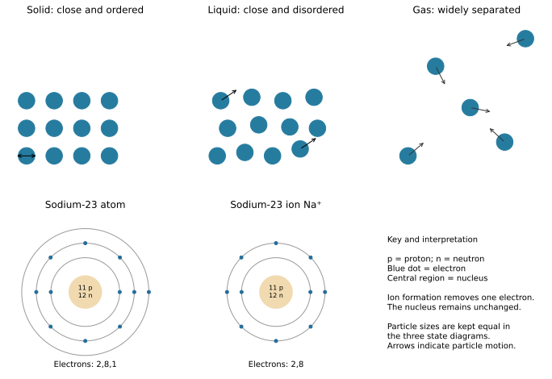
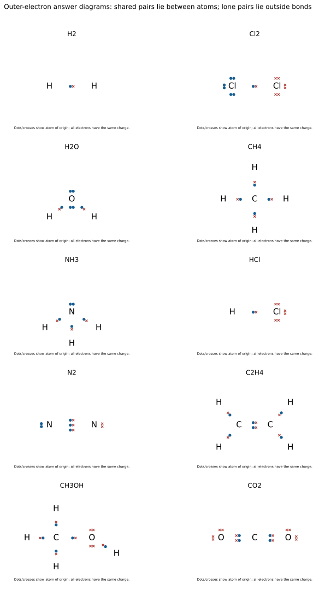
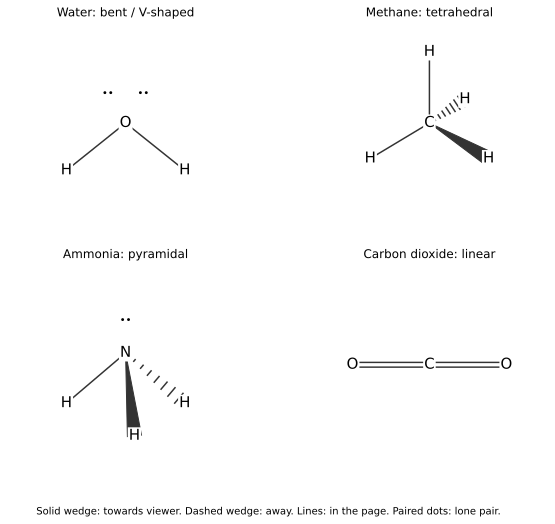
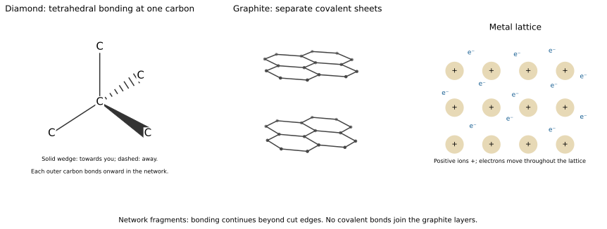

# 2 Matter

*NSSCO Chemistry 6117 — study notes. Worked examples teach methods; assessment tasks are supplied separately.*

---

## 2.1.1 — The particle nature of matter

### Recognising the three states

A solid has a fixed shape and volume under ordinary conditions. A liquid has a fixed volume but flows to take the shape of the part of its container that it occupies. A gas has neither a fixed shape nor a fixed volume: it spreads to fill the available container. These descriptions refer to the material itself. A pile of salt can be poured because separate solid grains move past each other; each grain remains solid. Pourability alone therefore does not establish that a sample is a liquid.

Solids and liquids are difficult to compress because their particles are already close together. A gas is much easier to compress because there is considerable space between its particles. In a sealed syringe, pushing the plunger reduces these spaces rather than shrinking the particles. Gas still has mass even when it is invisible. Classification uses observations such as shape, volume and compressibility together. For example, a transparent sample which spreads throughout a sealed vessel and becomes smaller in volume when compressed is a gas, not an empty space.

### Arrangement and movement of particles

In a typical crystalline solid, particles lie close together in an ordered arrangement. They vibrate about fixed positions, so the whole solid keeps its shape. They are not motionless. In a liquid, particles are also close together but have a less ordered arrangement and move past one another. This mobility explains flow while the small spaces explain why liquids resist compression. In a gas, particles are widely separated and move rapidly and randomly in all directions, repeatedly colliding with each other and the container walls.

A particle picture represents an enormous number of much smaller particles. Circles are symbols: the particles do not become larger circles when the material expands. Draw the same-sized particles before and after a physical change, changing separation, arrangement and motion as appropriate. Use arrows to show motion when requested. A row of touching circles with no enclosing boundary should not be mistaken for the outline of an individual solid grain. The diagram describes the internal arrangement. Explaining a property requires linking that arrangement to what the sample can do, rather than merely naming its state.

### Changes of state

Melting changes a solid to a liquid; freezing reverses this change. Boiling and evaporation both change a liquid to a gas, but boiling occurs throughout the liquid at its boiling temperature for the prevailing pressure, while evaporation occurs at the surface over a range of temperatures. Condensation changes gas to liquid. Sublimation changes solid directly to gas without an intervening liquid stage. The reverse direct change is deposition. A substance retains its chemical identity during these physical changes: water molecules remain water molecules when ice melts.

Heating supplies energy. Before melting, particles vibrate more vigorously as temperature rises. During melting of a pure substance, energy helps overcome attractions holding the particles in fixed positions. The temperature stays approximately constant while solid and liquid coexist under constant conditions. On further heating the liquid, particles move faster. At boiling, energy separates particles much further against their attractions. Cooling removes energy; particles move less vigorously and can become held close together or in fixed positions. Do not describe the particles themselves as melting, and do not say that covalent bonds inside water molecules break when water boils.

### Diffusion in liquids and gases

Diffusion is the net spreading of particles from a region of higher concentration to a region of lower concentration because of their random motion. Individual particles travel in many directions, including back towards the concentrated region. The overall movement arises because more particles initially leave the crowded region than enter it. Eventually the distribution becomes more uniform. Particles continue moving after an even distribution is reached; a uniform colour does not mean motion has stopped.

Both liquids and gases can show diffusion. In liquids, moving particles encounter close neighbours frequently, so spreading is generally slower than in gases. A small spot of soluble dye can gradually colour still water without stirring. Stirring speeds mixing by moving bulk liquid and is not itself diffusion. Similarly, a fan or draught transports scented air as a whole, while diffusion results from random molecular motion. When interpreting an experiment, identify what was controlled. An uneven temperature can create convection currents, so a colour spreading through hot and cold water is not automatically evidence for diffusion alone.

### Evidence for moving particles

A coloured solute spreading through still water and a gas spreading through another gas provide visible evidence consistent with movement of particles. The coloured region changes even though no spoon moves it. Take care to distinguish the visible colour from individual molecules: molecules are too small to be seen in this observation. A well-controlled demonstration reduces stirring and temperature differences, which could otherwise move the whole liquid and confuse the interpretation.

Brownian motion gives another kind of evidence. Under suitable magnification, tiny suspended particles, such as smoke particles in air, move irregularly. They receive uneven collisions from much smaller, moving molecules of the surrounding fluid. The observed suspended particles are not air molecules and are not moving because they are alive. Their zigzag paths reflect collisions occurring from changing directions. Brownian motion and diffusion support the particle model in complementary ways: the first reveals irregular movement of a suspended particle, while the second shows net spreading of many particles. Neither observation means that particles in a solid must be completely stationary.

### Factors affecting diffusion rate

Increasing temperature generally increases diffusion rate because particles have greater average kinetic energy and move faster. Compare the same diffusing substance in the same medium while keeping the distance and other relevant conditions constant. A warm sample changing colour sooner may support a temperature effect, but stirring or convection must be considered before attributing the whole difference to diffusion. A controlled comparison changes temperature deliberately and records a clearly defined measure of spreading.

At the same temperature, lighter gas molecules move faster on average than heavier gas molecules. For otherwise comparable gases and conditions, the lighter gas therefore diffuses faster. Molecular mass means the mass associated with a whole molecule, so use H2 rather than a single H atom when comparing hydrogen gas with another gas. Molecular mass and temperature are different variables: a comparison involving both different gases and different temperatures cannot be explained by mass alone. Here a qualitative prediction is sufficient. State the controlled conditions and the direction of the trend before giving the particle explanation.

### Diffusion in familiar situations

A perfume contains volatile substances that enter the air. Once in the gas phase, their molecules spread from the region near the source through random motion. Someone farther away can detect the perfume when enough molecules reach their nose. Evaporation supplies molecules to the air; diffusion spreads them through it. The two processes are related but are not the same. Air currents may also contribute substantially to the observed movement in a room, so the example does not prove that all transport is by diffusion.

Tea and soluble coffee contain substances that dissolve in water and spread away from a concentrated region. In an unstirred, nearly uniform-temperature sample, diffusion contributes to this spreading. In a cup of freshly heated water, convection and stirring often make mixing much faster. Explaining an everyday event requires naming the relevant particles and medium. Saying that a smell wants to fill a room gives the particles an intention they do not have. Instead identify random motion and the initial concentration difference. A closed lid reduces escape of vapour; it does not switch off particle motion inside the container.

### Suggested practical SP-6117-05 — Comparing gas diffusion

Use a teacher demonstration in a fume cupboard, or a supplied recording, of ammonia and hydrogen chloride vapours entering opposite ends of a glass tube at the same time. Mark the position of the white ammonium chloride ring and compare distances from the two sources. The ring is nearer the hydrogen chloride source because the lighter ammonia molecules diffuse faster under comparable conditions. Measure from the source positions, not the tube ends if these differ. Timing, temperature and source arrangement must be comparable; draughts and unequal release can affect the result. Learners should not prepare or inhale these irritating gases.

### Suggested practical SP-6117-06 — Everyday spreading in liquids

Compare a small drop of food colouring in two equal volumes of still water at different recorded temperatures. Use identical vessels and add equal drops at the same position without stirring. Record the coloured region after equal intervals. Faster spreading in warm water is consistent with faster particle motion, but convection may also contribute, so do not claim the observation isolates diffusion perfectly. Relate this limitation to tea in hot water and perfume in a draught: bulk fluid movement can accompany molecular diffusion. Use safe warm water rather than boiling water.

### Particle arrangements

Solid, liquid and gas particle arrangements; identical particle sizes throughout.

---

## 2.1.2 — Atomic structure

### How the atomic model developed

Ancient Greek thinkers proposed that matter might consist of tiny indivisible particles. This was a philosophical idea rather than a model established by experimental measurements. Dalton developed an atomic theory in which elements consisted of atoms and compounds contained atoms combined in fixed proportions. His solid-sphere picture was later revised when evidence showed that atoms contained smaller particles. Thomson's discovery of the electron led to a model with negative electrons embedded in distributed positive charge.

Rutherford's scattering results supported a small, dense, positively charged nucleus, with most of the atom being empty space. Most incident particles passed through the foil with little deflection, while a few changed direction greatly. Bohr introduced electrons occupying particular energy levels, represented here as shells. Chadwick established the neutron, a neutral particle in the nucleus, helping account for nuclear mass without extra positive charge. The sequence shows how evidence changes a model. A useful model explains observations but can be refined when new observations expose its limits; later discoveries do not mean that all earlier measurements were worthless.

### Proton number and the Periodic Table

Elements are arranged in increasing proton number in the modern Periodic Table. Proton number identifies an element: all sodium atoms have eleven protons, while all magnesium atoms have twelve. Changing electron number makes an ion of the same element; it does not move that particle to a different element's position. Changing neutron number creates a different isotope. Thus proton number is a more reliable identifier than either the total mass of an atom or the number of electrons in an ion.

For a neutral atom, electron number equals proton number. The first twenty elements therefore build up from hydrogen with one electron to calcium with twenty. Repeating outer-electron arrangements lead to repeating patterns in chemical behaviour. Reading across a period increases proton number by one at each successive element, while reading down a group finds related outer-shell arrangements. A table entry may show a relative atomic mass that is not an integer; that is an average over isotopes and is not the mass number of every atom. Before counting neutrons, use a specified isotope mass number rather than silently rounding an average.

### The proton

A proton has relative charge +1, approximate relative mass 1, and is located in the nucleus. Relative quantities compare particles on a common scale: a charge of +1 is not a charge of one coulomb, and a relative mass of 1 is not a mass of one gram. Every proton contributes one unit of positive charge to the nucleus. The number of protons is the proton number, so it identifies the element.

For example, the nucleus of a neutral oxygen atom contains eight protons and therefore has a total positive charge of +8 on this relative scale. Eight electrons supply a total charge of −8, making the complete atom neutral. Gaining two electrons produces an oxide ion with charge −2 while leaving the eight protons unchanged. Do not remove protons to explain ordinary chemical ion formation. Chemical reactions rearrange electrons and bonds, whereas changes within nuclei belong to nuclear processes. A labelled atom diagram should place the protons together with neutrons centrally, not on an electron shell.

### The neutron

A neutron has relative charge 0, approximate relative mass 1, and is located in the nucleus. Its lack of charge does not mean it has no mass. Together, protons and neutrons are called nucleons; they account for nearly all the mass of an atom. Neutron number is calculated by subtracting proton number from nucleon number. The electron count does not enter this subtraction.

An atom with twelve protons and thirteen neutrons has nucleon number 25. If it loses two electrons to form an ion, it still has thirteen neutrons and nucleon number 25. Isotopes of an element differ in neutron number, while their proton number remains fixed. For example, carbon-12 and carbon-14 each have six protons but have six and eight neutrons respectively. A neutron therefore matters when comparing atomic masses even though it contributes nothing to the net electric charge. Keeping separate columns for protons, neutrons and electrons helps prevent using a mass calculation as if it were a charge calculation.

### The electron

An electron has relative charge −1 and approximate relative mass 1/1840, often treated as negligible when comparing atomic masses. It occupies the region outside the nucleus, represented in the simple model by electron shells. Negligible mass does not mean zero charge: electrons have a decisive role in ion formation, chemical bonding and electrical conduction. One electron's negative charge balances one proton's positive charge.

A neutral aluminium atom has thirteen protons and thirteen electrons. After losing three electrons it has ten electrons and a net charge of +3, but its nucleus is unchanged. Its ion is positive because there are now more protons than electrons, not because an electron became positive. Conversely, gaining electrons produces a negative ion. In drawings, distinguish an electron from the complete atom or ion. A small dot on a shell represents one electron; a bracket with a charge represents the whole ion. The mass number counts nuclear particles, so adding the electron number to it would count the wrong kind of particle.

### Defining proton number

Proton number, symbol Z, is the number of protons in the nucleus of each atom of an element. It is also called atomic number. Because an atom is electrically neutral, Z also equals its electron count, but that equality is a consequence of neutrality rather than the definition. The definition must still identify an element when the particle has become an ion and electron number no longer equals proton number.

Suppose a particle has seventeen protons and eighteen electrons. Its proton number is seventeen and the element is chlorine; its extra electron makes it a chloride ion. Defining proton number as the number of electrons would incorrectly assign the ion the position of argon. A second chlorine particle with a different neutron count still has the same proton number. When using a table of particle counts, locate the proton column first to identify the element. Use electrons afterwards to decide whether the particle is neutral or charged, and use neutrons with protons to calculate nucleon number.

### Defining nucleon number

Nucleon number, symbol A, is the total number of protons and neutrons in an atom's nucleus. It is also called mass number. The relationship is A = number of protons + number of neutrons. Rearranging gives neutron number = A − Z. Both A and Z are whole numbers for an individual isotope because they count discrete particles. Neither quantity requires a unit such as grams.

For a magnesium-25 atom, Z is twelve and A is twenty-five. Its neutron count is therefore 25 − 12 = 13. Its twelve electrons are not added to A because they are not nucleons. A table of relative atomic masses serves a different purpose: the entry for an element reflects the isotopic mixture and can be non-integer. In counting problems, read which quantity is supplied. If a question gives only an averaged relative atomic mass, it has not necessarily identified one isotope. Ion formation changes electron number but does not change A or Z in the ordinary chemical processes studied here.

### Reading isotope notation

In isotope notation, write the nucleon number at the upper left of the element symbol and the proton number at the lower left. For example, ²³₁₁Na identifies a sodium atom with A = 23 and Z = 11. It contains eleven protons and twelve neutrons. Unless an ionic charge is shown or otherwise stated, an atom is neutral and therefore contains eleven electrons. The numbers on the left describe the nucleus; an ionic charge, when present, is written at the upper right.

For ²⁴₁₂Mg²⁺, the nucleus has twelve protons and twelve neutrons, while the ion has ten electrons. Read the right-hand 2+ as a net charge, not as an instruction to add two protons or two neutrons. To construct a symbol from counts, first identify the element using proton number. Then add protons and neutrons to obtain A. Finally compare proton and electron numbers to determine the charge, if any. This order keeps nuclear identity and electronic charge separate and gives a useful check on every stage.

### Electron shells for the first twenty elements

For the first twenty neutral atoms, use the simple shell arrangements: H 1; He 2; Li 2,1; Be 2,2; B 2,3; C 2,4; N 2,5; O 2,6; F 2,7; Ne 2,8; Na 2,8,1; Mg 2,8,2; Al 2,8,3; Si 2,8,4; P 2,8,5; S 2,8,6; Cl 2,8,7; Ar 2,8,8; K 2,8,8,1; Ca 2,8,8,2. The sum of the entries must equal proton number for a neutral atom. The first shell holds two electrons; the next shell fills to eight in this model.

To draw a Bohr diagram, mark a central nucleus, draw the required number of concentric shells, and place the specified electrons on each shell. State a key if dots and crosses have different meanings. Calcium needs four occupied shells, not three shells with ten electrons on the last. The diagram is a model of electron arrangement, not a photograph or a scale drawing of an atom. Equal spacing of symbols makes counting easier but does not imply stationary electrons. For ions, count the electrons actually present after loss or gain before drawing the shells.

### Comparing atomic structures

A useful atomic-structure table separates proton number, nucleon number, neutron count, electron count and shell arrangement. These columns are connected but not interchangeable. For a neutral sulfur-32 atom, Z = 16 and A = 32, giving sixteen protons, sixteen neutrons and sixteen electrons arranged 2,8,6. The nucleus has relative charge +16; the complete atom has net charge zero. Nearly all its mass is in the nucleus even though the surrounding electron region occupies most of the atom's size.

Comparisons should name the evidence. Two neutral atoms with the same number of occupied shells are in the same period, but they need not be the same element. Two particles with identical electron arrangements need not have identical nuclei: Ne and Na⁺ each have ten electrons but have ten and eleven protons respectively. Check neutrality rather than assuming it. A particle with eight protons and ten electrons is a negative oxygen ion, not neon. When data appear inconsistent, use proton number to establish identity and net charge to test the electron count before deciding that the mass number is at fault.

### Deducing atom and ion structures

Calculate the net charge of a simple particle by subtracting electron number from proton number, using relative charges. Twelve protons and ten electrons give +2; seventeen protons and eighteen electrons give −1. Neutrons affect nucleon number but not charge. For an ion with a stated positive charge, subtract that number of electrons from Z. For a stated negative charge, add electrons. This is electron bookkeeping; it does not imply that nuclear protons move during ordinary ion formation.

For ⁴⁰₂₀Ca²⁺, neutron number is 40 − 20 = 20 and electron number is 20 − 2 = 18. Conversely, a particle with nineteen protons, twenty neutrons and eighteen electrons is ³⁹₁₉K⁺. Both calculations preserve the distinction between atom and ion. A neutral bromine atom has thirty-five electrons when its proton number is thirty-five; Br⁻ has thirty-six. If a table calls a particle an atom but gives unequal proton and electron counts, its label is wrong. Use the counts to identify the charge instead of trusting the label.

### Sodium atom and ion

Sodium-23 nucleus unchanged on formation of Na⁺; shell counts differ by one electron.

---

## 2.2 — Isotopes

### Isotopes and allotropes

Isotopes are atoms of the same element with the same proton number and different nucleon numbers. Their neutron counts differ. Carbon-12 and carbon-14 both have six protons, so both are carbon, but their neutron counts are six and eight. Neutral atoms of these isotopes have the same number and arrangement of electrons, which accounts for their similar chemical behaviour. Different mass numbers do not by themselves prove that two atoms are isotopes: the proton numbers must also match.

An allotrope is a different structural form of the same element. Diamond and graphite differ in the arrangement and bonding of carbon atoms; they are not two isotopes. To distinguish the terms, ask what changes. A difference in nuclear neutron number concerns isotopes; a difference in how atoms are joined concerns allotropes. Atoms with the same mass number but different proton numbers belong to different elements. For example, an atom with six protons and eight neutrons and an atom with seven protons and seven neutrons both have A = 14, but they are carbon and nitrogen respectively.

### Radioactive decay

Radioactive decay involves emission from an unstable nucleus as it changes towards a more stable nuclear arrangement. The change occurs in the nucleus, not simply in the outer electron shells. Some isotopes are stable, while others are radioactive. Radioactivity therefore cannot be inferred just from the fact that a substance has isotopes: isotope describes a nuclear composition, whereas radioactive describes nuclear instability and decay.

A radioactive sample contains many unstable nuclei. Radiation can be detected outside the sample using suitable equipment, providing evidence of nuclear change. This is different from ordinary melting, dissolving or chemical bond formation. Those processes do not require a change in the nucleus. At this level, focus on the unstable nucleus, emission and the movement towards greater stability; identifying the detailed emitted particles is not necessary for this objective. Radioactive materials are handled through controlled specialist procedures. The school examples here use descriptions, diagrams and data, rather than inviting learners to obtain or experiment with a radioactive source.

### Examples of stable and radioactive isotopes

Hydrogen has isotopes hydrogen-1, hydrogen-2 and hydrogen-3. Each has one proton; their neutron counts are zero, one and two respectively. Hydrogen-3 is radioactive. Carbon-12 and carbon-13 are stable, while carbon-14 is radioactive. Chlorine-35 and chlorine-37 illustrate stable isotopes with the same chemical identity but different masses. Iodine-127 is stable, whereas iodine-131 is radioactive. Uranium-235 and uranium-238 are both radioactive. The number after the element name is the nucleon number, not the neutron number.

These examples show why “isotope” and “radioactive isotope” are not synonyms. A radioactive isotope is one member of the wider category of isotopes. Compare a pair in two stages: first establish the shared proton number and differing neutron numbers, then consider stability separately. Chemical behaviour depends mainly on electron arrangement, so neutral isotopes of an element behave similarly chemically even when their nuclear stability differs. Do not assume that different masses imply different elements, or that atoms of an element must all have the same mass. The element's identity is preserved by its proton number.

### Relating isotope names to neutron counts

The isotope name supplies the nucleon number. Subtract the proton number to obtain the neutron count. For chlorine-35, Z = 17 gives 35 − 17 = 18 neutrons. For chlorine-37, the same Z gives 37 − 17 = 20 neutrons. Their two-unit difference in nucleon number arises from two extra neutrons, not two extra protons. Both neutral atoms contain seventeen electrons, so neither is automatically an ion.

Reverse reasoning is equally useful. Two neutral atoms each contain eight protons; one has eight neutrons and the other ten. They are oxygen-16 and oxygen-18 because their nucleon numbers are 8 + 8 and 8 + 10. To check an isotope pair in a data table, compare proton counts before comparing masses. If proton numbers differ, reject the isotope classification even if a mass calculation happens to match. If both proton and neutron numbers match but electron numbers differ, the difference is ionisation rather than a different isotope. Keep nuclear composition and electrical charge on separate lines of your working.

### Uses of radioactive isotopes

Radioactive isotopes have applications that depend on detectable radiation or energy released in nuclear changes. Carbon-14 dating uses the reduction in carbon-14 content after an organism dies to estimate the age of suitable once-living material. It is not a general method for directly dating any rock or metal object. In radiotherapy, carefully controlled radiation is used to damage cancer cells; the treatment is planned and delivered by specialists because radiation can also damage healthy tissue.

During aluminium-foil manufacture, a source and detector can monitor the radiation transmitted through the foil. For a suitable beta source, thicker foil absorbs more radiation, so the detector response decreases. The machinery can use this change to adjust the rollers. In nuclear power generation, energy released by nuclear processes heats a working fluid and ultimately drives electricity generation. These uses have different purposes: dating estimates age, therapy treats disease, thickness monitoring controls a product, and power generation supplies energy. Naming a use is stronger when it states what is measured, controlled or produced rather than simply naming an industry.

### Atoms, ionic diagrams and isotope calculations

The electron has relative charge −1 and a mass about 1/1840 of the proton’s. A proton has charge +1 and relative mass 1; a neutron has charge 0 and relative mass 1. A neutral atom has equal proton and electron counts. The nucleus contains the protons and neutrons; its nucleon number is their total. Losing electrons changes charge without changing the identity of the element.

In a Bohr diagram for a first-twenty-element atom, label the nucleus, then distribute the electrons in shells. The first shell holds two; the second holds eight. The simple syllabus patterns for potassium and calcium extend into a fourth shell. A shell is a model of electron arrangement, not a scale drawing of an orbit. Check the total number of electrons against the proton count before adding a charge label.

An ionic dot-and-cross diagram shows transferred electrons, not a shared pair between the final ions. For sodium chloride, sodium loses its outer electron and chlorine gains it. Enclose each resulting ion in brackets and place the charge outside. Chloride’s outer shell contains seven original electrons and one transferred electron. For a Group II metal with a Group VII non-metal, two non-metal ions are needed for each 2+ metal ion. Distinguish dots from crosses by origin; all electrons have the same charge.

Isotopes have the same proton number but different neutron counts. Relative atomic mass is an abundance-weighted mean, not an unweighted midpoint unless the isotope abundances are equal. A sample made of 80% mass-10 atoms and 20% mass-11 atoms has mean mass 10.2 relative units. Changing abundance changes the mean without changing either isotope’s mass. Radioactive decay changes an unstable nucleus by emission of radiation/particles; it is not loss of an outer-shell electron in a chemical reaction. No identification of radiation types or half-life calculation is required here.

---

## 2.3.1 — Groups and periods

### Groups, periods and electron shells

For the main-group elements considered here, the group number in the I–VII convention indicates the number of electrons in the outer shell. Sodium, 2,8,1, is in Group I; chlorine, 2,8,7, is in Group VII. The period number equals the number of occupied electron shells in the neutral atom. Both examples are in Period 3 because they have three occupied shells. Group is the vertical column; period is the horizontal row.

The noble gases are treated separately as Group VIII in this syllabus. They have complete outer shells: helium has two electrons in its first and only shell, while neon has 2,8 and argon has 2,8,8. Do not force helium into an eight-electron description. When deducing a position from an electron arrangement, first count occupied shells, then inspect the outer shell. Do this for the neutral atom; the shell arrangement of an ion can resemble that of a different element. For example, Na⁺ has the same electrons as neon but is still an ion of the Period 3 element sodium.

### Complete outer shells and chemical behaviour

Noble-gas electron arrangements are associated with very low reactivity under ordinary conditions. Their outer shells are complete, so they do not readily gain, lose or share electrons in common chemical reactions. Helium's complete shell contains two electrons. The complete outer shell in neon and argon contains eight. “Unreactive” describes their behaviour in the ordinary contexts studied here; it should not be rewritten as a claim that no noble gas can form any compound under any circumstances.

Other main-group atoms often form ions or covalent bonds that produce a complete outer shell. Magnesium loses two outer electrons to form Mg²⁺ with arrangement 2,8. Oxygen gains two to form O²⁻ with arrangement 2,8, or shares electrons in covalent compounds. The model explains patterns but should not be anthropomorphised: atoms do not want electrons or make decisions. State the actual electron loss, gain or sharing. A noble-gas electron arrangement also does not change the element's identity; Mg²⁺ remains magnesium because its nucleus still contains twelve protons.

---

## 2.3.2 — Periodicity

### Changes across Period 3

Across Period 3 from sodium to argon, proton number rises by one at each element. Electrons are added to the third shell, so the outer-electron count increases from one to eight while the occupied-shell count stays at three. Metallic character decreases across the period: sodium, magnesium and aluminium are metals; silicon has intermediate properties; phosphorus, sulfur, chlorine and argon are non-metals. This is a pattern of chemical and physical behaviour, not a claim that all properties vary smoothly.

Atomic radius generally decreases across the period. Nuclear charge increases while electrons are added to the same main shell, so the stronger attraction draws the electron region closer to the nucleus. An explanation must include both features; merely saying “more protons” leaves out why adding electrons does not introduce a new occupied shell. Use comparable definitions when interpreting radius data. The trend concerns neutral atoms, whereas ions may have lost an entire outer shell or gained electrons. Do not mix atomic and ionic radii in a single unexplained sequence.

### Similarities within a group

Elements within a main group share the same number of outer electrons. Lithium is 2,1, sodium is 2,8,1 and potassium is 2,8,8,1. Each has one outer electron, so each commonly forms a +1 ion and shows related chemical reactions. Their occupied-shell counts differ, placing them in different periods. A shared group predicts a family resemblance rather than identical reaction rates or physical properties.

The same reasoning applies to Group VII: fluorine, chlorine and bromine have seven outer electrons and commonly gain one to form −1 ions. A chlorine atom and a chloride ion are not interchangeable examples: the neutral atom has seven outer electrons, while the ion has a complete outer shell. When comparing group members, describe the neutral atom arrangements first and then relate their common outer-electron count to the reactions. Differences in distance from the nucleus and shielding help explain changes in reactivity down a group. These changes do not remove the underlying similarity in the kinds of ions formed.

---

## 2.3.3 — Group properties

### Classifying elements with the Periodic Table

The Periodic Table organises elements by proton number and groups together related chemical behaviour. Metals occupy much of the left and centre, while non-metals lie towards the right, with hydrogen an important exception to a simple left-versus-right rule. A vertical group relates elements with similar outer-electron patterns; a horizontal period relates atoms with the same number of occupied shells. Position is therefore evidence for classification, rather than a substitute for describing the relevant properties.

Given an unfamiliar element in Group I below sodium, predict metallic behaviour and a tendency to form a +1 ion. Given an element in Group VII, predict a non-metal that commonly forms a −1 ion. These are family-based predictions, so support them with the group relationship. A table that supplies only proton numbers still allows identification using the provided Periodic Table. Colour alone seldom identifies an element uniquely. Combine position, electronic structure and observed behaviour when the information is available.

### Interpreting trends from supplied data

A trend is a pattern across an ordered set of values. Establish the order first: “down Group I” differs from “across Period 3”. Then compare the actual observations rather than forcing every property into the same trend. For example, rounded melting points for lithium, sodium and potassium are 181 °C, 98 °C and 63 °C, so melting point decreases down this three-element sequence. Rounded densities of 0.53, 0.97 and 0.86 g/cm³ do not increase steadily: potassium is less dense than sodium.

When asked to deduce a trend from data, cite the direction and any exception. Do not use the largest number alone as proof of a continuous increase. Colour and state require descriptive comparisons, while reactivity may be inferred from observations such as speed of gas production under controlled conditions. A prediction beyond the data is less secure than a description within it and should be identified as a prediction. Keep units attached: density is mass per unit volume, not sample mass.

### Lithium, sodium and potassium

Lithium, sodium and potassium are relatively soft Group I metals. They can be cut much more readily than metals such as iron. Down this sequence, melting point decreases and reaction with water becomes more vigorous. Their densities are low, but the trend has an exception: potassium is less dense than sodium. Each reacts with water to form a soluble metal hydroxide and hydrogen. For example, 2Na + 2H2O → 2NaOH + H2. The solution becomes alkaline because it contains hydroxide ions.

Flame tests help distinguish these metals in their compounds: lithium gives crimson red, sodium yellow, and potassium lilac. State the flame colour rather than the colour of a solid sample or solution. A strong sodium contamination can obscure other colours, so clean apparatus matters. Reactions of the metals with water are teacher demonstrations with suitable shielding and small controlled amounts; the description is not a home experiment. The trend in reactivity is explained by the outer electron being farther from the nucleus and more shielded down the group, making it easier to remove.

### Soluble Group I hydroxides

The Group I metals studied here react with water to form soluble hydroxides and hydrogen. Sodium hydroxide dissolves to give sodium ions and hydroxide ions, while potassium hydroxide gives potassium ions and hydroxide ions. These are alkaline solutions. The hydroxides are not obtained as insoluble precipitates simply by adding hydroxide ions to solutions of their salts. This contrasts with many metal-ion tests in qualitative analysis, where an insoluble hydroxide appears.

A precipitate is an insoluble solid formed from substances in solution. A colourless solution is not a white precipitate, and gas bubbles are not a precipitate either. If sodium hydroxide is added to a solution containing only potassium ions and a suitable soluble counter-ion, no potassium-hydroxide precipitate is expected. That result concerns solubility rather than an absence of particles: the ions remain dispersed in the solution. When writing observations, report “no precipitate” rather than “nothing exists”. The same distinction helps interpret negative tests without inventing a visible reaction.

Group I metals react with cold water to form an alkaline hydroxide solution and hydrogen. Lithium, sodium and potassium become more vigorous down the group. Balance atoms when writing an equation: two metal atoms and two water molecules produce two hydroxide formula units and one hydrogen molecule. These are teacher demonstrations; potassium and sodium must not be tested with dilute acids.

### The halogens

Chlorine, bromine and iodine are Group VII non-metals whose elements contain diatomic molecules: Cl2, Br2 and I2. At room conditions, chlorine is a pale green gas, bromine is a red-brown liquid, and iodine is a grey-black solid. Iodine vapour is purple. Distinguish the element's bulk state from the colour of its vapour or solution; “iodine is a purple gas at room temperature” confuses these descriptions. Down the group, melting and boiling points rise, while colour becomes darker.

Reactivity decreases from chlorine to bromine to iodine. Halogen atoms gain an electron when they form halide ions. Down the group, the outer region is farther from the nucleus and increasingly shielded, reducing the attraction for an incoming electron. This trend is opposite to the increasing reactivity of Group I metals, which lose an electron. Do not transfer a memorised direction from one family to the other without considering electron gain or loss. Halogen observations in school should use controlled teacher-prepared samples or supplied data; the elements can be hazardous.

### Halogen displacement

A more reactive halogen displaces a less reactive halogen from a solution of its halide ions. Chlorine can react with bromide and iodide ions; bromine can react with iodide ions but not chloride ions; iodine does not displace chlorine or bromine from their halides. For example, Cl2 + 2Br⁻ → 2Cl⁻ + Br2. Chlorine gains electrons to form chloride, while bromide loses electrons to form bromine. The elemental halogen and the halide ion therefore have different roles.

Predict a result by comparing the added element with the element corresponding to the dissolved halide. Adding bromine to sodium chloride does not give a displacement because bromine is less reactive than chlorine. Do not describe the sodium as the displaced substance; it remains a spectator ion in this example. Colour changes can support the prediction, but observations must name what is seen before inferring an identity. Dilution and solvent affect appearance, so use the supplied observations rather than inventing an exact colour intensity. A balanced ionic equation must conserve both atoms and net charge.

### Transition metals

Transition elements are metals in the central region of the Periodic Table. Typical properties include high density and high melting point compared with the Group I metals. Many of their compounds are coloured, and the elements or their compounds often act as catalysts. Examples include copper compounds with blue or green colours and iron used as a catalyst in ammonia manufacture. These are characteristic tendencies, not a promise that every transition-metal compound has the same colour or that every metal has an exceptionally high melting point.

A catalyst increases reaction rate while remaining chemically unchanged at the end. A transition-metal catalyst can therefore be useful in repeated processing, but it does not mean the catalyst supplies an unlimited amount of reactant. Compare a transition metal with a Group I metal using the same properties: hardness, density, melting point, compound colour or catalytic use. A coloured solution is evidence about the substance dissolved, not a direct view of an isolated metal atom. When interpreting an unknown sample, combine several properties before proposing that it belongs to the transition-metal region.

### Unreactive noble gases

The noble gases, Group VIII in the syllabus convention, are very unreactive under ordinary conditions. Their atoms have complete outer electron shells and do not readily gain, lose or share electrons. They exist as individual atoms rather than ordinary diatomic molecules such as chlorine. Helium has a full first shell of two electrons; neon and argon have complete outer shells of eight. Calling all noble gases “eight-electron atoms” would confuse total electron number with outer-shell occupancy and would also misdescribe helium.

Low reactivity makes these gases useful where reactions with the surroundings would be undesirable. That property should be separated from density: helium's usefulness for balloons involves both its low density and its non-flammability, whereas argon's use around a hot filament mainly concerns low reactivity. An inert atmosphere is one chosen to avoid unwanted reactions under the conditions of use. It does not mean that the gas has no particles, no mass or no collisions. The gas can still exert pressure while being chemically unreactive.

### Uses of argon and helium

Argon provides an unreactive atmosphere in some filament lamps. At the high operating temperature, oxygen would react with the hot metal filament. Replacing reactive air with argon reduces this unwanted reaction. The explanation is chemical: argon does not readily react with the filament. Do not substitute “argon is a vacuum”; a gas-filled lamp contains particles, whereas an evacuated lamp has had most gas removed.

Helium is used in weather balloons because it is less dense than air and non-flammable. The low density provides lift when the balloon displaces a heavier volume of air. Its unreactive nature makes it preferable to a flammable lifting gas in contexts where ignition is a concern. These are separate contributions, so a complete two-point explanation should identify both rather than repeating “safe” in different words. Helium remains a gas and exerts pressure inside the balloon. A balloon's rise does not show that helium has no mass; it shows that the complete balloon system can be less dense than the surrounding air.

### Suggested practical SP-6117-08 — Comparing Group I reactions

Observe a teacher-controlled demonstration or recording of small lithium, sodium and potassium samples reacting with water behind suitable protection. Record motion, gas production and relative vigour in a comparison table. Reactivity increases down this sequence. A fair comparison considers sample size, fresh surface and water conditions; dramatic flames alone are not a numerical rate measurement. Identify soluble hydroxide and hydrogen as products. Interpret this teacher demonstration; do not handle the metals unsupervised.

### Suggested practical SP-6117-09 — Soluble hydroxides and precipitation

Compare teacher-prepared dilute solutions containing Group I ions with a suitable metal-ion sample known to form an insoluble hydroxide. Add the same reagent volumes using clean droppers and record whether a precipitate appears. No Group I hydroxide precipitate is expected because these hydroxides are soluble. A clear solution still contains ions. Distinguish a newly formed solid from bubbles or a dirty test tube, and include a reagent blank if contamination is suspected. This is a solubility comparison; it does not identify every ion uniquely from a negative observation.

### Suggested practical SP-6117-10 — Testing hydroxide solutions

Test teacher-prepared dilute sodium and potassium hydroxide solutions with indicator paper, using clean sample transfer tools and eye protection. Record the indicator colours and the corresponding approximate pH ranges from the supplied chart. Alkaline results support the presence of hydroxide ions. Avoid assigning a precise pH from a broad colour band, and do not compare concentrations solely from similar colours. Include water as a comparison and prevent solution entering the indicator container. Corrosive concentrated hydroxides are unnecessary for this teaching comparison.

### Suggested practical SP-6117-11 — Identifying evolved hydrogen

Use a teacher-controlled collection and test of a small gas sample from a suitable metal–water reaction, such as calcium with water. Record bubbling separately from the gas-test result. Hydrogen gives a squeaky pop with a lighted splint under the controlled test conditions. Bubbling alone does not identify hydrogen, and a negative test on an air-contaminated sample may be inconclusive. Do not apply a flame directly to a reacting vessel or accumulate a large gas volume. Compare the result with the predicted products from the metal–water word equation.

### Suggested practical SP-6117-12 — Flame-test comparisons

With teacher supervision, use clean flame-test equipment and small prepared samples of lithium, sodium and potassium salts. Record crimson red, yellow and lilac respectively when these characteristic colours are observed. Clean between samples and use separate tools where possible, because sodium contamination can dominate a weaker colour. The flame observation is different from the solid or solution colour. Include a blank to check the equipment and compare an unknown with reference samples under the same conditions. Do not infer concentration from flame brightness alone.

### Suggested practical SP-6117-13 — Inferring halogen reactivity

Use supplied displacement observations or teacher-prepared microscale tests in suitable ventilation to compare chlorine, bromine and iodine. Construct a table showing which halogen reacts with which halide solution. The pattern supports chlorine being more reactive than bromine, and bromine more reactive than iodine. Record colour changes first, then infer displacement; do not label an inference as an observation. Keep solution volumes and concentrations comparable. Handling concentrated halogens is unnecessary for the learner task, which can be completed entirely from an original observation table.

### Suggested practical SP-6117-14 — Halogen–halide reaction matrix

For a paper-based practical, use this synthetic result set: chlorine displaces bromine from bromide and iodine from iodide; bromine displaces iodine from iodide; iodine displaces neither chlorine nor bromine. Complete the reaction matrix and write Cl2 + 2Br⁻ → 2Cl⁻ + Br2 for one positive result. A halogen does not displace itself from its own halide. Check atoms and charge in each equation. These results establish relative reactivity, not numerical rates. Check reagent presence before interpreting a negative result.

### Suggested practical SP-6117-15 — Observing coloured compounds

Observe labelled teacher-prepared samples or photographs of copper(II) sulfate and other transition-metal compounds. Record whether each colour belongs to a solid, a solution or a precipitate. A blue copper(II) sulfate solution provides an example of a coloured transition-metal compound, but does not establish that all copper compounds are blue. Use clean containers and comparable lighting, and do not taste or directly handle chemical samples. Colour supports identification but rarely identifies a compound alone.

---

## 2.4.1 — Building blocks of matter

### Atoms, molecules and ions

An atom is an electrically neutral particle of an element with equal numbers of protons and electrons. An ion is an atom or group of atoms with a net charge after gaining or losing electrons. A molecule is an electrically neutral group of atoms joined by covalent bonds. These distinctions identify different kinds of chemical particle, not different sizes of visible grain. A single salt crystal contains very many ions, while a sample of water contains very many molecules.

Argon gas consists of individual atoms. Oxygen gas contains O2 molecules, each made of two oxygen atoms. Sodium chloride contains Na⁺ and Cl⁻ ions arranged in a giant lattice, rather than separate sodium-chloride molecules. A compound ion such as NH4⁺ contains several bonded atoms but has an overall charge, so it is not a neutral molecule. When a question asks for particles, name them precisely. “Atoms” is not an adequate replacement for “ions” when explaining conduction in a salt solution, because the charge and mobility of the particles are the reason conduction occurs.

### Elements, compounds and mixtures

An element contains one kind of atom, identified by proton number. A compound contains atoms of different elements chemically combined in fixed proportions. A mixture contains substances together without requiring chemical combination between them, and its composition can vary. Oxygen gas is an element even though its particles are O2 molecules: both atoms are oxygen. Water is a compound because hydrogen and oxygen are chemically combined in a fixed ratio.

Air is a mixture containing several gases. Its components retain their identities and can be separated by suitable physical methods. A salt-and-sand mixture can be separated using differences in solubility, followed by filtration and recovery of the salt. By contrast, separating a compound into its elements requires chemical change rather than merely sorting its particles. A diagram can represent these distinctions: one atom type may form an element, identical unlike-atom groups can represent a pure compound, and multiple distinct substances together can represent a mixture. Purity concerns the number of substances, not whether a sample looks clean or transparent.

### Neutral groups and compound ions

Atoms can join to form a neutral molecule or a charged group called a compound ion. Water, H2O, is a neutral molecule, while hydroxide, OH⁻, is a compound ion. Both contain more than one atom, so atom count alone does not decide the classification. The net charge is essential. The atoms within a compound ion remain joined when that ion is represented as a unit in an ionic compound or in solution.

Ammonium sulfate contains NH4⁺ and SO4²⁻ ions. Within each compound ion, atoms are covalently bonded, while electrostatic attractions between the positive and negative ions hold the ionic solid together. This allows more than one bonding description within the same substance without contradiction. Read brackets and charges carefully. The formula NH4⁺ represents a group of one nitrogen and four hydrogen atoms carrying a total +1 charge; it does not mean each atom carries +1. When building a salt formula, balance the total charges of whole ions rather than changing the internal subscripts of a compound ion.

### Molecular and giant lattices

A crystal lattice is a regular, repeating arrangement of particles. In a molecular crystal, the repeating units are molecules. Iodine crystals contain I2 molecules held near one another by intermolecular attractions; the covalent bonds inside each molecule are distinct from those attractions. In a giant structure, bonding extends throughout a large network rather than stopping at separate small molecules. Examples include sodium chloride, copper and diamond, although their bonding types differ.

The word giant describes the connected structure, not the visible size of one piece. A tiny diamond fragment still has a giant covalent structure. Likewise, a large iodine crystal remains molecular. To classify a lattice, identify both its particles and the attractions holding them together. A diagram showing several separate bonded pairs with gaps between pairs can represent a molecular substance; a continuous network of bonds represents a different organisation. Changes of state depend on which attractions must be overcome. Melting a molecular solid generally overcomes intermolecular attractions without breaking the covalent bonds inside each molecule.

### Three kinds of giant structure

A giant ionic lattice contains positive and negative ions held together by electrostatic attraction. A giant metallic structure contains positive metal ions attracted to delocalised electrons. A giant covalent lattice contains atoms connected by covalent bonds throughout a network. The common word giant does not mean the three structures have identical particles, charge carriers or properties. Sodium chloride, copper and diamond illustrate the three descriptions respectively.

Use the structure to explain behaviour. Solid sodium chloride contains charged ions but they cannot move through the lattice, so it does not conduct electricity. Copper has mobile delocalised electrons and conducts as a solid. Diamond has strong covalent bonds and no mobile charged particles, so it does not conduct. Graphite is an important contrasting giant covalent structure with mobile electrons. Thus a statement such as “all giant structures conduct” is false, and a statement such as “all covalent substances fail to conduct” is also too broad. Name the actual particles and their mobility before drawing a conclusion.

### Alloys

An alloy is a mixture containing a metal together with other elements. Brass contains copper and zinc; bronze commonly contains copper and tin; steel contains iron with carbon and may contain other elements. These names describe families of mixtures rather than single fixed-ratio compounds. Changing the composition can change properties, so an alloy does not need one universal chemical formula. Distinguish alloying from plating: adding a surface coating is not the same as mixing elements throughout a metal.

In a pure metal, regularly arranged layers of similar-sized atoms can slide relatively easily. Atoms of different sizes in an alloy disrupt the regular arrangement and hinder this movement, often making the alloy harder. This explanation concerns the internal structure rather than a claim that the added atoms glue the layers together. Alloys are selected for combinations of properties such as hardness, corrosion resistance or ease of shaping. A harder alloy is not automatically better for every purpose: an application requiring bending may favour a different balance of properties.

### Suggested practical SP-6117-07 — Building particle models

Use coloured spheres with a written key to build an elemental molecule, a compound molecule, a mixture of both, and a fragment of a giant covalent network. Compare atom types, bonds and the number of distinct substances. Keep molecule boundaries visible and mark where a giant network continues beyond the model. A mixture should contain separate substances rather than new bonds invented between every component. Different sphere sizes or colours are conventions, not evidence of actual atomic dimensions. Check each model against its formula and explain which features the model simplifies.

### Suggested practical SP-6117-16 — Mixture versus compound

Compare an unheated iron-and-sulfur mixture with a teacher-prepared sample of iron sulfide, using observations or a recording where heating is unsuitable. A magnet can remove iron from the unreacted mixture; the compound has different properties and is not separated into iron and sulfur by the same simple sorting. Use a separate salt solution to show a mixture that can be separated by evaporation or distillation. Observe the prepared sulfide without adding chemical reagents in this activity. The limitation is that one physical test does not establish every detail of composition; connect it with preparation history and formula.

---

## 2.4.2 — Ionic bonding / electrovalent bonds

### Electron transfer and ions

When a suitable metal reacts with a non-metal, electrons can transfer from metal atoms to non-metal atoms. The metal forms positive ions, or cations, after losing electrons. The non-metal forms negative ions, or anions, after gaining electrons. For sodium chloride, a sodium atom with arrangement 2,8,1 loses one electron and a chlorine atom with arrangement 2,8,7 gains it. The ions have arrangements 2,8 and 2,8,8 respectively. Proton numbers remain unchanged.

Magnesium loses two electrons to form Mg²⁺, so two bromine atoms must each gain one electron to form two Br⁻ ions. The resulting formula is MgBr2. Show transferred electrons with a clear key in a dot-and-cross diagram, complete outer shells, brackets and charges. Do not draw a shared pair between magnesium and bromine as though the product were a covalent molecule. Electron transfer describes how ions form; ionic bonding describes the electrostatic attraction that holds oppositely charged ions together. Those statements answer different questions and should not be treated as interchangeable definitions.

### What an ionic bond is

An ionic bond is electrostatic attraction between oppositely charged ions. A positive ion attracts a negative ion because their charges have opposite signs. The attraction acts through the ionic lattice rather than creating one isolated pair of ions for each formula unit. Sodium chloride is therefore represented by the ratio NaCl, not as a collection of small NaCl molecules. The lattice contains many sodium and chloride ions, with attractions extending in different directions.

Electron transfer produces ions but is not itself the bond. A full explanation separates formation from attraction: sodium loses an electron, chlorine gains an electron, and the resulting oppositely charged ions attract. High melting points of many ionic compounds reflect the substantial energy needed to overcome these strong attractions. In the solid the ions are held in fixed lattice positions, although they vibrate. When molten, ions can move, allowing electrical conduction. The electrons used to describe ion formation should not be mistaken for mobile electrons passing through the molten salt; the moving charge carriers there are ions.

### Naming atoms and ions

A chlorine atom is neutral, while a chloride ion has charge −1. The name changes to indicate the simple negative ion. Similar examples include oxygen and oxide, sulfur and sulfide, and bromine and bromide. A metal ion usually retains the element name, such as sodium ion or magnesium ion, with its charge shown in the symbol. Where a metal has more than one common ion charge, the name can specify it, as in iron(II) and iron(III).

Names must agree with formulae. Cl identifies a chlorine atom, Cl2 a chlorine molecule, and Cl⁻ a chloride ion. They are different particles despite involving the same element. The formula of sodium chloride contains chloride ions, not chlorine gas trapped between sodium atoms. In written explanations, name the particle that actually exists at that stage. Saying “chlorine gains an electron” can describe an atom becoming an ion, but the resulting particle is chloride. A correct charge without a correct particle name may leave the chemical explanation ambiguous.

### Predicting simple ion charges

For main-group elements in familiar ionic compounds, use electron loss or gain to reach a complete outer shell. Group I metals commonly lose one electron and form +1 ions; Group II lose two and form +2 ions; aluminium commonly loses three to form Al³⁺. Group VII atoms gain one electron to form −1 ions, Group VI commonly gain two to form −2 ions, and nitrogen can form N³⁻ in suitable ionic compounds. These are useful common patterns, not a claim that every element reacts ionically in every substance.

Count charge from the change in electrons. An atom with arrangement 2,8,2 loses two outer electrons and becomes 2,8 with charge +2. An atom with arrangement 2,6 gains two and becomes 2,8 with charge −2. Do not change the nuclear proton number to make the charge work. When given a diagram of an ion, add the electrons on all occupied shells and compare with the stated proton number. Equal shell arrangements can belong to different ions: Mg²⁺ and O²⁻ both contain ten electrons but have different nuclei and opposite charges.

### The ionic lattice and conduction

An ionic crystal has a regular arrangement of positive and negative ions. In a simple two-dimensional representation of sodium chloride, alternate Na⁺ and Cl⁻ symbols to show the repeating pattern, while remembering that the real lattice extends in three dimensions. The charges belong to whole ions. Do not join neighbouring symbols with covalent bond lines, and do not draw separate neutral NaCl molecules. The formula states the simplest ratio needed for electrical neutrality.

In solid sodium chloride, ions vibrate around fixed positions and cannot carry charge through the solid. When the compound melts, the ordered lattice breaks down enough for ions to move. Both positive and negative ions can then carry current through the liquid. This differs from a metal, where delocalised electrons carry current. The phrase “electrons move” is therefore not a universal explanation of conductivity. For molten magnesium chloride, name Mg²⁺ and Cl⁻ as the mobile charged particles. A substance containing charges can still fail to conduct if those charges are not mobile.

### Worked example: designing and interpreting a conductivity comparison

Consider three labelled samples: solid sodium chloride, aqueous sodium chloride and aqueous glucose. A low-voltage direct-current circuit contains a switch, an ammeter and two graphite electrodes. In a circuit diagram, connect the components in series, put the electrode tips into the sample and leave a gap between them. Touching electrodes would bypass the sample and give a misleading large current.

Test the solutions using the same supply voltage, electrode spacing and immersed area. Switch off before changing samples, rinse the electrodes with deionised water, and remove residual rinse water. Record the ammeter reading against each sample identity rather than writing “works”. Suppose the salt solution gives a clear current while the glucose solution gives only the small background response. The comparison supports charge transport by ions supplied by the salt; dissolved glucose consists largely of neutral molecules. It does not show that any dissolved substance conducts.

Solid sodium chloride contains ions but they cannot move through the solid lattice. The aqueous salt has mobile ions. This distinction explains why counting charged particles without considering their mobility is insufficient. A metal strip, tested separately in a suitable circuit, conducts by mobile electrons instead. If the electrode gap was smaller for the salt solution, the current difference alone would be an unfair comparison; repeat with the same gap. Describe the observation first, then infer the charge carrier, and finally state the control that makes the comparison interpretable.

---

## 2.4.3 — Molecules and covalent bonds

### Sharing outer electrons

Non-metal atoms can form covalent bonds by sharing outer-shell electrons. A single covalent bond contains one shared pair of electrons, normally one contributed by each atom in the simple examples here. The shared pair is counted in the outer shell of both bonded atoms. Hydrogen reaches a complete first shell with two electrons, while carbon, nitrogen, oxygen and chlorine commonly reach eight outer electrons in the molecules considered here.

Sharing differs from complete electron transfer. In H2, neither hydrogen is represented as H⁺ or H⁻: the molecule is neutral and the pair is shared. In water, oxygen shares one pair with each of two hydrogen atoms and retains two non-bonding pairs. A dot-and-cross key records which atom contributed an electron, not two different types of electron. Check both the total number of outer electrons and the count surrounding each atom. A diagram can accidentally give hydrogen four electrons or omit a non-bonding pair while still looking symmetrical, so counting is more reliable than appearance.

### The attraction in a covalent bond

A covalent bond is attraction between the nuclei of bonded atoms and their shared electrons. The nuclei are positively charged and the electrons negatively charged, so the attraction is electrostatic. Sharing describes the electron arrangement; the attraction explains why the atoms remain bonded. The nuclei do not attract each other, since they have like charges. A statement that covalent bonding is “two positive nuclei attracting” reverses the electrical explanation.

In a diagram, show the shared electrons between the atoms where both nuclei attract them. A line in a displayed formula represents a shared pair, not a physical rod between atoms. Breaking a covalent bond requires energy because the attractive interaction must be overcome. That is different from separating whole molecules during boiling, where weaker intermolecular attractions can be overcome without breaking the molecular bonds. Always identify whether the process changes the connections inside molecules or the spacing between molecules. This distinction becomes important when explaining why many molecular substances boil at relatively low temperatures despite having strong covalent bonds.

### Homonuclear molecules

A homonuclear molecule contains atoms of the same element. Hydrogen H2, chlorine Cl2, fluorine F2, bromine Br2, iodine I2, oxygen O2 and nitrogen N2 are diatomic examples. Ozone O3 is also homonuclear even though it has three atoms. The prefix concerns sameness of element, not whether there are two atoms or whether every bond is single. Nitrogen remains an element when its atoms occur as N2 molecules.

To classify a formula, count the different element symbols rather than adding all the subscripts. O3 contains only oxygen and is homonuclear; CO2 contains carbon and oxygen and is not. A larger molecule made only of carbon can also be homonuclear. This classification does not say that all these elements have the same properties: O2 and O3 differ structurally and chemically despite containing only oxygen. Detailed ozone structure is not needed here. Keep molecule and atom distinct when counting particles: one O2 molecule contains two oxygen atoms, so three O2 molecules contain six oxygen atoms.

### Heteronuclear molecules

A heteronuclear molecule contains atoms of more than one element. Examples include H2O, CH4, NH3, HCl, C2H4, CH3OH and CO2. Water contains hydrogen and oxygen, while methanol contains carbon, hydrogen and oxygen. A formula with several atoms is not automatically heteronuclear: O3 contains three atoms but only one element. Look for different element symbols, each beginning with a capital letter.

The term molecule still requires an electrically neutral covalently bonded group in this course. An ionic compound such as NaCl contains two elements, but its solid is not described as a collection of heteronuclear NaCl molecules. Instead it is an ionic lattice with a fixed ion ratio. Likewise, sulfate SO4²⁻ contains different elements but is a compound ion because it is charged. These distinctions prevent a formula alone from being used as proof of particle type. Identify the elements present, then use the supplied bonding and charge information to decide whether the particle is a molecule, ion or part of a lattice.

### Hydrogen: one shared pair

Each hydrogen atom starts with one electron. In H2 the two atoms share their electrons as one pair, forming a single covalent bond. Each hydrogen counts both electrons in the shared region and therefore has a complete first shell. There are no non-bonding electron pairs on either atom. A Lewis dot-and-cross diagram can show H •× H, with the dot from one atom and the cross from the other. The displayed formula H–H represents the same bond with one line.

Count two electrons in the whole diagram, not four. The pair is counted around each atom for shell completion but physically consists of only two electrons. Adding another pair would give a wrong electron total. Hydrogen does not need eight outer electrons; its first shell is complete with two. The molecule is neutral, so brackets with ion charges are inappropriate. A correct drawing shows a shared pair between the atoms rather than two isolated dots outside them. The bond arises from attraction of both nuclei to that shared pair.

### Chlorine: bonding and lone pairs

Each chlorine atom has seven outer electrons. Two chlorine atoms share one electron each, making one bonding pair in Cl2. Each chlorine then counts eight outer electrons: two in the shared pair and six in three non-bonding pairs. The molecule contains fourteen outer electrons in total. A diagram showing only the shared pair demonstrates the bond but omits twelve outer electrons if a complete outer-electron diagram was requested.

Draw the two Cl symbols, place a dot-and-cross pair between them, and place three lone pairs around each chlorine. Dots and crosses record electron origins; an electron does not become a different physical particle because it is drawn differently. The displayed formula Cl–Cl shows one single bond but does not display the lone pairs. Cl2 must not be confused with two Cl⁻ ions: the molecule is neutral and its atoms share electrons, whereas each chloride ion has gained an electron. This distinction also separates elemental chlorine from chloride present in sodium chloride.

### Water: two bonds and two lone pairs

Oxygen has six outer electrons and each hydrogen has one. In water, oxygen shares one electron with each of two hydrogen atoms, producing two O–H single bonds. Oxygen retains four non-bonding electrons as two lone pairs. The whole molecule has eight outer electrons: four in bonding pairs and four in lone pairs. Each hydrogen counts two electrons and oxygen counts eight.

Place oxygen at the centre of the bonding diagram and connect one hydrogen to each of two shared pairs. Do not add a bond directly between the hydrogen atoms. A Lewis diagram emphasises electrons, whereas a shape diagram shows the bent arrangement of the atoms; a flat electron diagram need not be interpreted as an accurate three-dimensional model. Omitting the two lone pairs leaves the outer-electron diagram incomplete even if the H–O–H connectivity is right. Water molecules remain intact when water boils: the process separates molecules rather than splitting every O–H bond into hydrogen and oxygen atoms.

### Methane: four single bonds

Carbon has four outer electrons. In methane, CH4, it shares one with each of four hydrogen atoms. Four shared pairs form four C–H single bonds, so carbon counts eight outer electrons and each hydrogen counts two. There are eight outer electrons altogether and no lone pairs on the carbon atom. In a dot-and-cross drawing, use one symbol type for carbon's four electrons and another for the four electrons supplied by hydrogen.

A displayed formula often places the hydrogens above, below, left and right of carbon for clarity. This layout shows connectivity, not the true shape: methane is tetrahedral, not a flat cross. Do not add C–H bonds between the hydrogen atoms or place four electrons in a single bond. Each line corresponds to one shared pair. An answer can be checked by counting four bonds at carbon and one at each hydrogen. A molecule with only three hydrogen atoms and no charge is not the methane structure specified by CH4.

### Ammonia: three bonds and one lone pair

Nitrogen has five outer electrons. In ammonia, NH3, it shares one electron with each of three hydrogen atoms, forming three single bonds. The remaining two nitrogen electrons form one lone pair. Nitrogen counts eight outer electrons and each hydrogen counts two. The complete diagram contains eight outer electrons: six in shared pairs and two in the lone pair.

Draw nitrogen centrally with three H atoms bonded to it, then add the lone pair on nitrogen. A fourth N–H bond would change the particle represented and would not be neutral NH3. A complete outer-electron diagram also needs the correct total; three bonds without the lone pair show only six outer electrons. The molecular shape is pyramidal. The lone pair is part of the electron arrangement but is not an extra atom at the top of the pyramid. Distinguish an ammonia molecule from the ammonium ion NH4⁺ when reading formulae: the latter contains four hydrogens and has an overall positive charge.

### Hydrogen chloride

Hydrogen chloride contains one hydrogen atom and one chlorine atom joined by a single covalent bond. Hydrogen contributes one electron and chlorine contributes one of its seven outer electrons to the shared pair. Chlorine retains three lone pairs. Hydrogen counts two electrons and chlorine counts eight, with eight outer electrons in the whole molecule. The displayed formula is H–Cl.

The unequal atom types make HCl heteronuclear, but this does not by itself make the molecule an ionic lattice. The dot-and-cross diagram for the molecule shows sharing rather than separate H⁺ and Cl⁻ ions. Hydrogen chloride ionises when dissolved in water; do not silently replace a molecular drawing task with a description of that aqueous solution. A common drawing error is to give hydrogen three lone pairs by treating both atoms as though each needed eight electrons. Check hydrogen against its two-electron first shell and chlorine against its eight-electron outer shell independently.

### Nitrogen: a triple bond

Each nitrogen atom has five outer electrons. In N2 the atoms share three pairs, producing a triple covalent bond. Each atom contributes three electrons to the bonding pairs and retains two electrons as one lone pair. Thus each nitrogen counts eight outer electrons, while the whole molecule contains ten. The displayed formula N≡N represents the three shared pairs with three lines.

A single shared pair would not complete the outer shells of two neutral nitrogen atoms with the correct total electron count. Draw three dot-and-cross pairs between the atoms and one lone pair on each atom. Do not interpret three lines as three molecules or three pairs of nitrogen atoms. The formula still contains two atoms. Multiple bonds involve more than one shared pair between the same atoms; they are not ionic charges. Counting each nitrogen's five original electrons provides a second check after counting the completed shells. The triple bond is a feature of the familiar N2 molecule, not a rule for every nitrogen-containing substance.

### Ethene: a carbon–carbon double bond

Ethene has formula C2H4. Each carbon forms two single bonds to hydrogen and a double bond to the other carbon. The double bond contains two shared pairs; each C–H bond contains one. Each carbon therefore counts four bonding pairs, completing its outer shell, and each hydrogen counts one pair. There are twelve outer electrons in the molecule, all in bonding pairs, with no lone pairs on carbon or hydrogen.

Write the displayed structure as H2C=CH2, expanding all C–H bonds when a fully displayed formula is requested. A single carbon–carbon bond with only four hydrogens would leave the usual neutral carbon shell counts incomplete. Conversely, adding two extra hydrogens changes the formula to ethane, a different molecule. The electron diagram should retain two shared pairs between the carbons without placing an extra hydrogen in that shared region. The carbon–carbon double bond later helps explain ethene's addition reactions, but the task here is to represent electron sharing accurately rather than draw a reaction mechanism.

### Methanol: locating the oxygen bonds

Methanol has formula CH3OH. Carbon is bonded to three hydrogen atoms and to oxygen; oxygen is bonded to carbon and to the fourth hydrogen. All five bonds are single. Oxygen also has two lone pairs, while carbon has none. The total outer-electron count is fourteen: four from carbon, six from oxygen and four from hydrogen. Ten electrons occur in bonding pairs and four in oxygen's lone pairs.

The condensed formula separates CH3 and OH to show how the atoms connect. Placing all four hydrogen atoms on carbon and then adding oxygen would give carbon too many ordinary bonds. Putting oxygen between carbon and the OH hydrogen gives the correct C–O–H sequence. Count bonds around each atom: four at carbon, two at oxygen and one at each hydrogen. A displayed formula records these connections but does not necessarily show the exact spatial geometry. Distinguishing formula, connectivity and electron count prevents a correct total number of atoms from disguising an incorrect molecular structure.

### Carbon dioxide: two double bonds

Carbon dioxide has the structure O=C=O. Carbon shares two pairs with each oxygen, giving two double bonds. Carbon has no lone pairs; each oxygen retains two. There are sixteen outer electrons in total: eight in the four shared pairs and eight in the four oxygen lone pairs. Each of the three atoms counts eight outer electrons when shared pairs are counted around both bonded atoms.

A diagram with two single C–O bonds and the normal neutral atom electron totals does not represent the familiar complete-shell CO2 molecule. Show two pairs on each side of carbon and check the lone pairs on both oxygens. The molecule is linear, so a shape diagram places the three atoms on one straight line. Do not confuse the subscript 2 with a double-bond symbol: the subscript counts oxygen atoms, while the double lines show shared electron pairs. Molecular formula alone does not directly display all bonding. The full electron diagram or displayed formula makes that information explicit.

### Bohr, Lewis and Couper representations

Bohr diagrams show electrons in shells around a nucleus. In a bonding diagram, dots and crosses can identify electrons originally supplied by different atoms. Lewis diagrams concentrate on outer electrons, making bonding pairs and lone pairs easier to count without drawing filled inner shells. Couper, or displayed, notation represents a shared pair by a line: one line for a single bond, two for a double bond and three for a triple bond. These representations emphasise different information about the same chemical structure.

For water, the Lewis diagram includes two O–H shared pairs and two oxygen lone pairs, while H–O–H shows the bonds but omits lone pairs. For sodium chloride, draw bracketed ions with charges and complete outer shells; do not use a single covalent line to imply an NaCl molecule. Translate between representations by preserving atom counts, electron totals and charge. A line is not an additional pair on top of the dots: it is an alternative symbol for that pair. Include a dot-and-cross key and label ions clearly so the intended meaning is not left to the reader.

### Water: molecular shape

The molecular shape of water, H2O, is V-shaped (bent). O lies at the vertex with two H atoms on angled arms, not on a straight line. A shape diagram shows the spatial arrangement of atoms, whereas an outer-electron diagram emphasises shared pairs and lone pairs. A correct formula does not by itself guarantee a correct shape drawing. Name the central atom and its neighbours before arranging the bonds, then check the completed diagram against the required shape.

The two O–H bonds and two oxygen lone pairs belong to the electron arrangement; the shape name describes the positions of the three atoms. The lone pairs are not extra atoms. The drawn symbols are not to scale: a large letter does not mean a physically larger atom, and a shortened bond used for perspective does not mean a weaker bond. Use an explicit legend for a three-dimensional drawing. Rotating the whole molecule gives an equivalent drawing as long as the relative positions of the atoms remain correct. Bond angles need not be invented when the task asks only for the shape name. A useful final check is to distinguish the shape from the other three named examples: water is bent, methane tetrahedral, ammonia pyramidal and carbon dioxide linear.

### Methane: molecular shape

The molecular shape of methane, CH4, is tetrahedral. C is central and the four H atoms point towards the corners of a tetrahedron.

A flat cross is a useful connectivity drawing but is not the molecular shape. Use ordinary lines for bonds in the plane and a wedge/dashed bond convention to show bonds pointing towards and away from the viewer.

### Ammonia: molecular shape

The molecular shape of ammonia, NH3, is pyramidal. N lies above a triangular arrangement of three H atoms.

The nitrogen lone pair is part of the electron arrangement but is not a fourth hydrogen atom. A triangular flat drawing misses the height of the pyramid. A wedge and dashed bond can make the three-dimensional arrangement clear.

### Carbon dioxide: molecular shape

The molecular shape of carbon dioxide, CO2, is linear. The O, C and O atoms lie on one straight line.

Each C=O bond contains two shared electron pairs, but a double bond does not bend the molecule. Keep the two oxygen atoms on opposite sides of the central carbon. A V-shaped drawing would describe the wrong shape.

### Bonds within molecules and forces between them

Covalent bonds within a molecule are stronger than the intermolecular attractions between the small molecules studied here. The distinction concerns two different locations: intramolecular means within a molecule, while intermolecular means between molecules. When liquid water boils, molecules move farther apart as intermolecular attractions are overcome, but the O–H covalent bonds remain intact. Steam is still H2O, not a mixture of hydrogen and oxygen created by boiling.

This explains how a substance can have strong covalent bonds yet a relatively low boiling point. The change of state need not break those strong bonds. A diagram should therefore preserve the same bonded groups when changing from closely packed liquid molecules to widely spaced gas molecules. Draw larger gaps rather than breaking every molecule into atoms. Giant covalent substances need a separate explanation because they have a continuous bond network rather than discrete small molecules; their high melting points cannot be explained using only weak forces between molecules. Identify the structure before choosing the appropriate attraction to discuss.

### Comparing ionic and molecular properties

Ionic compounds commonly have high melting and boiling points because strong electrostatic attractions hold their lattices together. Small molecular substances commonly have lower melting and boiling points because only intermolecular attractions are overcome during changes of state. They are often more volatile, meaning they vaporise more readily. This comparison does not include giant covalent solids such as diamond as if they were small molecules.

Solid ionic compounds do not conduct because their ions cannot move through the lattice; molten ionic compounds and aqueous solutions of soluble ionic compounds conduct through mobile ions. Small molecular substances usually lack mobile charged particles and do not conduct. Solubility is more varied: many ionic compounds dissolve in water but some do not, and molecular substances may be water-soluble or insoluble depending on their interactions with the solvent. Sugar dissolves without producing ions, whereas hydrogen chloride forms ions in water. Therefore solubility alone does not establish conductivity or bonding type. Use several supplied properties and state any assumptions when identifying an unknown structure.

### Buckminsterfullerene

Buckminsterfullerene, C60, is a molecular allotrope of carbon. Each molecule contains sixty carbon atoms joined into a cage-like structure. Because all the atoms are carbon, the molecule is homonuclear. The existence of separate C60 molecules distinguishes it from the continuous giant covalent networks of diamond and graphite. The subscript 60 counts atoms in one molecule; it is not a charge, mass number or number of molecules.

Allotropes differ in structural form, while isotopes differ in neutron number. C60, diamond and graphite can therefore be discussed as carbon allotropes without asserting that their carbon nuclei differ. In solid C60, covalent bonds hold each cage together and intermolecular attractions act between cages. A particle diagram should preserve that distinction: several separate cages represent a molecular solid, whereas joining every cage into one unexplained network would suggest a different structure. Detailed cage geometry is unnecessary for identifying the classification here. State molecular, homonuclear and allotrope only when each describes the specific feature being asked about.

### Suggested practical SP-6117-17 — Comparing bonding through properties

Compare supplied data for sodium chloride, sugar and a volatile molecular substance, noting melting behaviour, water solubility and electrical response. Use the supervised low-voltage conductivity method for safe prepared solutions; use data rather than attempting to melt salts or heat volatile liquids. Sodium chloride solution conducts through ions, while sugar can dissolve without forming a conducting ionic solution. Control electrode spacing, depth and voltage. Combine several properties before inferring structure, since dissolving in water does not by itself prove ionic bonding. Label any invented teaching values as synthetic.

### Electron-sharing reference diagrams

All ten required molecular cases, with complete outer-electron counts and a dot-and-cross key.

### Molecular shape reference

Water bent, methane tetrahedral, ammonia pyramidal and carbon dioxide linear.

---

## 2.4.4 — Giant covalent structures

### Diamond and graphite structures

Diamond and graphite are giant covalent allotropes of carbon. In diamond, each carbon atom bonds to four others in a three-dimensional network. In graphite, each carbon bonds to three others in layers containing hexagonal rings. Strong covalent bonds extend through each layer, while weaker attractions act between layers. One electron per carbon is delocalised in graphite, enabling electrical conduction. Diamond has no equivalent mobile-electron system and does not conduct.

Both structures withstand high temperatures because breaking their giant covalent frameworks requires considerable energy. Do not explain graphite's high-temperature stability using only its weak interlayer attractions: those weak attractions allow sliding, while the strong bonds within layers maintain the carbon network. A diagram of diamond should not look like separate four-carbon molecules, and a graphite diagram needs more than one layer to show the contrast between strong intralayer bonding and weak interlayer attraction. Different structures explain different properties even though the element is the same. Carbon atom identity does not determine a single fixed set of bulk properties.

### Using carbon structures

Diamond is very hard because strong covalent bonds connect carbon atoms throughout a three-dimensional network. Moving one part relative to another would require disrupting strong bonds, so diamond is useful in cutting and drilling tools. The useful property is hardness, not simply a high melting point or the fact that it contains carbon. A material can withstand heat yet still allow layers to slide, as graphite demonstrates.

Graphite can act as a lubricant because its layers slide over one another relatively easily. The attractions between layers are weak compared with the covalent bonds within each layer. Sliding does not require breaking every carbon–carbon bond. This distinction lets graphite reduce friction while retaining its layered structure. When choosing a material, connect the requested performance to the relevant structural feature: cutting needs resistance to deformation, while lubrication benefits from easy sliding. Graphite's electrical conductivity is another useful property, but it is not the reason layers can slide. Avoid combining unrelated facts without showing the causal link.

### Silicon dioxide

Silicon(IV) oxide, or silicon dioxide, has formula SiO2 and a giant covalent structure. Each silicon is covalently bonded to four oxygen atoms, while each oxygen links two silicon atoms. The network extends through the solid. Sharing oxygen atoms between silicon centres gives the overall one-silicon-to-two-oxygen ratio; the formula does not describe separate O=Si=O molecules in this solid.

The strong network accounts for hardness and a high melting point. There are no mobile charged particles to carry an electric current in the usual solid, so it does not conduct. Compare the formula with CO2 carefully: similar atom ratios do not guarantee similar structures. Carbon dioxide consists of separate molecules, whereas silicon dioxide forms a continuous network. A diagram should show silicon atoms linked through oxygen atoms, not a direct Si–Si skeleton with unattached oxygens. Count local neighbours and the overall ratio as two separate checks. The network can be represented by a small fragment as long as continuing bonds indicate that it extends beyond the drawing.

### Comparing diamond and silicon dioxide

Diamond and silicon dioxide are both hard giant covalent solids with high melting points and no mobile charge carriers in their usual structures. Their strong bonds extend in three dimensions, making widespread rearrangement difficult. The similarity in properties follows from this network structure, even though diamond contains only carbon and silicon dioxide contains two elements. One is an elemental allotrope and the other a compound.

State the shared structure before explaining a shared property. High melting point follows from the large energy needed to disrupt strong covalent bonds; hardness follows from the rigid connected arrangement; lack of electrical conduction follows from the absence of mobile charged particles. Do not use “no electrons” as the conductivity explanation: both substances contain electrons, but those electrons are not free to move through the solid as charge carriers. Graphite is a useful contrast because its layers and delocalised electrons give different properties. A comparison should therefore be limited to diamond and silicon dioxide rather than asserted for every covalent substance.

### Giant structures

Diamond and graphite network fragments and a metallic model; bonds at boundaries continue beyond the drawing.

### Connections

Connect these particle and bonding ideas to Chemical reactions, Metals and Stoichiometry. Identify the particles and their charges before using a formula or explaining an observation.

---

## 2.4.5 — Metallic bonding

### Metallic bonding

Metallic bonding is electrostatic attraction between positive metal ions and delocalised electrons. In a simple model of a metal, the positive ions form a regular lattice and the outer electrons are free to move through the structure rather than belonging to one particular atom. The phrase sea of electrons is a model for this shared mobile electron population, not a literal liquid inside the metal.

The whole metal remains electrically neutral: positive ionic charge is balanced by negative electronic charge. Do not draw a metal as a lattice alternating positive and negative metal ions; that would resemble an ionic model with the wrong particles. A useful diagram labels positive metal ions and delocalised electrons separately and shows the electrons throughout the structure. The attraction holds the lattice together, while electron mobility explains conduction. The same model can explain why many metals have high melting points and why layers can move without the structure immediately splitting into separate molecules. Each property needs its own link to the model.

### Metal properties from structure

Metals conduct electricity because delocalised electrons move through their structure and carry charge. The positive ions do not migrate through a solid wire to carry the current. Many metals have high melting points because considerable energy is needed to overcome the strong attraction between ions and delocalised electrons, although melting points vary and some metals melt at much lower temperatures than others.

Malleability means the ability to be hammered or pressed into shape; ductility means the ability to be drawn into wire. Layers of metal ions can slide while remaining attracted to the delocalised electrons, allowing deformation without an immediate loss of cohesion. This differs from an ionic crystal, where displacement can bring like charges alongside one another and promote fracture. The mobile-electron model therefore supports both conduction and deformability, but the causal steps differ. When explaining a property, identify the relevant motion: electrons move to carry current, while layers of ions shift during shaping. Avoid saying simply that “particles move” without identifying which ones.

### Drawing the metallic model

Represent a typical metal by a regular array of positive ions with delocalised electrons between and around them. Use a clear key: large circles with plus signs can represent ions and small dots or e⁻ symbols can represent electrons. The diagram is a simplified section through a three-dimensional solid, not an exact scale image. Include enough repeated ions to show a lattice rather than an isolated molecule.

Charge balance matters conceptually even when the sketch is not counting every real particle. If the drawing explicitly represents singly charged ions and individual electrons, use equal numbers of positive charges and electrons in the complete model. Do not attach each electron permanently to one ion, since that would conceal delocalisation. An arrow can indicate possible electron motion but should not imply that every electron travels in a perfect circle around one atom. A diagram can be interpreted by identifying which particles are mobile and which form the regular framework. Labels prevent the small dots from being mistaken for neutral atoms or neutrons.

### Choosing a bonding model

Covalent bonding involves attraction between nuclei and shared electrons, ionic bonding involves attraction between oppositely charged ions, and metallic bonding involves attraction between positive metal ions and delocalised electrons. These descriptions identify the actual charged particles participating in each attraction. They should not be reduced to “all bonding is attraction” without the distinctions needed to explain structure and properties.

Position in the Periodic Table helps predict common patterns. A metal combined with a non-metal often forms an ionic compound; non-metals together commonly form covalent substances; an elemental metal has metallic bonding. Use these as starting points and check any supplied structural evidence. A compound ion can have covalent bonds inside it and ionic attractions to counter-ions, so one substance can involve more than one kind of interaction at different scales. For example, ammonium chloride contains covalent N–H bonds within NH4⁺ and ionic attractions between NH4⁺ and Cl⁻. The level of description must match the question.

### Suggested practical SP-6117-18 — Testing metal properties

Compare metal strips or wires using a current-limited low-voltage circuit and teacher-approved bending tests. Record conduction and ease of shaping; consult supplied melting-point data instead of trying to melt the metals. Delocalised electrons explain conduction, while sliding layers retained by metallic attraction explain malleability and ductility. Keep wire dimensions comparable when comparing resistance or bending behaviour. A thicker wire can appear harder to bend for geometrical reasons, so differences in sample size must not be mistaken for differences in bonding. Avoid sharp edges and switch off before changing samples.

---

## 2.4.6 — Writing and balancing equations

### Writing chemical formulae

A chemical formula uses element symbols and subscripts to show composition. Symbols are case-sensitive: Co is cobalt, while CO contains carbon and oxygen. A subscript applies to the symbol immediately before it unless brackets group several atoms. H2O contains two hydrogen atoms for each oxygen atom, and CO2 contains two oxygens for each carbon. A missing subscript means one, not zero.

For a molecular substance, a molecular formula counts atoms in one molecule. For an ionic compound, the formula gives the simplest whole-number ratio of ions in the lattice. MgCl2 means one magnesium ion for every two chloride ions, not a neutral molecule with a metal atom covalently bonded to two chlorines. Read the particle model before explaining the formula. A coefficient in front of a formula counts whole units: 3H2O represents three water molecules and therefore six H atoms and three O atoms. Altering a subscript changes the substance represented, while changing a coefficient changes only the number of units.

### Formulae from atom ratios

To deduce a simple formula from relative atom numbers, write the element symbols followed by the simplest whole-number ratio if the task asks for that ratio. A sample with two magnesium atoms for every two oxygen atoms has ratio 1:1 and gives MgO. A molecule with two carbon atoms and six hydrogen atoms has molecular formula C2H6; its simplest ratio is CH3. The molecular formula and simplest-ratio formula are different kinds of information, so do not simplify a stated molecule without being asked.

Divide every count by the same common factor when reducing a ratio. For twelve hydrogen atoms to six oxygen atoms, divide both by six to obtain 2:1. If the question supplies masses rather than atom numbers, a further amount-of-substance calculation is needed before treating the numbers as an atom ratio; mass ratios cannot be read directly as formula subscripts. That calculation is developed in Stoichiometry. Here the key is careful interpretation of what the supplied numbers count. Check the final formula against the original ratio by multiplying all subscripts by one common factor.

### Formulae from ionic charges

An ionic compound is electrically neutral overall, so total positive charge must equal total negative charge. Combine Mg²⁺ with Cl⁻ in a 1:2 ratio to obtain MgCl2: +2 is balanced by two charges of −1. Combine Al³⁺ with O²⁻ using the smallest common total charge, six. Two aluminium ions supply +6 and three oxide ions supply −6, giving Al2O3.

The familiar crossing of charge numbers can be a shortcut, but charge balance is the reason it works and the final ratio must be simplified. Mg²⁺ and O²⁻ combine as MgO, not Mg2O2 in the simplest formula. Do not write charge signs as subscripts or assume that a large ion charge means a large number of that ion. With compound ions, preserve the internal formula and use brackets if more than one is required, as in Ca(NO3)2. A final audit adds all positive and negative charges using the chosen ion counts; a non-zero sum signals an incorrect ratio.

### Formulae from models

A molecular model uses a key to identify the elements represented by different colours or symbols. Count each kind of atom in one complete molecule and write the formula without assuming that a familiar colour convention applies. A model with one black carbon, one red oxygen and four white hydrogens has formula CH4O, often written CH3OH when its bonding shows a methanol group. The formula alone gives composition; the arrangement can supply additional structural information.

For a lattice model, count the repeating ratio rather than calling the whole drawn fragment one molecule. A diagram may show only part of an extended crystal, so boundary atoms can be shared in ways that the key or question explains. Do not infer a new formula from an arbitrary cropped edge. If a model's legend states X and Y rather than actual elements, use X and Y in the deduced formula unless identities are supplied. Keep the key, counts and final formula together in working so that a reader can check the inference rather than relying on an unexplained answer.

### Word, symbol and ionic equations

A word equation names reactants on the left and products on the right. For magnesium burning in oxygen, write magnesium + oxygen → magnesium oxide. A symbol equation uses correct formulae and conserves each kind of atom: 2Mg + O2 → 2MgO. Balance by changing coefficients, never by changing the formula of a reactant or product. Count atoms on each side after every change. State symbols, when needed, identify solid (s), liquid (l), gas (g) and aqueous solution (aq).

An ionic equation removes spectator ions that remain unchanged. For precipitation of silver chloride, Ag⁺(aq) + Cl⁻(aq) → AgCl(s) shows the particles that form the precipitate. Both atoms and charge must balance: the left-hand +1 and −1 sum to zero, matching the neutral product. In 2H⁺(aq) + CO3²⁻(aq) → CO2(g) + H2O(l), the same checks confirm two H, one C and three O on each side and zero net charge. Do not omit a reacting ion merely because the final product has no charge.

### Compound ions in formulae

Common compound ions include hydroxide OH⁻, nitrate NO3⁻, hydrogencarbonate HCO3⁻, carbonate CO3²⁻, sulfate SO4²⁻ and phosphate PO4³⁻. These negatively charged oxygen-containing ions are oxyanions. Ammonium NH4⁺ is a positive compound ion. Treat each as a unit when balancing charge: the −1 oxyanions combine in the same charge ratios as a simple −1 halide, the −2 ions as oxide, and phosphate's −3 charge requires the corresponding positive total. Ammonium's +1 charge behaves like that of a Group I cation for formula counting.

Calcium nitrate is Ca(NO3)2 because one Ca²⁺ needs two nitrate ions. Ammonium sulfate is (NH4)2SO4 because two +1 ions balance one −2 ion. Magnesium phosphate is Mg3(PO4)2, balancing +6 against −6. Brackets protect a compound ion's internal composition when a multiplier applies to the whole group. Ca(NO3)2 contains one Ca, two N and six O atoms in the formula ratio. Writing CaNO6 would lose a nitrogen and misrepresent the nitrate groups. Check both charge balance and internal atom counts. For magnesium phosphate, three Mg²⁺ ions contribute +6 and two PO4³⁻ ions contribute −6; the formula therefore contains three magnesium atoms, two phosphorus atoms and eight oxygen atoms.
