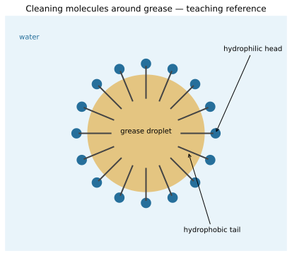
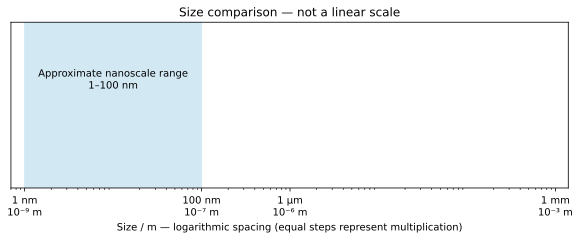

# 3 Materials

*NSSCO Chemistry 6117 — study notes. Worked examples teach methods; assessment tasks are supplied separately.*

---

## 3.1 — Types of materials

### Wood as a material

Wood is a natural material obtained from trees. It contains cellulose, a natural polymer, together with other substances, and commonly shows a grain that reflects its growth structure. Timber doors, roof supports and furniture are familiar uses in Namibia. A wooden chair is an object; wood is the material from which parts of it are made. An object may contain several materials, such as a wooden seat with steel screws and plastic feet.

Properties vary with species, grain direction, moisture and treatment. Wood is relatively easy to shape and generally conducts heat poorly compared with metals, making it useful for handles and some building components. It can absorb moisture, decay or burn, so suitability depends on conditions rather than the label natural alone. Painted wood remains wood even if its surface resembles plastic. To classify a sample, use its stated composition, visible grain and relevant observations together, without damaging an unknown object. Classification identifies the material; selection for a job also requires evidence about performance and durability.

### Metals as materials

Metal materials include elemental metals and alloys. Copper electrical wiring, aluminium cooking vessels and steel roofing sheets illustrate different uses. Most familiar metals conduct heat and electricity well and can be shaped without immediately shattering. Their composition and processing affect hardness, corrosion resistance and strength, so a property of one metal should not be assumed for another without evidence. Steel is an alloy, but still belongs to the broad metal-material category.

When identifying a material, distinguish appearance from composition. A shiny coating can conceal plastic or wood, and a magnet does not attract every metal. Aluminium and copper are metals even though an ordinary magnet does not strongly attract them. Use electrical conduction, stated composition and other suitable observations alongside appearance. The metal's role also matters: copper is selected for conducting wire, while an insulating coating around it serves the opposite electrical purpose. A complete object may therefore combine conducting metal with non-conducting materials. Naming the object alone does not identify the material in each component.

### Glasses

Glass is commonly used for windows, bottles and laboratory containers. Familiar window glass transmits visible light, resists many everyday substances and forms a rigid barrier. It is brittle: a sufficient impact can make it fracture rather than bend permanently. Different glass compositions provide different properties, so a window pane and a heat-resistant laboratory vessel are not automatically interchangeable.

Glass has an extended structure with mainly covalent bonding, but lacks the regular long-range arrangement of a crystal. Transparency alone does not identify it, because some plastics are also transparent. Classify a known window sample using composition or reliable product information rather than a hazardous breakage test. Distinguish the material glass from the object a drinking glass: a similarly shaped drinking vessel can be made from plastic. In selecting glass for a purpose, connect transparency with visibility, chemical resistance with containment, and brittleness with the risk of impact damage. A useful property and a limitation can belong to the same material without contradiction.

### Ceramics

Ceramics include fired clay bricks, pottery and many tiles. Heating suitable mineral materials during manufacture changes them into hard solids that retain their shape. Familiar ceramics often resist heat and wear but are brittle, meaning they can crack under an impact or tensile stress. A glazed tile has a surface coating that may change water absorption and appearance; the coating does not turn the whole object into a metal or plastic.

A mud brick dried without firing and a fired ceramic brick have different processing histories and may respond differently to water. Do not infer identical performance just because both are rectangular building blocks. A ceramic mug can withstand normal use while still breaking when dropped. Classification and suitability are therefore separate questions: first identify the material and then examine the loads, temperature and moisture it will encounter. Controlled observations can include surface appearance, porosity information and manufacturer-provided composition. Do not use unsafe heating or impact tests on unknown glazed items to identify them.

### Concrete

Concrete is a mixture made using cement, sand, larger aggregate such as crushed stone, and water. Cement acts as a binder as it reacts with water and hardens around the aggregate. Concrete is therefore not the same material as dry cement powder. Pavements, foundations and structural components provide local examples. It can be cast into a mould while fresh and becomes rigid as it sets and cures.

Concrete generally withstands compression better than tension. Steel reinforcement can help a concrete structure carry tensile loads, but the combination must be designed appropriately; adding an arbitrary piece of metal does not guarantee a safe structure. Here the aim is to link material properties with uses, not to prescribe building designs. Composition, water content, curing and defects all affect performance. A concrete sample can contain several kinds of bonding because it contains several substances, rather than one molecule with a single formula. The visible stones do not mean the cement has failed to mix: aggregate is an intended component.

### Plastics

Plastics are materials based on polymers that can be formed into useful shapes during manufacture. Examples include polythene packaging, nylon components and melamine-based moulded products. They contain long covalently bonded molecular structures, but different polymer structures and additives produce different properties. Some plastics are flexible, others rigid; some soften readily on heating, while others do not. “Plastic” is therefore a category, not one substance with one melting point.

Many familiar plastics are lightweight and poor electrical conductors, making them useful for packaging and insulation. Heat resistance, weathering and disposal must also be considered. A plastic coating can protect a metal or provide electrical insulation without changing the material of the underlying core. Identify a component from reliable information or appropriate observations; burning an unknown plastic is not an acceptable identification method because fumes may be harmful. A natural-looking colour or texture does not make a synthetic polymer natural wood. Conversely, natural polymers such as cellulose show that the word polymer is broader than the everyday category plastic.

### Fibres

Fibres are thin, elongated strands that can be spun into yarn or incorporated into other materials. Cotton and wool are natural examples; nylon and polyester are synthetic examples. Fabrics are made by arranging or joining fibres, often by weaving or knitting. A fibre describes the material's strand-like form as well as its practical use, so it can overlap with chemical categories: a nylon fibre is also a synthetic polymer.

Different fibres have different strengths, flexibility and water uptake. A fabric suitable for an absorbent towel may be unsuitable where rapid drying or low water absorption is required. Compare controlled samples rather than assuming every natural fibre is absorbent and every synthetic one is waterproof. A blended fabric contains more than one fibre type and may combine properties. When interpreting a label, distinguish the percentage composition from the weave or colour. An experiment on equal-sized fabric samples should also consider thickness and mass, because these can affect apparent absorption independently of the fibre chemistry.

### Natural and synthetic materials

Natural materials originate in living organisms or natural deposits, while synthetic materials are made through deliberate chemical manufacture. Wood, cotton and wool provide natural examples. Polythene and nylon are synthetic polymers. Processing a natural material does not automatically make it synthetic: cutting timber, washing wool or spinning cotton changes form without synthesising a new polymer. A manufactured object can therefore be made from a natural material.

The categories do not rank safety, quality or environmental impact by themselves. A natural material can burn, decay or require substantial processing, and a synthetic material can be durable or recyclable in an appropriate system. Compare the actual use, lifetime and disposal conditions. A label stating natural origin does not prove biodegradation will occur rapidly under every condition. If a sample combines natural and synthetic components, name both rather than forcing the whole object into one category. For example, cotton fabric with a synthetic coating has a natural fibre base and a manufactured polymer surface.

### Bonding in metals

Metallic bonding is attraction between positive metal ions and delocalised electrons. This model applies to the metal structure in familiar copper, aluminium and steel components. The delocalised electrons can move and carry electric current, while the positive ions form the structural framework. In a solid metal, conduction does not require the ions themselves to travel along the wire.

The model also helps explain shaping. Layers can move while remaining attracted to the electron population, so metals can often be hammered or drawn into wire. Alloys may resist sliding more strongly because atoms of different sizes disturb the regular arrangement. Do not replace this explanation with ionic bonding merely because the metallic model contains ions: ionic bonding involves attraction between positive and negative ions, whereas the negative component here is delocalised electrons. A material choice such as copper for a cable depends on the resulting properties as well as the bonding label.

### Bonding in concrete

Concrete contains several substances, so its bonding cannot be represented by one small molecular formula. Its constituents involve both ionic and covalent bonding. Aggregate and the hardened cement binder contribute different structures and roles. The binder forms through reactions involving cement and water and holds the aggregate together; the stones are not converted into a single enormous concrete molecule.

When asked to identify bonding in concrete, state both ionic and covalent contributions rather than choosing metallic bonding because a structure may contain steel reinforcement. Reinforced concrete combines concrete with metal, but that metal is a distinct reinforcing component. The overall behaviour depends on composition and arrangement as well as bond types. Hardness alone cannot identify a unique bonding type because ionic, covalent and metallic solids can each be hard in different circumstances. Treat the material as a composite mixture and connect any property claim to the particular constituent or structure being discussed.

### Bonding in glass

Common silica-based glass has a giant structure with mainly covalent bonding. The network extends through the solid rather than forming many separate small glass molecules. Its arrangement is not a regular crystal lattice over long distances. This distinguishes glass from a molecular liquid frozen into a simple array and also from a metal with mobile delocalised electrons.

Strong bonding contributes to rigidity, but a glass can still be brittle. Bond strength and resistance to impact are different questions: a rigid network can crack instead of allowing layers to slide as in a ductile metal. Ordinary glass is usually an electrical insulator because it lacks the mobile charge carriers characteristic of metals. Its transparency is useful for windows, but transparency alone does not prove covalent bonding; the structure must come from chemical knowledge or supplied evidence. Composition changes can alter thermal and chemical performance, so avoid assigning identical properties to every product called glass.

### Cellulose in wood

Cellulose is a natural polymer in wood and other plant materials. A polymer contains large molecules built from many linked units; in cellulose, covalent bonds join atoms within the long chains. Wood also contains other substances and structural features, so describing it as pure cellulose would be inaccurate. The chains and their organisation contribute to the mechanical behaviour of the plant material.

Natural origin does not imply the absence of chemical bonds or molecules. Cellulose is a chemical substance even though a plant produces it. Distinguish covalent bonds within its molecular structure from the larger-scale arrangement of fibres and cells in wood. Changes in moisture can alter practical behaviour without changing the statement that cellulose is a covalent polymer. A useful comparison is with a synthetic polymer such as polythene: both have covalently bonded molecular structures, but their chemical composition, origin and properties differ. One shared bonding category does not make them interchangeable materials.

### Synthetic polymer structures

Polythene, nylon, polyurethane and melamine-based polymers are examples of synthetic polymer materials. Covalent bonds hold atoms together within their polymer structures. The exact chains, connections and added ingredients differ, so the examples should not be treated as one identical molecular substance. Polythene packaging, nylon fibres and rigid melamine-based products illustrate the range of behaviour possible within this category.

The word synthetic describes manufacture, while polymer describes large molecular structure. A natural polymer such as cellulose also contains covalent bonds, so covalent bonding does not prove that a material is synthetic. Conversely, manufacturing a metal object does not turn its bonding into polymeric covalent bonding. When classifying a product, keep origin, structure, physical form and use separate. A nylon rope is synthetic in origin, polymeric in structure, fibrous in form and used to carry tension. Each description answers a different question, and combining them carefully gives a more useful account than memorising a single label.

### Connections

Connect material properties to Matter and bonding, Organic chemistry and Environmental and industrial chemistry. Distinguish a measured observation from an inferred structure or environmental claim.

---

## 3.2 — Building materials

### Building materials in the local environment

Buildings combine materials with different jobs. Mud or fired ceramic bricks form walls; concrete forms foundations and other load-bearing components; wood can form doors, frames and roof supports; metal can provide roofing sheets, fasteners or reinforcement; thatch provides a roof covering; and glass admits light through windows. The examples identify possible uses, not a rule that every building should use the same combination.

Survey a local building by recording each component, its material and the property that makes it useful. Windows transmit light, foundations support loads, and roofs resist weather. Distinguish the visible finish from the underlying material: paint or plaster can hide concrete, brick or wood. A roof's insulation depends on thickness, trapped air, arrangement and ventilation as well as material identity. Comparisons should therefore specify conditions. Link each component to its material and purpose.

### Selecting by properties

Selecting a building material begins with the required performance. Compressive strength concerns resistance to being crushed; tensile strength concerns resistance to being pulled apart. A material that performs well in one test may be weaker in the other. Thermal conductivity concerns heat transfer, while water absorption concerns uptake of moisture. These properties are related to different demands and should not be replaced by the vague statement that a material is strong.

For a window, transparency and resistance to ordinary weather matter, while for a cooking-area roof, heat transfer, durability and fire behaviour may matter. Use supplied test data to justify a choice and state a relevant limitation. Equal sample dimensions, comparable moisture conditions and consistent test procedures are needed for fair comparisons. A thicker sample may appear a better insulator simply because heat travels farther through it. Cost and availability can affect practical selection, but they do not establish chemical properties. These comparisons are not structural certification.

### Worked example: comparing insulation with a cooling graph

Two dry fabric jackets are wrapped around identical beakers with equal thickness and covered area. Each beaker contains 75 cm³ of water initially at 70 °C. A teacher supplies the hot water. Temperature readings at 0, 3 and 6 minutes are 70, 61 and 55 °C for jacket P, and 70, 65 and 61 °C for Q. Record time in one column and the two temperatures in separate columns, with units in the headings.

Plot time on the horizontal axis and temperature on the vertical axis using a scale that includes every reading. Mark each series distinctly and draw reasonable cooling curves; do not force the points into an unsupported straight line. Over six minutes P loses 70 − 55 = 15 °C, while Q loses 70 − 61 = 9 °C. Q therefore reduces cooling more effectively under these conditions. The average cooling-rate magnitudes over this interval are 15/6 = 2.5 °C/min and 9/6 = 1.5 °C/min. These are interval averages, not instantaneous initial rates.

The comparison is about the fabric arrangement tested, not every possible use of the material. Match water volume, starting temperature, vessel, lids and surroundings; otherwise a difference can have another cause. Keep the thermometer bulb in the water without touching the beaker. Repeat both arrangements and compare the repeated results. Water spilled onto one jacket changes its condition, so that trial should be investigated and repeated rather than quietly averaged with the dry tests.

### Making concrete

Concrete is prepared by mixing cement, sand and crushed stone or other suitable aggregate, then adding a controlled amount of water. Water allows the cement to undergo hydration reactions that form a hardened binder around the aggregate. Setting is therefore not simply the evaporation of all the water. Appropriate curing maintains conditions that allow the binder to develop. The precise proportions and treatment depend on the intended material specification.

Too much mixing water can leave a more porous, weaker hardened material after excess water leaves. Too little or poorly distributed water can prevent proper mixing and hydration. These relationships explain why preparation must be controlled rather than altered casually to make pouring easier. Distinguish cement, the binding ingredient, from concrete, the complete mixture. Sand and crushed stone provide different aggregate sizes; they are not alternative names for cement. In a school study, use teacher-prepared samples or a controlled small demonstration and avoid skin contact with wet cement, which is alkaline and can cause injury.

### Raw materials for cement

Clay and limestone are the principal raw materials named here for making cement. They are processed and heated to produce the cement-making material, which is then prepared as a fine powder. Cement is subsequently mixed with water and aggregate to make concrete. The two stages must remain separate: producing cement from raw minerals is not the same operation as preparing concrete at a building site.

Limestone is rich in calcium carbonate, while clay supplies other mineral components. For this objective, identify the raw materials rather than inventing a detailed industrial recipe. A bag of cement does not contain ready-made concrete because it lacks the intended sand and coarse aggregate mixture. Similarly, adding only water to cement produces a paste, not the full concrete mixture described in the preceding section. Reading a process diagram from left to right helps distinguish raw mineral extraction, cement manufacture, concrete mixing and curing. Each stage changes either composition, physical form or both.

### Suggested practical SP-6117-19 — Comparing strength

Use teacher-approved small samples and guarded apparatus to compare resistance to compression or tension. Record sample dimensions, the applied load and the chosen endpoint. Compare equal cross-sectional areas and change one material at a time; otherwise size may explain the result. Keep people away from possible falling loads or sharp fragments. Supplied data are an appropriate alternative to breaking samples. A compression result cannot be silently reused as a tensile-strength result, and a classroom comparison does not certify a material for a real building.

### Suggested practical SP-6117-20 — Surveying local materials

Survey an accessible building without disturbing its structure. Record component, apparent material, supporting evidence and likely purpose in a table. Check uncertain identifications using reliable information rather than appearance alone. Compare a window, roof covering, wall and frame. Link each use to a property such as light transmission, strength or weather resistance. Note concealed layers or coatings as limitations; a painted surface may not reveal the underlying material. The survey identifies uses and hypotheses, not a structural safety verdict.

### Suggested practical SP-6117-21 — Comparing insulation

Under teacher supervision, compare equal-thickness roofing-material samples in the same small model enclosure using safe warm-water containers as a heat source. Record temperatures at equal times with the same starting temperature, exposed area and room conditions. A slower temperature change can support better insulation under those conditions. Repeat and compare results; gaps around samples or unequal thickness are alternative explanations. Do not use an open flame or high-temperature heater to test unknown materials. The model simplifies ventilation and weather conditions found in real roofs.

---

## 3.3 — Cleaning materials

### The structure of a cleaning molecule

A soap or detergent molecule can be represented by a water-attracting head and a long water-repelling tail. The head is hydrophilic and the tail hydrophobic. The tail interacts with grease or oil, while the head interacts with water. A simple sketch uses a circle for the head and a long line or zigzag for the tail, with a key explaining both symbols. The sketch is a model of different interactions, not a claim that the molecule has a literal spherical head and rigid stick.

Keep the orientation clear when drawing cleaning action. Tails enter a grease droplet and heads face the surrounding water. Reversing the labels would predict the wrong arrangement. The general model applies to both soap and many synthetic detergents even though their detailed chemical groups differ. It explains how one molecule can connect an oily region with a watery environment. Exact structural formulae are unnecessary for a generalised sketch; the important features are the two different regions and their interactions.

### Removing grease by emulsification

Grease does not mix readily with water. Soap or detergent helps disperse grease into small droplets by placing hydrophobic tails in the grease and hydrophilic heads towards the water. Agitation helps detach and break up the grease, while the surrounding cleaning molecules help keep droplets dispersed. The resulting emulsion can be carried away during rinsing. This is dispersion of droplets, not necessarily conversion of grease into a new water-soluble chemical compound.

In a drawing, show a central grease droplet, tails directed inward and heads at the water-facing surface. Name the surrounding water so the direction has meaning. Saying only that soap dissolves dirt leaves out the mechanism and can be inaccurate for oily droplets. The cleaning action also depends on amount, temperature, agitation and water composition. A comparison of two cleaning products should hold these conditions steady before attributing a difference to the product. More foam does not automatically prove that more grease has been removed; foam and cleaning performance are different observations.

### Recognising cleaning materials

Soap and synthetic detergents are common cleaning materials. A soap bar may contain soap together with perfume, colourants and other ingredients. Washing-up liquids and laundry formulations commonly contain detergents and additional components. A product's everyday name does not establish its exact composition, so use a supplied ingredient description when a question distinguishes soap from a synthetic detergent.

Cleaning products are mixtures designed for particular purposes. Abrasive particles can scrub a surface, while surfactant molecules help disperse greasy material. These functions should not be confused with disinfection, which concerns microorganisms. A product that removes visible grease is not automatically proven to kill every microorganism. Likewise, an antimicrobial label does not explain emulsification. In a simple classroom comparison, identify the cleaning agent and the measured outcome before drawing conclusions. Do not mix household products to investigate them; the chemistry task can use prepared solutions or supplied labels and observations under teacher supervision.

### Preparing soap

Soap can be prepared by alkaline hydrolysis of a fat or oil. Heating the fat or oil with an appropriate alkali breaks it down to produce soap and glycerol. The process is commonly called saponification. The alkali is a reactant, not merely a neutral mixing liquid. A school description should identify the fat or oil, the alkali, controlled heating and the separation of the soap product without implying that ordinary mixing at any temperature gives an instantly finished product.

In a supervised demonstration, the mixture is heated using appropriate equipment and the soap is separated, for example by salting out, then collected and washed. Excess alkali must be removed or checked; an experimental product should not be used on skin simply because it looks like a soap bar. Hot alkaline mixtures can damage skin and eyes. The learning task is to relate the chemical change to the raw material and products, and to understand why separation and washing matter. Detailed industrial recipes and unsupervised manufacture are not needed.

### Biodegradability and persistence

Biodegradable means capable of being broken down by microorganisms. A non-biodegradable material does not undergo such breakdown readily under the relevant conditions and can persist. The distinction concerns a biological process, not simply whether a substance dissolves, breaks into small pieces or becomes invisible. A detergent can dissolve in water yet remain chemically present until a breakdown process acts on it.

Interpret environmental claims with conditions and timescales. Microorganisms, temperature, oxygen availability and treatment systems affect breakdown. Biodegradable does not mean instant disappearance or harmlessness at any dose. If two supplied samples lose 80% and 20% of their original material during the same controlled biodegradation test, the first breaks down more extensively under those conditions; that comparison does not prove its behaviour in every river or soil. State what the data support and identify the limitation. Responsible product comparisons also consider the amount released, toxicity and wastewater treatment rather than relying on one favourable label.

### Comparing soaps and detergents

Soaps can remove grease and are generally biodegradable, but calcium and magnesium ions in hard water form insoluble soap salts, commonly called scum. This consumes soap and can leave less available for cleaning. Many synthetic detergents remain effective in hard water because they do not form the same insoluble precipitate under comparable conditions. A fair comparison uses equal amounts, the same water, similar grease deposits and consistent agitation.

Environmental performance varies between detergent formulations. Some are readily biodegradable, while persistent ingredients can remain in the environment; additional formulation components may also matter. Do not state that every detergent is non-biodegradable or that natural soap has no environmental effects. Use the data supplied for the specific products. A recommendation may favour a detergent for hard-water cleaning while noting a persistence disadvantage, or favour a biodegradable product where comparable cleaning is achieved. State the criterion, evidence and trade-off rather than calling one category universally better. Increasing dose can compensate for some loss but increases material use and discharge.

### Suggested practical SP-6117-22 — Comparing emulsification

Place equal small volumes of water and cooking oil in teacher-approved stoppered tubes. Add a fixed amount of soap solution to one, detergent solution to another and no cleaning agent to a control. Shake each in the same way and record the appearance and time taken for layers to separate. More persistent fine droplets support emulsification. Keep temperature and amounts comparable; foam alone is not a measure of grease removal. Draw heads towards water and tails towards oil to explain the observation.

### Suggested practical SP-6117-23 — Observing soap preparation

Use a teacher demonstration of alkaline hydrolysis of a fat or oil, with eye protection and controlled heating. Record the starting materials, formation of a soap-containing mixture, separation by salting out, and washing of the collected product. Explain that excess alkali can affect both safety and test results. Do not use the unverified product on skin. Compare a small teacher-prepared solution with water for emulsification rather than assuming appearance alone proves purity. This is a chemical preparation followed by separation, not simply drying an oil.

### Cleaning-molecule orientation

Hydrophilic heads face water; hydrophobic tails enter grease.

---

## 3.4 — Nano-materials

### Nanotechnology and carbon materials

Nanotechnology works with materials at very small length scales to obtain useful properties. Graphene and fullerenes are carbon-based examples associated with this field. Graphene is a single sheet of carbon atoms in a connected arrangement, while fullerenes contain cage-like molecular structures. They are not interchangeable names for any small piece of carbon. The arrangement as well as the scale affects the properties.

Producing or organising a material at a small scale can change how it interacts with its surroundings. The term nanotechnology does not mean that ordinary atoms have been made smaller; it concerns structures and particles assembled from atoms. A sample may contain many atoms while still being nanoscale in one dimension. This distinction helps separate a nanoparticle from an individual atom and from a large bulk piece of material. At this level, recognise examples and the link between scale and properties rather than memorising a manufacturing process or assuming every nanoscale material has the same use.

### The nanoscale

The approximate nanoscale range used here is 1–100 nanometres in at least one dimension. One nanometre is 10⁻⁹ metres. A particle can therefore contain many atoms while being far smaller than an ordinary visible grain. A thin sheet can have a nanoscale thickness even if its length and width are much greater. Do not assume that every dimension must be identical or that a material is nanoscale merely because its packaging uses the word small.

Compare units carefully: 1 micrometre is 1000 nanometres, while 1 millimetre is one million nanometres. A 50 nm particle lies within the stated range; a 5000 nm particle does not on that dimension. A logarithmic size ladder gives equal spacing to equal multiplication factors, not equal differences in size. Label that scale explicitly so that a drawing does not falsely suggest 1 nm and 1 mm differ by only a few times. For example, a stated thickness of 0.050 micrometres converts to 0.050 × 1000 = 50 nm, within the stated nanoscale range. A thickness of 0.50 micrometres gives 500 nm, outside that range on the measured dimension. Check the decimal place before classifying a size: a tenfold error can reverse the conclusion. These conversions describe size; they do not establish toxicity, usefulness or chemical identity by themselves.

### Why small size changes behaviour

Nanomaterials can have properties different from a bulk sample of the same substance and from individual atoms or molecules. As a particle becomes smaller, a greater fraction of its atoms can be associated with the surface. Surface interactions can therefore become particularly important. The relevant change is in scale and arrangement, not a change in the element's proton number. Silver nanoparticles provide the syllabus example of antimicrobial behaviour.

An observed useful property does not justify a universal claim about safety or performance. Antimicrobial means acting against microorganisms under appropriate conditions; it does not mean that a silver-containing product sterilises anything it touches or is suitable for every medical use. The amount, surrounding material, particle size and exposure conditions all matter. A comparison should identify the measured property and the particle sizes being compared. A bulk piece of silver, a silver nanoparticle and an isolated silver atom are three distinct physical descriptions, even though each involves the same element. Treat any application claim as specific to the tested material and conditions.

### Applications of nanotechnology

Nanotechnology has applications in medicine, electronics, environmental technologies, consumer products and sporting goods. Examples include nanoscale materials in some antimicrobial coatings, miniaturised electronic structures, high-surface-area materials used in filtration or treatment, and lightweight reinforced composites used in some sports equipment. The useful property must be named alongside the application: small size, surface behaviour or reinforcement can serve different purposes.

These are application categories rather than a promise that any nanoparticle will work in every product. A filter must be tested for the substance it is meant to remove, and a reinforced material must be tested for the load and conditions of use. Describing a material as nano does not replace such evidence. For a school answer, give one concrete pairing of application and relevant property without inventing a product brand or a guaranteed health benefit. Environmental assessment considers both benefits during use and what happens when the material is released or discarded. Size alone is not a complete risk assessment.

### Size ladder

Logarithmic scale distinguishing nanometres, micrometres and millimetres.
