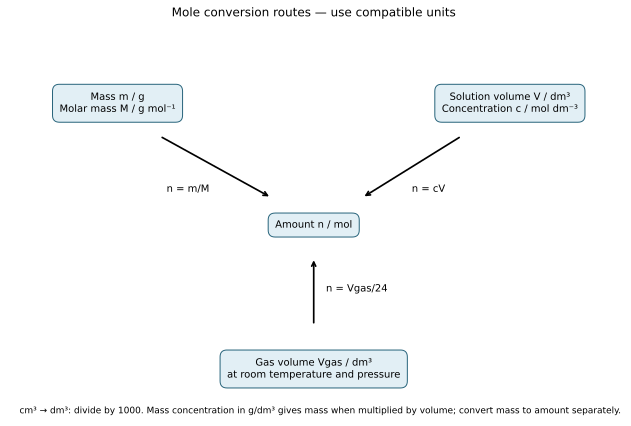
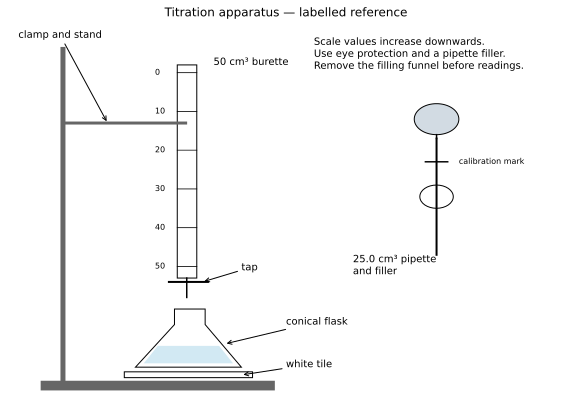

# 4 Stoichiometry

*NSSCO Chemistry 6117 — study notes. Worked examples teach methods; assessment tasks are supplied separately.*

---

## 4.1 — The mole concept

### Relative atomic mass

Relative atomic mass, Ar, is the average mass of an atom of an element compared with one twelfth of the mass of a carbon-12 atom. It has no unit because it is a ratio of masses. The average reflects the naturally occurring isotopic mixture rather than requiring every atom of the element to have identical mass. This is why a Periodic Table value can be non-integer even though a particular isotope's nucleon number is a whole number.

Distinguish Ar from proton number and nucleon number. Proton number counts protons and identifies the element. Nucleon number counts protons plus neutrons in one isotope. Ar is an average mass comparison used in chemical calculations. A table entry such as 35.5 must not be described as thirty-five and a half protons in an atom. When a calculation supplies rounded Ar values, use those values consistently throughout it. An answer in grams belongs to a calculated sample mass, not to Ar itself. The unit distinction prevents errors later when converting between mass and amount.

### Relative formula mass

Relative formula mass, Mr, is the sum of the relative atomic masses of the atoms represented by a chemical formula. It has no unit. For water, using Ar(H) = 1 and Ar(O) = 16 gives Mr = 2 × 1 + 16 = 18. For an ionic compound, the formula represents the simplest ion ratio rather than a separate molecule, but the same mass-summing method applies. Sodium chloride has Mr = 23 + 35.5 = 58.5 using those supplied values.

Brackets multiply the complete group within them. In Ca(NO3)2, count one Ca, two N and six O, so Mr = 40 + 2 × 14 + 6 × 16 = 164. Do not multiply only the oxygen or forget the two nitrogen atoms. A useful method is to write the atom counts first, multiply each by its Ar, then add. Keep the distinction between a dimensionless relative formula mass and a molar mass expressed in g/mol, even though their numerical values correspond in the calculations used here.

### Amount of substance and the mole

A mole is an amount of substance containing approximately 6.022 × 10²³ specified particles. The particle must be named: atoms, molecules, ions or formula units may be counted in different contexts. One mole of oxygen molecules contains one mole of O2 molecules but two moles of oxygen atoms. Both statements describe the same sample from different particle-counting viewpoints.

The mole is not itself a mass or a particle. Equal amounts of two different substances contain equal numbers of their specified particles but can have different masses. One mole of carbon atoms and one mole of water molecules therefore contain the same number of specified particles without weighing the same. If an equation shows a reacting ratio of 1:2, it compares amounts of the stated substances. It does not mean their Avogadro constants differ. Distinguish the number of moles from the number of particles: multiply amount in moles by the Avogadro constant to obtain a particle count, and divide a particle count by that constant to obtain amount.

### The Avogadro constant

The Avogadro constant is approximately 6.022 × 10²³ particles per mole. It connects an amount of substance with a number of specified particles. In N = nNA, N is particle number, n is amount in moles and NA is the Avogadro constant. The constant does not change with the element, compound or sample size. What changes is the amount and therefore the total number of particles.

For 0.50 mol of water molecules, the particle count is 0.50 × 6.022 × 10²³ = 3.011 × 10²³ molecules. Each molecule contains three atoms, so a question asking for total atoms would require a further factor of three. Read the requested entity before calculating. The unit mol⁻¹ describes the constant, whereas a particle count is a number of named entities. Confusing those quantities can produce an answer numerically similar to a familiar constant but chemically meaningless. In reacting calculations, use the balanced equation to find the amount first, then convert to a particle count if requested.

### Mass and molar mass

One mole has a mass in grams numerically equal to the relative mass of the specified substance. Molar mass M expresses this as grams per mole. Using Ar(Mg) = 24 gives M(Mg) = 24 g/mol; using Mr(H2O) = 18 gives M(H2O) = 18 g/mol. The relationship n = m/M converts mass m in grams to amount n in moles. Rearranging gives m = nM.

For 9.0 g of water, n = 9.0/18 = 0.50 mol. For 0.20 mol of magnesium, m = 0.20 × 24 = 4.8 g. These examples show why equal mole amounts need not have equal masses. Be precise about molecules: the molar mass of O2 is 32 g/mol when Ar(O) = 16, while the molar mass of oxygen atoms is 16 g/mol. A balanced reaction involving oxygen gas requires O2. Check that the formula used to calculate M matches the substance named in the equation and question.

### Empirical formula

An empirical formula gives the simplest whole-number ratio of atoms of the elements in a compound. It describes composition without necessarily identifying the number of atoms in a molecule. For C6H12O6, dividing all subscripts by six gives the empirical formula CH2O. For C2H6, dividing by two gives CH3. The simplification must apply the same factor to every element.

Some molecular formulae are already in their simplest ratio. H2O cannot be reduced further, so its empirical and molecular formulae are the same. By contrast, different molecular formulae can share an empirical formula; CH2O alone does not prove a molecule is glucose. An empirical formula also does not provide the detailed arrangement of bonds. To determine a molecular formula, additional relative molecular mass information is needed. In calculations from composition by mass, first convert masses to amounts, then find the simplest ratio. Directly copying a mass ratio into subscripts would ignore differences in atomic mass.

### Empirical formula mass

Empirical formula mass is the sum of the relative atomic masses in one empirical-formula unit. It is a relative quantity and has no unit. For CH2O, using C = 12, H = 1 and O = 16 gives 12 + 2 + 16 = 30. A molecule with this empirical formula can contain one or several of these simplest-ratio units.

Divide the given relative molecular mass by the empirical formula mass to obtain the whole-number multiplier. If Mr is 180 and the empirical formula mass is 30, the multiplier is six and the molecular formula is C6H12O6. Multiply every subscript, including any implied one. Multiplying only the carbon count would destroy the empirical ratio. A result far from a sensible whole number indicates that the formula, mass data or arithmetic needs checking; do not round an arbitrary value to force a convenient molecule. Rounded experimental data can produce a value very close to an integer, which should be interpreted with the stated precision.

### Concentration

Concentration is mass or amount of dissolved substance per unit solution volume. Mass concentration is commonly expressed in g/dm³ and amount concentration in mol/dm³. For amount concentration, c = n/V, where V is solution volume in dm³. Thus n = cV and V = n/c. One dm³ equals 1000 cm³, so divide a volume in cm³ by 1000 before using these equations with c in mol/dm³.

The volume is the total solution volume, not the volume of solvent before dissolving. Adding solute to a measured volume of water does not necessarily leave the final volume unchanged. In dilution, the same amount of solute occupies a larger solution volume, so concentration decreases. Strong and weak describe the extent of ionisation of an acid, while concentrated and dilute describe amount per volume; these pairs are not interchangeable. A dilute strong acid can have lower amount concentration than a concentrated weak acid. Stoichiometric calculations use the stated concentration and balanced equation rather than guessing from the word strong.

### Mole conversion routes

Routes between mass, amount, concentration and gas volume at room temperature and pressure.

### Connections

Connect these calculations to Matter, Acids, bases and salts, and Practical skills. Check formulae, balanced ratios, units and limiting conditions before interpreting a numerical answer.

---

## 4.2 — Mole calculations

### From formula to amount, particles and solution concentration

Relative formula mass is found by counting every atom, including brackets. For Mg(OH)2, the oxygen and hydrogen counts are each two; its relative formula mass is 24 + 2(16 + 1) = 58. Molar mass uses the same numerical value in g/mol. An amount is obtained by dividing sample mass by molar mass. Converting in the reverse direction multiplies amount by molar mass.

The Avogadro constant connects amount to particle count. Multiply moles by about 6.022 × 10²³ particles per mole, naming the counted particles: atoms, molecules, ions or formula units. One mole of a molecular substance does not necessarily contain one mole of atoms; count atoms per molecule before making that conversion.

Mass concentration divides mass by solution volume, while amount concentration divides moles by solution volume. Convert a volume in cm³ to dm³ before using a concentration in g/dm³ or mol/dm³. Concentration concerns the final solution volume, not the volume of solvent initially poured in.

An acid–alkali calculation starts with the balanced equation, not an assumed 1:1 ratio. A formula unit with two neutralisable hydrogen ions can require two hydroxide ions. Determine the known amount, use the coefficients to obtain the other amount, then divide by its solution volume if concentration is required. In a mixture with two known amounts, compare amount divided by its reaction coefficient. The smaller value limits the extent of reaction; the other reactant remains in excess.

### Reacting masses

A balanced equation supplies ratios of amounts, not direct ratios of masses. Convert the known mass to moles using n = m/M, apply the coefficient ratio, then convert the required amount to mass using m = nM. For 2Mg + O2 → 2MgO, magnesium and magnesium oxide have a 1:1 amount ratio, while oxygen gas has half as many moles. The different molar masses mean their reacting masses are not equal.

Read limiting conditions before applying the ratio. If one reactant is stated to be in excess, the specified other reactant controls the maximum product amount. If amounts of both are given, compare n divided by the respective coefficient; the smaller value identifies the limiting reactant. A theoretical mass assumes the stated reaction completes without losses. Show each stage with its substance label so a correct number is not attached to the wrong material.

### Solutions and reacting amounts

For a solution with concentration c in mol/dm³ and volume V in dm³, the dissolved amount is n = cV. Convert cm³ to dm³ first. For example, 40.0 cm³ becomes 0.0400 dm³, not 40.0 dm³. A missed conversion causes a factor-of-1000 error. If concentration is given in g/dm³, multiplying by volume gives mass, which must then be divided by molar mass before using a mole ratio.

At a complete reaction endpoint, use the balanced equation to connect the reacting amounts. HCl and NaOH react 1:1, whereas two moles of HCl react with one mole of Na2CO3. Equal volumes therefore do not automatically mean equal reacting amounts. In a limiting-reactant calculation, calculate each available amount separately and compare it with the required ratio. Name the limiting substance before calculating product mass or the amount left over.

### Worked example: working from a titration to concentration

A 15.0 cm³ portion of sodium carbonate solution is completely neutralised by 18.6 cm³ of 0.150 mol/dm³ hydrochloric acid. Start with the reaction: Na2CO3 + 2HCl → 2NaCl + H2O + CO2. The coefficients, rather than the two measured volumes, give the reacting amount ratio.

Convert acid volume before using n = cV: 18.6 cm³ = 0.0186 dm³. The acid amount is 0.150 × 0.0186 = 0.00279 mol. Two moles of acid react with one mole of carbonate, so carbonate amount is 0.00279/2 = 0.001395 mol. Its solution volume is 0.0150 dm³, giving concentration 0.001395/0.0150 = 0.0930 mol/dm³. Keep extra digits during the steps and round the final result sensibly.

### Gas volume at room conditions

Use a molar gas volume of 24 dm³/mol at room temperature and pressure in these calculations. Then Vgas = n × 24 and n = Vgas/24 when volume is in dm³. Convert cm³ to dm³ before division, or use the equivalent 24 000 cm³/mol consistently. The condition belongs with the numerical value: do not apply 24 dm³/mol to an unspecified high-temperature or different-pressure situation without justification.

Combine gas volume with the balanced-equation ratio where needed. If one mole of a carbonate produces one mole of carbon dioxide, calculate carbonate amount and transfer that amount to CO2 before finding volume. Gas volume ratios equal the equation's mole ratios when the gases are compared at the same temperature and pressure. State whether a calculated product volume is theoretical, especially for a reversible reaction. The question must supply enough conditions and completion assumptions to support the requested result.

### Worked example: limiting reagent, excess metal and gas volume

For a limiting-reactant calculation, start with the equation rather than comparing masses directly. In Mg + 2HCl → MgCl2 + H2, 4.80 g Mg is 4.80/24.0 = 0.200 mol. If acid contains 0.300 mol HCl, it can react with only 0.150 mol Mg, so acid is limiting. Hydrogen amount is 0.150 mol, not 0.200 mol. At room temperature and pressure using 24 dm³/mol, this is 3.60 dm³. The remaining magnesium is 0.0500 mol, or 1.20 g.

### Empirical formula from mass data

Convert each element's mass to an amount by dividing by its relative atomic mass. Then divide all amounts by the smallest to obtain a ratio. If percentages by mass are supplied, choose a notional 100 g sample, so each percentage becomes the corresponding mass in grams. The choice does not change the ratio. Round only after examining the complete ratio, because early rounding can obscure a simple relationship.

A ratio such as 1:1.5 should be multiplied throughout by two to give whole numbers, not rounded to 1:2. The final formula uses the same element order as the working and has no mole unit. Check it by calculating the approximate mass percentages it would imply. Small differences from rounded input percentages are expected; large differences suggest an incorrect ratio or an omitted element. If a product gains oxygen during a reaction, determine the oxygen mass separately before constructing the amount ratio.

### Molecular formula from an empirical formula

Calculate the empirical formula mass, then divide the supplied relative molecular mass by it. The resulting multiplier tells how many simplest-ratio units occur in one molecule. Multiply every empirical-formula subscript by that integer. For an empirical formula CH2 and Mr = 56, empirical mass 14 gives multiplier four, producing C4H8.

The molecular formula must preserve the empirical atom ratio and have the stated relative molecular mass. These are independent checks. A formula can have the correct ratio but the wrong total mass if the multiplier is wrong. Conversely, a guessed formula with the right mass may not preserve the measured composition. Keep implied subscripts of one visible in the working when that helps. A molecular formula specifies atom counts but does not necessarily identify one unique structure; different compounds can share a formula. Do not add a structural claim that the calculation cannot establish.

### Worked example: empirical and molecular formulae

For an empirical formula, convert each mass to an amount and divide by the smallest. A sample contains 2.40 g carbon and 0.600 g hydrogen. Amounts are 0.200 and 0.600 mol, giving a 1:3 ratio and empirical formula CH3. If relative molecular mass is 30, the empirical formula mass is 15, so the molecular formula is C2H6. The multiplier applies to every atom count.

### Percentage composition

Percentage by mass of an element in a compound equals its total mass contribution in the formula divided by the relative formula mass, multiplied by 100. Include every atom of that element, including those in repeated bracketed groups. In NH4NO3 there are two nitrogen atoms, not one, so nitrogen contributes 28 when Ar(N) = 14.

The denominator is the mass contribution of the complete formula. A numerator and denominator must refer to the same formula unit or sample. Do not divide an atom count by a mass, and do not confuse the percentage of atoms with the percentage by mass. The percentages for all elements should sum to approximately 100%, allowing for rounding. A percentage is dimensionless, written with %, whereas the intermediate mass contributions are based on the supplied relative atomic masses. Preserve unrounded working until the final percentage to avoid unnecessary rounding errors.

### Percentage yield

Percentage yield compares the actual product obtained with the theoretical maximum: actual yield divided by theoretical yield, multiplied by 100. Both yields must use compatible units and refer to the same product. The theoretical yield comes from the balanced equation and limiting reactant, assuming complete conversion by the stated reaction. It is not necessarily the starting reactant mass.

An actual yield can be lower because reaction is incomplete, competing reactions occur, or product is lost during separation and transfer. An apparent yield above 100% suggests a problem such as retained solvent, contamination or measurement error, rather than extra matter being created. Rearrange the percentage relationship when actual or theoretical mass is unknown. For a 75% yield, use the fraction 0.75; multiplying by 75 without dividing by 100 gives the wrong scale. State whether the measured product was dry and pure when those assumptions matter.

### Worked example: percentage yield

For percentage yield, first identify the theoretical product amount from the limiting reactant. If 7.50 g is theoretically possible and 6.00 g of dry product is isolated, yield is 6.00/7.50 × 100 = 80.0%. A mass recorded before drying can falsely inflate this value. Purity instead compares the desired substance in a sample with the whole sample; it is not the fraction of theoretical product collected.

### Percentage purity

Percentage purity is the mass of the desired pure substance divided by the total sample mass, multiplied by 100. It concerns sample composition, whereas percentage yield concerns how much product was obtained relative to a theoretical amount. A sample may have high purity but low recovery yield, so the two percentages answer different questions.

A reaction can determine the amount of a component if the other sample constituents do not contribute to the measured product. For limestone, carbon dioxide volume can indicate calcium carbonate content when carbonate reacts completely and the impurities do not also generate gas. Calculate gas amount, use the reaction ratio, convert the carbonate amount to mass, then divide by the whole sample mass. State those assumptions in the question rather than letting the answer invent them. If purity is given and pure mass is required, multiply total mass by the purity fraction, such as 0.90 for 90%.

### Titration apparatus reference

A clamped burette above a conical flask, with a pipette and filler for the fixed aliquot.

### Worked example: reading a titre and controlling the endpoint

A pipette transfers the fixed carbonate portion to a conical flask. A burette delivers a variable acid volume. Rinse each volumetric instrument with the solution it will contain; rinse the flask with deionised water. Remove any air bubble from the burette tip before the initial reading. Near the endpoint, add acid dropwise while swirling and observe the methyl-orange endpoint. Obtain repeat titres that agree sufficiently for the instrument and method, rather than averaging a rough trial with careful repeats.

If the final burette reading is 20.10 cm³ and the initial reading is 1.50 cm³, the delivered volume is 18.60 cm³. Neither reading alone is the titre. A drawing should label the burette, tap, flask and indicator, with the burette vertical and its tip over the flask.

### Connections

Connect these calculations to Matter, Acids, bases and salts, and Practical skills. Check formulae, balanced ratios, units and limiting conditions before interpreting a numerical answer.
