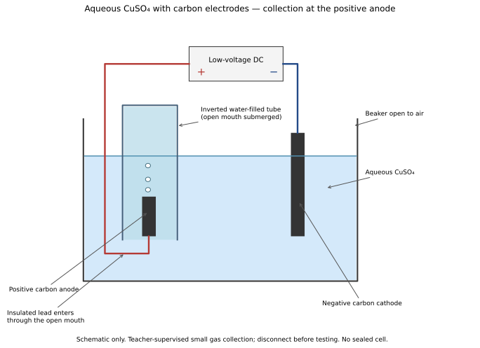
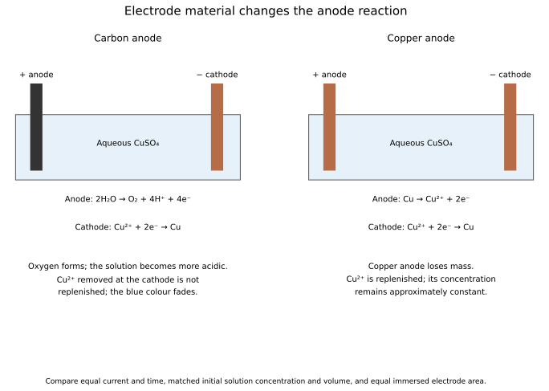

# 5 Electrochemistry

*NSSCO Chemistry 6117 — study notes. Worked examples teach methods; assessment tasks are supplied separately.*

---

## 5.1 — Electrodes and electrolytes

### Electrodes and the external circuit

An electrode is a conductor through which an electric current enters or leaves an electrolyte. In an electrolytic cell, two separated electrodes are connected to a direct-current supply. Electrons move in the external metal wires and conducting electrodes, while ions carry charge through the electrolyte. The electrodes must contact the electrolyte without touching each other, otherwise a direct conducting path can bypass the intended process.

An inert electrode conducts without supplying the main reacting material in the simplified examples, while an active copper electrode can participate in a copper-ion solution. Electrode material therefore matters when predicting electrolysis products. Carbon is often used as an approximately inert electrode in classroom descriptions, but it is consumed under some industrial conditions, including aluminium extraction. Always state the relevant context rather than assuming the word carbon guarantees complete chemical inactivity. A circuit diagram should label the supply polarity, both electrodes and the electrolyte, so a reader can connect the predicted half-reactions to the actual apparatus.

### Electrolytes

An electrolyte is a substance that conducts electricity through mobile ions when molten or in solution and is decomposed by the current. A solid ionic crystal may contain ions but does not conduct through them while they remain fixed in the lattice. Melting or dissolving can make the ions mobile. In aqueous solutions, ions from water may compete with dissolved ions at the electrodes, so the product prediction can differ from that for the molten substance.

Concentration and electrode material must be included in an aqueous-electrolysis description. Concentrated and dilute refer to amount per solution volume, whereas strong and weak describe the extent of acid ionisation. A dilute strong acid can conduct, and a weak acid solution can also conduct to an extent because some ions are present. Those terms are not interchangeable. In a current-limited classroom test, a conducting solution completes the circuit through ion movement; electrons do not simply travel through the liquid in the same way as in a copper wire. Distinguish the conducting medium from the solid electrodes immersed in it.

### The anode in electrolysis

The anode is the electrode at which oxidation occurs. In an electrolytic cell it is positive, connected to the positive terminal of the direct-current supply. Negative ions are attracted towards it, but the actual reaction also depends on the electrolyte and the electrode material. Oxidation means loss of electrons, so electrons appear on the product side of an oxidation half-equation.

For concentrated aqueous chloride solution with an inert anode, 2Cl⁻ → Cl2 + 2e⁻ describes chlorine formation. With an active copper anode in aqueous copper(II) sulfate, Cu → Cu²⁺ + 2e⁻ describes copper dissolving instead. Thus “the anode makes a gas” is not a general definition. Identify it by oxidation and use the specific conditions to predict its product. Do not transfer the positive-sign rule to every kind of electrochemical cell without considering the context: this section concerns electrolysis driven by an external supply. The process-based definition, oxidation at the anode, is the essential connection.

### The cathode in electrolysis

The cathode is the electrode at which reduction occurs. In an electrolytic cell it is negative and connected to the negative terminal of the supply. Positive ions move towards it and can gain electrons. In a reduction half-equation, electrons appear on the reactant side. For example, Cu²⁺ + 2e⁻ → Cu shows copper-ion reduction to copper metal.

At the cathode, a metal or hydrogen is commonly produced in the syllabus examples. Molten salts contain no water to compete, so their metal cations can form metal. In aqueous solutions, hydrogen may form instead of a very reactive metal such as sodium. Therefore the same dissolved salt and molten salt need not give the same cathode product. A correct answer names both the species gaining electrons and the product where possible. Saying only that positive ions move to the negative electrode describes attraction but does not yet describe the electron-transfer reaction at its surface.

### Drawing an electrolytic cell

A basic electrolytic-cell diagram shows a container of electrolyte, two separated electrodes and wires connecting them to a direct-current supply. Label the positive electrode anode and the negative electrode cathode. State the electrolyte's identity and whether it is molten or aqueous. Where products are collected, show collection at the correct electrode and avoid sealing a gas-producing cell without an outlet.

For aqueous copper(II) sulfate with carbon electrodes, copper deposits at the negative electrode and oxygen forms at the positive electrode in the usual classroom example. An inverted water-filled collection tube can collect a small gas sample above the anode using a suitable arrangement. The diagram must allow bubbles to reach the tube and keep electrical connections outside the liquid where appropriate. A label alone cannot repair an impossible connection. Check the complete current path, the electrode signs and the location of each product. A learner drawing should be attempted before consulting the labelled answer diagram.

### Half-equations and competing reactions

A half-equation shows one electrode reaction, including the electrons transferred. Check both atom counts and charge. For molten lead(II) bromide, Pb²⁺ + 2e⁻ → Pb is reduction and 2Br⁻ → Br2 + 2e⁻ is oxidation. Combining the two cancels equal electron numbers. Electrons are transferred through the circuit; they are not a substance accumulating in the electrolyte.

Aqueous solutions contain water as well as the dissolved substance, so hydrogen or oxygen can form instead of some dissolved components. In acidic aqueous conditions, 2H⁺ + 2e⁻ → H2 represents hydrogen formation and 2H2O → O2 + 4H⁺ + 4e⁻ can represent oxygen formation at an inert anode. In suitable alkaline notation, 4OH⁻ → O2 + 2H2O + 4e⁻ is an alternative oxygen half-equation. Use a form consistent with the stated medium. A copper anode in aqueous copper(II) sulfate dissolves instead of following the inert-anode oxygen example.

### General product patterns and their limits

In familiar electrolysis examples with inert electrodes, metals or hydrogen are formed at the negative cathode, while non-metals other than hydrogen are formed at the positive anode. This pattern follows reduction at the cathode and oxidation at the anode. It is a useful summary after the electrolyte and electrode conditions have been stated, not a substitute for identifying them.

An active metal anode is an important qualification. A copper anode in aqueous copper(II) sulfate can dissolve to form Cu²⁺, so an anode need not release a non-metal gas. Likewise, seeing a coating on an electrode is not by itself proof of its identity: use the electrolyte, polarity and any product test. Never exchange the names of the electrodes because one diagram places the cathode on the left and another on the right. Left and right have no fixed chemical meaning. Follow the terminal connection and electron-transfer process to decide which name applies.

### Molten lead(II) bromide

Molten lead(II) bromide contains mobile Pb²⁺ and Br⁻ ions. With inert electrodes, lead forms at the cathode and bromine at the anode. The cathode half-equation is Pb²⁺ + 2e⁻ → Pb; the anode half-equation is 2Br⁻ → Br2 + 2e⁻. The overall change is decomposition of the molten compound into its elements. There is no water in this stated electrolyte to provide a competing hydrogen product.

The solid does not conduct through mobile ions, so melting is essential for this example. It does not create the ions from neutral molecules; it allows ions already present in the lattice to move. The demonstration involves hot material and hazardous lead and bromine substances, so learners use teacher-controlled observations, recordings or supplied data. Bromine's colour can be described as an observation, but do not recommend smelling the product. Identify the metal and non-metal products from the ionic species and electrode reactions, then relate observations to that prediction.

### Dilute sulfuric acid with inert electrodes

Electrolysis of dilute sulfuric acid using inert electrodes produces hydrogen at the cathode and oxygen at the anode. Hydrogen-ion reduction can be written 2H⁺ + 2e⁻ → H2. Oxygen formation can be represented by 2H2O → O2 + 4H⁺ + 4e⁻. The sulfate ions are not the source of sulfur gas in this experiment. Overall, water is decomposed, with twice as many moles of hydrogen as oxygen.

At the same conditions, the collected hydrogen volume is ideally twice the oxygen volume. Real collections may depart from this through leakage, dissolved gas or incomplete collection, so observations need evaluation. Hydrogen gives a squeaky pop in a controlled small-sample lighted-splint test, while oxygen relights a glowing splint. Keep the gases separate and use teacher-supervised low-voltage apparatus. The concentration condition matters: this example is dilute sulfuric acid, not an unspecified concentrated sulfur-containing mixture. The inert-electrode condition also prevents confusing these reactions with an electrode that dissolves.

### Concentrated hydrochloric acid

With inert electrodes, electrolysis of concentrated hydrochloric acid produces hydrogen at the cathode and chlorine at the anode. The half-equations are 2H⁺ + 2e⁻ → H2 and 2Cl⁻ → Cl2 + 2e⁻. The concentrated chloride condition supports chlorine formation at the positive electrode rather than treating every aqueous anode as an oxygen source. The overall reaction is 2HCl → H2 + Cl2 under the stated conditions.

Name the electrode and substance together. A statement that both electrodes produce gas is an observation category, not a complete identification. Chlorine is hazardous and must not be identified by deliberate inhalation. Product observations should come from supervised apparatus or supplied evidence, with appropriate small-sample tests performed by trained supervision. Do not combine hydrogen and chlorine collections or imply a sealed demonstration is safe. Strong hydrochloric acid describes ionisation, while concentrated describes amount per volume; the anode prediction here specifically retains the concentrated-solution condition.

### Concentrated aqueous sodium chloride

Concentrated aqueous sodium chloride, or brine, gives hydrogen at the cathode and chlorine at an inert anode. Sodium metal is not deposited from this aqueous solution. At the cathode, water can be represented as gaining electrons: 2H2O + 2e⁻ → H2 + 2OH⁻. At the anode, 2Cl⁻ → Cl2 + 2e⁻. Sodium ions remain in solution with hydroxide ions, giving sodium hydroxide solution when the products are appropriately separated.

Compare this with molten sodium chloride, which has no water and gives sodium metal at the cathode. Omitting aqueous or molten changes the meaning of the question. Similarly, the concentrated chloride condition matters for the anode product. In manufacture, separation prevents the products reacting undesirably with one another; technical cell construction is not required here. Keep the essential starting material, conditions and half-equations clear. Chlorine is hazardous, so the learner resource uses diagrams and supplied observations rather than instructions to generate it unsupervised.

### Predicting products of a molten binary compound

A binary compound contains two elements. For a molten ionic binary compound with inert electrodes, identify the positive metal ion and negative non-metal ion. The metal ion gains electrons at the cathode, while the anion loses electrons at the anode. Molten magnesium chloride therefore gives magnesium and chlorine. Its half-equations are Mg²⁺ + 2e⁻ → Mg and 2Cl⁻ → Cl2 + 2e⁻.

Check the element's normal product form. Chlorine and bromine are diatomic, so write Cl2 and Br2 rather than isolated neutral atoms as the final bulk products. Balance electrons and charges separately at each electrode. A supplied compound formula establishes the ion ratio but does not mean both electrodes release the same number of atoms per electron. Keep molten explicit: water-derived hydrogen and oxygen competition belongs to aqueous conditions. If an electrode can react, that additional information must be considered instead of applying the inert-electrode prediction automatically.

### Copper sulfate: active and inert anodes

Aqueous copper(II) sulfate behaves differently with carbon and copper anodes. With an inert carbon anode, oxygen is produced, while Cu²⁺ ions gain electrons and deposit as copper at the cathode. The solution's Cu²⁺ concentration decreases as those ions are removed without being replenished, so its blue colour can fade. State that the solution is aqueous and the anode is carbon before applying this description.

With a copper anode in aqueous copper(II) sulfate, the anode dissolves: Cu → Cu²⁺ + 2e⁻. At the cathode, Cu²⁺ + 2e⁻ → Cu still deposits copper. Ideally, anode dissolution replaces the copper ions removed at the cathode, so their concentration remains approximately steady. The copper anode loses mass while the cathode gains mass. This is the active-electrode case; do not claim that copper-ion concentration stays constant with an inert carbon anode. Compare cells at the same current and time, and measure clean, dry electrodes to distinguish real metal transfer from retained solution.

### Worked example: choosing evidence about an electrolytic anode

Compare two aqueous copper(II) sulfate cells under the same current and time: one has a carbon anode, the other a copper anode. Mark the anode positive and cathode negative in the circuit. The external power supply drives the reactions; electrons travel through the external wires, while ions carry charge through the solution.

At either cathode, Cu²⁺ + 2e⁻ → Cu deposits copper. At the carbon anode, water is oxidised: 2H2O → O2 + 4H⁺ + 4e⁻. At the copper anode, Cu → Cu²⁺ + 2e⁻ dissolves copper. Check both atom balance and charge: the water equation has four hydrogen atoms and two oxygen atoms on each side, and its four positive charges are balanced by four electrons.

Suppose the copper cathode gains mass in both cells, but the blue colour fades noticeably only in the carbon-anode cell. This is consistent with removal of Cu²⁺ without replacement at that anode. Copper dissolving from a copper anode replenishes Cu²⁺, so concentration can remain approximately constant under matched conditions. Colour alone is qualitative evidence; different starting concentrations or path lengths can mislead.

A fair comparison uses matched initial solution concentration and volume, current, time and electrode immersion. Record masses before and after after consistent washing and drying. Observe any anode gas in a supervised setup. Do not infer the anode reaction from polarity alone: the electrode material and electrolyte also matter.

An apparatus diagram needs labelled components, correct connections and the positions that affect the measurement; artistic perspective is unnecessary. An observation can support an identification without proving purity; shared observations require another discriminating test. A fair investigation specifies the changed variable, measured outcome, controls, repeats, relevant precautions and the comparison used for its conclusion.

### Electroplating

Electroplating deposits a thin metal coating on a conducting object by electrolysis. The object is the cathode, where metal ions gain electrons and form metal. The electrolyte must supply ions of the coating metal. For copper plating, aqueous copper(II) sulfate can supply Cu²⁺ and a copper anode can replenish ions as copper deposits on the object. Clean the object first so dirt or grease does not prevent a coherent coating.

The choice of object and solution matters. Some reactive metals can displace copper from a copper-ion solution even without an external current; a zinc object in CuSO4 therefore requires a no-current comparison if the aim is to attribute deposition specifically to electroplating. Keep applied current, time and exposed area controlled when comparing coatings. Rinse and dry objects before comparing mass. A heavier wet object does not establish a thicker metal deposit. The classroom account uses teacher-supervised low-voltage equipment and prepared dilute solutions; product quality and safe handling are separate from simply observing a colour change.

### Uses of electroplating

Electroplating can improve appearance, protect a surface or give a component a useful surface property while retaining a different bulk material underneath. Examples include a decorative metal finish on an object or a corrosion-resistant coating on a suitable component. The coating is not the same as mixing the two metals throughout the object to form an alloy. A plated item has a surface layer over a base material.

Protection depends on the coating and conditions. A damaged coating may expose the base metal, and different metal combinations can behave differently. Therefore “electroplating prevents all corrosion” is too broad. For this objective, name a clear use and connect it with a purpose rather than claiming that every shiny object is electroplated. Some similar-looking finishes are produced by other processes. A product description or manufacturing information provides stronger evidence than appearance alone. The underlying electrochemical principle remains reduction of coating-metal ions at the cathode.

### Manufacturing aluminium

Aluminium is obtained by electrolysis of pure aluminium oxide dissolved in molten cryolite. Cryolite allows the process to operate below the temperature required to melt pure aluminium oxide alone. The electrolyte must be molten so ions can move. At the cathode, Al³⁺ + 3e⁻ → Al forms aluminium. Oxide ions lose electrons at the anode: 2O²⁻ → O2 + 4e⁻.

The hot oxygen reacts with carbon anodes, producing carbon dioxide in the simplified overall account, so the carbon anodes are consumed and require replacement. This is why carbon cannot be called inert without qualification in this industrial example. Essential knowledge is the purified oxide feed, molten cryolite, electrical energy and electrode reactions; technical cell diagrams and construction details are not required. An aqueous aluminium-ion solution is not an interchangeable feed for obtaining aluminium at the cathode, because water competes and hydrogen is produced instead in the usual aqueous case. Distinguish the element extracted from the solvent material used to help achieve suitable operating conditions.

### Manufacturing chlorine and sodium hydroxide

Chlorine and sodium hydroxide are manufactured by electrolysis of concentrated aqueous sodium chloride. Chloride ions lose electrons at the anode to form chlorine: 2Cl⁻ → Cl2 + 2e⁻. At the cathode, water gains electrons: 2H2O + 2e⁻ → H2 + 2OH⁻. Sodium ions remain in solution with hydroxide ions, so the liquid product contains sodium hydroxide. Hydrogen is a useful additional product.

Maintain the distinction between concentrated aqueous brine and molten sodium chloride. The molten salt would produce sodium metal at the cathode and would not supply hydroxide from water. Industrial product separation is necessary to limit unwanted reactions between products, but detailed apparatus design is outside this objective. When explaining the process, organise the answer as starting material, condition, anode reaction, cathode reaction and remaining solution. This keeps chlorine gas, hydrogen gas and sodium hydroxide solution separate rather than assigning the liquid product to a gas-collecting electrode.

### Electrolysis vocabulary and half-equations

An electrolyte conducts through moving ions when molten or dissolved and undergoes chemical decomposition during electrolysis. A solid ionic lattice contains charged particles but cannot conduct through them while they remain fixed. Electrodes carry current between the external wires and the electrolyte.

In an electrolytic cell the anode is positive and oxidation occurs there; the cathode is negative and reduction occurs there. Write electrons on the product side for electron loss, and on the reactant side for electron gain. Balance charge as well as atoms. With a copper electrode present, distinguish cathode deposition from anode dissolution. For copper deposition, Cu²⁺ + 2e⁻ → Cu; for chloride oxidation, 2Cl⁻ → Cl2 + 2e⁻. The diatomic product requires two chloride ions. Keep a half-equation separate from the overall equation so the electron transfer is visible.

### Suggested practical SP-6117-24 — Comparing conductivity

In a teacher-supervised low-voltage, current-limited circuit, compare sodium chloride solution, lemon juice and distilled water with the same clean electrodes and spacing. Record a meter reading, rather than treating a lamp that does not visibly glow as proof of zero current. Rinse electrodes between samples, keep immersed area and temperature comparable, and disconnect between brief readings. Both salt solution and lemon juice contain mobile ions, but their current readings depend on ion concentrations as well as mobility and the cell arrangement. Lemon juice contains a weak acid; weak does not mean dilute, and a concentrated weak-acid solution is not equivalent to a dilute strong-acid solution. Do not prolong a conductivity test into unsupervised gas production. Interpret a measured difference as a difference under the stated conditions, not a universal ranking of all salts and acids.

### Suggested practical SP-6117-25 — Copper coating on zinc

For a teacher demonstration, clean a small zinc object and connect it to the negative terminal of a low-voltage current-limited DC supply. Place it in copper(II) sulfate solution opposite a copper anode connected to the positive terminal. Keep the electrodes apart. Record initial appearance and the coating after a fixed measured current and time. Disconnect before removing the object, then rinse and dry consistently. A positive copper anode can replenish Cu²⁺ while copper deposits at the cathode. Include a second zinc sample in the same solution without a current: zinc can displace copper chemically from Cu²⁺, so a coating alone does not prove electrical deposition. Because zinc can dissolve while copper is deposited, the net object mass change is not automatically the mass of copper plated. Compare the powered and unpowered observations, identify this limitation and keep solution concentration, exposed area and immersion time comparable. This demonstration connects electrolysis with displacement rather than treating the two mechanisms as mutually exclusive.

### Electrolytic cell

Open aqueous copper(II) sulfate cell with separated carbon electrodes and collection above the anode. These labelled diagrams are answer and teaching references; attempt drawing tasks before consulting them.

### Comparing anodes

Carbon and copper anodes give different reactions in aqueous copper(II) sulfate. These labelled diagrams are answer and teaching references; attempt drawing tasks before consulting them.

### Connections

Connect electrolysis to ions in Matter, electron transfer in Chemical reactions, and extraction in Metals. Name the electrolyte state, concentration where relevant, and electrode material before predicting a product.
