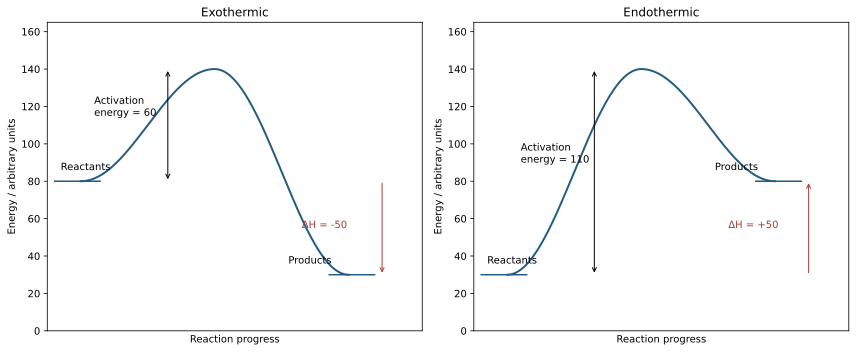
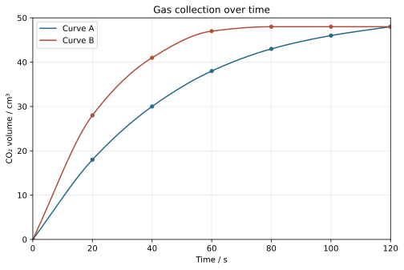
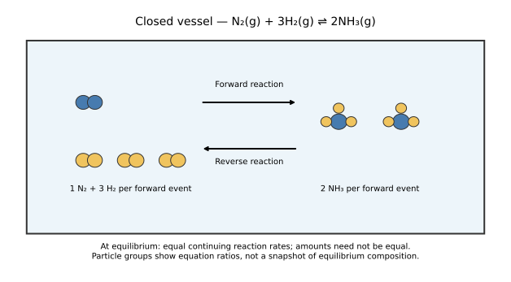

# 6 Chemical reactions

*NSSCO Chemistry 6117 — study notes. Worked examples teach methods; assessment tasks are supplied separately.*

---

## 6.1 — Chemical and physical changes

### Physical and chemical changes

A physical change alters a state, shape or arrangement without forming a different chemical substance. Ice melting remains water: the particles move differently, but the molecular identity stays H2O. A chemical change forms one or more new substances. Burning magnesium forms magnesium oxide, so the product has a different chemical composition from the starting metal. Classify by substance identity rather than by how dramatic the event looks.

Reversibility alone is not a reliable classification rule. Some chemical reactions can be reversed by changing conditions, and a physical change such as breaking a glass may be difficult to reverse in practice. Likewise, bubbles can arise from boiling or from a reaction; they do not prove chemical change without evidence of the gas identity and process. Compare properties before and after, identify a new product where possible, and explain the inference. A supplied observation should support the conclusion rather than merely repeat the word change.

### Energy accompanies reaction

Chemical reactions involve an energy change. Energy may pass from the reacting system to its surroundings or enter the reacting system from them. A temperature rise or fall is one possible observation, but energy may also be transferred as light or electrical work. A change too small for a classroom thermometer to detect does not establish that no energy change occurred.

Decide what belongs to the system before describing the energy direction. In a simple reaction mixture, a thermometer measures the mixture temperature, while the chemical process changes the energy stored in the substances. Insulation reduces transfer to the wider room and makes a temperature change easier to interpret. The distinction between the reaction and the warming water will matter when using calorimetry: heat gained by the water corresponds approximately to heat lost by an exothermic reaction, with opposite signs.

---

## 6.2 — Energetics of a reaction

### Exothermic changes

An exothermic reaction transfers energy from the reacting system to the surroundings. In a simple insulated experiment, the mixture or surrounding water usually warms, providing evidence of released thermal energy. The reaction enthalpy change is negative because the products are at a lower enthalpy than the reactants under the comparison conditions. Burning a fuel and many neutralisation reactions provide familiar examples.

Exothermic does not mean a reaction needs no starting energy. A fuel may require ignition because particles must overcome an activation-energy barrier before the reaction proceeds rapidly. After initiation, energy release may sustain further reaction. Keep this starting requirement separate from the net energy change between reactants and products. A hot starting mixture alone does not prove a reaction is exothermic: compare the observed temperature change with appropriate controls and account for external heating.

### Endothermic changes

An endothermic reaction takes in energy from the surroundings. The products have a higher enthalpy than the reactants, giving a positive enthalpy change. If the reaction draws thermal energy from an initially unheated mixture, its temperature can fall. Energy has not vanished: it has been transferred into the chemical change. Some endothermic reactions require continued heating to maintain a useful rate.

A temperature observation needs its conditions. Evaporation and other physical changes can also cool a sample, so cooling alone does not prove that a chemical reaction occurred. Establish the chemical change independently, then use the temperature evidence to infer the direction of energy transfer. An insulated container reduces exchange with the room but does not make measurement perfect; the container, thermometer and surrounding air may still exchange energy. Describe the observed change before assigning an energy sign.

### Energy profiles and activation energy

An energy profile plots energy vertically against reaction progress horizontally; the horizontal axis is not time. Label reactants and products at their respective levels. Their vertical difference is the enthalpy change, ΔH: product level minus reactant level. For an exothermic change the products lie lower and ΔH is negative; for an endothermic change they lie higher and ΔH is positive. The zero of the vertical scale may be chosen arbitrarily, so differences matter.

The profile rises to a peak representing the activation barrier. Forward activation energy is measured from the reactant level to the peak, not from zero on the page. A catalyst provides a pathway with a lower barrier but does not change the reactant or product levels and therefore does not change ΔH. In an illustrative profile with reactants at 40, peak at 100 and products at 10 kJ/mol, forward activation energy is 60 kJ/mol and ΔH is −30 kJ/mol. Label both arrows separately and do not mistake the peak height for the net reaction change.

### Breaking and forming bonds

Breaking a chemical bond requires energy input and is endothermic. Forming a chemical bond releases energy and is exothermic. A reaction usually involves both processes, so its overall energy change depends on the balance. It is incorrect to describe fuel combustion as releasing energy simply because fuel bonds break: bond breaking consumes energy, while formation of product bonds releases it.

For an exothermic reaction, the energy released on forming product bonds exceeds the energy required to break reactant bonds. For an endothermic reaction, the required input exceeds the release. Draw a clear boundary around the balanced reaction when counting bonds, because a coefficient multiplies every bond in that molecule. The separate steps are an accounting model for the overall change; they are not a claim that a reacting mixture first becomes a container of isolated atoms and then reforms all its bonds.

### Simple calorimetry

For a substance changing temperature without changing state, q=mcΔT relates transferred thermal energy to mass m, specific heat capacity c and temperature change ΔT. With mass in grams and c in J/(g °C), q is in joules. Subtract initial temperature from final temperature before substituting. Use the mass of the material being warmed, not automatically the mass of the fuel or a reactant added to it.

In simple calorimetry, heat gained by water or solution is used to estimate the reaction energy released. State assumptions: negligible heat loss, negligible heat absorbed by apparatus, and the stated heat capacity. A measured water temperature rise gives positive q for the water; the corresponding exothermic reaction has negative energy change. Converting joules to kilojoules requires division by 1000. If a temperature rise is requested instead, rearrange to ΔT=q/(mc). Report the quantity the prompt requests and avoid attaching a per-mole unit unless an amount of reaction has actually been used.

### Bond-energy estimates

Estimate a reaction energy change as total energy required to break reactant bonds minus total energy released when product bonds form. Both supplied bond-energy values are positive magnitudes, so the subtraction determines the final sign. Count bonds from displayed formulae and multiply by equation coefficients. A double bond uses its supplied double-bond energy; it is not automatically twice a single-bond value.

For H2 + Cl2 → 2HCl, one H–H and one Cl–Cl bond are broken and two H–Cl bonds form. With supplied values 436, 243 and 431 kJ/mol respectively, the estimate is 436+243−2×431=−183 kJ/mol of reaction as written. Average bond energies are estimates and need not reproduce a precise experimental enthalpy. A reverse question may give ΔH and ask for a missing bond energy: retain the coefficient multiplying that unknown when rearranging. Check that the final result has the requested sign and refers to the stated reaction amount.

### Light as an energy source

Light can supply energy needed for a chemical reaction. Photosynthesis uses light to support chemical synthesis, and silver chloride can decompose in light to form silver. A colour change in exposed silver chloride can therefore provide evidence of a light-sensitive reaction when compared with a protected sample. Light supplies energy; it is not a chemical element added to the product formula.

A controlled comparison separates light from other changes. Use equal samples, equal exposure time and comparable temperature, protecting one from light. If an intense lamp also heats one sample, the experiment cannot attribute the entire difference to light alone. Some reactions respond to particular wavelengths and conditions, so the statement does not imply that illumination speeds up every chemical reaction. Use supervised observations or supplied results for light-sensitive chemical tests, and describe the light condition alongside the outcome.

### Photosynthesis

Photosynthesis produces glucose from carbon dioxide and water in the presence of chlorophyll and sunlight. A balanced summary is 6CO2 + 6H2O → C6H12O6 + 6O2, with light and chlorophyll shown as conditions rather than reactants consumed in the equation. The process stores energy in chemical products and provides organic material used by living organisms.

Distinguish the energy input from the material inputs. Carbon in glucose comes from carbon dioxide, while water provides hydrogen and participates in the overall change. Sunlight supplies energy rather than matter. Chlorophyll enables light absorption; it is not written as a coefficient-bearing glucose ingredient. In an answer naming the requirements, include both starting substances and the light/chlorophyll conditions. This chemical summary does not require a detailed biological pathway or a claim that all absorbed light is converted into glucose.

### Reading energy profiles and extraction redox

On an energy profile, activation energy is measured from the reactant level to the peak. Reaction enthalpy change is measured from reactants to products, retaining its sign. A lower product level gives a negative change and an exothermic reaction. Do not measure activation energy from the graph’s zero unless the reactants happen to lie there. A catalyst lowers the peak for the reaction pathway without changing reactant and product levels.

During extraction, the substance removing oxygen from a metal oxide is the reducing agent. It is itself oxidised. Carbon monoxide can take oxygen from iron oxide and become carbon dioxide while iron is formed. Identify both changes from the actual equation because the role of a carbon-containing substance depends on the reaction.

### Suggested practical SP-6117-26 — Estimating energy from a spirit fuel

A teacher-controlled spirit burner can heat a measured water mass in a suitable metal calorimeter. Record the water temperature before and after and the burner mass before and after a short heating period, with the burner extinguished and safely cooled for weighing. Stir the water gently for a representative reading and use q=mcΔT to estimate energy gained by the water. Divide by fuel mass lost for an approximate energy transferred per gram. Keep the flame-to-container distance and water mass comparable across trials. Heat lost to the room, warming of apparatus and fuel evaporation limit the estimate. A shield must not restrict ventilation. Methylated spirits are flammable and harmful: trained supervision handles fuel, and a hot or burning burner must not be refilled. This gives a calorimetry estimate, not a claim that all combustion energy reached the water.

### Suggested practical SP-6117-30 — Light and silver chloride

Compare equal small teacher-prepared silver chloride samples, one exposed to light and the other protected, while keeping temperature and observation time comparable. Record initial appearance and the extent of darkening. Silver forms during photochemical decomposition, explaining the colour change; the protected sample provides a control for changes unrelated to illumination. A covered sample can also have a different temperature, so check that limitation rather than assuming the covering changes light alone. Use approved handling and waste collection under supervision. The conclusion is that this reaction responds to light, not that illumination increases the rate of every chemical process.

### Energy profiles

Separate exothermic and endothermic profiles show activation barriers and net energy changes. These labelled diagrams are answer and teaching references; attempt drawing tasks before consulting them.

---

## 6.3 — Production of energy

### Burning fuels

A fuel releases useful energy when it reacts, commonly by burning in oxygen. Complete combustion of a hydrocarbon forms carbon dioxide and water and transfers energy to the surroundings. A stove or heater directs some of this transfer into an intended use, such as warming water. The useful fraction is less than the total release because surrounding air and apparatus also warm.

Fuel choice involves more than whether a flame is visible. Compare energy delivered, supply, cost and unwanted products under the same purpose and conditions. Limited oxygen can lead to incomplete combustion and hazardous carbon monoxide, while solid soot may indicate incomplete burning. Do not infer a fuel's energy content from flame colour alone. In a calorimetry comparison, measure mass consumed as well as water temperature change; burning twice as much fuel does not establish that it releases more energy per gram.

### Nuclear energy sources

Radioactive isotopes can be sources of energy through changes in their nuclei. Uranium-235 is used as a nuclear fuel: controlled nuclear fission releases energy that heats a working system, which can be used to generate electricity. This is a nuclear process, not combustion of uranium in oxygen and not a rearrangement of outer electrons in chemical bonds.

A description at this level identifies the isotope, the nuclear origin of the energy and its useful transfer. Compare it with a chemical fuel without claiming that both release energy by the same bond changes. Nuclear generation does not require burning a carbon fuel during the energy-releasing process, but radioactive materials and waste require controlled management. Do not use the absence of carbon dioxide from the fission step to conclude that construction, fuel preparation and the whole energy system have no environmental effects.

### Simple chemical cells

A simple chemical cell can produce electrical energy from a spontaneous chemical reaction using two suitable different electrodes in an electrolyte. The electrode materials and electrolyte must support complementary reactions. Electrons travel through the external connection, while ions carry charge in the electrolyte. A complete circuit permits current to flow through a load, such as a small suitable meter.

This arrangement differs from an electrolytic cell driven by an external power supply. In a generating cell, the chemical reaction supplies the energy for electron flow; in electrolysis, electrical energy drives a chemical change. Both involve oxidation and reduction, but do not transfer an electrode-sign rule from one case without checking the cell type. Electrolysis products also depend on an aqueous or molten electrolyte and on whether an inert electrode or an active copper electrode is used. Comparing different metals in an identical electrolyte can show that the electrode pair matters. Keep immersion depth, contact quality and solution conditions consistent; a weak or unstable reading can reflect the apparatus rather than prove no chemical change is possible.

### Cleaner energy sources

Solar, wind and hydroelectric generation can provide useful energy without burning a fuel at the point of generation. Solar cells convert light to electricity, wind turbines use moving air, and hydroelectric systems use moving water. Calling a source cleaner usually compares particular emissions or impacts; it does not mean the system has no materials, land or maintenance requirements.

Match a source to the conditions needed for operation. Solar output depends on available light, wind output on wind conditions, and hydroelectric output on suitable water flow and infrastructure. Storage or a combination of sources may help when output varies. A comparison should name both the benefit and its boundary: reduced combustion emissions during generation do not quantify the full lifecycle impact. Avoid treating renewable and continuously available as synonyms. A renewable flow can vary through a day or season.

### Solar cells

Solar cells produce electrical energy from sunlight. The input is light, and the useful output is electrical energy. A solar water heater has a different immediate output, transferring energy to water as heat. Both may use sunlight, so identify the device by its conversion rather than by the general word solar.

A small classroom cell connected to a meter can show how output changes with illumination. Compare exposure while keeping the circuit, orientation and load consistent, and distinguish a qualitative demonstration from an efficiency measurement. No fuel is consumed by combustion in the cell during generation, but energy conservation still applies: the electrical output comes from the incoming light. At night without another light source, the same device cannot generate from absent sunlight; a system providing power then must draw on storage or another supply.

### Hydrogen fuel cells

A hydrogen fuel cell reacts hydrogen with oxygen to generate electricity, producing water overall. The summary equation is 2H2 + O2 → 2H2O. It is useful to distinguish this electrochemical conversion from simply burning a hydrogen flame to heat water. At this level, the reactants, useful electrical output and water product explain its role; internal construction detail is unnecessary.

Hydrogen is an energy carrier whose environmental impact depends partly on how it was produced and transported. Water as the product at the fuel cell does not establish that producing the hydrogen emitted no greenhouse gases. A balanced evaluation names the point-of-use benefit and the production limitation without introducing an unsupported numerical efficiency. Compare a hydrogen fuel cell with a fossil-fuel combustion source for a specified purpose, retaining the boundary of the comparison. Both require an available supply of suitable reactants to continue operating.

---

## 6.4 — Rate of reaction

### Rate is change per time

Rate of reaction measures the change in a reactant or product quantity per unit time. Depending on the observation, it can be expressed as gas volume per second, mass lost per second or concentration change per second. An average rate uses a stated interval: change in the measured quantity divided by elapsed time. A total gas volume alone measures an amount of product, not a rate.

On a product-volume against time graph, gradient represents the rate of volume production. A steeper curve indicates faster production at that time. A flattening curve has a declining rate, and a plateau means no further measured gas is being collected. Distinguish the curve's final height from its steepness: two reactions may give the same final gas amount but reach it at different times. Conversely, a larger final volume need not imply a larger initial rate. State both the measured quantity and time interval when comparing results.

### Catalysts

A catalyst increases the rate of a chemical reaction and is chemically unchanged at the end. It participates in the reaction pathway rather than standing outside the process, but is regenerated overall. It may change physically, for example through a change in particle size, without having been consumed as a reactant. A small amount can therefore influence the conversion of a larger amount of reactant.

A catalyst is specific to a useful pathway and does not make every reaction faster. It changes how rapidly equilibrium is approached but does not alter the equilibrium position or the energy difference between reactants and products. In a comparison, keep other conditions fixed and measure rate rather than assuming a larger final amount means catalytic action. Recovery of the catalyst helps test the definition, but unchanged mass alone is not proof of unchanged chemical identity. Link the observation to both rate increase and regeneration.

### Lower activation energy

A catalyst provides an alternative reaction pathway with a lower activation energy. At the same temperature, a greater fraction of particle encounters can lead to successful reaction along that pathway. It does not increase the particles' average kinetic energy by definition; heating and catalysis are different ways to change reaction rate.

On an energy profile, represent the catalysed pathway with a lower peak while leaving the reactant and product levels unchanged. Both pathways connect the same starting and ending substances. The vertical distance from reactants to the lower peak is the reduced activation energy. The energy change ΔH remains the same, so a catalyst cannot turn an endothermic reaction into an exothermic one. When explaining an observed speed increase, name the alternative pathway and lower barrier instead of claiming that the catalyst simply adds heat.

### Inhibitors

An inhibitor is a substance that reduces the rate of a chemical reaction. The term describes its effect on the rate, not a claim that it permanently stops every reaction. Some applications seek slower unwanted change, such as reducing a damaging reaction during storage. Whether an inhibitor is useful depends on the specified reaction and conditions.

Distinguish an inhibitor from dilution or cooling, which are changes in conditions rather than necessarily added inhibiting substances. In an investigation, compare the same reacting system with and without the candidate substance while keeping other variables constant. If addition also changes concentration or temperature, those changes may explain a lower rate. Measure the rate consistently and use a control before concluding that inhibition occurred. Do not infer the detailed molecular mechanism simply from the word inhibitor; that would require further evidence.

### Concentration and collisions

For a reaction involving dissolved particles, increasing concentration commonly increases rate when other relevant conditions are fixed. More reactant particles occupy each unit volume, increasing the frequency of encounters with other reacting particles or a reacting surface. More frequent successful collisions can produce more product per second. The explanation is about particle number per volume, not particles becoming larger or necessarily moving faster.

Compare concentration effects at the same temperature, with the same solid mass and exposed area where a solid reacts. If more concentrated solution also contains more total limiting reactant, the final product amount may change as well as the rate. Separate those consequences: use excess solution with a fixed limiting solid to compare rates while keeping the theoretical total gas similar. Concentrated and dilute describe amount per volume; strong and weak acids describe ionisation extent. Compare concentrations of the same acid, rather than confusing acid strength with concentration. The concentration rule is conditional and does not imply direct proportionality for every chemical system.

### Gas pressure and rate

Increasing the pressure of gaseous reactants by compressing them at constant temperature brings more particles into each unit volume. Their collision frequency increases, which can increase the reaction rate. This explanation applies to reacting gases; increasing pressure around a solid does not automatically create the same concentration effect. The temperature condition prevents a separate kinetic-energy change from being confused with compression.

Distinguish the effect on rate from the effect on equilibrium composition. Compression may speed reactions through more frequent gas collisions, while an equilibrium shift depends on the numbers of gaseous particles on the two sides of the equation. An equation with equal gas amounts on both sides can have no pressure-driven equilibrium shift even though collision rates change. When answering a rate question, state the gas-concentration and collision link; do not replace it with a yield argument unless equilibrium composition is actually requested.

### Particle size and exposed area

Breaking a solid into smaller pieces increases its total exposed surface area without changing its total mass. For a reaction occurring at the solid surface, more reactant can contact the solid at once, increasing the frequency of successful surface collisions. Powder can therefore react faster than the same mass of large chips under otherwise comparable conditions.

Do not describe the solid's individual atoms as becoming smaller. The pieces contain fewer particles each, and more of the original particles are exposed at surfaces. A fair test keeps solid composition and mass, liquid concentration and volume, and temperature fixed. Where the solid is the limiting reactant and reacts completely, changing size need not change the final gas amount. It changes the time taken to reach that amount. Settling, clumping or incomplete mixing may complicate a real powder comparison and should be considered when observations depart from the simple model.

### Catalysts and successful collisions

A catalyst changes the available reaction pathway so that the activation-energy barrier is lower. At the same temperature, more collisions have enough energy to lead to reaction along this pathway. The resulting increase is in successful reaction events per unit time, not necessarily in the total number of collisions between particles.

A suitable inorganic catalyst or an enzyme can show this effect, but suitability depends on the reaction and conditions. Keep catalyst identity separate from concentration and temperature. A demonstration with a catalyst and a hotter uncatalysed mixture cannot isolate the catalyst effect without additional controls. The catalyst is regenerated chemically and does not change the overall energy difference between reactants and products. For a reversible reaction it accelerates both directions, helping equilibrium be reached sooner without shifting the equilibrium composition at a fixed temperature.

### Temperature and collision energy

Raising temperature increases particles' average kinetic energy. They move faster and collide more frequently, but the especially important effect is that a greater fraction of collisions have enough energy to overcome the activation barrier. Together these changes commonly increase the reaction rate. Lowering temperature reverses these tendencies under comparable conditions.

An explanation should not say that every collision becomes successful or that activation energy itself falls when a mixture is heated. The barrier belongs to the pathway; heating changes the distribution of particle energies. A catalyst, by contrast, changes the pathway. In a controlled experiment, warm reactants to a measured starting temperature and maintain comparable conditions during the reaction. If heat is released or absorbed, the mixture may not stay at its initial temperature, and that is a limitation when comparing trials.

### Light-sensitive reactions

For a light-sensitive reaction, absorbed light can provide energy needed to initiate chemical change. Increasing suitable illumination may increase the rate when other factors are fixed. Silver chloride darkening in light is an example. This is not simply the same claim as increasing the temperature: absorbed photons can drive a light-dependent process even when bulk temperature is controlled.

Apply the condition explicitly. Light does not accelerate every reaction, and increasing illumination may cease to be the limiting factor. A comparison should control temperature, sample size, exposed area and observation time. Shield one sample as a reference and record the change consistently. If the light source heats the sample, separate that thermal effect before attributing a faster change to illumination. Do not force every rate factor into the phrase more collisions; for light, explain the energy supplied to the relevant photochemical process.

### Enzymes

Enzymes are proteins that act as biological catalysts in organic reactions. They increase rate while being regenerated chemically, but their activity depends on suitable conditions. Their protein structure gives them a functional shape, so the response to temperature cannot be extended indefinitely from the simple rule that heating increases rate.

At sufficiently high temperatures, an enzyme can lose its functional structure and activity. This differs from an inorganic catalyst merely operating faster at a higher temperature. A classroom enzyme investigation should keep enzyme amount, substrate amount and pH comparable when testing temperature. Use controlled observations to distinguish an initial rate change from a loss of activity. The term enzyme identifies a protein catalyst, not the reactant consumed to make the product, and not a source of extra product atoms.

### Combustible dust

A combustible material dispersed as fine powder has a large exposed surface compared with an equal mass in a compact piece. If suspended in air, much of that surface can contact oxygen. Ignition can then lead to rapid combustion and energy release, creating an explosion hazard in settings such as flour handling or coal dust accumulation. The hazard requires a combustible dust and suitable conditions; not every powder burns.

The chemical explanation connects exposed area, contact with oxygen and rapid reaction. Do not attempt to demonstrate a dust explosion in ordinary learner work. Use teacher-provided observations or diagrams and discuss prevention conceptually, such as avoiding dust accumulation and ignition sources. A pile and a suspended cloud of the same substance need not behave alike because oxygen access differs. This example applies collision reasoning to a real consequence without suggesting that changing particle size changes the chemical identity of the fuel.

### Investigating rate

Choose a measurable change that follows reaction progress, such as gas collected or mass lost, and record it against time. To investigate acid concentration with carbonate, change concentration while keeping carbonate mass and particle size, acid volume and temperature constant. Use enough acid in each trial to remain in excess if the aim is to compare rates at the same limiting solid amount.

Start timing consistently at mixing, minimise gas lost during assembly, and ensure a collection syringe moves freely. Record several points, repeat trials and compare gradients or average rates over equivalent intervals. A final volume alone cannot establish a rate difference. Identify leaks, timing delay and changing temperature as possible limitations. Eye protection and teacher supervision are needed, and gas must have an unobstructed path into the collection device rather than a rigid sealed container. A fair method explains both what changes and what is held constant.

### Interpreting rate data

Read the axis labels before interpreting a rate graph. On a gas-volume against time graph, gradient measures gas production per time, while height measures gas collected. For a mass-remaining graph, the gradient may be negative; its magnitude indicates the speed of loss. Use the physical quantity and unit to explain what the slope means rather than applying a memorised shape without context.

For supplied observations of 18 cm³ at 20 s and 38 cm³ at 60 s, average gas-production rate is (38−18)/(60−20)=0.50 cm³/s. This is an interval average, not necessarily the instantaneous rate at either endpoint. A plateau can support completion of the measured gas evolution, but check for leaks or a blocked collection device before concluding the reaction itself stopped. Compare final amounts only after the curves have levelled off. When one curve is still rising, its latest reading is not yet proven to be its final yield.

### Worked example: extracting rates from a gas-volume record

A carbonate reacts with excess dilute acid. A gas syringe records 0, 12, 21 and 27 cm³ at 0, 15, 30 and 45 seconds. The first interval rate is (12 − 0)/(15 − 0) = 0.80 cm³/s. The next is (21 − 12)/15 = 0.60 cm³/s. The decreasing increases in volume show that the rate is falling even while total gas volume is rising.

Plot cumulative gas volume against time. The slope represents the gas-production rate; the height is total gas collected. A flatter curve is not negative gas production. For an instantaneous rate, draw a tangent at the required time and find its gradient using a large, clearly marked triangle. A difference between two widely separated readings gives an interval average, not the tangent rate.

To compare particle size, use equal masses of the same carbonate, the same acid concentration and excess volume, and matched temperature. Start timing consistently when reactants are brought together. A leak or delay in fitting the bung can lower the measured volume without changing the chemistry, so check the apparatus and use a consistent starting method. Draw a gas-tight flask-to-syringe connection with no sealed outlet blocking the evolving gas. Repeat trials before deciding that a small difference is reliable. The model prediction is a steeper early curve for greater exposed surface area; equal amounts of the limiting reactant should give the same final gas amount under matched collection conditions.

Choose the operation and instrument to match the measured quantity; keep sample identity clear and use separate clean portions when reagents could interfere. Record quantities and units in table headings and calculate changes by final reading minus initial reading before calculating a rate or ratio. Label graph axes with quantities and units, plot measured points on suitable scales, and distinguish an interval gradient from an instantaneous tangent gradient. A fair investigation specifies the changed variable, measured outcome, controls, repeats, relevant precautions and the comparison used for its conclusion.

### Suggested practical SP-6117-27 — Comparing rates with dilute acid

Under teacher supervision, react equal masses of carbonate chips with equal volumes of dilute acid at several concentrations, each chosen to leave acid in excess. Collect carbon dioxide in a gas syringe and record volume at fixed intervals, starting consistently at mixing. Keep particle-size range and temperature constant. Plot volume against time and compare early gradients; the larger gradient indicates faster measured gas production. Repeat trials to judge spread and check for leakage or delayed collection. A metal–acid alternative produces hydrogen, so ignition sources must be excluded and product identity distinguished. Keep the gas outlet unobstructed. Explain a concentration effect by particle encounters rather than claiming that a larger endpoint alone proves a faster reaction.

### Suggested practical SP-6117-29 — Two catalyst demonstrations

In a teacher-supervised comparison, manganese(IV) oxide increases oxygen evolution from hydrogen peroxide compared with a matched control. Record gas production over equal intervals; the catalyst is regenerated, and the reaction is 2H2O2 → 2H2O + O2. A separate teacher demonstration uses a cobalt(II) salt to catalyse oxidation of tartaric acid or tartrate by hydrogen peroxide. A pink-to-green-to-pink sequence and faster gas evolution illustrate temporary participation followed by regeneration; the returning colour supports, but alone does not prove, chemical regeneration. This needs peroxide as a reacting substance rather than heating tartaric acid alone. Compare matched starting mixtures and temperatures; use recorded observations where suitable facilities are unavailable. The cobalt demonstration includes carbon dioxide and oxygen evolution, so bubbling is not a specific gas test. The observation sequence is checked against the [University of Western Australia teaching guide](https://www.uwa.edu.au/science/-/media/Faculties/Science/Docs/Teacher-Guide---Controlling-reactions.pdf). Detailed intermediate structures are outside this lesson.

### Gas-production curves

chip and powder data distinguish initial gradient from final gas volume. These labelled diagrams are answer and teaching references; attempt drawing tasks before consulting them.

---

## 6.5 — Reversible reactions

### Reversible reactions

Some chemical reactions can proceed in either direction when conditions change. Heating blue hydrated copper(II) sulfate removes water of crystallisation and leaves white anhydrous copper(II) sulfate. Adding water can restore the blue hydrated form. Hydrated cobalt(II) chloride is pink, while the anhydrous form is blue. These changes demonstrate chemical reversibility, not simply a solid melting and freezing.

Use a reversible arrow when representing the forward and reverse changes. For copper(II) sulfate, CuSO4·5H2O ⇌ CuSO4 + 5H2O summarises hydration and dehydration under appropriate conditions. Gentle teacher-controlled heating is needed; excessive heating can produce further chemical changes outside the intended comparison. Reversibility does not mean both directions proceed at the same rate under every condition. It means the reverse chemical process is possible, while equilibrium requires a suitable closed system and stable conditions.

### Dynamic equilibrium

Dynamic equilibrium is the state in a closed system where forward and reverse reaction rates are equal, so reactant and product concentrations remain constant. The word dynamic matters: both reactions continue. Constant concentrations do not imply that the amounts of reactants and products are equal, nor that particles have stopped reacting.

Imagine a reversible reaction initially containing mostly reactants. The forward reaction creates products, which can then react in reverse. At equilibrium, the two rates balance. If a molecule changes into product, another event can convert product back, maintaining the macroscopic composition. The equality concerns rates, not individual particle identities. A graph of concentrations can therefore flatten while molecular changes continue. State the closed-system condition because loss of a gaseous component can prevent the required balance from being maintained.

### Why a closed system matters

A reversible reaction can reach dynamic equilibrium in a closed system, where relevant substances cannot escape or enter. Stable temperature and other conditions permit a steady balance between the forward and reverse processes. If a gas product escapes, its removal changes the composition and can keep driving further forward reaction rather than preserving the original equilibrium.

A closed system is not the same as an insulated system. Closed concerns material exchange, while insulation concerns energy transfer. A closed reaction vessel may still exchange heat with its surroundings. This distinction helps separate equilibrium reasoning from calorimetry. A sealed classroom vessel must not be improvised for a gas-generating reaction; equilibrium descriptions are conceptual or use appropriate controlled equipment. When explaining a constant composition, refer to equal reaction rates rather than claiming that the reaction has ceased.

### Changing concentration at equilibrium

Changing the concentration of a component disturbs a chemical equilibrium. The system responds in the direction that tends to oppose the imposed concentration change. Adding a reactant commonly favours its consumption and increases the equilibrium amount of product; removing a product also favours further product formation. State temperature as fixed when isolating a concentration effect.

The response is partial rather than magical cancellation. Adding reactant does not mean every added particle is consumed, and the new equilibrium need not have the same concentrations as before. Identify the species changed, the side on which it appears and the direction that uses it up or replaces it. In a supplied symbolic reaction A + B ⇌ C, adding B at fixed temperature favours C formation, while removing A favours the reverse direction. The reasoning follows the stated equation, not the left-to-right layout of a memorised example.

### Changing temperature at equilibrium

Increasing temperature favours the endothermic direction of a reversible reaction, while decreasing it favours the exothermic direction. Establish which direction the supplied ΔH describes before predicting a shift. For a forward exothermic reaction, warming favours the reverse reaction and can reduce the equilibrium product proportion even though reactions proceed faster.

This distinction between rate and equilibrium yield is essential. A hotter process may reach equilibrium sooner but have a less favourable equilibrium composition for a desired product. Conversely, cooling can favour an exothermic product while making approach to equilibrium slow. A prediction should specify the temperature change, the favoured thermal direction and the resulting composition change. Do not use the sign of ΔH without explaining that negative means the forward direction releases energy and positive means it absorbs energy.

### Changing pressure at equilibrium

For a gaseous equilibrium, increasing pressure by compression favours the side with fewer moles of gas. Decreasing pressure favours the side with more moles of gas. Count the gas coefficients in the balanced equation; solid and liquid amounts do not enter this simple gas-count comparison. If both sides contain equal gas amounts, compression produces no equilibrium shift in this model.

For N2(g) + 3H2(g) ⇌ 2NH3(g), four moles of gaseous reactants correspond to two moles of gaseous product. Increased pressure at fixed temperature therefore favours ammonia. Explain both the direction and gas-count basis, rather than saying pressure always favours products. Reversing how the equation is written reverses the words left and right but not the physical conclusion. Pressure questions must retain the gas-state condition and distinguish equilibrium composition from the separate collision-frequency effect on rate.

### Suggested practical SP-6117-28 — Dehydration and rehydration

Use teacher demonstrations or recorded observations of small hydrated-salt samples. Gentle heating changes hydrated copper(II) sulfate from blue to white; adding water to the cooled anhydrous salt restores blue. Hydrated cobalt(II) chloride changes from pink to blue on dehydration, with the reverse colour change on hydration. Record the starting colour, change during heating and change after water addition in separate columns. Avoid excessive heating, which may introduce further changes. Cobalt salts require controlled handling and disposal, so this is not an unsupervised learner procedure. Explain the observations by loss and return of water of crystallisation, and distinguish reversibility from evidence of equilibrium in an open test tube.

### Closed-system equilibrium

Equal forward and reverse rates do not require equal reactant and product amounts. These labelled diagrams are answer and teaching references; attempt drawing tasks before consulting them.
## 6.6 — Redox

### Oxidation

Oxidation can be defined as gain of oxygen or loss of electrons. The electron definition applies to reactions where oxygen is absent, such as Mg → Mg²⁺ + 2e⁻. Magnesium loses two electrons, so it is oxidised. When magnesium burns to form magnesium oxide, it gains oxygen and loses electrons; both definitions identify oxidation in that example.

Write electrons on the product side of an oxidation half-equation and check the total charge. Mg on the left is neutral; Mg²⁺ and two electrons on the right have a total charge of zero. Do not confuse losing negative electrons with becoming more negative: electron loss makes the resulting ion more positive. Oxygen gain is a useful visible chemical pattern, but a reaction need not contain oxygen to be redox. The wider electron definition connects this topic to electrode reactions and displacement.

### Reduction

Reduction can be defined as loss of oxygen or gain of electrons. Copper(II) ions are reduced in Cu²⁺ + 2e⁻ → Cu because they gain electrons. Copper(II) oxide can be reduced by removing oxygen to form copper. In a suitable reaction, the oxygen removed is accepted by another substance, linking reduction with oxidation of that substance.

Place electrons on the reactant side of a reduction half-equation and verify charge balance. A positive ion gaining enough electrons may form a neutral atom, but not every reduction produces a neutral substance: Fe³⁺ + e⁻ → Fe²⁺ is also reduction. Its ionic charge decreases because a negative electron has been gained. Relate charge changes to actual electron transfer rather than assuming that a smaller positive number means fewer electrons. This makes unfamiliar ionic examples easier to classify.

### Recognising redox from charge

Changes in ionic charge can show electron transfer. An increase from Fe²⁺ to Fe³⁺ represents loss of an electron and oxidation; a decrease from Fe³⁺ to Fe²⁺ represents gain and reduction. In a complete redox reaction, electrons lost by one species are gained by another, so the electron transfers balance overall.

Compare the same element before and after reaction and distinguish its ionic charge from a formula subscript. The 2 in MgCl2 counts chloride ions in a formula unit; it is not a charge on magnesium written by itself. Where half-equations are supplied, locate the electrons and check atoms as well as charge. A reaction such as ion exchange without a change in the relevant ionic charges is not identified as redox simply because ions are present. The evidence must be a transfer of electrons.

For the supplied reaction Zn + Cu²⁺ → Zn²⁺ + Cu, separate the changes. Zinc becomes Zn²⁺ by losing two electrons: Zn → Zn²⁺ + 2e⁻. Copper(II) ions gain those electrons: Cu²⁺ + 2e⁻ → Cu. Adding the half-equations cancels two electrons on each side and gives the stated overall equation. There is one zinc atom and one copper atom on both sides, and total charge is +2 on both sides. These checks establish balanced transfer; a half-equation with just one electron for Zn²⁺ would fail the charge check.

### Oxidising and reducing agents

An oxidising agent causes another substance to be oxidised and is itself reduced. It accepts electrons in the electron-transfer description. A reducing agent causes another substance to be reduced and is itself oxidised, donating electrons. Name the agent from what it does to its reaction partner, while checking the change it undergoes itself.

For CuO + H2 → Cu + H2O, hydrogen removes oxygen from copper(II) oxide and is the reducing agent; hydrogen is oxidised to water. Copper(II) oxide supplies oxygen to hydrogen and is the oxidising agent; it is reduced to copper. In a supplied ionic displacement, the metal losing electrons is the reducing agent and the ion gaining them is the oxidising agent. Do not label the final metal product as the reducing agent merely because it was formed by reduction. The agent belongs to the reacting substance that causes the partner's change.

In that zinc–copper example, zinc is the reducing agent because it provides the electrons that reduce Cu²⁺. The Cu²⁺ ion is the oxidising agent because it accepts the electrons lost by zinc. Name the reacting ion rather than the spectator sulfate ion if the solution happens to be copper(II) sulfate. A useful answer sequence is to identify the electron loss, identify the matching gain, and then assign the agents. This prevents the common reversal between the agent name and the change the agent itself undergoes. The reducing agent is oxidised; the oxidising agent is reduced. These paired descriptions are consistent, not contradictory.

### Connections

Connect this topic to particle models, stoichiometry and electrochemistry. Keep energy direction, collision rate and equilibrium composition distinct; interpret each using the stated conditions and measured quantity.

---

