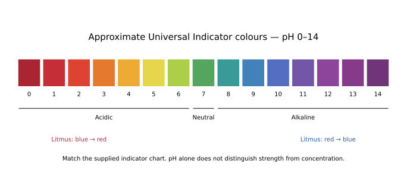
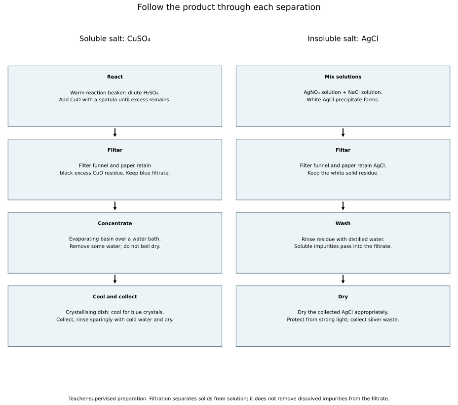

# 7 Acids, bases and salts

*NSSCO Chemistry 6117 — study notes. Worked examples teach methods; assessment tasks are supplied separately.*

---

## 7.1 — The characteristic properties of acids and bases

### Acids as proton donors

An acid is a proton donor in the aqueous proton-transfer model used here. A proton is represented by H⁺. Hydrochloric acid donates protons in water, giving the characteristic reactions of its aqueous solution. The definition concerns transfer to another species, rather than a sour taste or a hazard label. Tasting chemicals is not an identification method.

Keep acid strength separate from concentration. A strong acid ionises completely in aqueous solution; a weak acid ionises partially. Concentrated and dilute describe the amount of dissolved acid per solution volume. A strong acid can be dilute, and a weak acid can be concentrated. The pH depends on the resulting hydrogen-ion concentration, which is influenced by both strength and total acid concentration. Define the acid by proton donation first, then state these separate descriptors where the question supplies them.

### Bases as proton acceptors

A base is a proton acceptor in the aqueous proton-transfer model used here. Hydroxide ions accept protons to form water: H⁺ + OH⁻ → H2O. Ammonia can also accept a proton in water to form ammonium, showing that a base need not have OH written in its original molecular formula. Identify the species accepting the proton rather than treating every hydrogen-containing substance as an acid.

The acid and base roles belong to a particular proton-transfer reaction. In the familiar neutralisation of aqueous hydrochloric acid by sodium hydroxide solution, the relevant reacting species are H⁺ and OH⁻. Sodium and chloride ions remain in solution as spectators. Writing the ionic change helps distinguish proton transfer from an unrelated reaction such as a metal losing electrons. Keep this lesson within aqueous examples; more general solvent chemistry is unnecessary for the stated syllabus model.

### Bases and alkalis

An alkali is a water-soluble base that gives hydroxide ions in aqueous solution. Sodium hydroxide is an example. Base is the broader category: an insoluble basic oxide such as copper(II) oxide can react with acid but is not an alkali. Solubility therefore distinguishes an alkali from a base that does not dissolve sufficiently to make the corresponding alkaline solution.

Do not infer solubility from the ability to neutralise an acid. An acid can react with an insoluble solid at its surface, gradually using it up. This distinction determines salt-preparation methods: excess insoluble base can be filtered away, whereas an excess soluble alkali cannot be removed by ordinary filtration. State the water-solubility condition when explaining the category. A comparison between copper(II) oxide and sodium hydroxide should connect the naming difference to practical behaviour rather than merely memorising two examples.

### Indicators

Indicators give different colours under different acid–alkali conditions. An acidic solution turns blue litmus red, while an alkaline solution turns red litmus blue. A neutral solution does not produce either of those opposite-colour changes. Litmus identifies broad categories, whereas Universal Indicator provides an approximate pH by comparison with the colour chart supplied for that indicator.

Use separate small samples and clean equipment so the indicator test does not contaminate the main preparation. Record the observed colour before inferring acidic or alkaline. A coloured sample may obscure the indicator, and Universal Indicator gives an estimate rather than an exact concentration. Its familiar progression is red/orange/yellow in acidic regions, green near neutral and blue/purple in alkaline regions, with exact shade boundaries checked against the supplied chart. Do not use indicator colour alone to identify a particular acid or prove its degree of ionisation.

### The pH scale

For the usual room-temperature school scale, pH 7 is neutral, values below 7 are acidic and values above 7 are alkaline. Within the stated 0–14 range, a lower pH indicates greater acidity and a higher pH greater alkalinity. This syllabus uses whole-number readings, so match a Universal Indicator colour to the nearest supported whole-number value rather than inventing decimal precision.

A pH comparison describes the solutions as tested. It does not by itself give the total amount of acid available for reaction or identify the acid species. Two samples with the same pH can have different total acid concentrations if their ionisation behaviour differs. Similarly, a large volume of dilute acid can contain more total acid than a small concentrated sample. Keep pH, concentration and total amount as separate quantities. Compare colours with the relevant chart under suitable lighting and acknowledge ambiguous matches.

### Comparing alkaline samples

Universal Indicator can compare the alkalinity of supplied soap solution, limewater and sodium hydroxide samples. A sample matching pH 10 is alkaline, while one matching pH 13 has a higher hydroxide-ion concentration under the comparison conditions. This is a comparison of measured solutions, not proof that the lower-pH substance is partially ionised. Concentration and solubility can affect the result as well as intrinsic base strength.

Limewater is aqueous calcium hydroxide. Its limited solubility must not be mistaken for weak dissociation of the dissolved portion. The syllabus groups it with weakly alkaline examples, but this should be read as a classroom comparison of samples rather than a chemically precise definition of weak base. Sodium hydroxide solution itself can have a lower pH when sufficiently diluted. Report the actual indicator observation and pH, then explain the limits of what that evidence establishes. Ammonia solution is a clearer example of a weak base when teaching partial formation of ions in water.

### Comparing acidic samples

A supplied lemon-juice sample and hydrochloric acid can both give acidic Universal Indicator colours. Lemon juice contains weak acids, whereas hydrochloric acid is a strong acid. At a suitable matched acid concentration, a strong acid generally produces a higher hydrogen-ion concentration than a weak acid, giving a lower pH. The comparison needs the concentration condition; the names alone do not fix the pH of an arbitrary sample.

For observed samples at pH 3 and pH 1, both are acidic and the pH 1 sample is more acidic as tested. It is not valid to conclude from that observation alone that every pH 3 solution contains a weak acid. A dilute strong-acid solution can have that reading. Distinguish evidence about pH from evidence about ionisation, and do not assign an invariant pH to lemon juice, whose composition and dilution vary. Use whole-number readings consistent with the indicator chart.

### Acids and reactive metals

A suitable reactive metal reacts with a dilute non-oxidising acid to form a salt and hydrogen. Magnesium with dilute hydrochloric acid gives magnesium chloride and hydrogen: Mg + 2HCl → MgCl2 + H2. Bubbles indicate gas evolution, while an appropriate small-sample hydrogen test gives a squeaky pop with a lighted splint under supervision.

The conditions matter. Copper does not produce hydrogen from dilute hydrochloric acid in the same way, so avoid writing that every metal reacts with every acid. Nitric acid has different oxidising behaviour and is not the basis of this general hydrogen pattern. Describe the metal disappearing and gas forming as observations, then identify the products from the reaction and test. Keep hydrogen away from ignition sources during collection; the controlled test uses a separate small sample. The salt name follows the acid's anion and the reacting metal.

### Acids and bases

An acid reacts with a suitable base to form a salt and water. A metal oxide such as copper(II) oxide consumes acid as the solid reacts, while a soluble hydroxide supplies hydroxide ions directly in solution. For hydrochloric acid and sodium hydroxide, HCl + NaOH → NaCl + H2O. The aqueous hydrogen and hydroxide ions combine to form water.

A neutralisation reaction can occur without the final mixture being neutral. If acid or alkali is left in excess, the mixture retains its corresponding acidic or alkaline character. Even at a stoichiometric endpoint, the salt can affect pH outside the simple strong-acid/strong-alkali example. For this level, identify the reactants and products and avoid saying that adding any amount of base instantly makes any acid pH 7. Controlled quantities and an appropriate endpoint matter when preparing a pure soluble salt.

### Acids and carbonates

An acid reacting with a metal carbonate forms a salt, water and carbon dioxide. Calcium carbonate with hydrochloric acid gives CaCO3 + 2HCl → CaCl2 + H2O + CO2. Effervescence accompanies gas production, but identify carbon dioxide using a test rather than calling every colourless gas carbon dioxide.

Bubble a small gas sample through limewater; it turns milky or cloudy as a white calcium carbonate precipitate forms. Name both the reagent and observation. Carbon dioxide itself is colourless, so saying the gas turns white confuses the gas with the precipitate in the test solution. A carbonate sample may dissolve as it is consumed, but any excess solid or insoluble impurities can remain. The acid selected determines the salt anion, and the product solubility influences whether this reaction is convenient for preparing a particular salt.

### Recognising proton transfer

To explain a supplied aqueous reaction as acid–base, identify the proton donor and the proton acceptor. In H⁺ + OH⁻ → H2O, the proton is accepted by hydroxide. In NH3 + H⁺ → NH4⁺, ammonia accepts a proton to become ammonium. These examples show the transfer directly without requiring a metal hydroxide formula in every base.

Check atoms and charge in the ionic description. The hydroxide example has total charge zero on each side, while ammonia plus H⁺ has total charge +1, matching NH4⁺. Proton transfer is different from electron transfer: a species becoming positively charged does not by itself prove oxidation. Ammonia gaining H⁺ is an acid–base event in this model, not a loss of an electron. Use the stated reacting species to support the classification and avoid deciding solely from the word hydrogen appearing somewhere in the equation.

### Strength and ion formation

A strong acid ionises completely in aqueous solution, while a weak acid ionises only partially. For bases, a strong soluble hydroxide such as sodium hydroxide gives its dissolved ions essentially completely; a weak base such as ammonia reacts with water only partly to produce hydroxide ions. The central distinction is the extent of ion formation under the relevant conditions, not the amount placed in a bottle.

Use matched concentrations when comparing the effect of strength on pH or electrical conductivity. A weak acid solution contains both un-ionised acid and ions; it is not an ion-free liquid. Diluting it reduces the total acid amount per unit volume even though the fraction ionised may change. At this level, qualitative particle descriptions are enough. Do not confuse a sparingly soluble strong hydroxide with a weak molecular base: limited dissolution and partial ionisation are different limitations on the ion concentration.

### Concentration and dilution

Concentration describes dissolved substance per unit volume of solution. For comparable samples of the same strong acid, a more concentrated sample contains more H⁺ ions per dm³; for the same strong alkali it contains more OH⁻ ions per dm³. This comparison holds the substance and ionisation behaviour fixed. Across different acids or bases, total dissolved concentration cannot be replaced by an ion count without considering strength.

Dilution adds water and increases total solution volume without adding solute. The same solute amount is spread through a larger volume, lowering concentration. A dilution does not turn hydrochloric acid from a strong acid into a weak acid, because those words describe ionisation rather than amount per volume. State the species and comparison conditions when linking concentration to hydrogen or hydroxide ions. A claim about the total number of ions in a whole container also requires the container volume, not just the concentration.

### Why pH needs two descriptors

The pH of an acid or alkali solution depends on both its strength and its concentration. Strength determines how extensively the dissolved species produces ions, while concentration describes how much dissolved substance is present per volume. The resulting H⁺ or OH⁻ concentration controls the acid–alkali condition being measured. Either factor can therefore change an indicator reading.

A lower pH cannot identify a stronger acid unless concentration and other relevant conditions are controlled. Compare a dilute strong acid with a concentrated weak acid cautiously: the names strong and weak alone do not establish which has the lower pH. Conversely, equal pH does not imply equal total acid concentrations or equal quantities needed for neutralisation. A sound answer states what information is available and what further comparison is needed. Use these distinctions to check claims about household samples, whose concentrations are often unspecified.

### Suggested practical SP-6117-31 — Placing samples on a pH scale

Under teacher supervision, test separate small samples of labelled solutions using Universal Indicator and its supplied chart. Use clean droppers and wells, record the colour first, then assign a supported whole-number pH and place the sample on a 0–14 scale. Include a neutral reference and known acidic and alkaline references. Compare samples without tasting or touching them. A strongly coloured sample may obscure the indicator, and the chart match is approximate. A pH ranking describes the tested solutions; it does not identify their chemical names or total acid amounts.

### Suggested practical SP-6117-32 — Comparing strength at matched concentration

Compare teacher-prepared strong and weak acid samples with the same stated total molar concentration and comparable proton stoichiometry. Record pH under the same conditions and connect a lower pH to greater hydrogen-ion formation in the matched comparison. A similar comparison can use sodium hydroxide and aqueous ammonia at stated comparable concentrations. Do not use arbitrary household samples with unknown dilution as evidence of intrinsic strength. Calcium hydroxide solubility is a separate issue and must not be presented as partial ionisation. Keep temperature, indicator method and sample contamination controlled. The conclusion needs both the measurement and the concentration information.

### Indicator scale

Approximate Universal Indicator colours and the pH 0–14 scale; neutral at 7.

---

## 7.2 — Types of oxides

### Basic oxides

A basic oxide reacts with an acid to form a salt and water. Many metal oxides, including sodium oxide and magnesium oxide, show this behaviour. Some react with water to form alkaline solutions; others are insoluble and react directly at the surface when acid is added. Water solubility is therefore not the defining test for basic oxide character.

Use the reaction to justify the classification. MgO + 2HCl → MgCl2 + H2O shows magnesium oxide neutralising hydrochloric acid. A sample's pH cannot be read directly if it is a dry solid; an indicator tests an appropriate aqueous mixture. Metal character gives a useful trend but not an exception-free rule, because aluminium oxide is amphoteric. State the particular oxide and its observed reaction rather than calling every metal oxide a soluble alkali.

### Acidic oxides

An acidic oxide reacts with a base to form a salt, often with water. Many non-metal oxides, including sulfur dioxide and sulfur trioxide, are acidic. Carbon dioxide reacts with calcium hydroxide solution to form calcium carbonate and water, which is the chemical basis of the limewater test. Some acidic oxides form acidic solutions on reacting with water.

Classify by chemical behaviour rather than by the state or colour of the oxide. A gas is not necessarily acidic, and some non-metal oxides are neutral. For the syllabus examples SO2, SO3 and NO2, retain the acidic classification while avoiding the blanket statement that every non-metal oxide is acidic. Aqueous indicator evidence can support the classification where the oxide reacts with or dissolves in water, but reaction with a base is the defining comparison used here.

### Amphoteric oxides

An amphoteric oxide reacts with both acids and alkalis. Aluminium oxide is the specified example: it can show basic behaviour towards an acid and acidic behaviour towards an alkali. Amphoteric does not mean neutral or chemically inactive. It describes two types of acid–base reactivity depending on the reaction partner.

The broader trend from metallic to non-metallic character helps organise oxide behaviour, but exceptions and intermediate behaviour matter. Aluminium is a metal, yet its oxide is amphoteric, so metal identity alone cannot settle the classification. Use supplied reaction observations to justify the category: reaction with an acid and with an alkali together supports amphoterism. Detailed complex-ion formulae are not needed here. Compare the behaviours without adding advanced product structures that the syllabus excludes.

For a supplied comparison, oxide X reacts with acid but not with alkali, while oxide Y reacts with both. X shows basic behaviour in those tests; Y shows amphoteric behaviour. The conclusion uses the pair of observations, not a guess from colour. A test giving no visible change may need adequate time or a suitable measurement before being treated as no reaction. Record the tested conditions and distinguish a negative observation from proof of chemical inactivity under every possible condition.

---

## 7.3 — Neutralisation

### Neutralisation

Neutralisation is the reaction of an acid with a base. In the common acid–metal oxide or acid–hydroxide examples, a salt and water form. The acid's hydrogen ions are consumed through reaction with the base. Neutralisation is a chemical reaction; it is not simply diluting an acid by adding water.

Distinguish the reaction from the final pH. Adding a small base amount to excess acid gives neutralisation while leaving an acidic solution. For the familiar strong-acid/strong-alkali pair, a correctly matched endpoint can give a neutral salt solution, but matching volumes alone does not establish matching reacting amounts. Concentration and the balanced ratio also matter. Record a temperature change or indicator transition as an observation, then explain it using the acid–base process rather than assuming that every neutralisation mixture must have the same colour or final temperature.

### The neutralisation ionic equation

For an aqueous acid reacting with an alkali, the key ionic equation is H⁺(aq) + OH⁻(aq) → H2O(l). One hydrogen ion combines with one hydroxide ion to form one water molecule. Atoms and charge balance: two hydrogen atoms and one oxygen atom occur on each side, and the positive and negative charges sum to zero.

Spectator ions are omitted because they do not change in this ionic step. In hydrochloric acid and sodium hydroxide, Na⁺ and Cl⁻ remain in solution before and after neutralisation. They form the dissolved salt's ions rather than disappearing. An ionic equation therefore gives a focused account of the chemical change, not a claim that the whole beaker contains water alone afterwards. Keep the 1:1 H⁺:OH⁻ ratio separate from molecular acid-to-base ratios, which can differ when a formula supplies more than one reacting ion.

### Preparing a soluble salt by neutralisation

Neutralisation can prepare a soluble salt from a suitable acid and base. Hydrochloric acid and sodium hydroxide produce sodium chloride solution. Because both reagents are soluble, an unmeasured excess of either remains in the solution and cannot be removed by simple filtration. A titration first finds the volumes that react accurately.

Use a suitable indicator for the endpoint, then repeat the measured reaction without indicator when a pure salt is required. Concentrate the resulting solution carefully and allow crystals to form, rather than assuming the initial dilute solution will immediately crystallise. Collect and dry the crystals appropriately. The indicator is useful for measuring the endpoint but would become an impurity if retained. Accurate apparatus and repeat titres therefore support chemical purity, not merely neat volume readings.

### Choosing a soluble-salt route

Choose a preparation method from reagent solubility and reactivity. Copper(II) sulfate can be prepared by adding excess copper(II) oxide to warm dilute sulfuric acid. The acid is consumed while some black oxide remains; filtration removes the excess insoluble solid, leaving a blue salt solution. Concentrating and cooling that filtrate then gives crystals.

Sodium chloride needs a different control when prepared from sodium hydroxide and hydrochloric acid, because both reagents dissolve. A titration establishes the required amounts, followed by an indicator-free repeat. Do not choose an unreactive metal and an acid simply because the desired salt contains that metal: copper with dilute sulfuric acid is not an appropriate hydrogen-producing route. A proposed method must give the correct ions, remove excess reagent and provide a workable separation. Use supplied solubility information to explain why each stage is possible.

### Oxides and hydroxides with acids

Metal oxides and metal hydroxides can neutralise acids, forming salts and water. Copper(II) oxide with sulfuric acid gives CuO + H2SO4 → CuSO4 + H2O. Sodium hydroxide with hydrochloric acid gives NaOH + HCl → NaCl + H2O. Name the acid and basic reactant to determine the salt, then balance the equation.

The visible behaviour depends on solubility. An insoluble oxide may disappear as it reacts, while two colourless solutions can react without an obvious visual change unless an indicator or thermometer is used. Do not invent bubbling as a general neutralisation observation: gas is not a product of these oxide/hydroxide equations. Excess solid remaining after adequate stirring and warming can indicate that the acid has been used up, but insufficient mixing could also leave solid temporarily. Completion should be judged with the method conditions in mind.

### Carbonate reaction and gas test

An acid–carbonate reaction produces carbon dioxide in addition to salt and water. The test reagent is limewater, an aqueous calcium hydroxide solution. Carbon dioxide passing through it produces a white calcium carbonate precipitate, making the initially clear liquid look milky. The observation belongs to the test liquid, not to a colour change of the carbon dioxide gas.

Record reagent and result together: gas bubbled through limewater makes it milky. A statement such as it turns cloudy is incomplete unless the reader knows which liquid was used. Prolonged passage of excess carbon dioxide can eventually clear the cloudiness, so the initial positive observation is the relevant test at this level. Compare gas tests carefully: hydrogen gives a squeaky pop with a lighted splint, while oxygen relights a glowing splint. Choosing the correct test prevents a gas merely being guessed from bubbling.

### Acid–oxide equations

A word equation identifies the chemical substances before a symbol equation accounts for atoms. For magnesium oxide and hydrochloric acid: magnesium oxide + hydrochloric acid → magnesium chloride + water. The balanced symbol equation is MgO + 2HCl → MgCl2 + H2O. Magnesium's +2 charge requires two chloride ions in the salt formula.

Write correct formulae first and change coefficients to balance; do not change formula subscripts to force a count. The coefficient 2 before HCl provides two hydrogen atoms for water and two chlorine atoms for MgCl2. Check oxygen as well as metal and hydrogen. For a different acid, the anion changes: magnesium oxide plus sulfuric acid makes magnesium sulfate and water. The general salt-and-water pattern helps predict products, but the formula and ratio still need independent checking.

### Acid–hydroxide equations

Group I hydroxides such as NaOH contain one hydroxide ion per formula unit, whereas a Group II hydroxide such as Ca(OH)2 contains two. Their acid requirements reflect those counts. Hydrochloric acid reacts as NaOH + HCl → NaCl + H2O, but calcium hydroxide needs Ca(OH)2 + 2HCl → CaCl2 + 2H2O.

Read brackets correctly: Ca(OH)2 has two oxygen and two hydrogen atoms in its hydroxide groups. The coefficient before water then balances both oxygen atoms and the hydrogen supplied by hydroxide and acid. The word equation calcium hydroxide + hydrochloric acid → calcium chloride + water names the substances but does not state these quantities. State symbols may be added where known: solutions are aqueous and water is liquid. Keep the aqueous neutralisation relationship H⁺ + OH⁻ → H2O visible beneath the formula-unit ratio.

### Acid–carbonate equations

For an acid and carbonate, include salt, water and carbon dioxide before balancing. Calcium carbonate + hydrochloric acid → calcium chloride + water + carbon dioxide becomes CaCO3 + 2HCl → CaCl2 + H2O + CO2. The carbonate's three oxygen atoms appear as one in water and two in carbon dioxide.

A common mistake is to omit water because the bubbles draw attention to the gas. Check hydrogen: the two H atoms from two HCl must appear in a product. For sodium carbonate with hydrochloric acid, Na2CO3 + 2HCl → 2NaCl + H2O + CO2. The sodium coefficient changes because the carbonate formula contains two sodium ions, while the acid requirement remains two H⁺ per carbonate ion. Count each element explicitly rather than copying coefficients from a superficially similar equation.

### Suggested practical SP-6117-33 — Comparing acid reactions

In teacher-supervised small-scale tests, compare dilute hydrochloric acid reacting with a suitable metal oxide, metal hydroxide and carbonate. Record solid disappearance, temperature change where measured, and any gas separately. The oxide and hydroxide give salt and water; the carbonate also evolves carbon dioxide. Test the carbonate gas with limewater and record its milky appearance. Do not invent gas production for every acid–base reaction. Keep reagent identities explicit, avoid excess heating and use eye protection. Where starting solids differ in solubility or particle size, the observations are reaction descriptions rather than a controlled ranking of reaction rates.

### Suggested practical SP-6117-35 — Titration for salt preparation

Measure an alkali aliquot with a pipette and filler into a conical flask. Under supervision, add acid from a burette using a suitable indicator and a white tile to recognise the endpoint. Record initial and final burette readings and calculate their difference. A rough trial locates the endpoint; careful repeats with small additions near it give concordant titres. Repeat the established reacting quantities without indicator to prepare an uncontaminated salt solution. Remove a filling funnel before reading the burette, keep the meniscus at eye level, and rinse apparatus appropriately. Equal liquid volumes are not assumed to mean equal reacting amounts.

### Suggested practical SP-6117-36 — Two neutralisation routes

Prepare sodium chloride solution from accurately measured hydrochloric acid and sodium hydroxide volumes established by titration, repeating without indicator. Separately, add excess copper(II) oxide to warm dilute sulfuric acid, stir until reaction is complete and filter excess oxide from the blue solution. Concentrate the appropriate solutions and allow crystallisation, then collect and dry the crystals suitably. Compare why one route needs measured soluble reactants while the other tolerates removable excess solid. Do not boil copper(II) sulfate solution to dryness. Record observations at each stage, and explain which fraction is retained after filtration rather than treating filtration as a universal salt-recovery step.

### Connections

Connect acid–base chemistry to ionic formulae, reacting amounts and separation techniques. Check strength separately from concentration, and identify the desired product fraction before filtering or crystallising.

---

## 7.4 — Preparation of salts

### Separating and purifying salts

For a soluble salt prepared with excess insoluble reactant, filter the mixture and retain the filtrate. Concentrate the filtrate gently, allow it to cool for crystallisation, then collect the crystals. A small cold-water rinse can remove adhering mother liquor while limiting dissolution, followed by suitable drying. Evaporation to complete dryness is not the intended method for hydrated copper(II) sulfate crystals.

For an insoluble salt made by precipitation, the product is the solid residue on the filter, not the filtrate. Wash the precipitate with distilled water to remove soluble impurities and dry it appropriately. These routes reverse which fraction contains the desired product. Before each separation, identify the product's physical state and solubility. A method that says filter but never states which fraction to keep leaves a crucial decision unresolved. Purification removes unwanted material; it is different from simply collecting the largest possible mass, which may include excess reactants or retained solution.

### Sodium, potassium and ammonium salts

The school solubility rules classify the familiar sodium, potassium and ammonium salts as soluble in water. This makes their solutions useful sources of anions in precipitation preparations. Sodium carbonate solution can supply carbonate ions, for example, while sodium ions generally remain in solution when an insoluble carbonate is formed with another metal ion.

Soluble does not mean that unlimited solid dissolves in a fixed amount of water. A solution can become saturated, and temperature affects solubility. Use the rule to decide whether a reagent can be supplied as a solution and whether a predicted product is likely to precipitate in the stated classroom conditions. When two soluble solutions are mixed, inspect the new ion combinations rather than assuming they remain soluble because the starting salts were soluble. The rule is an organising tool for the specified salts, not a claim about every imaginable compound under every condition.

### Nitrates

The nitrate salts used in this syllabus are soluble in water. Silver nitrate and lead(II) nitrate can therefore provide dissolved metal ions for a precipitation reaction. Their nitrate ions remain in the solution when the metal forms an insoluble chloride, sulfate or carbonate with another reagent.

Identify nitrate as NO3⁻ and distinguish it from a metal ion. In AgNO3 + NaCl → AgCl + NaNO3, the silver chloride is the precipitate, while sodium nitrate remains dissolved. Ordinary filtration can separate the solid from the liquid but cannot remove dissolved nitrate from the liquid itself. Washing the collected precipitate removes solution carrying nitrate and other soluble impurities. This explains why the solubility rule matters for both the choice of starting reagent and the purification stage.

### Lead salts

Many familiar lead(II) salts are insoluble or sparingly soluble, but lead(II) nitrate is soluble. Lead(II) chloride, sulfate and carbonate are important exceptions to broader soluble-salt patterns or examples of insoluble products at ordinary classroom conditions. State the named salt rather than treating the metal name lead as sufficient to predict every case.

Lead(II) nitrate solution can supply Pb²⁺ for a precipitation example because it dissolves. The resulting insoluble lead salt is collected as a solid and soluble spectator ions are washed away. These are conceptual or teacher-controlled examples because lead compounds are hazardous; do not propose unrestricted learner handling. Lead(II) chloride is more soluble in hot water than in cold water, so solubility conditions matter. A simplified rule for cold aqueous mixtures should not be extended to every temperature or concentration.

### Hydroxides

Most familiar metal hydroxides are insoluble, while sodium and potassium hydroxides are soluble. Calcium hydroxide is slightly soluble and produces limewater; the dissolved portion supplies hydroxide ions. Aqueous ammonia is a weak alkaline solution and should not be treated as proof that every named metal hydroxide dissolves.

The rule helps predict precipitates in qualitative tests, but observations should distinguish an insoluble solid from a coloured solution. Mixing a metal-ion solution with a soluble hydroxide can form an insoluble metal hydroxide, which appears as a precipitate. Some precipitates dissolve in excess reagent; those specific tests are taught in Qualitative Analysis. Here the task is to identify whether the initial hydroxide product is expected to remain dissolved. Keep limited solubility separate from weak base behaviour: dissolution and ion formation are different questions.

### Carbonates

Most familiar metal carbonates are insoluble in water. Sodium, potassium and ammonium carbonates are soluble exceptions in the school rules. A soluble carbonate solution can therefore supply CO3²⁻ ions to precipitate an insoluble carbonate of another metal, such as calcium carbonate.

A carbonate's reaction with acid is different from its solubility in plain water. An insoluble carbonate can disappear when acid is added because it chemically reacts, producing a salt, water and carbon dioxide. Do not describe that disappearance as evidence that it was water-soluble all along. When selecting a precipitation reagent, choose a soluble source of carbonate ions; adding two insoluble powders to water does not provide the same controlled mixing of dissolved ions. The intended product must then be retained on the filter and washed.

### Chlorides

Most familiar chlorides are soluble in water, with silver chloride and lead(II) chloride important insoluble or sparingly soluble exceptions under ordinary classroom conditions. Silver nitrate solution mixed with sodium chloride solution produces white silver chloride. The net ionic equation is Ag⁺ + Cl⁻ → AgCl, with a solid product.

The white appearance is a precipitate in the mixture, not a white solution of dissolved silver chloride. Filter and wash the solid to separate it from soluble spectator ions. Protect silver chloride from strong light when appropriate because it can darken through photochemical change. Lead(II) chloride has temperature-dependent solubility, so a cold-water rule needs that boundary. A correctly named exception is more useful than the inaccurate blanket statement that every chloride dissolves.

### Sulfates

Most familiar sulfates are soluble, but barium sulfate and lead(II) sulfate are insoluble, and calcium sulfate is only slightly soluble. These exceptions matter when choosing an acid for salt preparation. Adding sulfuric acid to a calcium-containing solid may form a poorly soluble coating rather than providing the clean soluble-product route expected from a different acid.

Barium sulfate forms when suitable soluble barium and sulfate solutions are mixed. A soluble sodium sulfate reagent can provide sulfate while sodium remains a spectator ion. The solid product is recovered by filtration, washing and drying. Do not collect a sulfate precipitate by crystallising the filtrate; that liquid contains the soluble species left after the desired solid has been removed. Read both ion identities before applying the rule, because a soluble nitrate starting material does not make the newly formed sulfate soluble.

### Selecting starting materials

A precipitation preparation starts with suitable soluble reagents that supply the two ions of an insoluble product. For silver chloride, silver nitrate and sodium chloride solutions provide Ag⁺ and Cl⁻. Mix measured amounts, allow the solid to form, filter it, wash away soluble impurities and dry it appropriately. The net ionic reaction identifies the product independently of the spectator ions.

For a soluble salt, choose a different route: neutralise an acid with an appropriate base, carbonate or reactive metal, then separate any excess solid and crystallise the solution. If both reacting substances are soluble, measured reacting quantities are needed because filtration cannot remove a dissolved excess. A method choice is justified by solubility, chemical reactivity and purification, not just by matching words in the product name. Use any supplied solubility table to check the proposed starting substances and final product before describing the apparatus.

### Worked example: making crystals without treating every solid as a precipitate

To prepare copper(II) sulfate from copper(II) oxide and dilute sulfuric acid, warm the acid gently under supervision and add small portions of oxide while stirring. Stop adding when some black oxide remains despite adequate stirring. This excess makes it more likely that the acid has reacted; a black solid at the instant of addition is not enough, because it may simply need time to react.

Filter to remove unreacted oxide. The desired salt is dissolved in the filtrate, so keeping the residue would keep the wrong material. Gently evaporate some water from the filtrate, then allow the concentrated solution to cool. As solubility falls, crystals separate. Filter the cooled crystals and dry them suitably. Do not heat the solution completely dry merely to make the process faster.

The two solid appearances have different explanations: black residue is excess insoluble reagent, whereas later blue crystals are product separating from solution. Write observations without substituting an interpretation such as “pure product obtained”. A coloured solution is not a precipitate.

If the cooled liquid gives no crystals, examine whether enough water was removed or whether the solution has cooled sufficiently. Concentrating further may help; adding more oxide to a filtered, fully reacted solution does not address insufficient concentration. A method explanation should name the operation, the material it retains and the property making the separation possible. In an apparatus sketch, put filter paper inside a supported funnel and the collecting vessel below it.

### Solubility exceptions and the acid–metal gas

The syllabus’s lead-compound rule has two soluble exceptions: lead nitrate and lead ethanoate. Most hydroxides are insoluble, but Group I hydroxides and barium hydroxide are soluble; calcium hydroxide is only slightly soluble. These exceptions matter when choosing a precipitation method. An intended product that stays dissolved cannot be recovered as a precipitate by ordinary filtration.

A suitable reactive metal with dilute acid produces a salt and hydrogen. Test a small separately collected gas sample with a lighted splint; a squeaky pop supports hydrogen. A glowing splint tests oxygen, not hydrogen. Do not bring a flame to the reaction vessel while gas is being generated.

### Suggested practical SP-6117-34 — Observing crystals

Examine teacher-prepared salt crystals using a magnifying glass. Record colour, shape and size with labelled sketches, distinguishing separate crystals from clumps and wet mother liquor. Compare crystals from slow cooling with those from faster concentration where samples are available, while avoiding an unsupported claim that one shape proves purity. Blue copper(II) sulfate crystals provide a familiar example. Handle with appropriate tools, not bare fingers, and do not taste the samples. A visible crystal is a solid with an ordered arrangement; a clear solution can contain the same salt dissolved even though crystals are absent.

### Suggested practical SP-6117-37 — Preparing an insoluble salt

Use teacher-approved soluble reagents that supply the desired product ions. For AgCl, mix measured silver nitrate and sodium chloride solutions, observe the white precipitate, filter and retain the solid, wash with distilled water and dry appropriately. Protect the product from strong light and collect silver waste for controlled disposal. In the model explanation, Ag⁺ and Cl⁻ form AgCl while Na⁺ and NO3⁻ remain dissolved. A small separate completion test can check whether adding more precipitating reagent causes further cloudiness; it does not by itself prove purity. Washing removes soluble impurities but cannot separate an unrelated insoluble contaminant, so suitable clean starting materials matter.

### Salt preparation routes

Keep the filtrate for soluble CuSO4, but the washed residue for insoluble AgCl.
