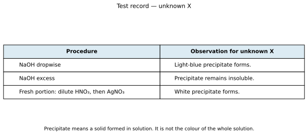
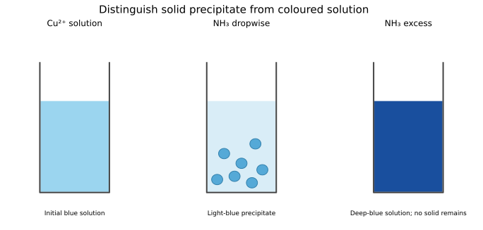
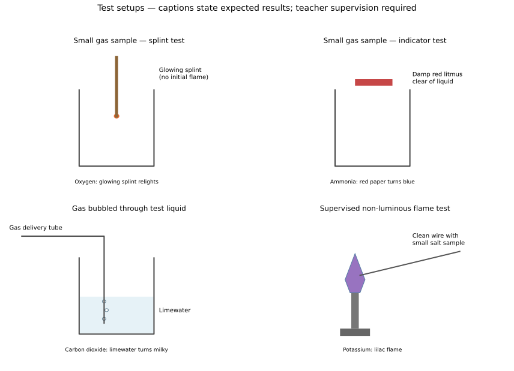

# 8 Qualitative analysis

*NSSCO Chemistry 6117 — study notes. Worked examples teach methods; assessment tasks are supplied separately.*

---

## 8.1 — Identification of ions in solution

### Ammonium ions

To test for ammonium ions, add aqueous sodium hydroxide to a small sample and warm carefully under supervision. Ammonia is released if ammonium ions are present. Test the gas with damp red litmus paper held clear of the liquid; it turns blue. State the reagent, warming condition and gas-test observation rather than writing that a smell proves ammonium.

The gas is ammonia, NH3, while the ion being identified is ammonium, NH4⁺. Confusing those names loses the distinction between original sample and product of the test. Sodium hydroxide droplets can also make litmus blue, so keep the paper out of contact with the liquid and avoid vigorous boiling or spray. Use separate clean samples for other tests. A nitrate reduction test also produces ammonia, but it requires additional aluminium and different interpretation; warming with alkali alone is the relevant ammonium comparison.

### Aluminium ions

Aluminium ions give a white precipitate when aqueous sodium hydroxide is added gradually. The precipitate dissolves in excess sodium hydroxide, leaving a colourless solution. With aqueous ammonia on a fresh portion, a white precipitate forms but does not dissolve in excess. Record the initial solid and the final behaviour separately.

The sodium hydroxide result alone does not distinguish aluminium from zinc, because both give white precipitates soluble in excess NaOH. The ammonia comparison distinguishes them in the syllabus set: aluminium's precipitate remains, whereas zinc's dissolves in excess ammonia. Do not call the final colourless sodium hydroxide mixture a white solution. White described the precipitate that was present before excess reagent. A colourless solution may contain dissolved aluminium species even though no solid is visible; detailed complex-ion formulae are not required for the observation-based identification.

### Zinc ions

Zinc ions give a white precipitate with a small amount of aqueous sodium hydroxide. It dissolves in excess to give a colourless solution. A fresh portion treated with aqueous ammonia also gives a white precipitate that dissolves in excess, again leaving a colourless solution. Both the initial and excess-reagent observations are needed for the full test pattern.

Compare the two reagents rather than stopping after white precipitate. Aluminium and calcium can also give white solids under suitable tests, but their excess behaviour differs. Aluminium's precipitate does not dissolve in excess ammonia, and calcium's does not dissolve in excess NaOH. Use clean labelled portions so a previous reagent does not alter the next test. The conclusion is strongest when the complete observed pattern agrees with the candidate ion, not when one colour is treated as a unique fingerprint.

### Worked example: identifying an ion while keeping an observation separate from a conclusion

Suppose an unknown solution gives a white precipitate with a little aqueous sodium hydroxide, and the precipitate dissolves in excess. This observation alone does not distinguish aluminium ions from zinc ions. Record “white precipitate, soluble in excess NaOH” before writing an ion name.

Test a fresh portion with aqueous ammonia added dropwise and then in excess. If the white precipitate dissolves in excess ammonia, zinc ions are supported; aluminium hydroxide would remain. Fresh portions matter because sodium hydroxide carried from the first test changes the conditions of the second. A results table needs separate columns for the reagent, the initial observation and the effect of excess reagent. Label the test tubes and use separate droppers to reduce contamination.

For a chloride test on another fresh portion, first add dilute nitric acid, then aqueous silver nitrate. A white precipitate supports chloride. Hydrochloric acid would be unsuitable for acidification because it adds the very ion being tested. By contrast, a cream precipitate supports bromide and a yellow precipitate supports iodide. The reagent and observation are both needed; writing only “silver nitrate” does not complete the test.

Positive cation and anion tests support their presence, not the absence of every impurity. Check unexpected observations with fresh portions, suitable controls and a repeat. A diagram should show labelled test tubes and controlled dropwise addition rather than a reagent bottle poured into an unlabelled mixture. Keep gases, solutions and precipitates distinct in the written record.

Choose the operation and instrument to match the measured quantity; keep sample identity clear and use separate clean portions when reagents could interfere. An apparatus diagram needs labelled components, correct connections and the positions that affect the measurement; artistic perspective is unnecessary. A conclusion should name the observed change and its comparison or control, rather than substituting a remembered expectation for evidence. An observation can support an identification without proving purity; shared observations require another discriminating test.

### Calcium ions

Calcium ions give a white precipitate with aqueous sodium hydroxide, insoluble in excess. With aqueous ammonia there is no precipitate or only a very slight white precipitate under the syllabus test conditions. Preserve this qualification rather than treating every slight cloudiness as evidence against calcium.

A flame test can add a brick-red observation, distinguishing calcium from ions with other flame colours. The wet and flame tests provide different kinds of evidence and should be recorded separately. With a very dilute sample, a weak precipitate may be difficult to see; compare against a clean reagent blank where appropriate. A white solid by itself is not a unique calcium test. The useful combination is NaOH insolubility, the limited ammonia response and a suitable confirming observation. Do not invent a deeply coloured solution for a colourless calcium-ion sample.

### Copper(II): solid and solution colours

Copper(II) ions give a light-blue precipitate with a small amount of aqueous sodium hydroxide. That precipitate remains insoluble in excess NaOH. With aqueous ammonia on a separate portion, the initial precipitate is also light blue, but excess ammonia dissolves it to form a dark or deep-blue solution. The final liquid is a solution, not a deeper-coloured precipitate.

Record which reagent was used and whether it was in excess. A statement that copper turns blue is ambiguous because an initial copper(II) solution may already be blue and the test can produce both a blue solid and a different blue solution. Use the words precipitate forms, remains or dissolves to describe the change. The copper(II) ion is also distinct from copper metal and from copper(II) carbonate: a green carbonate solid is not made blue simply because it contains copper. These distinctions prevent a memorised colour from being attached to the wrong substance or physical state.

### Iron(II) ions

Iron(II) ions give a green precipitate with aqueous sodium hydroxide, insoluble in excess. Aqueous ammonia on a fresh portion also gives a green precipitate insoluble in excess. State the initial green observation, because exposure to air can change the appearance as iron(II) material is oxidised.

Iron(II) and iron(III) are different ions of the same element, with different charges and test colours. A delayed brown appearance does not justify rewriting the original green observation as if it never occurred. Record timing and any subsequent change separately. In a supplied candidate set containing Fe²⁺ and Fe³⁺, a fresh green precipitate supports Fe²⁺, whereas a red-brown precipitate supports Fe³⁺. Avoid identifying every green solution as iron(II); reagent, precipitate formation and excess behaviour provide the relevant evidence.

### Iron(III) ions

Iron(III) ions give a red-brown precipitate with aqueous sodium hydroxide. It remains insoluble in excess. Aqueous ammonia gives a red-brown precipitate with the same excess-reagent behaviour on a separate sample. The observation distinguishes iron(III) from the initial green precipitate of iron(II) in the specified tests.

Write iron(III) or Fe³⁺ rather than just iron, because the oxidation state is the target of the comparison. A sample containing a mixture may produce less straightforward observations than a single-ion exercise; do not invent certainty beyond the supplied evidence. In a clean candidate comparison, the reddish-brown solid and its persistence in excess reagent support the inference. Distinguish colour of the original solution from colour of the precipitate. The reagent can create a new solid whose colour is the observation being recorded.

### Lithium flame test

Lithium salts give a red flame in the syllabus test. Use a clean suitable wire loop, a small sample and a non-luminous flame under teacher supervision. The observed colour is the flame colour, not the original salt's appearance. Record the red observation before identifying lithium from the candidate set.

A wire carrying residue from a previous sample can give a mixed or misleading colour. Clean it and check the blank flame before introducing the next sample. Compare lithium red with calcium brick-red rather than treating the two verbal descriptions as identical. A flame colour is useful evidence in the defined test, but a contaminated or mixed sample may need repeat testing. Do not introduce advanced electron-transition calculations; the practical aim is a reliable observation and identification under the stated conditions.

### Sodium flame test

Sodium salts give a bright-yellow flame. Its strong colour can mask weaker colours from other ions when contamination is present. Use a clean wire and a blank check before testing the sample, and avoid transferring solution with a dropper already used for another reagent.

Distinguish the observed yellow flame from the inference sodium present. A dirty wire giving yellow before the sample is added does not establish sodium in the sample itself. Repeat after cleaning and compare the blank with the test. The flame test is not a quantitative sodium-concentration measurement: brightness depends on sample size and conditions as well as composition. In a simple pure-salt exercise, the characteristic bright yellow supports sodium identification; in mixed or contaminated samples, state the limitation.

### Potassium flame test

Potassium salts give a lilac flame. The colour can be harder to see than sodium's bright yellow, so a clean sample holder and suitable flame are especially useful. A teacher-supervised test should use a small sample and compare the observed hue with a known reference or the stated observation guide.

If yellow appears with a faint lilac component, contamination is a plausible explanation and a clean repeat is justified. Do not conclude that potassium is absent merely because a sodium colour dominates the first attempt. State the action and reason: clean the wire, test a blank and repeat so the sample's lilac observation can be distinguished from carry-over. No chemical identity should be inferred from an artist's colour patch alone; schematic colours support the written observations and are not a replacement for controlled testing.

### Calcium flame test

Calcium salts give a brick-red flame. This observation complements the wet-test pattern of a white precipitate with NaOH that remains in excess, and little or no precipitate with aqueous ammonia. The flame and wet tests should be performed on appropriate separate material and recorded independently.

Compare brick-red with lithium's red in a controlled candidate exercise; colour names are useful but human perception and contamination can make a single observation uncertain. A clean-wire repeat and a supporting wet test improve the inference. Do not say that calcium metal must be burned directly to perform the ion test: the classroom test uses a suitable small salt sample under supervision. The colour is associated with the tested calcium-containing sample and is not a claim that its solution is red.

### Barium flame test

Barium salts give a green flame in the syllabus test. Use teacher-approved small samples because soluble barium compounds require controlled handling and disposal. A clean wire and non-luminous flame make the colour easier to recognise than an already yellow luminous flame.

The green flame supports barium identification within the specified candidate set; it is not a universal proof that any green light comes from barium. Distinguish a flame colour from a green precipitate such as an iron(II) test result. The physical observation and the reagent context matter together. Record the flame colour promptly, compare a blank and repeat if contamination is suspected. Do not use tasting or uncontrolled sample burning to distinguish salts. A well-recorded negative or ambiguous test is more useful than a forced identification.

### Carbonate ions

Add dilute acid to a small carbonate-containing sample. Effervescence occurs as carbon dioxide forms. Pass the gas through limewater to obtain a milky appearance, confirming the gas test. The carbonate inference relies on the reaction with acid plus the carbon dioxide observation, not bubbling alone.

Limewater is the reagent in the second stage, not the reagent that starts the carbonate reaction. Keep the sequence clear: dilute acid releases a gas, then limewater tests that gas. The white material is a precipitate in the limewater, while carbon dioxide is colourless. Use an unobstructed gas path and avoid drawing liquid back into a hot reaction tube. Strong and weak describe acid ionisation, whereas concentrated and dilute describe amount per volume; the test instruction specifies a suitable dilute acid rather than requiring a concentrated acid.

### Chloride ions

Acidify a fresh solution sample with dilute nitric acid, then add aqueous silver nitrate. Chloride gives a white precipitate of silver chloride. The precipitate dissolves in dilute aqueous ammonia, providing a further distinction from the cream bromide precipitate under the stated conditions.

Nitric acid is chosen because it does not add the chloride ions being tested. Hydrochloric acid would contaminate the test and could produce a false positive. Acidification also removes carbonate interference before silver nitrate is added. Record the order, white precipitate and any ammonia follow-up separately. Do not use a portion already treated with another chloride-containing reagent. The test identifies chloride ions in solution; a white solid forming after arbitrary reagents is not sufficient evidence without the correct procedure.

### Bromide ions

Bromide ions give a cream precipitate when aqueous silver nitrate is added after acidification with dilute nitric acid. The silver bromide precipitate is insoluble in dilute ammonia in the syllabus comparison. Use the cream colour and stated ammonia concentration together rather than replacing them with a vague pale solid description.

Chloride gives a white precipitate and iodide a yellow one, so consistent lighting and clean separate samples help compare the three. A coloured starting solution can obscure small colour differences, making the full test sequence more useful. Do not add hydrochloric acid for acidification because chloride contamination would create another silver precipitate. Interpret only the stated reagent concentration: dilute ammonia behaviour is the comparison specified here, and it need not be replaced by a detailed study of concentrated-reagent chemistry.

### Iodide ions

Iodide ions give a yellow precipitate after the sample is acidified with dilute nitric acid and treated with aqueous silver nitrate. The product is silver iodide. In the syllabus colour comparison, chloride is white, bromide cream and iodide yellow. Describe the solid as a precipitate rather than a yellow solution.

Use a fresh portion and add the reagents in the stated order. A previous sodium hydroxide test or another added ion can interfere if the same tube is reused indiscriminately. The test concerns the iodide ion I⁻, not iodine I2; their names, charges and physical observations differ. No complex-ion formula is needed to identify the yellow precipitate. If observations are mixed or unclear, report that limitation and repeat with clean apparatus instead of assuming one idealised colour proves a pure single-ion sample.

### Nitrate ions

For the syllabus nitrate test, add aqueous sodium hydroxide and then aluminium foil to the sample, warming carefully under supervision. Nitrate is reduced to ammonia. The evolved gas turns damp red litmus blue. Include the aluminium step: warming with alkali alone is the ammonium-ion test rather than the full nitrate test.

An existing ammonium ion can also release ammonia with warm alkali, so it can interfere with interpretation. Use a separate preliminary ammonium check or a suitably prepared sample before attributing ammonia produced after aluminium addition to nitrate. Keep litmus clear of the liquid so alkaline spray is not mistaken for ammonia. The inference is nitrate initially in solution, not ammonia as the original anion. Detailed reduction balancing is unnecessary for this practical identification objective; the required elements are reagents, warming, gas test and careful interpretation.

### Sulfate ions

Acidify a fresh sample with dilute nitric acid, then add aqueous barium nitrate. Sulfate ions produce a white precipitate of barium sulfate. Acidification removes carbonate interference, which could otherwise also form an insoluble barium salt. The procedure therefore makes the white-precipitate inference more specific.

Do not acidify with sulfuric acid, because it supplies the sulfate being tested and can cause a false positive. A fresh portion also avoids contamination from previous reagents. State which barium reagent is used and describe the white solid explicitly as a precipitate. The observation is not a white solution. Handle soluble barium reagents only under appropriate supervision and collect waste as directed. The conclusion identifies sulfate in the original sample, not nitrate introduced by the test reagents.

### Qualitative analysis: consolidated Annexe B reference

The following consolidated reference paraphrases syllabus Annexe B (PDF page 49, printed page 46). Record precipitate colour separately from the colour of a solution, and use fresh portions for different tests.

| Ion | Aqueous NaOH | Aqueous ammonia |
|---|---|---|
| Al³⁺ | White precipitate; dissolves in excess to a colourless solution | White precipitate remains in excess |
| Zn²⁺ | White precipitate; dissolves in excess to colourless solution | White precipitate; dissolves in excess to colourless solution |
| Ca²⁺ | White precipitate remains in excess | No precipitate or a very slight white precipitate |
| Cu²⁺ | Light-blue precipitate remains in excess | Light-blue precipitate dissolves in excess, giving dark-blue solution |
| Fe²⁺ | Green precipitate remains in excess | Green precipitate remains in excess |
| Fe³⁺ | Red-brown precipitate remains in excess | Red-brown precipitate remains in excess |
| NH4⁺ | Warm carefully: ammonia released | Not the ammonium test |

| Anion | Reagent sequence | Positive observation |
|---|---|---|
| Carbonate | Dilute acid; test evolved gas with limewater | Bubbles; gas makes limewater milky |
| Chloride | Dilute nitric acid, then silver nitrate | White precipitate, soluble in dilute ammonia |
| Bromide | Dilute nitric acid, then silver nitrate | Cream precipitate, insoluble in dilute ammonia |
| Iodide | Dilute nitric acid, then silver nitrate | Yellow precipitate |
| Nitrate | Sodium hydroxide and aluminium foil; warm carefully | Ammonia released |
| Sulfate | Dilute nitric acid, then barium nitrate | White precipitate |

| Flame-test ion | Colour |
|---|---|
| Lithium | Red |
| Sodium | Bright yellow |
| Potassium | Lilac |
| Calcium | Brick-red |
| Barium | Green |

| Gas | Test and positive result |
|---|---|
| Ammonia | Damp red litmus becomes blue |
| Carbon dioxide | Limewater becomes milky |
| Chlorine | Damp litmus is bleached |
| Hydrogen | A lighted splint gives a pop with a small collected sample |
| Oxygen | A glowing splint relights |

A reference-table match supports an identification only under the stated reagent and excess conditions. A contaminated wire or reagent can produce the same visible result as a sample ion. Check a blank when contamination is suspected. Colour alone is rarely enough: aluminium and zinc both form white precipitates, but their behaviour with excess ammonia differs.

### Suggested practical SP-6117-39 — A systematic test record

In a supervised sequence covering the Annexe B tests, use labelled small portions for each reagent. Record reagent identity, addition order, initial observation and behaviour in excess where relevant. Keep sodium hydroxide and ammonia results in separate columns, and distinguish precipitate colour from final solution colour. Include clean-wire flame tests and the specified gas tests. Compare observations with known reference samples before interpreting unknowns. Do not taste chemicals or smell gases directly. Controlled handling and waste collection are needed for silver, barium, lead and other hazardous reagents. A complete test record is more useful than a list of ion names without the observations that support them.

### Suggested practical SP-6117-40 — Identifying both ions in an unknown

Take separate labelled portions of a soluble unknown. Use sodium hydroxide and, where needed, aqueous ammonia to investigate the cation; use a fresh portion for the appropriate anion test. A practice sample gives a light-blue precipitate insoluble in excess NaOH, and a white precipitate after dilute nitric acid followed by silver nitrate. These observations support copper(II) and chloride within the stated candidate set. Infer copper(II) chloride only after both ion conclusions are justified. Do not identify the anion from solution colour or use a previously contaminated portion. Report an ambiguous observation rather than forcing a unique answer when the evidence does not distinguish candidates.

### Unknown observations

Unknown X observation matrix without identities; separate answer overlay supplied. These labelled diagrams are answer and teaching references; attempt drawing tasks before consulting them.

### Copper and ammonia

Light-blue precipitate dissolves in excess ammonia to a deep-blue solution. These labelled diagrams are answer and teaching references; attempt drawing tasks before consulting them.

### Connections

Connect these tests to ionic charges, solubility rules and reliable observations. Name the reagent, its order and amount condition, the physical change, and only then the inferred ion or gas.

---

## 8.2 — Identification of gases

### Ammonia gas

Ammonia turns damp red litmus paper blue. The paper must be damp so the gas can dissolve and produce an alkaline condition at the indicator. Hold the paper in the gas region without touching the generating liquid. Direct contact with alkaline liquid or spray could turn it blue without establishing that ammonia gas was present.

Use the chemical test rather than deliberately smelling the gas. Ammonia is not ammonium: ammonia is the gas NH3, while ammonium is the ion NH4⁺ that can release ammonia when warmed with alkali. In a supplied unknown-gas exercise, red-to-blue litmus supports ammonia among the specified gases. It is different from chlorine's bleaching and from the splint tests for oxygen and hydrogen. Record the initial paper colour, the damp condition and the final colour to make the observation unambiguous.

### Carbon dioxide gas

Carbon dioxide turns limewater milky. Passing the gas into initially clear limewater forms a suspension of white calcium carbonate. The cloudiness is a solid precipitate dispersed in liquid; the gas itself has not turned white. Name limewater rather than simply water when describing the test.

Use a small gas sample and observe the initial change. Passing a large excess of carbon dioxide can eventually clear the precipitate, so a later clear tube does not erase an earlier positive result. Record observations in order. A gas extinguishing a flame is not a specific confirmation of carbon dioxide because several gases do not support combustion. The limewater result is the characteristic test required here. Keep the delivery path open and avoid suck-back when a generating apparatus cools.

### Chlorine gas

Chlorine bleaches damp litmus paper. With damp blue litmus, an initial acidic red change may be seen before bleaching, but the characteristic identifying observation is loss of colour. Moisture is needed for the usual test chemistry, so a dry-paper negative result cannot be interpreted as equivalent.

Chlorine is hazardous; use a teacher-controlled demonstration or supplied observations, not deliberate inhalation or unrestricted learner generation. Distinguish bleaching from ammonia turning red litmus blue. An answer naming just litmus without its damp condition and colour loss is incomplete. Also distinguish the gas's appearance from the indicator response: the test establishes an observed chemical effect on damp paper. Test a separate small sample with suitable containment and supervision, and never propose combining unknown gases to see whether they react.

### Hydrogen gas

A small hydrogen sample gives a squeaky pop with a lighted splint in the controlled test. Lighted means a visible flame, unlike the glowing splint used to identify oxygen. The pop is evidence of rapid reaction with oxygen from the air at the test boundary.

Testing must use a separate small sample under teacher supervision, with the generating mixture kept away from ignition sources. Do not apply a flame to a large accumulated unknown gas volume. Record the pop rather than writing merely that the gas burns, because burning is not unique to hydrogen. A positive test identifies the gas, not the metal ion left in the generating solution. If hydrogen was made by a reactive metal and dilute acid, the salt in solution is a separate product with its own identification evidence.

### Oxygen gas

Oxygen relights a glowing splint. A glowing splint has a hot ember but no visible flame when introduced; renewed flame is the positive observation. Oxygen supports combustion, but the test does not mean oxygen is itself a fuel. A lighted splint simply burning more vigorously is not the precise confirmation required by this test.

Distinguish gas tests from flame tests for metal ions. A lilac flame identifies potassium in a suitable salt test, while a glowing splint relighting identifies oxygen gas in the specified gas comparison. A hydrogen test instead uses a lighted splint and a pop. Keep these three procedures separate in both words and drawings. Record the starting condition of the splint and the observed change, because saying a splint was used leaves the key distinction unresolved.

### Suggested practical SP-6117-38 — Obtaining three gas samples

Use teacher-supervised small-scale preparations: carbonate with dilute acid for carbon dioxide, hydrogen peroxide with a suitable catalyst for oxygen, and a suitable reactive metal with dilute hydrochloric acid for hydrogen. Keep samples labelled and separate. Choose a collection method appropriate to the gas and apparatus, leaving an unobstructed outlet. Test carbon dioxide with limewater, oxygen with a glowing splint and a separate small hydrogen sample with a lighted splint. Keep bulk hydrogen generation away from ignition. Record starting materials, collection and test observations separately; a preparation label is a prediction, while the positive gas test is confirming evidence.

### Suggested practical SP-6117-41 — An unknown-gas decision

Use teacher-provided small samples or recorded observations to distinguish the specified gases. A glowing splint relighting supports oxygen; a lighted splint producing a squeaky pop supports hydrogen; limewater turning milky supports carbon dioxide. Damp red litmus becoming blue supports ammonia, while bleaching of damp litmus supports chlorine. Select a suitable test rather than applying ignition to a large unknown gas volume. Keep the observed change separate from the inferred gas name and include the damp or glowing condition explicitly. A negative or unclear test may reflect wet apparatus, contamination or collection error; repeat safely with appropriate controls instead of claiming every gas has been excluded.

### Gas and flame test references

Separate apparatus panels distinguish glowing splints, damp litmus, limewater and clean-wire flame testing. These labelled diagrams are answer and teaching references; attempt drawing tasks before consulting them.
