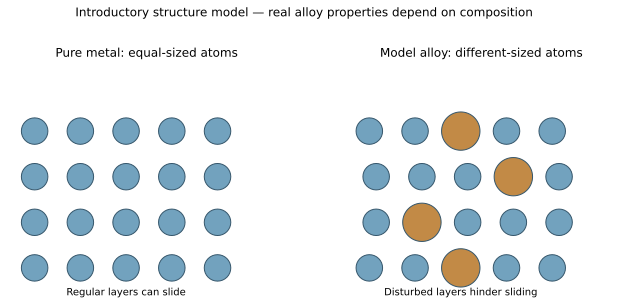
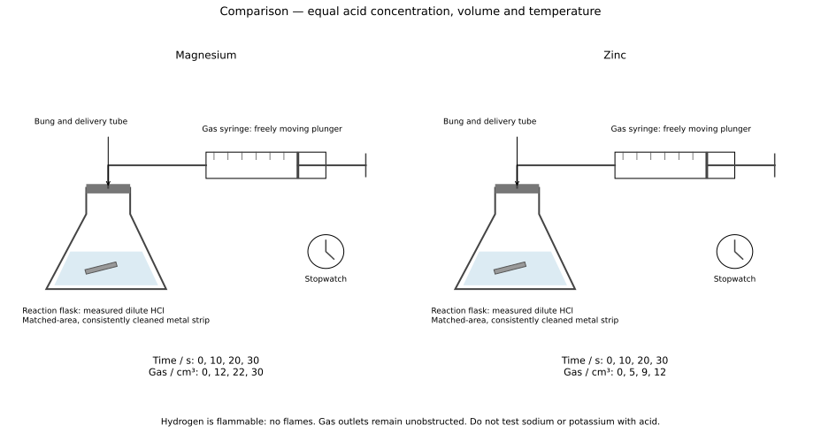
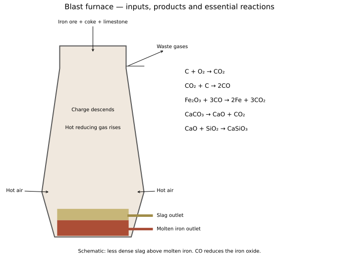

# 9 Metals

*NSSCO Chemistry 6117 — study notes. Worked examples teach methods; assessment tasks are supplied separately.*

---

## 9.1 — Properties of metals

### Metals and non-metals

Metals generally conduct electricity and heat well, are malleable and ductile, and form positive ions in their common reactions. Many non-metals are poor conductors and, when solid, are brittle rather than malleable. These are general comparisons rather than exception-free definitions: graphite conducts electricity, and physical state or appearance alone does not classify every element reliably.

Choose a material by the properties needed for its purpose. A bendable electrical connector needs both conductivity and an ability to deform without fracture. A thermal insulator has a different requirement. Link each supplied observation to the stated task rather than choosing a material merely because it is called a metal. Chemical comparisons also need conditions: a metal may react with acid or oxygen at a rate affected by its reactivity and surface coating. An apparently unchanged sample does not establish that all metals behave alike.

### Reading metal and alloy diagrams

A simple particle diagram of a pure metal shows one type of metal atom in a repeating arrangement. An alloy contains more than one element, usually represented by different sizes or colours of particles. Read the key before deciding what the symbols mean: two colours cannot establish two elements if the diagram key says they represent different charges or positions instead.

A particle model shows composition and packing qualitatively. In a pure-metal representation, similar-sized layers can slide relative to each other. In many alloys, differently sized atoms disturb regular layers and make sliding harder. Identify the alloy from the presence of different element types and explain hardness using disrupted movement when the model supports that inference. Do not claim that every alloy must be harder than every pure metal under every possible condition.

### Representing alloy structure

To draw an alloy model, start with a metal arrangement and include particles representing the added element. Show a clear key and, where illustrating hardness, a size difference that disturbs the regular layers. For a pure-metal comparison, use one consistent atom size and a regular pattern. The two drawings should differ in the structural feature being explained rather than in unrelated decoration.

Alloys can include a non-metal as well as a metal: steel contains iron with carbon and may contain other additions. Therefore a definition restricted to mixtures of metals misses an important syllabus example. The model should represent a mixture containing a metal and other element or elements, not a fixed ionic compound with alternating positive and negative ions. Do not draw discrete alloy molecules or imply a universal exact ratio. Use this model for composition and sliding comparisons.

### Metal and alloy models

Equal atoms in regular layers compared with a model alloy containing differently sized atoms. These labelled diagrams are answer and teaching references; attempt drawing tasks before consulting them.

### Connections

Connect metal behaviour to particle structure, redox and electrolysis. Distinguish intrinsic reactivity from apparent rate, and connect a material choice to the actual property required.

### Using properties and particle models

A physical property describes behaviour without changing chemical identity. Conductivity can be tested with a complete low-voltage circuit; deformation under a load can be tested separately. A shiny surface alone is weak evidence for classifying a material, because coatings and some non-metals can also appear shiny. Identify the property required by the application before selecting a material.

A wire must conduct and must be drawn into a long, thin shape without breaking: conductivity and ductility serve different requirements. A saucepan body needs thermal conduction, whereas its handle should limit heat transfer. A structure supported over a long distance may need low density as well as adequate strength. Hardness describes resistance to scratching or indentation; strength describes resistance to failure under load. These words should not be treated as interchangeable.

Metals commonly have high melting points and densities, but these are trends, not definitions. Mercury is liquid at ordinary room temperature, and some Group I metals have low densities. Graphite is a non-metallic form of carbon that conducts electricity, so a conducting sample is not automatically a metal. A classification should use several properties together and, where available, the particle model.

In a metallic model, positive ions occupy a lattice and delocalised electrons move through the structure. The electrons are not each attached permanently to one particular ion. Electrical charge can therefore move even while the ions stay in their approximate positions. When layers move during shaping, attraction to the surrounding electrons can maintain bonding. By contrast, shifting an ionic lattice can bring like charges together and cause repulsion and fracture.

An alloy model retains the metallic structure but includes more than one element. Different-sized atoms can obstruct easy movement of layers, making deformation harder. The diagram should distinguish the added atoms without showing a separate molecular compound at each lattice site. The composition can vary, and the resulting hardness, corrosion resistance and ductility must be assessed for the proposed use rather than inferred from the word alloy alone.

---

## 9.2 — Reactivity series

### The reactivity sequence

The syllabus sequence from more to less reactive is potassium, sodium, calcium, magnesium, aluminium, carbon, zinc, iron, tin, lead, hydrogen, copper, silver, gold and platinum. Carbon and hydrogen are comparison positions rather than metals. A metal above hydrogen can form hydrogen with a suitable dilute non-oxidising acid under appropriate conditions, while a more reactive metal can displace a less reactive metal from a suitable aqueous salt solution.

Reactivity evidence must retain conditions. Potassium and sodium are considered with cold water under controlled demonstration conditions and must not be added to acids. Magnesium and zinc provide safer supervised dilute-acid comparisons. Surface coatings can slow apparent reaction, and very reactive metals can react with water rather than giving a simple aqueous displacement. In magnesium with copper(II) sulfate, magnesium forms ions and copper ions become copper metal. The general sequence supports that prediction; observed rate also depends on area, temperature, concentration and surface condition. Strong and weak describe acid ionisation, while concentrated and dilute describe amount per volume; keep the same acid and concentration in a fair rate comparison.

### Deducing reactivity from observations

Translate each displacement result into a comparison before assembling an order. If metal X displaces Y from a suitable Y-ion solution, X is more reactive than Y. If Y then displaces Z, the evidence gives X above Y above Z. Use the direction of displacement rather than the alphabetical order of the labels.

A no-change result needs care. An oxide coating, insufficient time or unsuitable solution can prevent an expected visible reaction, so controlled surface preparation and appropriate candidates matter. In an idealised supplied dataset, use the stated assumptions; in a real investigation, evaluate alternative explanations. Rate with acid can support a comparison when exposed area, acid conditions and temperature are matched, but total gas volume depends on reacting amount as well as rate. State the evidence supporting each link in the order, and do not infer a comparison between two metals when the data leave it unresolved.

### Metal properties, reactivity and observations

Metals generally conduct heat and electricity, are malleable and ductile, and have a metallic appearance on a clean surface. Electrical conduction depends on delocalised electrons moving through the structure. Malleability is different from hardness: a metal may resist scratching yet still be capable of shaping. Alloying can impede layer movement, but properties depend on composition and treatment. Selection for an application must consider the actual loads, corrosion conditions and manufacturing process.

The syllabus reactivity sequence is potassium, sodium, calcium, magnesium, aluminium, carbon, zinc, iron, tin, lead, hydrogen, copper, silver, gold and platinum. Carbon and hydrogen are reference positions, not metals. Carbon’s position helps judge which metal oxides can be reduced by carbon. Hydrogen’s position helps predict displacement of hydrogen from dilute acid. Do not infer that reaction speed always gives the exact order: an oxide film, temperature and surface area can affect the observations.

Potassium and sodium are demonstrated only with cold water. They form hydroxides and hydrogen. Calcium also reacts with cold water, giving gas bubbles and calcium hydroxide; a cloudy mixture may develop. Magnesium reacts only slowly with cold water but reacts more readily with steam, producing magnesium oxide and hydrogen. Hot iron reacts with steam; copper does not displace hydrogen from water or dilute hydrochloric acid under ordinary test conditions. Never add sodium or potassium to dilute acid.

Magnesium, zinc and iron can dissolve in dilute hydrochloric acid with bubbles of hydrogen, with rates depending on conditions. Aluminium may initially appear unreactive because its adherent oxide layer blocks contact. Copper below hydrogen shows no comparable reaction with dilute hydrochloric acid. An observation is what is seen: bubbles, a dissolving solid, a deposit or a colour change. The identity of the gas or ion is an inference requiring the relevant evidence.

A more reactive metal can displace a less reactive one from its aqueous salt. A deposit on a strip and a changing solution colour can support displacement, but use the actual metal and solution identities before writing the equation. A set of displacement results can establish a relative order without knowing any rate. Conflicting results should prompt checking contamination, surface films and whether a visible change actually occurred.

Many metal oxides, such as magnesium oxide, are basic and react with acids to give a salt and water. Many non-metal oxides, such as sulfur dioxide, are acidic. Aluminium oxide is amphoteric: it reacts with both acids and strong alkalis. These are chemical classifications, not rules based solely on colour or whether the solid dissolves in water.

### Suggested practical SP-6117-42 — Comparing metals with water or acid

Use teacher-controlled demonstrations or recorded observations to compare metals under appropriate conditions. Highly reactive lithium, sodium and potassium belong to small-sample cold-water demonstrations behind a safety screen, not acid tests; calcium is also compared with cold water. Magnesium and zinc can be compared with dilute acid using matched exposed areas and consistent cleaning. Do not design a universal test that puts every metal into the same acid. Record reagent, temperature, gas evolution and surface change, and identify any hydrogen by a separate controlled small-sample test. Rate alone needs controls: a coating, unequal area or a changed acid concentration can distort the inferred order. The notes use conservative dilute-acid comparisons rather than inviting unsupervised use of stronger acid with slower metals.

### Suggested practical SP-6117-43 — Displacement evidence

Under supervision, place suitable clean metal strips in separate labelled solutions containing other metal ions. Record coating formation and solution-colour changes, alongside a control tube. Magnesium or zinc in copper(II) sulfate can give a copper coating while the blue solution fades. Infer that the displacing metal is more reactive than copper, and express each successful displacement as a pairwise comparison before building an order. Keep surface preparation, sample size, solution conditions and observation time comparable. A no-change result may reflect a coating or unsuitable conditions, so avoid using it as conclusive evidence without controls. Do not use water-reactive sodium or potassium as simple aqueous-displacement test metals.

### Controlled rate comparison

Matched magnesium/zinc setups with timed gas data and no ignition source. These labelled diagrams are answer and teaching references; attempt drawing tasks before consulting them.

### Connections

Connect metal behaviour to particle structure, redox and electrolysis.

---

## 9.3 — Extraction of metals

### Ores and combined metals

Most metals occur chemically combined with other elements in compounds rather than as uncombined metal. An ore is a naturally occurring material from which a useful component can be extracted economically under the relevant conditions. It is usually a mixture containing metal compounds along with unwanted rock or other minerals.

Distinguish an ore from a pure compound and from the extracted element. Haematite contains iron(III) oxide, but an ore sample can also contain silica and other material. Extraction must separate unwanted material and chemically convert the metal compound where necessary. The word most matters: less reactive metals such as gold can occur native. Whether a deposit is worth extracting depends on composition and practical circumstances, so not every rock containing traces of a metal is automatically a useful ore. The chemical lesson concerns the metal's combined state and the changes needed to obtain it.

### Namibian ore examples and uses

The syllabus identifies ores of copper, zinc, uranium and tin as important Namibian examples. The extracted metals serve different purposes: copper conducts electricity in wiring, zinc protects steel by galvanising and forms brass, uranium is a nuclear fuel, and tin is used for coatings and bronze. Relate the ore to the metal it supplies before naming the metal's use.

A mineral name and a metal use are different kinds of information. Chalcopyrite is a copper-bearing ore mineral; an electrical wire is a use of extracted copper, not a typical direct use of unprocessed chalcopyrite. Zinc blende supplies zinc and cassiterite is a tin oxide ore. These examples teach the connection between resources and materials without requiring current mine-production statistics. Avoid claiming that every deposit is currently mined or that the named ore is a pure sample of the metal. Processing and refining intervene between the geological material and a manufactured object.

### Native metals

A native metal occurs as the uncombined element in nature. Gold and platinum are examples because their relatively low reactivity allows them to persist without necessarily being converted into compounds. Native does not mean that a recovered sample is perfectly pure or already shaped for use; it can be mixed with rock, other metals or impurities.

Contrast native occurrence with a metal bound in an oxide or sulfide ore. Physical separation may be important for a native metal, while chemical reduction is needed to convert many combined metal ions into atoms. The distinction helps explain why one extraction route cannot be applied to all metals. Low reactivity also connects with resistance to corrosion, but it is not a claim that gold or platinum is incapable of any reaction. Use the precise definition uncombined element rather than the vague word natural, since compounds are natural too.

### Reactivity determines extraction route

Extraction converts a metal-containing material into useful metal, and the suitable chemical route depends strongly on reactivity. Metals below carbon in the series can often be obtained by reducing their oxides using carbon or carbon monoxide. Metals above carbon form compounds too stable for this simple carbon-reduction route and may require electrolysis of a suitable molten electrolyte.

Aluminium illustrates the electrolysis route, while iron is reduced from oxide by carbon monoxide in a blast furnace. The ore may need preliminary treatment before reduction: a sulfide can be roasted to an oxide. Position in the series gives a chemical starting point, but the actual industrial route also depends on ore composition and process conditions. Do not say that heating any ore with carbon automatically gives pure metal. Name the metal compound, reducing agent and relevant products, then consider separation and refining.

### Worked example: using mass change to interpret a reduction experiment

An iron(III) oxide sample has mass 8.00 g. After a complete, appropriately supervised reduction it produces 5.60 g of iron. First calculate the mass lost: 8.00 − 5.60 = 2.40 g. In the simplified pure-sample model, that loss is oxygen removed from the oxide, not iron disappearing. The retained iron fraction is 5.60/8.00 = 0.700, or 70.0%.

The equation Fe2O3 + 3CO → 2Fe + 3CO2 describes oxygen transfer. Iron(III) oxide is reduced and carbon monoxide is oxidised. Carbon-containing reducing agents can be used for suitable metals below carbon in the reactivity series; this does not justify using carbon for aluminium oxide. Extraction choices depend on reactivity, not simply whether a substance is called an ore.

A reliable mass comparison requires the same clean container before and after, consistent cooling before weighing and prevention of material loss during transfer. Moist product can make the final mass too high; spilled solid can make it too low. Those errors have opposite effects on the inferred oxygen loss. Repeated heat–cool–weigh cycles can help establish a stable final mass in an appropriate method. The example explains the measurement logic; carbon monoxide reduction is hazardous and is not an instruction for unsupervised generation or handling of the gas. A laboratory method must use an approved supervised apparatus and ventilation.

Choose the operation and instrument to match the measured quantity; keep sample identity clear and use separate clean portions when reagents could interfere. Record quantities and units in table headings and calculate changes by final reading minus initial reading before calculating a rate or ratio. An improvement must identify the source of error and explain how the change reduces it; repeats estimate variation but do not automatically remove a persistent bias. A fair investigation specifies the changed variable, measured outcome, controls, repeats, relevant precautions and the comparison used for its conclusion.

### Bauxite and aluminium

Bauxite is the principal ore named for aluminium in the syllabus. It contains aluminium compounds and is processed to obtain purified aluminium oxide before electrolysis. The ore, the oxide feed and aluminium metal are three distinct materials in the production chain.

Purified aluminium oxide is dissolved in molten cryolite for electrolysis; cryolite lowers the operating temperature compared with melting pure aluminium oxide alone. Do not call cryolite the aluminium ore in this syllabus pairing. At the cathode, aluminium ions gain electrons to form metal. The energy-intensive conversion is one reason recycling aluminium is useful. Naming bauxite identifies the source material, but a complete process explanation also needs purification and the correct molten electrolyte. Detailed industrial plant drawings are unnecessary for this objective.

### Haematite and iron

Haematite is the iron ore named in the syllabus, with iron(III) oxide represented as Fe2O3. In a blast furnace, carbon monoxide reduces the oxide to iron. A real ore contains other material, so limestone-derived calcium oxide is also used to remove acidic silica impurities as slag.

Distinguish haematite from the metal product and from the reducing agent. Iron oxide supplies iron; coke supplies energy and the carbon monoxide reducing agent; limestone helps remove impurity. The three inputs have separate purposes. A formula such as Fe2O3 indicates two iron atoms for every three oxygen atoms in the oxide, not an alloy of iron and oxygen. Reduction removes oxygen chemically. Naming haematite is a recall target, while explaining the furnace requires the linked reactions and separation of molten iron from slag.

### Chalcopyrite and copper

Chalcopyrite is a copper-bearing sulfide mineral named in the syllabus's Namibian ore examples. Its formula is commonly written CuFeS2, showing that it contains iron and sulfur as well as copper. It is not copper metal and cannot be used directly as electrical wire simply because copper is one constituent.

Extraction separates or removes unwanted components and converts copper into a useful metallic form, followed by refining where needed. Roasting and reduction are broad chemical stages considered in the syllabus. Sulfur-containing ores can produce sulfur dioxide during processing, so the gas is an environmental issue to control rather than an ignored by-product. Keep the recall pairing chalcopyrite–copper separate from the more detailed extraction account. A statement that an ore contains a useful metal identifies a resource, not proof that a particular sample is economical or pure.

### Galena and lead

Galena is lead(II) sulfide, PbS, and is the lead ore named in the syllabus. The formula shows lead chemically combined with sulfur. Producing metallic lead therefore needs a chemical conversion rather than simply melting a piece of pure lead already present in the ore.

An ore name identifies the source mineral, while a product name identifies the extracted material. Distinguish galena from lead metal and from lead(II) nitrate used as a soluble reagent in salt chemistry. Their composition, properties and handling requirements differ. Lead-containing materials require controlled industrial and laboratory handling; these notes use the example to connect ores with chemical extraction, not to propose learner smelting. As with other sulfide ores, processing can involve sulfur-containing emissions and separation of impurities. The key recall link is galena to lead.

### Uranium oxide ores

The syllabus names uranium oxide as the uranium-bearing ore material in its Namibian examples. Uranium is chemically combined with oxygen in this description, not present as a ready-made piece of pure metal. Uranium-bearing ores can include other minerals and require controlled processing to obtain useful material.

The educational distinction is between an ore's chemical composition and the eventual use of the extracted element. Uranium is used as nuclear fuel, where energy comes from nuclear changes rather than ordinary chemical combustion. This does not mean that every uranium-bearing rock can be placed directly in a power station. Extraction, purification and regulated fuel preparation are separate industrial stages. Detailed fuel processing is outside this objective. State the named oxide–uranium link and avoid confusing uranium oxide with the oxide ores of aluminium or iron.

### Iron in the blast furnace

Coke burns in the incoming hot air: C + O2 → CO2. The hot carbon dioxide reacts with more coke to make carbon monoxide: CO2 + C → 2CO. Carbon monoxide reduces haematite: Fe2O3 + 3CO → 2Fe + 3CO2. These linked reactions explain why coke is both an energy source and the source of a reducing gas.

Limestone decomposes on heating: CaCO3 → CaO + CO2. Calcium oxide reacts with silica impurity: CaO + SiO2 → CaSiO3, forming slag. Molten iron and slag collect separately, with less dense slag above the iron. Assign the inputs correctly: ore supplies iron, coke supports heating and reduction, and limestone removes silica through a basic oxide. The iron produced contains carbon and other impurities, so it is not automatically steel of the required composition. State the essential chemical reactions rather than treating the furnace as a machine that merely melts ore into metal.

Check the reduction equation by counting atoms: Fe2O3 supplies two iron atoms and three oxygen atoms, while three CO molecules supply three carbon and three more oxygen atoms. The products contain two Fe atoms and three CO2 molecules, accounting for six oxygen atoms in total. Iron oxide loses oxygen and is reduced; carbon monoxide gains oxygen and is oxidised. It is therefore the reducing agent. Limestone has a different role: its calcium oxide product removes silica through an acid–base reaction, not by reducing iron oxide. Confusing these roles leads to a correct-looking list of ingredients with an incorrect explanation. Follow each input to the reaction it enables, and then to the material leaving the furnace. Slag removal and iron collection are physical separations after the relevant chemical changes.

### Making steel

Basic oxygen steelmaking uses molten iron from a blast furnace. Oxygen reacts with excess carbon and other impurities, reducing their amounts; suitable additions then control the final steel composition. Carbon is removed as gaseous oxides, while other unwanted components can enter slag. The aim is controlled composition, not simply turning molten iron solid.

An electric arc furnace uses electrical energy to melt scrap iron and steel, followed by composition adjustment and removal of impurities as needed. It supports recycling but requires suitable sorting and control because different scraps can contain different alloying elements. Distinguish the feedstocks: blast-furnace molten iron for the basic oxygen route, and scrap as the key stated input for the electric arc route. Both need energy and chemical control. Neither method implies that every impurity is harmless or that all steels have one fixed formula.

### Steel composition and properties

Steel properties depend on the controlled amount of carbon and other added elements. Low-carbon mild steel can be shaped for car bodies and machinery, while different compositions can provide greater hardness, wear resistance or corrosion resistance. Increasing carbon generally increases hardness and can reduce ductility in the simple syllabus comparison.

Composition changes affect how the material behaves under force and in its environment. An application needing easy forming may not benefit from the hardest available steel. Stainless steel includes chromium and may include other additions that improve corrosion resistance. Choose using the required property rather than assuming more added elements means universally better material. Processing also affects real steel properties, so the introductory composition trend is not a full specification for every grade. A good explanation links a named compositional change to the property and intended use.

### Zinc from zinc blende

Zinc blende contains zinc sulfide, ZnS. In the thermal route described here, roasting in oxygen produces zinc oxide and sulfur dioxide: 2ZnS + 3O2 → 2ZnO + 2SO2. The oxide can then be reduced with carbon: ZnO + C → Zn + CO under suitable high-temperature conditions.

Zinc is volatile at the extraction temperature, so zinc vapour is cooled and condensed to collect the metal. This collection stage differs from assuming every extracted metal remains as a liquid pool in the furnace. Roasting prepares the oxide for reduction; it is not by itself the same as recovering metallic zinc. Sulfur dioxide from sulfide roasting requires controlled treatment because of its environmental effects. Keep the order sulfide to oxide to metal, with the reducing agent and collection method clearly named.

### Aluminium by electrolysis

Aluminium is obtained by electrolysis of purified aluminium oxide dissolved in molten cryolite. The molten medium permits ion movement and lowers the required operating temperature compared with pure aluminium oxide. At the cathode, Al³⁺ + 3e⁻ → Al forms the metal. The positive carbon anodes are consumed as oxygen-containing discharge products react with carbon.

Name the molten condition: an aqueous aluminium-ion solution does not give the same extraction because water competes at the cathode. An inert electrode is a useful classroom comparison, but the industrial carbon electrode is not chemically unchanged indefinitely. A copper electrode has a different role in aqueous copper-sulfate processes and should not be substituted into this account. The process needs substantial electrical energy. This connects extraction cost and recycling without requiring technical cell construction or a numerical energy claim unsupported by the supplied data.

### Copper by roasting and reduction

Copper is less reactive than carbon and can be obtained from suitable oxide material by reduction. For an oxide example, 2CuO + C → 2Cu + CO2 shows carbon removing oxygen. Copper-bearing sulfide ores undergo roasting or related oxidation stages to remove sulfur and prepare material for metal recovery. The complete industrial route depends on the ore, so a sulfide cannot be treated as if it were already a pure oxide.

Keep the scope at the essential chemical distinction: roasting involves reaction with oxygen, while reduction produces metal from a compound by electron gain or oxygen removal. Sulfur dioxide can form during sulfide treatment and must be controlled. Extracted copper may need refining for demanding uses such as electrical wiring. Do not assume a one-step classroom oxide equation fully describes every chalcopyrite process. Name the feed compound and explain the appropriate stage rather than combining incompatible formulae into one invented reaction.

### Finite ores and recycling

Metal ores are finite resources: accessible deposits do not replenish on the timescale of ordinary human use. Extracting a metal consumes part of that resource and produces waste material. Recycling existing metal reduces demand for new ore and can reduce the amount of mining and processing needed for the same useful material supply.

Finite does not mean every deposit will run out on a known date, and these notes do not assign an unsupported depletion forecast. The conservation argument is that recovering material already in circulation reduces fresh extraction requirements. Recycling also requires collection, sorting and energy, so it is not impact-free. A lost or contaminated fraction may be difficult to recover. Explain the benefit as reduced demand and waste under an effective recovery system rather than claiming that recycling eliminates all need for mining.

### Evaluating recycling

Recycling iron, steel and aluminium can conserve ores, reduce waste and avoid some extraction stages. Aluminium recycling can avoid repeating the electrolysis needed to make primary metal, although remelting still uses energy. Iron and steel scrap can be used in an electric arc furnace with composition control.

Costs and limitations include collection, transport, sorting, contamination and energy use. Mixed alloys may produce an unsuitable composition unless separated or adjusted. A decision should compare the available clean scrap with the required product quality, rather than assume all scrap is interchangeable. For a local collection scheme, reliable sorting may improve recovery quality even if it adds effort. Discuss both benefit and limitation and connect them to a workable improvement. Avoid unsupported percentage energy savings or claims about current scrap prices; the chemical reasoning is sufficient for the syllabus comparison.

### Blast furnace chemistry

Essential furnace inputs, reactions and separate iron/slag layers. These labelled diagrams are answer and teaching references; attempt drawing tasks before consulting them.

### Connections

Connect metal behaviour to particle structure, redox and electrolysis.

---

## 9.4 — Uses of metals

### Why make alloys?

An alloy is a mixture containing a metal and one or more other elements. Many alloys combine metals, such as copper and zinc in brass, but steel includes carbon, a non-metal, in iron. This broader definition is needed to include the syllabus examples accurately. Alloys are made to obtain useful combinations of properties rather than to preserve every property of the pure metal.

Different-sized atoms can disturb regular metal layers and make sliding harder, helping explain why many alloys are harder than a corresponding pure metal. The exact effect depends on composition and processing. Brass can be useful for fittings, while bronze combines copper and tin. Do not describe alloying as forming a fixed-ratio molecule or assume a universal alloy formula. Relate the chosen composition to the desired hardness, corrosion resistance, forming behaviour or other supplied property.

### Controlled steel additions

Steel is based on iron with a controlled carbon content and sometimes other alloying elements. Composition is adjusted to obtain properties suitable for the use, such as formability, hardness or corrosion resistance. Mild steel has a relatively low carbon content and is useful where shaping and strength are both needed.

Chromium-containing stainless steels resist corrosion better than ordinary unprotected mild steel in many environments. The addition supports a protective surface behaviour rather than making the metal impossible to attack under every condition. A specification must match the service conditions. Do not add arbitrary quantities of carbon or other metals and assume quality improves continuously. Control means selecting and measuring additions to achieve a known composition and testing the resulting properties. This connects steelmaking with the structure–property reasoning of alloy diagrams.

### Mild and stainless steel uses

Mild steel is used for car bodies and machinery because it combines useful strength with the ability to be formed and joined. Stainless steel is used for cutlery and chemical plant where resistance to corrosion is important. The examples link the material to its purpose, rather than treating all steel as one interchangeable substance.

A car body may need protection such as paint because mild steel can rust. Stainless steel's corrosion resistance reduces that vulnerability in suitable environments, but grade and service conditions still matter. Cutlery also needs a surface that can be cleaned and withstand ordinary use. A use question should name the specified steel type alongside the object; a property explanation should then connect the chosen grade to forming or corrosion requirements. Avoid inferring that an object is stainless merely because its polished surface is shiny.

### Uses of zinc

Zinc is used to galvanise iron or steel and to make brass with copper. Galvanising applies a zinc coating that acts as a barrier and can provide sacrificial protection because zinc is more reactive than iron. Brass is an alloy whose useful properties differ from those of its constituent metals.

Distinguish these uses: a zinc coating on steel is not the same as uniformly mixing zinc into copper. If a galvanised surface is scratched, nearby electrically connected zinc can oxidise preferentially and continue protecting the exposed iron under suitable moist conditions. A pure barrier coating lacks this sacrificial function. Zinc's place above iron in the reactivity series therefore explains a practical protective use, while brass production illustrates alloying. Do not call brass copper and tin; that is the familiar bronze pairing.

### Uses of tin

Tin is used for tin-plating and for making bronze with copper. An intact tin coating can prevent water and oxygen reaching the underlying iron or steel, helping protect it. Bronze is a copper–tin alloy, distinct from copper–zinc brass.

Tin is less reactive than iron, so its protection is mainly a barrier in this comparison. If the coating is scratched and iron is exposed, tin does not act as the more reactive sacrificial metal. This explains why the condition intact coating matters in a corrosion answer. Do not assume every metal coating protects after damage in the same way. Compare the reactivity of coating and substrate before predicting behaviour. The named uses connect tin to both surface treatment and alloy composition without requiring details of industrial plating equipment.

### Copper and aluminium uses

Copper is used in electrical wiring because it conducts electricity well and can be drawn into wire. Its thermal conductivity also supports use in cooking utensils, where heat transfer is useful. Aluminium is used in aircraft parts, commonly as suitable alloys, because low density helps reduce mass while alloying supplies useful strength. Food containers benefit from low mass, formability and a protective surface layer under suitable conditions.

Link each use to a relevant property rather than listing all metal properties. Electrical wiring depends principally on electrical conduction and ductility, while a cooking surface needs heat transfer. Aircraft structures require both strength and low mass, so soft pure aluminium is not automatically the intended material. Food compatibility depends on the contents and any lining, so the oxide layer does not establish resistance to every chemical. The appropriate explanation is conditional on the stated application.

### Uses of uranium

Uranium is used as fuel in nuclear power stations. The syllabus also names its historical and technological use in nuclear weapons. These are high-level use categories; the chemistry lesson does not require designs, preparation procedures or operational details. Nuclear energy release differs from burning a chemical fuel in oxygen.

Keep the metal's use separate from the ore's identity. Uranium oxide is a source material in the syllabus examples, while a power station uses regulated, prepared fuel. The relevant comparison with copper or aluminium is the property underlying the use: uranium provides a nuclear energy source rather than being selected mainly for conductivity or low density. Radioactive materials require specialised controls, so ordinary classroom study uses information and models. Naming the use is sufficient for this recall objective and should not expand into unrelated nuclear engineering.

### Preventing rust

Iron rusts when water and oxygen are available. Paint, oil, plastic or an intact metal coating can act as barriers that exclude those substances from the iron surface. If the coating is damaged, the barrier may no longer protect the exposed region. A description should therefore state whether the layer remains intact.

Galvanising with zinc adds sacrificial protection: zinc is more reactive than iron and oxidises preferentially while suitably connected, helping protect exposed iron even at a scratch. Tin is less reactive and does not provide the same sacrificial role. A separate attached more-reactive metal can also protect iron through sacrificial action. Compare coatings using both barrier integrity and reactivity. Protection is not unlimited; sacrificial metal is consumed and may need replacement. The explanation should say which substance oxidises rather than merely asserting that zinc prevents rust by being shiny.

Consider three identical iron samples in the same moist air: one painted intact, one with scratched paint, and one scratched through an attached zinc coating. Intact paint can maintain a barrier; the scratched paint exposes iron directly. The zinc-coated sample has a second protective mechanism because zinc can be oxidised preferentially. A fair test would keep iron area, exposure time, water and oxygen conditions alike, then compare rust formation rather than simply the starting colour. This separates a coating's physical barrier from sacrificial chemistry. It also explains why a damaged coating should be assessed by both its condition and the coating metal's reactivity.

### Protective surface layers

Aluminium and zinc can appear less reactive than their positions in the reactivity series suggest because an adherent surface oxide layer limits contact with air, water or another reagent. For aluminium, a thin oxide film forms readily and can protect the metal beneath. The observation concerns the accessible surface, not a reversal of the metal's intrinsic reactivity ranking.

A fresh or consistently cleaned surface may react differently from one with an established coating. This matters when comparing reaction rates experimentally: unequal surface preparation can make a more reactive metal appear slower. Cleaning must be done safely and consistently under supervision, not by indiscriminate attack with concentrated chemicals. Explain apparent unreactivity through a barrier to contact and then state the evidence needed to test that explanation. Do not claim the oxide film survives every acid or alkali; the surrounding conditions determine whether it remains protective.

### Connections

Connect metal behaviour to particle structure, redox and electrolysis.
