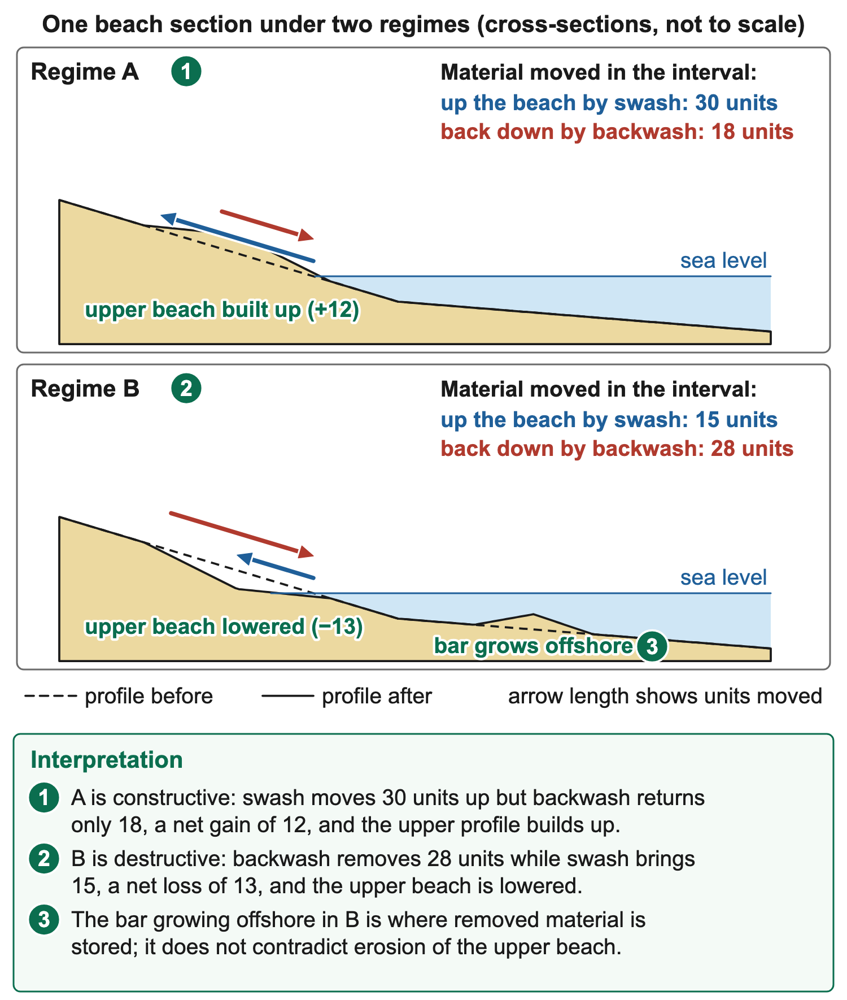
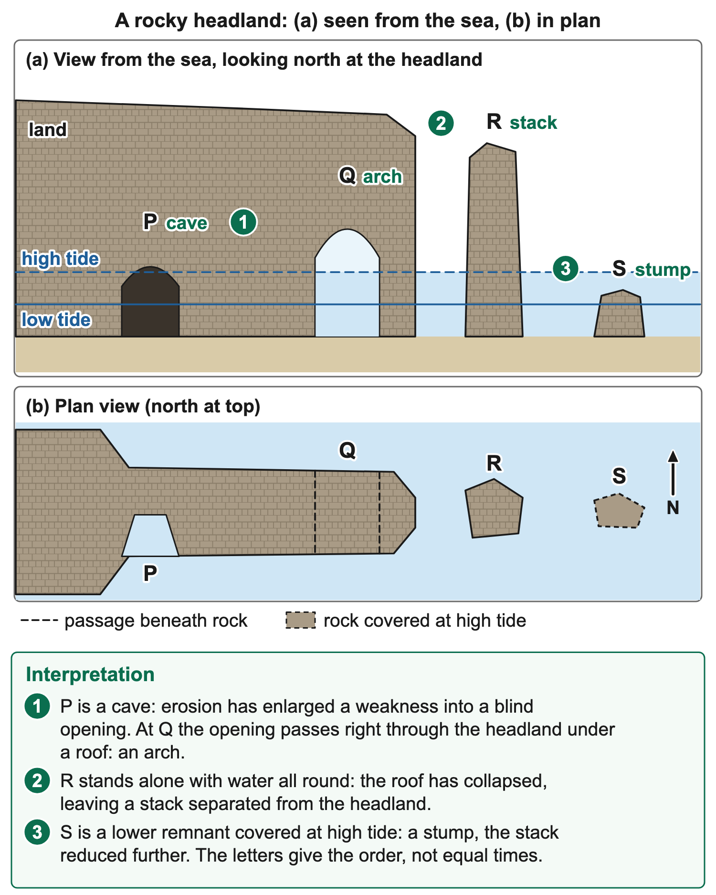
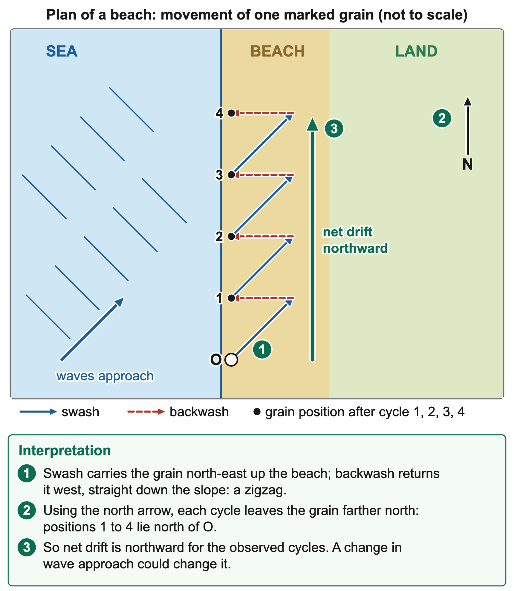
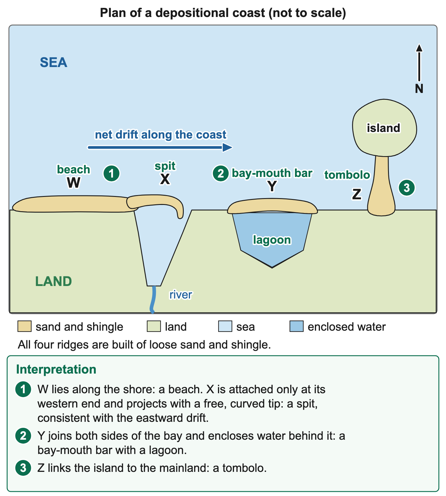
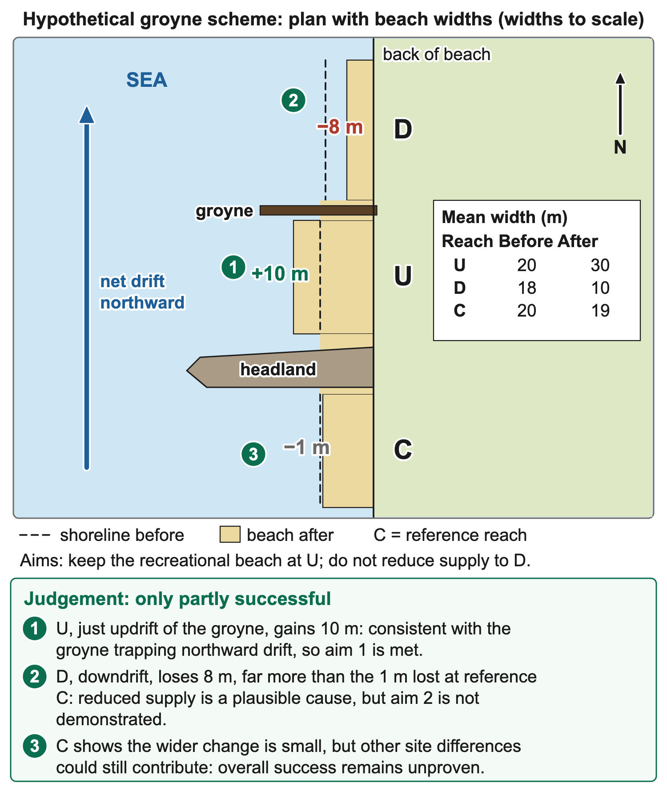
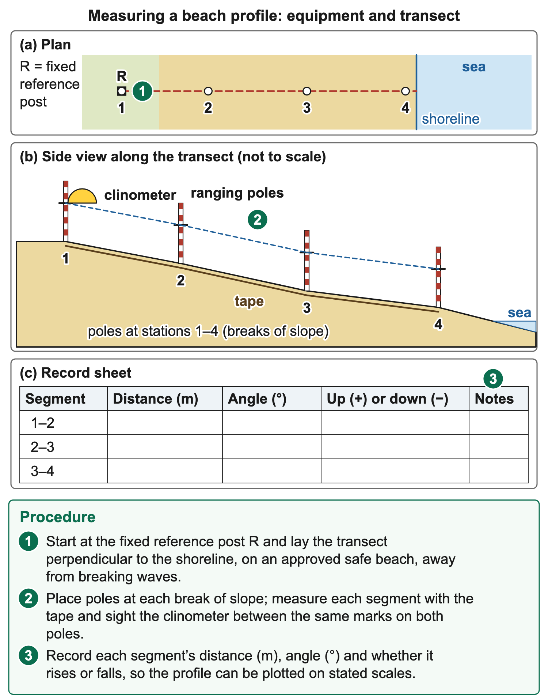
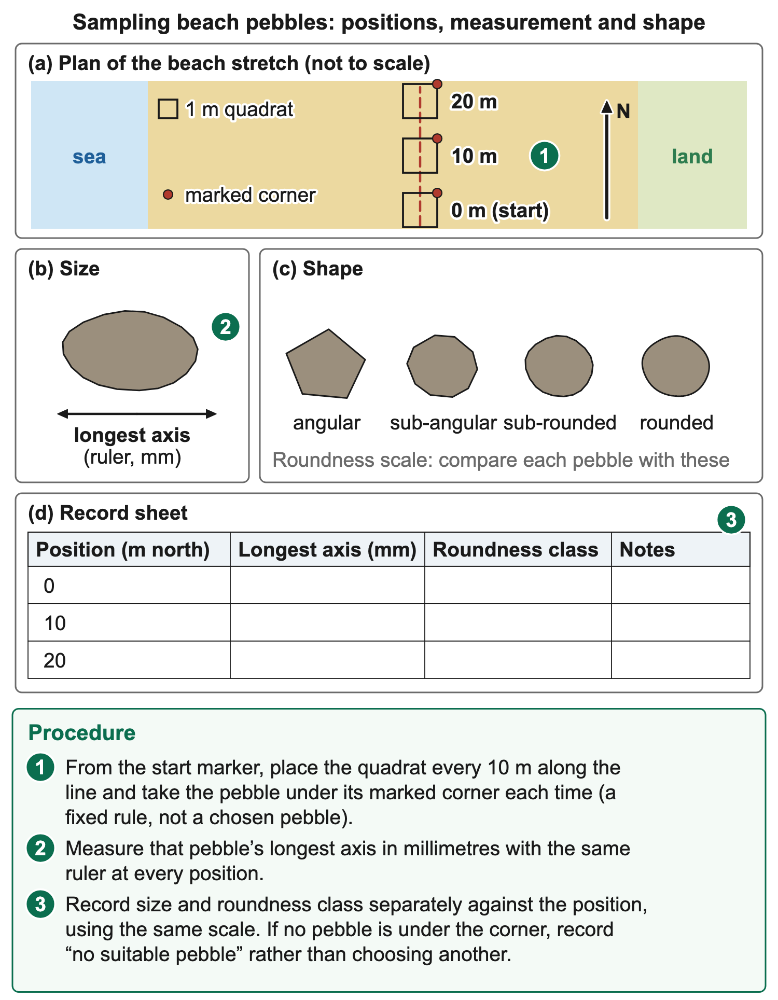
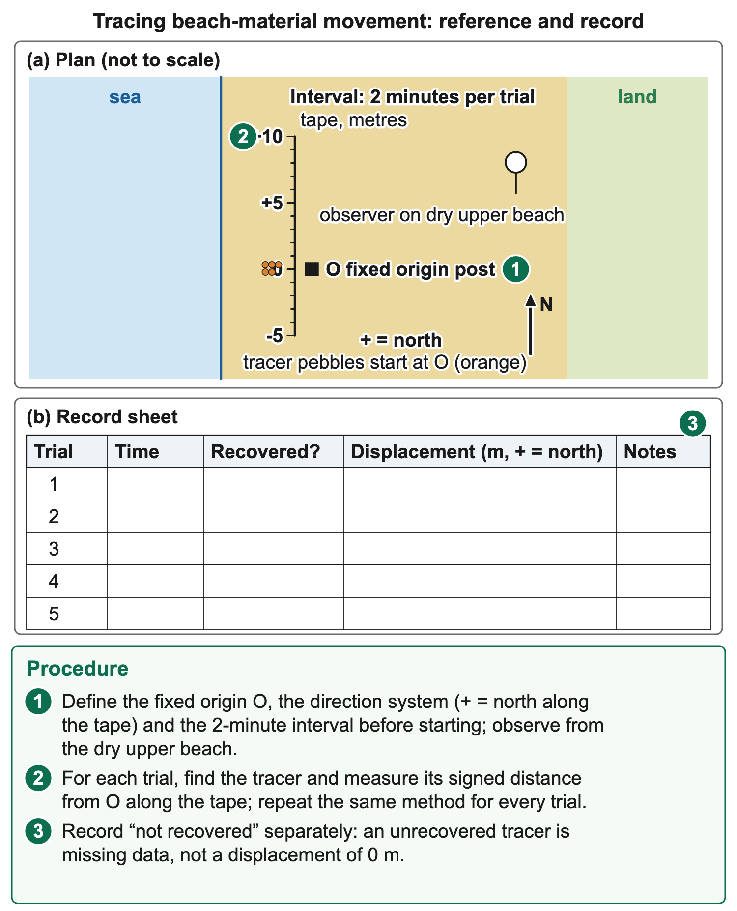

# 1.5 Coastal/Marine processes

*nam-6137-nssco-2026. Offline study notes, rendered from the approved content units on 2026-10-30. Everything here is also what the flashcards are built from.*

---

## Features of a wave

### Features of a wave

A wave is a travelling disturbance that transfers energy through water. Its crest is the highest part and its trough the lowest part. Wave height is the vertical distance from trough to crest; amplitude is measured from the undisturbed level to the crest or trough in a simplified symmetrical wave. Wavelength is the horizontal distance between corresponding points on successive waves, such as crest to crest. Wave period is the time between successive crests passing the same point. These measurements describe different dimensions, so height cannot be substituted for wavelength or period.

### Worked example

In a supplied resource, a crest is 1 m above the stated still-water level and the trough 1 m below it. Wave height is 2 m, not 1 m. If successive crests are 12 m apart, wavelength is 12 m. If they pass a fixed point every six seconds, period is six seconds. The values are teaching data rather than a measurement at a Namibian beach. A diagram’s axes and scale are needed before calculating; a stylised sketch without scale cannot establish an actual height in metres.

### Connections

Wave energy and the motion of individual water particles should not be confused. In deep water, particles generally follow orbital paths rather than all travelling steadily forward with the crest. Near the shore, interaction with the bed changes the motion and waves may break, producing the uprush called swash. This connects wave measurements to wave generation, breaking and beach processes. A surface line is a profile through the water, not a map of the route taken by one particle from offshore to land.

---

## Generating waves

### Generating waves

Most ordinary surface waves studied at the coast are generated by wind transferring energy to the water. Frictional interaction creates small disturbances, and continued wind can increase the waves. Wave characteristics depend on wind speed, how long it blows and fetch: the uninterrupted distance of water over which it acts in the relevant direction. A longer fetch can allow greater wave development under otherwise suitable conditions, but it does not set the wave height independently of speed and duration. Waves can also travel beyond the area where the generating wind is blowing.

The sequence is wind acting on the surface, energy entering the water and a wave disturbance moving away. As waves approach shallower water, interaction with the bed changes their speed and shape. The crest can become unstable and break. A useful explanation keeps wind generation separate from the later breaking process. Saying that a wave is generated because it hits the beach reverses the order: the wave already exists before its nearshore transformation. Tsunamis have other generating mechanisms and should not be treated as ordinary locally wind-generated waves.

### Connections

A supplied comparison holds wind speed and duration similar while fetch differs. Larger waves in the longer-fetch record are consistent with fetch contributing to development. They do not prove that fetch was the sole influence unless other conditions were controlled. Likewise, the wind at the beach today may differ from the offshore wind that generated arriving swell earlier. This connects wave generation to climate observations and enquiry: identify the measured variable, the period and the location before attributing a wave pattern to one current reading.

---

## Swash and backwash

### Swash and backwash

Swash is the movement of water up a beach after a wave breaks. Backwash is water returning down the beach towards the sea. The difference is direction and stage in the nearshore sequence. Swash follows breaking and carries water and potentially sediment onto the beach; backwash returns under gravity down the slope. Both are water movements, while the grains moved by them constitute transported material. A diagram should distinguish water-direction arrows from a sediment path and should make the shoreline and slope clear.

Where waves approach obliquely, swash can move diagonally up the beach in the direction associated with the incoming wave. Backwash commonly returns more directly downslope under gravity. The repeated contrast can produce a zigzag path and net movement of sediment along the coast. This is a simplified longshore-drift model. It should not be interpreted as a rule that each returning water parcel follows a perfectly straight line or that all sediment makes identical journeys. Beach shape, currents, grain properties and changing waves influence the actual movement.

To identify swash in a sequence, locate the breaking wave and the subsequent uprush towards higher beach positions. To identify backwash, follow water retreating from those positions towards the sea. A photograph of water on a beach is insufficient on its own to determine direction unless foam trails, a time sequence or other evidence supports it. If arrows are supplied, use their orientation rather than assuming that the upward direction on the page means uphill. A plan view and a slope profile can use very different page directions for the same physical movement.

### Worked example

Consider an original shore plan with land to the east and sea to the west. Wave crests approach obliquely so that the breaking-water movement carries a grain northeastward up the beach; returning flow takes it westward and downhill. Repetition can shift the grain northward overall. The explanation uses the stated land–sea orientation and directions. A memorised rule that longshore drift moves to the right would fail if the map were rotated. Direction is a geographical relationship that must be reconstructed from the resource, not a fixed preference on the page.

### Worked example

A beach cross-section gives different information. A marker starts at a lower waterline position, is moved upslope by swash and is then returned part-way down by backwash. If repeated cycles leave more material higher on the beach than is removed, the net result is accumulation for that interval. If return transport removes more, the net result can be erosion. The individual swash event does not establish the whole beach sediment budget. Material may also move alongshore or offshore, so interpretation should consider the resource’s spatial coverage.

### Worked example

Surface infiltration influences how much swash water remains available to return over the surface. Coarser permeable beach material may allow more infiltration than finer, less permeable material under comparable conditions. Slope and wave conditions also matter. These relationships help explain why swash and backwash characteristics vary among beaches, but they should not become a universal claim that one grain size dictates every beach process. A self-contained resource needs to state relevant observations, such as the movement of water, sediment or profile change, rather than requiring an unseen beach to be imagined.

A short investigation can record the direction of repeated swash and backwash from a safe observation point on an approved beach. Use a clear reference direction, sufficient repetitions and a stated time and tide context. Do not stand in hazardous breaking water or place people where waves can cut off access. Supplied video observations or data can support the learning task instead. A safe record can show the variability of individual events and help distinguish a dominant pattern from one unusual movement. It cannot establish the regime for every season without a broader sample.

Swash and backwash connect wave behaviour to beach transport, deposition and erosion. Their relative effectiveness is central to the school model of constructive and destructive conditions. The terms name movements, not moral descriptions of waves as good or bad. A supported interpretation follows direction, material movement and the net pattern over the observed period. This prepares the explanation of longshore drift and the evaluation of coastal structures, where trapping sediment at one location can affect the amount available farther along the shore.

### Connections

A direction record should state its reference explicitly. Uphill and downhill describe the beach slope, whereas north and south describe orientation on a plan. Combining the two carelessly can reverse an interpretation even when the process names are correct.

---

## Constructive and destructive conditions

### Constructive and destructive conditions

A constructive wave has relatively stronger swash than backwash and tends to build up beach material. A destructive wave has relatively stronger backwash than swash and tends to remove beach material. These are models of net beach response under particular wave and sediment conditions. The names do not imply that constructive waves cannot be hazardous or that destructive waves create no deposits anywhere. The useful distinction is the balance of movement and the observed change at the beach, rather than a judgement about the wave’s purpose.

Constructive waves are low-energy waves. They are low, with a long wavelength, and break infrequently, so the swash of one wave has time to soak away before the next arrives. They spill gently onto the beach, giving a strong swash and a weak backwash, so sand and pebbles are carried up the beach and left there. Destructive waves are high-energy waves, often driven by strong winds during storms. They are high and steep, with a short wavelength, and break frequently. They plunge down onto the beach, so the swash is weak and the backwash strong: material is dragged down the beach and may be stored offshore in a bar. Beach slope, sediment size and the sequence of events also affect the result.

### Worked example

A resource showing material moving landward and a beach profile building over the stated interval supports a constructive interpretation. A resource showing net seaward removal and a reduced upper beach profile supports a destructive interpretation. Compare the relative transport and outcome, not just which arrow is drawn longest. If arrow length represents velocity in a key, it can be interpreted that way; without that declaration, its length may be purely illustrative. An answer should use measured or clearly specified evidence rather than treating the artwork as a quantitative instrument.

### Worked example

An original teaching comparison can label two regimes. At A, repeated waves move more sediment up the beach than back down and the upper profile gains material. At B, return movement removes more sediment from the upper beach and a nearshore bar grows. A supports constructive net behaviour at the observed beach section; B supports destructive behaviour there with offshore storage. The bar’s growth does not contradict upper-beach erosion because the two locations are different parts of the sediment system. Do not describe all of the eroded sand as permanently lost from the wider coast.

Beach profiles can change between storms and calmer intervals. Sand removed from the upper beach during energetic conditions may accumulate nearshore and later return under suitable conditions. This seasonal or event-related exchange means that one post-storm profile cannot establish a permanent long-term retreat by itself. Repeated profiles at comparable reference points, together with water-level and wave information, provide stronger evidence. A narrower beach on one date can also partly reflect a higher tide, so its width needs a stated reference and comparable measurement conditions.

A comparison should pair the wave types explicitly: constructive conditions have relatively stronger swash and a tendency towards local accumulation, whereas destructive conditions have relatively stronger backwash and a tendency towards removal from the beach. Saying only that destructive waves are stronger is not enough: state the energy, the wave form and the swash/backwash balance. Likewise, a response that names deposition without locating it can confuse upper-beach accumulation with offshore bar formation. The physical location and observation period belong in the explanation.

These distinctions matter for management and coastal enquiry. Beach nourishment may be redistributed during destructive conditions even if the project adds a large volume of sand. A groyne may trap material moving alongshore but not prevent all cross-shore exchanges during a storm. The appropriate conclusion therefore connects the specified process to the intended outcome. If the task supplies a figure with both regimes, first classify the swash/backwash balance, then explain the observed sediment response and retain any exceptions or limits shown by the data.

### Worked example

One original sediment-budget comparison records 30 teaching units moved onto an upper-beach section and 18 moved off it during interval A. Its net gain is 12 units. During interval B, 15 units arrive and 28 leave, giving a net loss of 13. These simplified units illustrate balance, not measured volumes or wave heights. A constructive interpretation fits A’s net gain, while a destructive interpretation fits B’s net removal from that section. The comparison would change if alongshore transfers were omitted from the record, so the boundary of the measured section matters. A net loss at one profile also does not establish the fate of all sediment elsewhere along the coast.

### Connections

A measured net balance needs a defined boundary and interval. Sand crossing an alongshore edge is an output from that section even if it remains on a beach nearby. Specifying the boundary keeps local gain or loss separate from a conclusion about the entire coast.

---

## Marine erosion processes

### Marine erosion processes

Coastal erosion wears away and removes material from the shore. Waves and currents act on rock, loose sediment and existing weaknesses, while weathering and gravity can prepare or move material on the cliff. Marine abrasion, hydraulic action, solution and attrition describe different actions within this system. Their names should be attached to the agent, contact and change involved. The fact that all four can occur near waves does not make them interchangeable. A resource may support more than one process, but each needs its own evidence rather than a list copied onto every coastal landform.

Corrasion, or abrasion, occurs when moving sand, shingle or larger fragments strike and scrape a surface. The load acts as a tool against the cliff or shore platform. Strong waves can move abrasive material, but wave energy alone does not establish that a particular surface was worn by sediment. Suitable material and contact are part of the explanation. A drawing of shingle thrown against a cliff, with impact-related wear, supports abrasion. A stone simply moving through water demonstrates transport unless wear or contact with a target is also specified.

The distinction between corrasion and corrosion is especially important. Corrasion is mechanical abrasion. Corrosion is chemical solution of susceptible material. The words differ by one letter but refer to different mechanisms. Use the alternative names abrasion and solution to make the intended meaning clear. Describing a limestone surface dissolving while calling it corrasion would misclassify the action even if the location were coastal. Conversely, a pebble scraping an exposed face does not become a chemical process because seawater contains dissolved salts.

### Worked example

Hydraulic action involves the force and pressure of water acting on the rock or sediment. Waves breaking against a cliff can force water into joints and weaknesses, helping loosen material. Air trapped in some cracks can be compressed and contribute to stresses as pressure changes, but the resource should support that particular detail if it is used. The central mechanism is water-force action on a weakness, rather than sediment tools scraping the rock. Repeated impacts can work with existing joints, weathering and other erosion to enlarge an opening.

### Worked example

An original observation of a joint widening during repeated pressure changes, followed by detachment of a block, supports hydraulic action where the water contact is established. If no abrasive particles are recorded striking the joint, do not invent them as the explanation for that event. Equally, the absence of a recorded impact does not prove that abrasion never occurs anywhere on the cliff. The inference belongs to the stated observation. This distinction between a supported local mechanism and an unrestricted claim helps keep both descriptions and explanations precise.

Corrosion or solution occurs when water chemically dissolves susceptible minerals. Carbonate rocks can be affected by weakly acidic water under suitable conditions. The rate and effectiveness depend on rock composition, water chemistry and contact conditions; not every coastal rock dissolves at the same rate. Dissolved products become part of the water’s dissolved load, distinct from visible rock fragments. An explanation should identify chemical change rather than saying that water makes rock disappear. Solution can enlarge weaknesses and contribute to other processes, but it need not be the dominant mechanism at every rocky shore.

### Worked example

A resource giving evidence of dissolved carbonate leaving a limestone face supports solution erosion. A smooth face or a hole alone is less specific because abrasion and other processes can produce similar visible forms. The defining evidence concerns the susceptible mineral and dissolved products. If the task supplies an original chemical result, interpret that result rather than replacing it with an imagined sequence of collisions. The connected transport of the dissolved material is another stage: removal by dissolution and movement in solution are related, but the question may ask about one rather than both.

Attrition is the wearing and rounding of transported particles as they collide with each other. Waves can repeatedly move shingle, causing impacts that break corners or reduce particle size. The target is chiefly the load, unlike abrasion of a fixed cliff or platform. A grain may also strike the shore, so one moving particle can participate in different contacts. To distinguish them, state what collides with what and which material changes. A sentence about stones hitting the cliff describes a possible abrasion action, not a complete account of particle-to-particle attrition.

### Worked example

An original paired observation can test the distinction. In A, pebbles strike a platform and scratches develop on the platform. In B, marked pebbles collide with one another and lose projecting corners. A supports abrasion of the platform; B supports attrition of the load. A later sample of round pebbles does not establish the entire history, because source material, past transport and selective sampling can influence the result. A stronger investigation records comparable samples and uses a consistent shape scale, rather than choosing only especially rounded stones from one site.

### Worked example

Rock properties influence how marine erosion proceeds. Joints, faults and bedding can provide weaknesses and guide cave or notch development. Contrasts in resistance can help form headlands and bays. A hard-looking rock is not immune to erosion, and a weak-looking material may be sheltered from energetic wave attack. Exposure, sediment tools, water levels and the frequency of suitable conditions also matter. A landform explanation needs the combination relevant to the resource instead of treating one descriptive adjective as a complete cause.

Weathering and mass movement act alongside marine erosion. Salt-related weathering, wetting and drying, root activity or other processes can weaken a cliff face depending on its setting. Gravity can cause falls or slumps when material loses support or strength. Waves may then remove debris, allowing renewed attack at the base. The fall itself should not be called attrition, and weathering in place should not be confused with the removal stage. Linking these actions in sequence explains cliff retreat more fully than attributing every visible change directly to one breaking wave.

### Worked example

These mechanisms connect to the study of river and wind erosion, where abrasion and attrition retain the same contact-based distinctions. At the coast, wave direction, water level and exposure shape where the processes act. A supported resource response names the action, cites a feature or observation and explains the relevant result. If the evidence does not distinguish competing causes, qualify the conclusion. Knowing the vocabulary is useful only when it is attached accurately to the rock, sediment, water and sequence shown in the particular setting.

To compare mechanisms, a supplied record can hold the target rock similar while varying the observed action. At site A, sand impacts coincide with surface scratches. At B, water enters joints and pressure changes precede detachment, with no recorded sand impacts. At C, analysis detects dissolved mineral products leaving the surface. The evidence supports abrasion, hydraulic action and solution respectively for the recorded changes. If a fourth record shows only a cliff becoming lower over an undated interval, it establishes change but does not discriminate the mechanism. More specific contact, chemical or sequence evidence would be needed. This distinction prevents a plausible process from being presented as an observation. The explanation can still acknowledge that several processes contribute to a real coast without claiming that the sparse fourth record proves them all.

### Connections

An erosion observation should also distinguish a temporary cover from the underlying target. Sand piled against a cliff may hide the rock surface from direct attack for a period, while a later event removes that cover. A before-and-after photograph needs this context before every apparent change is attributed to fresh rock erosion.

---

## Cliffs, platforms, caves and residual landforms

### Cliffs, platforms, caves and residual landforms

Rocky coasts change through erosion, weathering and gravity. Their form depends on rock resistance, geological structure, wave exposure, water level and the history of change. Cliffs and platforms can develop as the shoreline retreats. Headlands and bays reflect uneven coastal resistance and other controls. Caves, arches, stacks and stumps can form through progressive erosion of a headland, but the full sequence is a model rather than a compulsory future for every rock projection. Read the resource’s weaknesses, layers and viewing direction before explaining its landforms.

A sea cliff is a steep coastal slope or face. Waves can erode its base, while weathering weakens material and gravity removes unsupported sections. A wave-cut notch is an indentation produced near the cliff base where erosion is concentrated within the relevant water-level zone. Repeated hydraulic action and abrasion can deepen the notch. As support is removed, the overlying material may fail, adding debris at the foot. Removal of that debris can expose the new base to further erosion. Retreat results from repeated linked actions, not the entire cliff sliding steadily backward as a single intact block.

### Worked example

The shape and stability of a cliff also depend on bedding, joints and groundwater. A massive resistant rock can produce a different failure style from layered material with weaker bands. Water within a slope can affect strength and pressure, helping certain failures under appropriate conditions. A steep face alone does not establish the exact mechanism of collapse. In a resource specifically showing an undercut base, overhang and fallen blocks, the support-loss sequence is justified. A resource showing a curved slump surface needs an explanation suited to that structure rather than a rockfall story copied from another example.

### Worked example

The notch should be located against the cliff at the stated level of wave action, not arbitrarily at the top. It is a local recess, distinct from a cave extending into a headland. If the figure shows a wider recess stretching along the foot, describe that form accurately. Tides and changing water levels mean that effective attack can occur over a vertical zone rather than one permanent line. Do not infer a fixed height above a datum unless the resource provides it. The scale of a notch and the height of the whole cliff are separate measurements.

As a cliff retreats, a relatively gently sloping rock surface may remain in front of it: a wave-cut platform. Erosion and removal work on the exposed rock while the cliff line moves landward. Parts of the platform may be covered by water at higher tides and exposed at lower tides. It is not necessarily a sandy beach, though loose sediment can cover parts of it. The rock surface, cliff relationship and tidal exposure provide evidence for identification. A flat strip of sand without rock or retreat information should not automatically be called a wave-cut platform.

### Worked example

An original cross-section can show an earlier cliff line seaward of the present line, a notch at the present foot and a low rock surface between them. The relative positions support cliff retreat and platform development. If the horizontal distance between dated cliff lines is supplied, it can support an average retreat estimate for that interval. A stylised drawing without a scale cannot establish metres of retreat, and a platform’s present width need not equal the distance removed during one recent event. Its history can extend over many episodes and changing conditions.

Headlands are projections of land into the sea, while bays are coastal indentations between or beside them. In a simple differential-erosion model, less resistant rock is removed more rapidly, creating bays, while more resistant rock remains as headlands. The model is clearest on a discordant coastline, where bands of more and less resistant rock run at right angles to the coast and hydraulic action and abrasion wear back the less resistant bands faster. The actual pattern also depends on structure and exposure. A bay may have a depositional beach within it, so its existence does not imply that every part is undergoing rapid erosion at the time observed.

Wave refraction can help modify the pattern. As waves enter water of different depths, parts of the wave slow at different times and the wave fronts bend. In some settings this concentrates wave energy towards exposed headlands and spreads it within bays. The process can reinforce contrasts in erosion and deposition, but the exact result depends on bathymetry and wave approach. A simple plan-view diagram needs consistent wave-front and depth geometry. Arrows pointing towards a headland are not a substitute for showing or explaining why the wave pattern changes.

### Worked example

A resource might identify rock A as relatively resistant, rock B as less resistant and an initially straighter coast crossing both. Later, B is set back into an indentation while A projects seaward. The paired change supports the differential-resistance explanation. Do not describe the headland as being built outward by erosion: it may project because adjacent material was removed faster. Relative projection does not necessarily mean the headland itself has not retreated. Both rock types can erode while maintaining a contrast in coastline position.

A sea cave can develop where waves enlarge a weakness in a cliff or headland. Hydraulic action and abrasion work into joints, faults or weaker rock, gradually extending an opening. A cave has an entrance and an enclosed or partially enclosed chamber that does not yet form an open passage through the entire headland. Describe the opening and the surrounding rock before explaining its growth. A dark patch in a photograph might be shadow rather than a cave, so interpretation needs depth cues, a clear entrance or supporting information.

If erosion extends a cave through a narrow headland, or caves from opposite sides join, an arch can form. The arch has an opening passing through the rock with a roof remaining above it. The route through distinguishes it from a blind cave. The roof’s survival depends on the material and structure as well as the size of the opening. Weathering, erosion and gravity can weaken it over time. A diagram of an arch should show a continuous connection between the remaining rock on either side rather than an isolated pillar mistakenly labelled as a roof.

When an arch roof collapses, an isolated pillar of rock may remain offshore as a stack. The stack is separated from the mainland; that separation is part of the identifying relationship. The fallen roof material can become debris that is later moved or worn. Do not skip directly from cave to stack without explaining the formation and loss of the connecting roof if the task asks for the full sequence. A stack may remain for a long period or be reduced relatively quickly under suitable conditions; one sequence diagram does not establish its lifetime.

### Worked example

Continued erosion and weathering can reduce a stack to a lower remnant called a stump. A stump may be more visible at low water and partly or wholly submerged at other stages. It is not simply the shadow of a tall stack or a separate pile of recently deposited sand. In a resource sequence, compare the height and continuity of the rock remnant and read the water-level reference. If the final frame shows a low rock base where a taller isolated pillar previously stood, the change supports reduction from stack to stump.

The cave–arch–stack–stump model combines enlargement, breakthrough, collapse and reduction. A useful description preserves the order and the defining spatial change at each stage. Caves may also collapse without producing a long-lived arch, and geological structure can produce other residual forms. The model should therefore be applied to the evidence shown rather than treated as a prediction that every headland must display all stages simultaneously. The same coast can include features of different ages and different histories without fitting a neat left-to-right sequence in a photograph.

### Worked example

An original four-frame resource can label A as a joint opening into a headland, B as an enlarged chamber, C as a passage beneath a surviving roof and D as a detached pillar after roof collapse. A and B show weakness enlargement and cave development, C an arch and D a stack. If a further frame shows a much lower rock base, it can represent a stump. The description should not infer that frames occupy equal time intervals unless dates are given. A labelled letter indicates the order supplied, not a measured duration.

Viewing direction is central to identification. A side photograph of a headland may hide whether an opening passes right through; a plan view can reveal connection and separation but not easily establish height. A cross-section can show the notch and platform relationship while omitting alongshore variation. Combine the views where available. If only one view is supplied and it cannot resolve a distinction, state the most supported interpretation and the missing evidence rather than inventing an unseen opening or a roof collapse that was not recorded.

### Worked example

Scale also matters. A small crack can be a weakness from which a cave develops, but it is not already a large cave simply because a later drawing shows one. A rock pillar separated by a narrow gap is still distinct from a connected arch if no roof joins it to the mainland. A measured platform width, cliff height and cave depth have different reference directions. Keep their units and labels attached to the correct feature. This is particularly useful when interpreting a resource that places several measurements close together.

These erosional landforms connect to beach sediment budgets because removed cliff material can supply fragments to the shore. Their size, composition and subsequent transport depend on the rock and wave conditions. A seawall can reduce direct cliff-base attack locally but may alter sediment supply or nearby processes; the physical sequence helps explain that management trade-off. Likewise, falling rock and changing tides create reasons to observe from safe approved positions or use supplied images. Understanding the landform does not require approaching an unstable cliff or entering a sea cave.

A complete account links the form, mechanism and evidence. For a cliff and platform, explain base erosion, support loss, retreat and the remaining rock surface. For a headland sequence, explain the weakness, cave enlargement, arch breakthrough, roof collapse and later reduction where shown. For headlands and bays, compare resistance and relative retreat. The same erosion vocabulary appears in each explanation, but its role is different. Listing hydraulic action and abrasion without describing what they do in the particular sequence leaves the landform formation unexplained.

### Worked example

A scaled original cliff resource can separate the relationships further. The cliff is 18 m high, the notch extends 2 m horizontally into its foot and the exposed rock platform is 30 m wide at the stated low-water stage. These values describe three different dimensions. The notch depth does not equal cliff retreat for the whole observation period, and platform width is not cliff height. If the next dated survey places the cliff line 3 m landward, that gives an additional horizontal change, not a reason to subtract 3 m from its height. A description should attach each number to its feature and direction before using it in an explanation.

### Worked example

A second original plan can place a cave on one side of a headland and an opening visible from the opposite side. If a surveyed passage connects them beneath a roof, an arch interpretation is supported. Without the passage evidence, the two openings could remain separate caves. This is a useful test because it identifies what extra information resolves the distinction. It also shows why a ground-level photograph from one side can be insufficient even when the most familiar textbook sequence suggests a later arch.

### Connections

A dated survey can demonstrate change without establishing the rate between every pair of dates. Sudden collapse may account for much of the measured retreat. Describe the average over the stated interval and avoid turning it into a claim of steady daily movement.

---

## Longshore drift

### Longshore drift

Longshore drift is the net transport of beach material along the coast through oblique swash and returning backwash. When breaking waves approach the shore obliquely, swash runs diagonally up the beach. Gravity then returns backwash more directly downslope. Repeated movements give sediment a zigzag path with a net alongshore component. The direction depends on wave approach and the orientation of the shore; it is not invariably north, south or to the right of a page. Local wind can influence wave direction, but distant swell and refraction mean drift cannot always be inferred from the local wind. A labelled diagram shows the prevailing wind, the oblique swash, the backwash running straight down the beach and an arrow for the direction of drift. Longshore currents can also transport sediment within the nearshore system.

### Worked example

In an original plan, sea lies west of a north–south beach. Swash carries a marked grain northeastward and backwash returns it roughly westward. After repeated cycles its position is farther north, supporting northward net drift for that interval. If the approach direction reverses later, transport can change. The observed short-term direction does not prove a single direction throughout the year. A clear diagram needs a north arrow, land and sea positions, wave approach and separate water or sediment arrows.

### Connections

A groyne crossing the beach can intercept part of this sediment movement, producing greater accumulation on the updrift side under suitable conditions. That pattern can help infer the dominant drift during the observed period, provided sediment supply and other controls are considered. Do not identify direction from a groyne alone without the beach-level or movement evidence. This connects longshore drift to spits, beaches and coastal management, where reducing supply past one structure can affect a neighbouring reach. Material trapped locally is part of a wider sediment system, not sand created by the structure itself.

---

## Onshore and offshore sediment exchange

### Onshore and offshore sediment exchange

Coastal sediment can move across the shore as well as along it. Onshore movement carries material towards the beach or higher beach positions; offshore movement carries it seaward into the nearshore zone. Waves and associated flows can produce both, depending on conditions. A beach can lose material from its upper profile while a nearshore bar gains sediment, so local erosion need not mean permanent loss from the entire coastal system. Later conditions may permit some stored sediment to return landward.

### Worked example

An original before-and-after resource can show the upper beach becoming narrower after energetic conditions and a submerged sand ridge developing farther seaward. The paired observations support redistribution offshore, but do not prove that every removed grain reached that bar unless the investigation traces the material or closes the sediment budget. If the upper beach later rebuilds as the bar reduces, the pattern is consistent with onshore return. Other inputs and outputs should still be considered before claiming a complete explanation of all changes.

### Connections

Landforms such as beaches and nearshore bars record these exchanges over time. Longshore drift explains net movement parallel to the coast, whereas cross-shore exchange concerns the landward–seaward direction. The mechanisms can operate together. A resource showing one profile provides evidence at that transect; it may miss sediment transported alongshore outside the measured section. This connects to beach-profile enquiry: comparable reference points, water-level information and repeated dates are needed to distinguish actual redistribution from differences in measurement position or tide. A single outline without scale cannot establish a volume of sediment moved.

---

## Beaches, bars, tombolos and spits

### Beaches, bars, tombolos and spits

Coastal depositional landforms are built from sediment accumulated where supply and local transporting conditions permit it to remain. Beaches, bars, tombolos and spits have different geometries and connections to land. Their identification should use the coastline, water bodies, sediment symbols and direction information in the resource. A pale strip in an image may be sand, rock or shallow water, so the key and supporting observations matter. Deposition does not imply that erosion has ceased elsewhere; a coast can gain material in one location while losing it from another.

A beach is an accumulation of loose material such as sand, shingle or pebbles along the shore. Waves and currents sort and redistribute the sediment, producing a changing profile. Material is often sorted by size across the beach. Strong swash, especially from storm waves, throws large pebbles to the back of the beach, while the weaker backwash can carry only smaller material back down. Material near the water is moved most often, so attrition makes it smaller and rounder. Large pebbles are therefore often found at the top of the beach and finer material nearer the sea. Beaches can include different zones and seasonal forms. Their material may come from rivers, cliff erosion, offshore deposits or transport from elsewhere along the coast. A beach should not be defined as sand alone or assumed to be permanently the same width. Tidal level and the reference line used for measurement affect the visible exposed width on a particular date.

### Worked example

A beach resource can show a belt of loose sediment between land and the active waterline, with a measured slope profile. If an upper section gains sand while a lower section loses it, describe the redistribution rather than declaring uniform growth. A line marking today’s water edge is not necessarily the same as the long-term shoreline reference. Comparing images from different tides can exaggerate apparent change. A supported interpretation uses comparable levels or states the limitation. This connects the landform to the practical task of recording profiles from fixed points.

A spit is an elongated depositional feature attached to land at one end and projecting into water at the other. Longshore transport can carry material beyond a bend in the coastline or across a sheltered opening, where conditions allow accumulation. The end may curve because of changing waves, currents or transport directions. The whole feature need not be straight. Continued water flow at an estuary can limit extension across the opening. A spit should not be described as an isolated island or as a ridge attached at both ends without checking the actual connections.

### Worked example

In an original plan, a beach extends eastward along a coast, which then turns north. A narrow sediment ridge continues east into the adjacent water, attached only at its western end. If the resource establishes eastward sediment transport, the ridge is consistent with a spit built beyond the coastal bend. A curved tip is an additional feature to describe, not a requirement to invent. The extension occurs through deposition, so saying that erosion carves the spit out of rock would contradict a key identifying it as accumulated sand or shingle.

### Worked example

A bar is an elongated accumulation of sediment. In coastal teaching, a bar can lie across a bay or nearshore, so identify the resource’s particular setting. A bay-mouth bar may develop where an extending depositional feature connects across an opening, potentially enclosing a lagoon. An offshore bar is a submerged or partly exposed ridge seaward of the beach, associated with cross-shore sediment movement under suitable conditions. These forms share a sediment ridge but differ in position and connection. A generic word bar should therefore be accompanied by the geometry shown.

### Worked example

A bay-mouth resource might show a sediment ridge joining the two sides of an indentation, with enclosed water behind it and a marked opening or no opening according to the stage illustrated. This supports a bar-and-lagoon interpretation. The enclosed water’s salinity, permanence or depth cannot be established from the shape alone. A profile showing a ridge offshore with water between it and the beach supports a different bar setting. Do not move the ridge onto the land in the explanation because another familiar diagram depicts a bay-mouth bar.

A tombolo is a depositional connection between an offshore island or rock and the mainland. Wave refraction and shelter around the offshore feature can create conditions favouring sediment accumulation in its lee, with a connecting ridge developing over time. The defining relationship is the island–mainland connection. It differs from a spit attached to land at one end with a free tip. Some connections can be exposed only at particular water levels, so the interpretation needs the date and tidal context where those matter. A bridge built by people is not a depositional tombolo.

### Worked example

An original three-plan comparison can show A as a free-ended ridge attached at one end, B as a ridge closing a bay opening and C as a sediment link to an offshore island. A is consistent with a spit, B a bay-mouth bar and C a tombolo. Their similarities make the connections especially useful for discrimination. Colour alone does not distinguish them.

The appropriate explanation then identifies the transport and shelter conditions supplied, rather than claiming that every elongated deposit is made by the same single wave approach or becomes the same final feature.

Walvis Bay provides a Namibian example of the importance of coastal deposition to human use. Its harbour, Namibia’s only natural deep-water harbour, is protected by the Pelican Point sand spit, which keeps the water calm. That relationship connects a depositional landform with sheltered water and port activity. It does not establish that the spit is fixed permanently or that no coastal management is needed. Details such as present dredging quantities, erosion rates or the exact volume of sand movement would need their own dated evidence. The basic case is useful because it links landform geometry, shelter and an identifiable economic activity without invented statistics.

The development of these forms depends on sediment supply as well as wave and current patterns. A structure that intercepts longshore transport can change the material reaching a spit or neighbouring beach. Storms can breach or reshape accumulations, while changes in water level alter exposure. A present-day map therefore records one stage in an evolving system. A sequence with dates provides evidence of growth, retreat or shifting connections; a single image does not establish the rate or direction of long-term change by itself.

### Worked example

These depositional landforms connect to coastal management, tourism, wildlife and field enquiry. A beach can absorb and dissipate wave energy while supporting recreation; a spit can shelter water and support habitats or navigation conditions. Those opportunities coexist with changing sand positions, flooding and access constraints. A resource description should begin with form and spatial relationships, then use the supplied process evidence for explanation. A management judgement needs the wider sediment system and affected users, rather than treating each feature as an isolated permanent object that can be altered without consequences elsewhere.

### Worked example

A connection checklist helps with difficult depositional resources. First identify whether the feature is loose sediment or rock. Then establish whether it meets the mainland at one end, both ends or through a link to an offshore island. Finally check its relationship to the beach, bay opening or nearshore water. A sand ridge attached at one end with a free tip differs from a ridge joining an island to land even if both look long and narrow. If high water conceals the connection, a lower-water view or survey can resolve the uncertainty. This method uses evidence of geometry rather than relying on the feature’s colour or an assumed stage of development.

### Connections

At an estuary mouth, river discharge and tidal currents can keep an opening active even where longshore sediment supply tends to extend a spit. This helps explain why a free tip does not necessarily complete a bay-closing bar. The competing flows need evidence in the particular resource; a gap is not proof that deposition has never occurred.

---

## Hard and soft coastal management

### Hard and soft coastal management

Coastal management aims to address specified problems such as erosion of an asset, flood exposure, loss of beach material or damage to sensitive environments. Hard engineering uses built structures that resist or modify physical processes. Soft approaches work more with sediment supply, land use and adaptation, although they can still require substantial machinery, planning and maintenance. The categories are not a guarantee that hard measures are effective or soft measures are harmless. Evaluate each option against the stated objective, coastal processes, time scale and people affected.

### Worked example

Groynes extend across part of the beach and nearshore zone, commonly roughly perpendicular to the shore. They interrupt some alongshore sediment movement, encouraging accumulation on the updrift side where suitable sediment is available. A wider beach can help protect the land behind it and support recreation. The structure does not manufacture sand. If the scheme traps material that would otherwise move onward, a downdrift reach may receive less and become more exposed. Design, spacing, permeability, bypassing and the wider sediment budget influence the outcome. A judgement should consider both local benefit and effects beyond the defended site.

### Worked example

An original groyne scenario has northward transport, a beach gaining sand south of the groyne and a neighbouring northern reach losing width. The pattern supports local trapping with a possible downdrift cost. A decision that the groyne is successful because the southern beach widened ignores the criterion if it includes protection of both communities. Further evidence is needed to isolate the cause of northern change, but the observed contrast and transport direction provide a plausible pathway. Management may need nourishment, sediment bypassing or a different scheme rather than more structures placed without considering supply.

A seawall is a built barrier along the shore intended to reduce direct wave attack on land or assets behind it. Its effectiveness depends on design, foundation, condition and the events it encounters. It can provide strong local protection for valuable infrastructure, but it may reflect wave energy, affect access or alter the beach and scour near its base or ends. A wall does not replace sediment lost from the beach or eliminate all flood routes. Water may overtop it or arrive from another pathway during extreme conditions. Describe the protected asset and residual risk instead of calling a wall permanent complete protection.

A seawall scenario can compare an occupied building immediately behind a retreating frontage with a recreational beach already narrowing in the record. A wall may directly address attack on the building, while doing less to maintain beach width and potentially creating other local effects. If the objective is protecting that building for a stated period, its benefit is relevant. If the objective is preserving a wide natural beach and access, the limitations become more important. The same structure can therefore receive different judgements under different criteria without contradiction.

### Worked example

Gabions are cages or baskets filled with rock and used to protect or support a coastal edge in suitable designs. They can allow some water movement through the structure and use a rough surface to help dissipate energy. Their durability depends on the baskets, foundations, movement and exposure. Damaged wire or displaced material can reduce performance and require repair. A low initial cost does not establish a low lifetime cost if frequent maintenance is needed. A resource judgement should compare the actual site demand and upkeep arrangements, not assume that rock-filled baskets are suitable for every energetic coast.

### Worked example

An original gabion proposal may offer a relatively inexpensive response for a limited frontage with moderate exposure and regular inspection. The same proposal becomes less convincing if the resource identifies severe exposure, damaged baskets elsewhere and no maintenance funding. The physical description remains the same; the conditions governing performance differ. Explain that relationship. A statement that gabions are cheap is not a complete advantage unless it is linked to the budget and the intended service period, while a statement that they look unattractive needs an actual landscape or recreation criterion to be relevant.

Revetments are protective sloping structures placed along a shore or embankment. Rock, timber, concrete or other suitable materials can be used, depending on the design. Their slope and roughness can absorb or dissipate wave energy and protect the underlying edge. They require space and can affect beach access or the local environment. Performance depends on stability, foundation, toe protection and maintenance. A revetment should not be confused with a groyne: the revetment generally protects along the frontage, while a groyne crosses sediment movement and traps material.

For a supplied comparison, a sloping rock revetment could be more suitable than a vertical wall where the site has space and the objective is reducing direct attack through energy dissipation. It is not automatically preferable where space is extremely constrained or where the footprint would damage a valued habitat. The judgement needs the supplied facts. Coastal engineering is not a contest with one universal winner; the design must fit the exposure, land availability, objective and wider effects. The word sloping describes form but does not by itself prove that the structure is stable.

Beach nourishment adds suitable sediment to a beach so natural processes can incorporate it into the system. It can widen the beach, support recreation and improve its buffer role. The material needs appropriate properties and a suitable source, and placing it can affect local environments. Waves and currents can redistribute it, so repeat nourishment or related sediment management may be required. The added volume is an input, not proof that all material stays where it was placed. A narrower profile after a storm should be interpreted within the cross-shore and alongshore sediment system before declaring the whole project lost.

### Worked example

A nourishment scenario might specify a valuable public beach, suitable sediment and a funded replenishment programme. These conditions make its flexibility and beach-maintenance role relevant advantages. If no suitable source or repeat funding exists while the resource records rapid losses, the proposed long-term outcome becomes less secure. The limitation is conditional and connected to the physical process. Do not state that nourishment is natural and therefore cost-free, or that any movement of its sand proves failure: redistribution is part of the system that the scheme intends to manage.

Coastal land management includes controlling where development occurs, protecting dunes or other natural buffers, managing access and making space for coastal adjustment. Setting new assets away from exposed locations can reduce future vulnerability without trying to hold every shoreline in place. Managed realignment or relocation can have substantial social, economic and environmental consequences, so they need planning and support. Land management does not stop wave erosion; it changes exposure or the use of space. A distinction between the physical hazard and the people or assets exposed is central to judging its value.

### Worked example

A hypothetical new-building proposal offers a choice between an undeveloped exposed frontage and a set-back site with access to services. Avoiding new exposure at the set-back site can be more direct than building at the edge and assuming future defences will be funded. The judgement changes for an existing community with few relocation options and important cultural or livelihood ties. A plan should consider those people rather than treating relocation as a simple line moved on a map. The costs and benefits differ across households, businesses and public agencies.

Combining approaches can be appropriate. Nourishment may work with structures that improve retention, while land-use planning limits new exposure and monitoring checks beach response. Combination is not an excuse to list every measure regardless of the problem. Each should have a role, and the interactions should be understood. A groyne scheme and nourishment both alter sediment availability, while a seawall and revetment may address direct attack at a frontage. A supported recommendation identifies what each contribution achieves and what remains unresolved under the stated conditions.

A practical evaluation uses a clear criterion, such as maintaining beach width without increasing neighbouring erosion, protecting a road for a specified period or reducing exposure of new development. Compare the evidence with that criterion, state relevant conditions and reach a supported decision. Equal numbers of advantages and disadvantages are not necessary if the evidence strongly favours one option. Unsupported promises of complete protection are not a sound conclusion. Monitoring, maintenance and changes outside the site belong in the account because a coast is connected and continues to change after a scheme is installed.

A six-option teaching comparison can make the management criteria concrete. A groyne proposal may widen one beach but require checking the supply to the next reach. A seawall proposal may protect a road edge while leaving access and beach-width questions unresolved. Gabions may be feasible within an initial budget yet need funded basket repairs. A revetment may dissipate energy but occupy space used by people or habitats. Nourishment may preserve a sandy recreational surface but require repeat supply. Land-use controls may prevent new exposure without protecting an existing building already at risk. These are distinct mechanisms and limitations, so substituting one option’s advantage for another’s can produce a misleading judgement.

### Worked example

Suppose an original council has enough money either for one immediate repair or for a longer-term design study. The resource identifies a failed protective frontage beside an essential access road, with a temporary safe route available, and also records sediment loss affecting a neighbouring community. The immediate road need is relevant, but so is avoiding a repair that worsens the sediment problem. A reasoned recommendation can separate emergency stabilisation from the later scheme, identify the evidence needed for each and retain uncertainty about the wider effect. Calling every emergency measure the permanent solution would ignore the stated time scales.

Monitoring should match the objective. Comparable beach profiles can assess local width and volume changes; repeated frontage inspections can assess structural condition; observations on both sides of a groyne can investigate sediment redistribution. A structure remaining upright does not prove that a neighbouring beach has retained its protective width. Conversely, sand moving during one storm does not establish long-term failure without the project’s intended performance and recovery period. State the measure of success before interpreting the evidence.

### Connections

An inspection record should distinguish damage, repairs and the date of observation. A photograph taken immediately after repair establishes condition then, while a later storm may change it. Comparing the same reference locations over time helps evaluate durability rather than treating a single attractive image as evidence for an entire design lifetime.

---

## Opportunities and limitations of a coastal environment

### Opportunities and limitations of a coastal environment

Coastal settings can support ports, fishing, tourism, recreation and habitats, while also exposing people and assets to erosion, flooding, shifting sediment and access constraints. The opportunities depend on the physical setting and supporting services. A sheltered bay can benefit port activity, whereas a changing sediment deposit may create management needs. A scenic beach can attract visitors while remaining vulnerable to seasonal profile changes or harmful disturbance. Identify the link between the physical feature and the activity instead of treating proximity to the sea as a complete explanation.

### Worked example

Walvis Bay illustrates one such link: the Pelican Point sand spit shelters the harbour. The relevant mechanism is reduced exposure within the sheltered water, supporting a particular use. That does not imply that every nearby site is equally sheltered or that the spit is unchanging. Swakopmund and the wider Namibian coast provide contexts for considering beach use and coastal processes, but numerical claims about visitor totals, present erosion rates or the performance of a named defence require their own dated evidence.

### Connections

A supported discussion compares the stated benefits and constraints for the people involved. A port operator, a household near an eroding edge, a visitor and a habitat manager may have different priorities. A proposed measure should be judged against an explicit aim and the wider sediment system. This connects physical geography to tourism, settlement and resource management: the same landform can provide an opportunity, create a risk and require choices about use without any of those descriptions cancelling the others.

---

## Measuring a beach profile

### Measuring a beach profile

A beach profile records changes in slope along a line across the beach. Begin with an aim, approved safe conditions and a fixed reference point. Run a transect approximately perpendicular to the shoreline and identify changes in slope. At successive points, use suitable ranging poles, a tape and a clinometer or other approved method to record segment distance and angle. Keep pole reference heights consistent and record whether a segment rises or falls in the chosen direction. Supplied data can replace field collection where conditions are unsafe.

The record should list distance, angle and any relevant surface observations at each segment. A plotted profile needs stated horizontal and vertical scales and a clear reference level. Vertical exaggeration changes visual steepness, so compare scale information before judging two drawings. A single angle does not represent the whole beach if slopes vary. Repeated profiles should start from the same reference and follow comparable lines so differences are not simply caused by measuring different parts of the shore.

### Connections

Record the date, time, tide context and recent conditions. Use safe observation positions, keep away from unstable cliffs and hazardous breaking waves, and follow the approved supervision plan. A changing waterline can affect apparent width, while a storm can redistribute sediment. Repeated profiles support a change investigation but do not establish the cause alone. Link the observed gain or loss to wave, sediment or management evidence where available, and state limitations rather than treating one transect as proof of the condition of the entire coastline.

---

## Pebble selection, size and shape

### Pebble selection, size and shape

A pebble investigation needs an explicit selection method and consistent measurements. Define the stretch of beach and the comparison being tested. Systematic sampling can select positions at stated intervals from a stated start; random sampling uses a chance procedure linked to eligible positions; stratified sampling selects within relevant groups under a declared allocation. These methods address different coverage issues. Choosing the nearest attractive pebble is not random. A quadrat placed at each sample point marks the area from which pebbles are chosen. Size is measured with a ruler, callipers or pebbleometer; a roundness chart classifies shape.

At each selected position, apply a consistent rule for choosing a pebble and state how an absent suitable pebble will be handled. Measure the agreed axis, commonly the longest axis for a simple size comparison, using suitable units and a consistent instrument. Assess shape with the same supplied roundness scale. Size and roundness are different variables; a large stone can be rounded and a small one angular. Record both against the position rather than assuming that one predicts the other.

### Connections

Repeat or cross-check measurements where feasible, and avoid selective replacement of inconvenient observations. An observer comparison can reveal inconsistent use of a shape scale. A larger sample may improve coverage but does not repair a biased selection rule. Interpret the pattern using the sampled places and date, considering sediment sources, transport and local conditions. Attrition can help explain rounding, but a fresh sediment input or selective sampling can create exceptions. This connects field evidence to the erosion and transport mechanisms without claiming that every pebble’s complete history is known from its appearance.

---

## Investigating beach-material movement

### Investigating beach-material movement

A beach-material movement investigation should specify a testable directional or distance relationship and use a safe approved method. Supplied tracer data or a recorded demonstration can replace direct work in the water. If a supervised method uses identifiable material, place and recover it according to the approved environmental and safety arrangements; do not introduce persistent plastic or treat unapproved material release as necessary for the task. Mark a reference position and define the observation interval and direction system before collecting results.

Record each recovery position or movement observation with distance, direction and time. Repeated trials help distinguish a dominant pattern from one unusual wave. Record the direction the waves approach from as a compass bearing, and note the tide and beach conditions, while recognising that short observations do not establish the whole year’s drift. If some marked material is not recovered, record the missing observations rather than assigning them zero movement. Zero displacement and failure to recover are different outcomes and can affect interpretation in different ways.

### Connections

Use the evidence to test the hypothesis. For example, several recorded northward movements support a northward tendency during the stated interval, while a southward exception should remain in the discussion. A mean net displacement needs signed or direction-aware values, not an average of absolute distances that erases direction. Evaluate limitations such as incomplete recovery, changing waves or uncertain positions and propose improvements that address those specific problems. This connects longshore drift to practical enquiry and supported conclusions, rather than turning an expected textbook direction into a result that must be reported regardless of the data.
