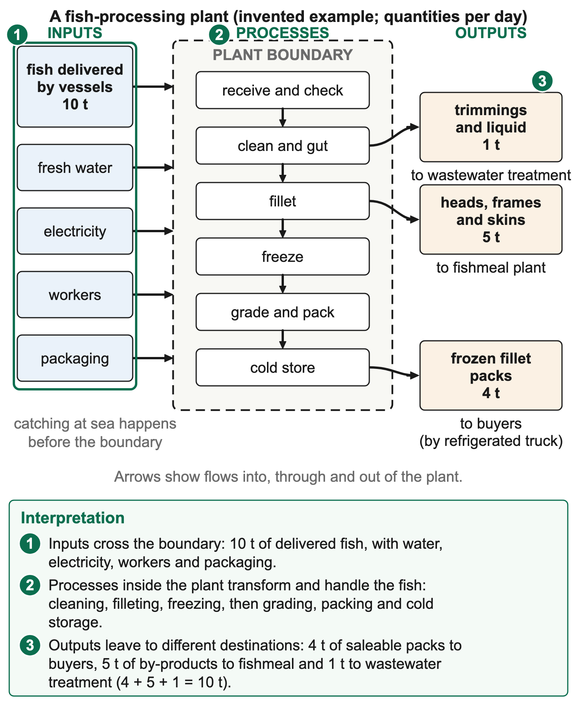

# 2.1 Industrial system

*nam-6137-nssco-2026. Offline study notes, rendered from the approved content units on 2026-10-30. Everything here is also what the flashcards are built from.*

---

## Primary, secondary and tertiary activities

### Primary, secondary and tertiary activities

Primary industry obtains raw materials from the natural environment. Secondary industry processes raw materials or manufactures products. Tertiary industry provides services. The classification concerns the activity, not the age, size or ownership of a business. A small processing workshop is secondary because it transforms material, while a large transport company remains tertiary because it provides a service. The word secondary does not mean second-hand goods, and primary does not mean that an activity is the most important in every economy.

The fishing chain makes the distinction concrete. Catching fish from a natural stock is a primary activity. Cleaning, filleting, freezing or canning the catch in a processing plant is secondary activity because the product is changed or prepared through processing. Transporting the finished product, financing operations, marketing it or repairing a vessel provides services and is tertiary. One connected industry therefore contains several activity types. Calling the whole chain primary because its raw material is fish overlooks the processing and service work that makes the product available to buyers.

A single enterprise can undertake more than one stage. If it catches fish, operates a factory and distributes products, its activities cross the three classifications. A question about the catching operation has a different answer from one about its refrigerated delivery service. The organisation’s name alone may not resolve the classification. Read the action described. A warehouse storing products and a factory changing them can stand beside one another while belonging to different categories. Physical proximity does not erase the distinction between storage as a service and processing as transformation.

### Worked example

Manufacturing can add value by changing form, quality, usability or readiness for sale. A whole fish becomes a packaged product that can reach a different market or be stored under specified conditions. Added value is not the same as profit: wages, energy, packaging and other costs also have to be paid. The geographical point is that processing changes the relationship between raw material and market. It can create employment and supporting demand locally, but its benefits depend on how the operation is organised, where inputs come from and whether the resource can support continued production.

Tertiary services connect the chain. A lender can help finance vessels or refrigeration; a mechanic keeps equipment working; a transporter links landing point, plant and market; a seller connects the product to customers. These activities can influence the efficiency and location of the other stages. A processing plant near fish landings may still struggle if power, transport or maintenance is unreliable. An explanation should connect the service to its effect rather than simply list jobs. The service classification describes what is done, while the effect explains why it matters.

### Worked example

Consider three records. A crew catches fish at sea and lands them. A plant converts the catch into frozen fillets. A transport operator carries sealed products to a market. The first supplies a natural raw material, the second transforms it and the third provides distribution. The same fish moves through all three, but the classification changes with the activity. If a fourth record describes a buyer purchasing a used machine, the word used does not make the activity secondary. The actual production or service function must be identified.

Industry type—primary, secondary or tertiary—is separate from location and technology. An automated factory is still secondary, while a traditional hand-operated processing unit can also be secondary. A primary fishing operation can use expensive modern equipment without becoming manufacturing. Likewise, a service can require buildings, machinery and skilled labour without producing a physical good. These distinctions prevent classification by appearance alone. A photograph of a large building may need a caption or visible process evidence before the industrial category can be established confidently.

The categories are also separate from public or private ownership. A government-operated transport service is tertiary, and a privately owned factory is secondary; reversing the owners would not change the underlying activity. Employment totals can be grouped by activity, but their interpretation needs consistent categories and periods. A rise in the number of service workers does not by itself prove that all manufacturing has declined. The whole economy may change in several ways at once. Classification is a framework for analysing those changes, not a statement that one category replaces every other one.

### Worked example

For a resource task, identify the verb and the material or service involved. Extracting, catching and harvesting indicate obtaining raw material in the relevant natural-resource setting. Processing and manufacturing indicate transformation. Transporting, financing, maintaining and marketing indicate services. Borderline cases need the actual operation described rather than a memorised business label. A resource can deliberately include several stages to test whether the learner distinguishes them. Cite the action as evidence, not merely the word fish or the fact that people work there.

### Worked example

These distinctions connect industry to agriculture, energy, transport and sustainable development. Primary resources create possibilities for local processing, while services make the chain workable. The relationships also lead to clustering, where related activities locate near one another and gain shared advantages. Classification is the starting point: the next explanation asks why a particular stage locates in a particular place, which inputs it needs and how changes at one stage affect the others. Keeping activity type separate from cause, location and ownership makes those later links much clearer.

### Connections

A small employment table can illustrate why the classification must follow the activity. Suppose ten workers are recorded in catching, five in processing, four in transport and three in maintenance services. Under that grouping, primary employment is ten, secondary five and tertiary seven, giving twenty-two altogether. The service workers do not become primary because their customers catch fish. Likewise, the figures describe employment counts, not each category's contribution to output value. A different table might classify an integrated enterprise as a whole for a stated statistical purpose, so read its convention before comparing it with an activity-by-activity exercise. Clear categories make the calculation meaningful rather than simply attaching labels after adding numbers.

---

## Factors influencing industrial location

### Factors influencing industrial location

Industrial location is a decision about where an activity can obtain inputs, carry out production and reach users under suitable conditions. Raw materials, labour, energy, capital, transport, markets and site characteristics can all influence that decision. Their importance differs among industries and stages. A fish-processing plant needing rapid access to perishable catch faces a different balance from a service delivered digitally. A useful explanation identifies a factor, shows how it affects operation or cost and connects that effect to the location. A list of factor names alone does not explain attraction to a place.

Raw materials matter through availability, quality, perishability, weight and the amount required. A plant processing fish can benefit from proximity to reliable landing points because the catch needs prompt handling and suitable temperature control. Shorter journeys can reduce delays or handling risks, although refrigeration and logistics can extend the feasible distance. A bulky raw material may make transport costs important, while an input available widely may be less decisive. Proximity is therefore a conditional advantage, not proof that the closest site is automatically the best overall choice.

### Worked example

A supplier’s reliability matters as well as its distance. A nearby landing point with highly uncertain supply may not sustain a plant sized for continuous operation. Seasonal availability can affect how much capacity is used and whether storage or product flexibility is needed. The resource itself must remain biologically and legally available; a factory cannot assume unrestricted catches simply because boats operate nearby. Connecting raw-material location to the plant therefore requires both access and a feasible continuing supply. The decision interacts with fisheries management rather than standing outside it.

Labour influences location through numbers, skills, reliability, training needs and the conditions under which people work. Processing may need workers for handling, machinery operation, maintenance, quality control, administration and logistics. A port town with relevant experience and training can attract an activity that needs those capabilities. Lower wage rates alone do not establish the lowest effective cost if turnover, skill shortages or poor working arrangements reduce productivity. A sound explanation links the particular labour requirement to the task, instead of using cheap labour as a universal answer for every industry.

### Worked example

Labour supply can also change over time as related firms cluster and training develops. An existing concentration of skills may reduce recruitment difficulty, while growing demand can create competition for experienced workers. The same cluster can therefore provide benefits and pressures. A location account should specify the mechanism supported by the evidence. If a resource identifies a training centre and available technicians, those are relevant details; the mere existence of a large population does not prove that all required skills are present. Population size and occupational suitability are different pieces of information.

### Worked example

Energy is needed for machinery, lighting, refrigeration and other processes. A fish plant can be particularly sensitive to interruptions in cold storage and freezing. Reliable supply can protect product quality and reduce downtime, while the tariff affects operating costs. A site with low advertised energy prices may be less attractive if interruptions create costly losses or require expensive backup. Distinguish the availability, reliability and price aspects rather than treating power as one undifferentiated word. The relevant requirement depends on the equipment and process shown in the resource.

### Worked example

Energy supply can also affect the design of the operation. Backup generation, insulation, efficient equipment or storage arrangements may reduce some exposure to interruption, but they require investment and maintenance. Their presence does not make the supply problem disappear automatically. A location comparison should consider whether the plant can afford and operate the proposed response. A statement that the town has electricity is less informative than evidence about a suitable connection, capacity and reliability for the intended load. The geographical advantage lies in meeting the actual industrial need.

### Worked example

Capital is finance and productive resources needed to establish or expand operations. A plant may require premises, processing lines, refrigeration, vehicles, working finance and other investment. Access to suitable finance can make a location or project feasible, while financing costs and repayment conditions affect the decision. The existence of a bank does not guarantee that a borrower will receive a loan. A lender considers the proposal and risk under its own conditions. A supported explanation therefore says that financial services can facilitate investment, not that they must fund every business nearby.

Working finance is important between paying for inputs and receiving sales income. A fish processor may need to buy catch, pay wages and energy bills and package products before customers pay. Insufficient liquidity can interrupt production even when machinery and a building already exist. This is different from the long-term fixed investment in a plant. A location with suitable financial and business services may help manage both needs, but the firm still requires a viable operation. Geography links access to services with the practical chain rather than promising that finance creates demand or fish stocks by itself.

### Worked example

Transport connects raw-material sources, the plant and markets. Roads, ports, shipping services and appropriate vehicles influence time, reliability and cost. Perishable or frozen products may need a maintained cold chain, so the suitability of transport matters as much as the number of routes. A short distance with frequent delays can be less useful than a somewhat longer dependable connection. A site comparison should therefore consider the product’s handling requirements, route capacity and services. A line on a map does not prove that transport is affordable or suitable for every cargo.

Ports can concentrate landing, storage, shipping and supporting services. Walvis Bay and Lüderitz provide Namibian contexts for examining the fishing chain. Lüderitz harbour serves as a base for the fishing industry, and Walvis Bay has cold-storage facilities at the port. These facts support specific links between industrial activity and infrastructure. They do not establish that every plant in either town has identical costs or access, and changing capacity figures need dated sources. The example should explain why the infrastructure matters rather than rely on the place name alone.

Markets influence location through demand, product requirements, delivery time and the ability to reach customers. Some industries benefit from being near a large local market; others can produce near raw materials and use transport to reach distant buyers. A fish processor selling frozen products abroad needs suitable packaging, quality systems and shipping links, while a fresh local product may face tighter delivery constraints. The market is not simply a place on a map: it includes buyers with particular needs. A large nearby population does not automatically demand the exact product at a viable price.

### Worked example

Market access can include information and services that connect sellers and buyers. Marketing, distribution networks and compliance with the relevant product requirements can affect whether goods are accepted. These are operational considerations rather than a guarantee that exports will be sold. A location explanation can link a port and specialist services to access to foreign buyers while recognising transport costs, competition and quality requirements. If the resource supplies a local-versus-export comparison, use its product and delivery information instead of assuming that all fish products must serve the same market.

Site factors concern the specific plot and its immediate environment. Space, slope, ground conditions, water, drainage, waste handling, expansion potential and proximity to sensitive uses can affect suitability. A low purchase price may be offset by preparation, flood exposure or inadequate utilities. A fish plant needs hygienic water and arrangements for wastewater and by-products; those requirements connect the site to the wider town and environment. A site should not be selected solely because it is empty. The question is whether it can support the intended activity without unacceptable constraints or effects.

Situation is the location relative to other places and networks, while site refers more directly to the plot’s own characteristics. A level plot with room to expand is a site advantage; closeness to a port or market is a situational relationship. The terms can interact in a practical decision, but separating them improves explanation. A map of routes provides evidence of situation, while a plan showing drainage and available land provides site evidence. Do not infer an unshown ground condition from a road connection or a market distance from a contour alone.

### Worked example

Consider a plant choosing between A beside the landing harbour with reliable power but limited expansion space, and B farther inland with more land but a longer refrigerated journey. A has raw-material and transport-time advantages, while B offers a site-expansion benefit. The decision depends on scale, cold-chain cost, supply and the importance of future growth. A recommendation should compare the stated trade-off rather than declare the closest site best simply because fish are perishable. If costs are supplied, calculate comparable totals and keep assumptions about volume and time explicit.

### Worked example

A second comparison can hold market distance similar but identify a skilled maintenance cluster at A and repeated equipment-repair delays at B. The labour/service link can favour A because breakdown time affects production and refrigeration. This is a developed explanation of attraction, not just a list of jobs. If the resource shows higher rent at A, that cost also matters. A cluster advantage can be worthwhile without making the location cheaper on every individual item. Evaluate the combined operational effect using the criterion supplied.

### Worked example

Location factors can change in importance as technology, infrastructure, resources and markets change. Improved cold transport may extend the distance a plant can operate from landings, while a declining stock can undermine a previously favourable raw-material location. New services can improve an existing town’s attraction; congestion or environmental pressure can create constraints. A historical reason for location is not necessarily a complete explanation of current operation. Distinguish initial attraction, continuing advantages and later adaptation when the resource provides a time sequence.

These factors connect industry to the physical environment, settlement, energy, water and trade. The most useful answer is a chain: identify the specific input or service, explain how access affects production or delivery, and connect that effect to the location under the stated conditions. Real decisions involve several such chains and trade-offs. A plant can be close to fish yet lack a suitable site, or near a market yet face unreliable power. A supported judgement uses the evidence to rank relevant needs rather than naming all factors with no explanation of their practical importance.

### Worked example

A cost comparison can develop the location reasoning. Suppose the same proposed output at site A involves monthly raw-material delivery of N$48,000, finished-product transport of N$12,000 and energy of N$20,000. The corresponding stated costs at B are N$74,000, N$9,000 and N$18,000. The three specified costs total N$80,000 at A and N$101,000 at B, a N$21,000 difference. A's energy and finished-transport costs are higher, but its raw-material-delivery advantage more than offsets them within this limited comparison. The result supports a cost advantage on those stated items, not a guaranteed profit or a complete site recommendation.

The comparison needs a common period, output and scope. Adding A's monthly energy bill to B's annual delivery cost would produce a meaningless ranking. A site purchase price is also not directly comparable with one month's operating bill without a stated method. If B has essential expansion space that A lacks, that non-cost constraint may matter more than the partial monthly saving. The answer should preserve the calculation and then evaluate what it does and does not resolve. A numerical advantage is evidence within the decision, not permission to ignore feasibility or omitted costs.

### Connections

A location decision should state which cost or constraint is decisive for the particular operation, then explain why the competing site is less suitable under those stated conditions.

---

## Physical controls on fish resources

### Physical controls on fish resources

The availability of marine fish is influenced by ocean conditions, food webs, habitat, reproduction and movement. Namibia’s fishing context is strongly connected with the Benguela system and coastal upwelling. These physical conditions can support productive marine food webs, but a cold current is not a direct food item and a long coastline does not automatically produce a larger sustainable catch. The explanation must connect water movement, nutrients, biological production and fish, while recognising variability and limits. A productive ecosystem can still be harmed by unsuitable conditions or excessive extraction.

Upwelling is the rise of deeper water towards the surface. Off Namibia the cold Benguela Current flows northwards, driven by the south-east trade winds. Near the coast these winds push surface water offshore, and cold water from depth rises to replace it. The replacement water is often cold and rich in nutrients accumulated through processes at depth. Near the sunlit surface, those nutrients can support phytoplankton growth when light and other conditions are suitable. This is the key link to biological production. The process should not be explained as fish being lifted mechanically from the bottom into fishing nets.

### Worked example

Phytoplankton are microscopic photosynthetic organisms at the base of many marine food webs. Zooplankton and other consumers feed on them, and fish can feed at different levels. Small pelagic fish can provide food for larger predators, linking primary production to commercially useful resources. The chain involves energy and material moving through organisms, not nutrients being converted instantly into large adult fish. Growth, reproduction and survival take time, and not all biological production becomes available as a human catch. A food web is more complex than one unbranched row, but a simple chain can illustrate the relevant connection.

### Worked example

A process resource can show wind-related surface movement offshore, colder nutrient-rich water rising, phytoplankton growth in the lit layer and consumers feeding. The ordering matters. Removing nutrients from the surface while claiming the diagram shows increased nutrient supply would contradict the proposed mechanism. Likewise, arrows from large fish directly to sunlight would confuse feeding relationships with the energy source for photosynthesis. Follow the key and arrow convention: some diagrams show food-to-consumer energy flow, while others label who eats whom differently. The stated convention must remain consistent.

Ocean currents influence temperature, nutrient transport and the movement or habitat of fish. The Benguela system contributes a cold-water setting along Namibia’s Atlantic coast, with important upwelling processes. Different species respond to temperature and water properties differently, so a change can alter distribution or recruitment rather than causing one identical response across all stocks. A fishing vessel’s catch can change if fish move, even before a biological population decline is established. The interpretation of availability therefore needs a spatial and time scale as well as a count of landed fish.

Cold water can hold more dissolved oxygen than warmer water under comparable conditions, but oxygen supply and consumption also depend on mixing, circulation and biological processes. Productive upwelling systems can still experience low-oxygen events in particular layers or places. It is therefore too simple to say cold water guarantees healthy fish. Decomposition of large amounts of organic matter can consume oxygen, and the ability of fish to avoid a low-oxygen area varies with species and conditions. The food-supply benefit and oxygen-related risk can coexist within a dynamic ecosystem.

### Worked example

Namibia’s coastline runs for about 1,500 km from the Kunene River to the Orange River. A long coast gives a large sea area to fish, and because Namibia controls a 200-nautical-mile Exclusive Economic Zone along its whole length, its fishing grounds over the productive upwelling zone are very large. Length is still only one part of resource availability. Continental shelf characteristics, suitable habitat, stock distribution, ports, weather and permitted activity also matter. A longer coast with low productivity or difficult access need not support a larger catch than a shorter productive coast. Real marine resources are unevenly distributed and move across political and physical boundaries.

### Worked example

A long coastline can create opportunities for several ports and communities, while distances between them affect service access and transport. Namibia’s Walvis Bay and Lüderitz provide examples of coastal centres supporting fishing operations. The physical marine setting supplies possibilities; port facilities, finance, labour and management make exploitation feasible. These are connected but different influences. A location explanation that names the cold current without a food-web link is incomplete, while one that names only a harbour leaves out why a useful biological resource is available offshore in the first place.

### Worked example

A comparison of two coast sections can illustrate the distinction. A has recorded upwelling, nutrient supply and suitable habitat; B is longer but the resource gives no equivalent production evidence. The observations support a stronger biological-resource explanation for A, not a conclusion that B must have more fish simply because its coastline is longer. Actual sustainable catch would still require stock and management evidence. The comparison separates a physical opportunity from a numerical harvest claim, preventing a plausible mechanism from becoming an invented quota or current production total.

Food-web evidence also helps interpret change. Lower phytoplankton production can affect consumers, but the timing and magnitude depend on stored reserves, movement and alternative food. A large bloom can supply food yet become harmful under some conditions, such as toxic species or oxygen depletion after decay. The term plankton does not automatically mean danger, and the word bloom does not guarantee useful fish growth. Identify the organism, water conditions and observed effect where supplied. This prepares the later discussion of red tides and other threats without reversing the basic nutrient–production pathway.

### Worked example

These controls connect the physical environment to primary industry and sustainable development. A renewable biological resource needs time and suitable conditions to replace what is removed. Strong natural productivity does not justify unlimited fishing, while a poor season does not automatically establish one human cause. A supported account follows the mechanism from current or upwelling to nutrients, producers, consumers and fish availability, then states what further evidence is needed for a harvest judgement. The physical system explains opportunity and variability; responsible use also requires observation, limits and effective management.

Nutrients such as nitrogen- and phosphorus-containing compounds support producer growth when light and other requirements are met. Their availability differs from the energy supplied by sunlight: neither replaces the other. A phytoplankton-rich layer can provide food for zooplankton and some fish, which in turn support other consumers. The chain explains why upwelling can help sustain fisheries, but the final fish population still depends on suitable habitat, survival and replenishment. A diagram should therefore show biological steps rather than draw an arrow labelled cold water directly becoming adult fish.

### Worked example

Continental-shelf conditions can influence the habitat and accessibility of resources along a coast. A map of shallow shelf, deeper water and landing ports supplies different information from coastline length alone. A port may be well placed for a particular fishing ground even if another stretch has more coast kilometres. Travelling distance, sea conditions and the location of the target all affect practical access. These relationships connect the physical resource to the industrial location account, while avoiding an unsupported assumption of equal productivity in every coastal kilometre.

### Connections

A short change record needs the same care. Fewer landings at one place could reflect reduced effort or movement of fish as well as lower stock. Survey and effort information help discriminate those possibilities. The environmental mechanism explains a possible change in availability, but the observed catch is an outcome of both resource and fishing activity.

---

## Demersal, pelagic and fishing methods

### Demersal, pelagic and fishing methods

Demersal fish live or feed mainly near the seabed, while pelagic fish occupy the water column away from the bottom, including species found nearer the surface or in mid-water. The distinction concerns habitat and behaviour, not whether fish are caught close to shore or whether they are large or small. Hake provides an important demersal fishing context for Namibia, while horse mackerel is an important pelagic example. Different species and life stages can move, so the categories should not be turned into a claim that an individual fish remains at one exact depth throughout its life.

### Worked example

Fishing methods need to match the target’s distribution and behaviour. A demersal operation may use a bottom trawl to work near the seabed, or appropriately arranged lines with baited hooks. A pelagic school can be targeted with a mid-water trawl or an encircling method under suitable conditions. The method’s name alone is not a complete description: identify where the gear operates, how fish enter or encounter it and how the catch is retrieved. A net drawn above the seabed should not be described as scraping the bottom unless the resource shows that contact.

Trawling involves towing a net through the relevant water zone. Bottom trawling operates at or near the seabed according to its design, while mid-water trawling targets the water column. Gear, speed, mesh and location affect the catch and impacts. A generic explanation that a trawler simply circles a school and closes a purse underneath would confuse trawling with purse seining. For a diagram task, follow the towing direction, net opening and depth relative to the seabed. These features identify the operation more accurately than the outline of the vessel alone.

### Worked example

Purse seining surrounds a school with a net and closes the lower opening so fish are retained. It is associated with schooling fish in suitable pelagic conditions. The school must be located and the gear deployed appropriately; the method does not imply that every fish in a broad sea area is collected. A sequence can show encirclement, closing and retrieval. If the resource shows a net simply dragged in a line, do not infer an encircled school. The contrast concerns the catch mechanism and the spatial arrangement of the net.

Longlining uses a line with multiple baited hooks under a particular configuration. The depth and arrangement can target different species. The relevant environmental and selectivity implications depend on the operation, including non-target interactions. A short school explanation should not imply that a hook method has no bycatch or that a net automatically catches only the named species. All methods need evidence about the actual target, gear and conditions before their performance can be judged. The objective is understanding exploitation, not treating one gear type as universally best.

### Worked example

A three-panel resource can distinguish the settings. A shows a net towed close to the bottom with fish marked near the seabed. B shows a net towed through a school in mid-water. C shows a school encircled and a lower opening being closed. A supports a demersal-trawling interpretation, B a pelagic mid-water operation and C purse seining. The evidence is the relationship between fish, gear and depth. Merely naming the fish as marine or saying the boat uses a net would not discriminate the methods.

Capture is followed by handling and landing. Cooling, suitable storage, traceable records and timely transport can help maintain quality for processing or sale. A high volume caught is not automatically a high-value usable output if handling losses are large. The geographical chain therefore connects the offshore method with port services and processing needs. A vessel’s operating range and trip duration also affect its demand for fuel, maintenance and storage. These factors help explain why specialised service centres develop around fishing ports rather than every landing site offering the same facilities.

Exploitation can affect stocks and habitats. Catching juveniles or too many breeding fish can reduce future replenishment, while some gear can disturb habitats or catch non-target organisms under particular conditions. The impact depends on intensity, location, selectivity and the wider ecosystem. A diagram showing near-bottom gear does not measure its full ecological effect, and a single bycatch observation does not establish an annual rate. Management needs repeated catch and environmental evidence as well as an understanding of the mechanism. This links the methods to quotas, net rules and conservation measures.

### Worked example

A useful comparison might identify a target species concentrated near the bed and a proposal to deploy a surface-school method. The habitat evidence makes the proposed match doubtful unless further information shows that the fish are accessible to it. Another proposal can use suitable gear but operate during conditions that threaten stock recovery. Suitability for catching is therefore different from sustainability of the amount or timing. A complete account considers both questions, rather than assuming that an efficient catch method is sufficient evidence of responsible exploitation.

### Worked example

These distinctions connect primary activity with the whole industrial system. Offshore habitat and gear affect what is landed; handling affects what the plant can use; markets and management affect what can be sold and sustained. For a resource answer, identify demersal or pelagic from the fish’s position and the stated convention, describe the actual capture sequence and recognise relevant limits. This produces a supported explanation of how the resource is exploited without inventing current fleet totals, quotas or biological outcomes that the resource does not supply.

### Connections

A depth table can separate habitat from distance offshore. Fish group A is recorded within five metres of the seabed in 200 m of water. Group B forms a school at 30 m depth where the seabed is also 200 m down. A is consistent with a demersal setting and B with a pelagic setting in that record. The distinction is position relative to the bed, not the shared total water depth or a claim that one group lives on land. Gear interpretation should use the same reference: a net surrounding B in mid-water is not thereby a bottom trawl.

---

## Threats and sustainable fish-resource management

### Threats and sustainable fish-resource management

A fish resource can be threatened by physical environmental changes and human pressures. Harmful algal events, changes in water temperature or oxygen conditions, pollution and excessive extraction affect availability through different mechanisms. The effects can interact, and a decline in catch does not by itself identify the cause. Fish may move, fishing effort may change or the stock may decline. A supported explanation distinguishes those possibilities and uses appropriate observations before assigning responsibility. Management needs both knowledge of the ecosystem and effective control of activities, not a single label such as conservation.

The term red tide is often used for harmful algal blooms, but harmful blooms are not necessarily red and not every algal bloom is harmful. Some species produce toxins or have other harmful effects, while large amounts of decaying organic material can consume oxygen. Low oxygen can stress or kill organisms unable to avoid the affected water. Blooms can also affect gills, light or food-web conditions depending on the organisms involved. A school explanation should state the specific pathway supported by the evidence instead of assuming that colour alone proves a toxic event.

### Worked example

Algae also support marine food webs through primary production. The presence of phytoplankton is therefore not itself a threat. The distinction concerns the species, concentration, water conditions and effect. A productive bloom can be beneficial to consumers under suitable conditions, while a harmful event can damage fish, other wildlife or fishing activity. This is why a simple statement that nutrients always increase the catch is inadequate. Biological response takes time and can have limits or adverse outcomes. Follow the nutrient–production pathway and then examine whether the resource supplies evidence of harm.

A monitoring record can combine algal identification, dissolved oxygen, fish behaviour and water movement. If oxygen falls after a large mass of algae dies and decomposes, the observations support an oxygen-consumption pathway. If a toxin is measured, that supplies different evidence. A fish-kill image without those data establishes damage but not the unique cause. Other pollution, temperature or oxygen processes may be involved. A cautious conclusion can identify the supported mechanism and the observations still needed, without pretending that every coastal discolouration has the same explanation.

Fluctuating water temperatures can alter habitat suitability, growth, reproduction and the distribution of species. A warmer or colder interval can shift where fish are found, affecting fishing grounds and catch rates. The response differs among species and life stages. A reduced catch near one port may reflect redistribution rather than an identical decline across the entire population. To investigate, compare effort, survey coverage, temperature and stock information. Temperature alone does not provide a complete measure of available fish, and a short unusual event should not automatically be treated as the new permanent state. Namibia’s coast also has two distinctive physical threats. Hydrogen sulphide eruptions happen when bacteria decompose dead plankton on the seabed and the gas bursts upwards; it is poisonous and removes oxygen from the water, killing fish, as in a large eruption around Walvis Bay in July 2007. About once a decade a Benguela Niño brings warm, nutrient-poor water into the northern part of the system. Together with earlier overfishing, the 1993–1995 event left pilchard stocks so low that the pilchard quota was set at zero for 2002.

### Worked example

Temperature also interacts with oxygen and food supply. Warmer water generally holds less dissolved oxygen under comparable conditions, while changes in circulation and biological activity can further alter the balance. Upwelling can bring useful nutrients while water layers or decomposition create oxygen constraints elsewhere. The ecosystem can therefore be productive and vulnerable at the same time. A resource answer should connect the specific condition to its physiological or distribution effect rather than equating cold water with guaranteed safety or warm water with the death of every fish.

Pollution can enter from land, vessels or industrial activities. Depending on the substance, concentration and pathway, it can affect water quality, habitats and organisms or lead to restrictions on use. Wastewater with high organic content can contribute to oxygen demand during decomposition, while oils or other contaminants can have different effects. A port’s existence does not prove that it is polluting a particular fishing ground. Evidence should identify a source, route and receiving environment. This source–pathway–effect chain is more informative than listing pollution without explaining what changes.

Processing operations also need appropriate waste and by-product management. Some material can be used in suitable products or recovery processes, while unsuitable discharge can create environmental pressure. Handling a useful by-product is not the same as disposing of all waste safely. Treatment, storage, transport and monitoring need to fit the material and conditions. A location near water does not make dilution a complete solution to pollution. The industrial system must connect its outputs to appropriate management rather than drawing only the marketable product and omitting the remaining material.

### Worked example

Overfishing occurs when fishing pressure removes too much relative to the stock’s capacity to sustain the relevant production and recovery objective. The issue is not merely that many fish are caught: productive stocks can support substantial catches under suitable management, while even smaller removals can be excessive for a vulnerable stock. Reproduction, recruitment, growth, natural mortality and movement affect the balance. A resource comparing catch with a supported recovery measure can illuminate the problem, but actual stock assessment is more complex than one simple subtraction. Its causes include strong demand and the profit motive, too many vessels chasing a limited stock, efficient fishing fleets, illegal or unreported catches and weak control. Before independence in 1990, foreign distant-water fleets overexploited Namibia’s fishing grounds because management was weak or absent.

### Worked example

In a simplified stock exercise, 100 units are present initially, 40 are added through the stated replenishment and 60 are removed, with other changes explicitly excluded. The result is 80 units, a net decline of 20. This illustrates why a renewable resource can still shrink when removal exceeds replenishment. It is not a measured Namibian stock or a complete fisheries model. A later recovery would require its own conditions and evidence. A quota written above the supported replenishment would not make the arithmetic or biology sustainable simply because it is official.

### Worked example

Conservation law provides a framework for controlling use, assigning responsibilities and supporting enforcement. Namibia’s Marine Resources Act, 2000 is a named example of the legal framework relevant to marine resources. Its provisions include mechanisms for total allowable catch and quotas informed through the stated scientific and advisory processes. For learning the management principle, the key connection is between assessed resource conditions, a limit on extraction and compliance. The Namibian system, as described in 2007, links several measures. After independence in 1990 Namibia declared a 200-nautical-mile Exclusive Economic Zone, ending uncontrolled foreign fishing in it. Fishing rights limit how many companies may fish, every commercial vessel needs a licence, and a total allowable catch for each major species is set every year from scientific advice and shared out as quotas. Closed seasons protect breeding, minimum mesh sizes let small fish escape, every commercial vessel carries a fisheries observer, and sea, air and shore patrols and inspectors at Walvis Bay and Lüderitz check that the rules are kept.

### Worked example

A total allowable catch limits the overall amount permitted for a defined resource and period under the relevant system. Allocated quotas divide or specify permitted amounts according to that framework. A quota is not a forecast that exactly that many fish will be caught, nor proof that unreported catches are absent. Setting a biologically appropriate limit requires evidence, and implementing it requires records, monitoring and enforcement. The relationship matters more than treating any number labelled quota as automatically sustainable. Conditions and stock knowledge can change, so management needs review rather than one permanent unchanging value.

A quota comparison can show why compliance and setting are separate. In one scenario the limit fits the supplied assessment but actual extraction exceeds it. In another, all users comply but the limit is based on outdated stock information. Both can fail the recovery objective through different pathways. The first needs effective control of actual removal; the second needs reassessment of the permitted amount. A good judgement identifies which issue the evidence supports. More patrols alone do not correct an unsuitable limit, while a revised limit on paper does not ensure compliance.

### Worked example

Net size and type influence selectivity and the organisms retained or affected. Suitable mesh rules can allow some smaller fish to escape and reduce capture of juveniles under the relevant gear conditions. Gear design or restrictions can also address non-target catch or habitat interactions. No net rule should be described as catching only the desired species with no losses. Selectivity depends on fish size, body form, gear and how it is used. A resource should provide enough information to link the specified change to its intended effect rather than treating larger as automatically better for every fishery.

A diagram comparing two mesh sizes can support the mechanism if it shows which illustrated fish pass through and which remain. The figure should not shrink the fish between panels or change other conditions while claiming that mesh alone was tested. If the objective is allowing juveniles to escape, identify the relevant size class and the recorded result. If escaped fish have uncertain survival, that uncertainty matters to the broader stock conclusion. A simple classroom image can demonstrate a selectivity principle without proving the full ecological performance of a commercial gear system.

Other measures can include temporal or spatial controls, research, observation and management of pollution or habitat pressures according to the relevant framework. Their purpose should be linked to the problem. Protecting a breeding period may help replenishment if the species and timing are appropriate; monitoring can improve knowledge but does not itself reduce every harmful activity. A management list is incomplete without those links. The amount of detail needed depends on the task, and a current closure date should be sourced rather than inferred from an undated school example.

### Worked example

Sustainable use also has economic and social conditions. Fishers, processors, workers and communities depend on the resource, while restrictions can impose short-term costs. Consultation, workable transitions, reliable information and fair implementation can affect whether controls succeed. That does not mean every livelihood pressure justifies unlimited extraction. It means the management account must consider compliance incentives and alternatives alongside biological limits. Long-term supply, employment and ecosystem functions can support one another when use remains within a defensible plan, but the relationship needs evidence and continued review.

A combined response might use stock assessment to inform limits, catch records and inspections to check removal, suitable gear rules to improve selectivity and pollution controls to address water quality. Each component targets a different pathway. If the evidence identifies a harmful bloom, increasing mesh size alone may not address its immediate cause. If the problem is unreported excessive catch, a water-quality programme alone leaves extraction uncontrolled. Choose measures that fit the documented pressure and state what they can achieve, under what conditions and what remains unresolved.

### Worked example

These issues connect the physical marine environment with the industrial chain and sustainable development. A processing plant needs continued raw material, so conservation is not separate from its future operation. At the same time, a productive ecosystem does not guarantee profitable processing without markets, services and suitable handling. A supported judgement links the resource threat to the proposed response and the intended outcome. It distinguishes a rule from compliance, a measured stock from a catch count and a short event from a permanent trend, while retaining the named mechanisms that make the explanation testable.

### Worked example

Suppose a stock assessment supports a limit of 60 stated units for an interval, but actual recorded removal is 90. The immediate compliance gap is 30 units. A printed 60-unit quota does not demonstrate that extraction remained within it. In a second scenario, recorded removal matches the limit but a new assessment identifies a lower recovery capacity. The compliance result can be satisfactory while the biological setting of the limit needs review. These scenarios distinguish rules, actual activity and the resource evidence rather than treating them as one measurement.

Catch trends should also be compared with effort. A simplified record of 100 tonnes over ten vessel-days gives ten tonnes per vessel-day; a later record of 80 tonnes over four vessel-days gives twenty tonnes per vessel-day. Total catch falls, but the effort-adjusted value rises. Neither number alone establishes the whole stock condition, because location, gear, behaviour and coverage can change. The exercise shows why a lower total cannot automatically be used as proof that a particular conservation measure failed or that pollution caused a decline. Relevant monitoring combines several sources and interprets them in the biological context.

### Connections

The response should match the supported pressure. A toxin observation needs a different immediate assessment from a documented excess-catch record. Long-term management can address several threats together, but the explanation must retain the distinct pathways.

---

## Locating a fish-processing plant

### Locating a fish-processing plant

A fish-processing plant needs reliable access to suitable catch and the services that preserve and transform it. Proximity to landings can reduce handling time, while power supports freezing and machinery. Labour and maintenance skills keep the process operating, capital funds equipment and working needs, and transport connects the plant to buyers. Suitable water, waste arrangements, land and room for the intended scale are site considerations. The location explanation should connect these needs to the particular place rather than repeat a list without showing how the operation benefits.

Walvis Bay and Lüderitz provide Namibian contexts because their port activities and services connect to fishing. A plant near a landing point may benefit from shorter raw-material journeys and access to specialised services. That advantage does not remove market distance, energy reliability or site constraints. If one proposed site is close to catch but lacks suitable power, compare the cost and feasibility of addressing the shortfall. Perishability makes the chain important, not a rule that every plant must occupy the nearest possible plot to the water.

### Connections

For a decision, state the priority and use the supplied evidence. A plant serving a distant frozen-product market may place different weight on cold storage and shipping connections from a small operation supplying a nearby fresh market. Compare like costs and periods, identify non-cost constraints and avoid predicting guaranteed profit from one favourable factor. This connects general industrial location to the fish-processing system, where inputs, processes and outputs show why the particular raw material and services matter in practice.

---

## Inputs, processes and outputs

### Inputs, processes and outputs

An industrial system can be analysed as inputs, processes and outputs. Inputs are resources entering the operation, processes are actions that transform or handle them, and outputs leave as products, by-products, waste or other results. A fish-processing flow diagram should show those relationships, not simply arrange three headings around the word fish. The system boundary matters: catching may be an upstream primary activity, while a plant’s boundary begins with delivery of the catch. A service can be an input to the plant even though its provider belongs to the tertiary category.

### Worked example

Inputs include fish of suitable species and quality, labour, water, energy, packaging, machinery and finance for operation. Some are physical materials, while others provide capacity or services. Raw fish is not the only input because workers, freezing equipment and suitable water are also needed. The exact combination depends on the product. A canning operation and a frozen-fillet operation may share cleaning and handling needs while using different equipment and packaging. A resource should identify the actual intended process before all possible inputs are treated as necessary in the same quantities.

Processes can include receiving and checking catch, cleaning, heading or gutting, filleting, chilling or freezing, grading, packing and storage before dispatch. The order and details depend on product and quality requirements. A flow diagram can branch where a by-product leaves one stage or where different products take different routes. Processing is not the same as transport from the vessel to the factory, although that delivery is connected to it. The distinction helps identify secondary activity without claiming that every part of a long fishing chain occurs inside one building.

Outputs include the saleable product and materials that need another use or safe management. A frozen fillet, a canned product or a packaged whole fish can be an output under the specified process. Heads, bones and trimmings may become useful by-products under suitable arrangements, while wastewater and unsuitable material require appropriate management. Calling every non-fillet material useless waste can overlook recovery opportunities, but calling it a by-product does not prove that a viable safe use exists. The actual destination and handling need to be stated.

### Worked example

A simple mass balance illustrates the connections. Suppose 1,000 kg of fish enters a stated processing stage, with 600 kg leaving as the main product, 250 kg as usable trimmings and 150 kg as other specified material, with no other mass change in the exercise. The outputs sum to 1,000 kg. The main-product share is 60%, not a 60% profit margin. Mass yield and financial profitability are different quantities. If water, packaging or other inputs cross the boundary, the full balance must include them rather than forcing an incomplete record to conserve only fish mass.

### Worked example

The system also uses energy and water, which cannot be evaluated solely by adding kilograms of fish. A flow chart can use different arrow types or labels to show material, energy and information. Units and the key should remain clear. A number of workers is not a mass output, and an electricity bill is not a quantity of fish. A good resource makes those categories distinct so the learner can explain the operational relationship without combining unlike measurements. Quality checks and stock records influence decisions even though they are not another edible material in the final box.

Breakdowns and delays can propagate through the system. If freezing stops, material awaiting that stage may accumulate and product quality can be threatened under the relevant conditions. If delivery fails, machinery and workers may be underused. If dispatch transport is delayed, storage capacity may become a constraint. The explanation should identify the affected input or stage and the resulting effect. A general statement that the plant loses money may be plausible but is less developed than showing how an interrupted process affects throughput, quality or the ability to meet orders.

Environmental management also belongs within the system. Water supply and wastewater treatment connect the plant to local services and the receiving environment. Energy efficiency and appropriate by-product use can reduce some costs or pressures, while their performance depends on equipment and management. A diagram ending only with saleable fish can conceal these relationships. Include the relevant outputs and destinations rather than implying that all material becomes the main product. This is especially useful in a sustainable-development discussion that asks about both economic activity and environmental effects.

### Worked example

A resource can test the model with three records: raw catch and packaging arriving, cleaning and freezing inside the plant, and packed products plus specified residual material leaving. Classify each by the system boundary. The packaging is an input even though it may also leave as part of the product’s final package; freezing is a process rather than a raw material; a residue has an output destination that needs identifying. A correct answer follows the actual flow rather than assuming that every noun is an input and every verb an output.

### Worked example

These relationships connect plant location, industrial classification and supporting services. Reliable fish supply and power explain inputs; skills and equipment explain processes; buyers and transport explain outputs reaching a market. Finance and maintenance support continuity across the chain. An explanation of the system should therefore name the specific stage and link it to what enters or leaves. It provides a practical basis for interpreting a flow chart, judging a bottleneck or explaining why a port-based cluster can benefit related operations while still needing resource and environmental management.

### Connections

A bottleneck record can identify more than one kind of capacity. A plant may have space to store incoming fish but insufficient freezing throughput for the delivery schedule. Extra raw-material storage alone does not increase the freezing stage's output per hour. Conversely, a functioning line can be limited by inadequate dispatch storage. Compare the stage capacity, input timing and product requirements before recommending equipment. This is an application of the system model: the relevant process or service must address the actual constraint rather than simply add another input.

---

## Agglomeration in the fishing industry

### Agglomeration in the fishing industry

Agglomeration is the clustering of related economic activities in an area, linked through shared advantages and supporting activities. In a fishing centre, landings, processing, cold storage, transport, equipment supply, repairs and finance can locate near one another. The benefit is a spatial and operational relationship: firms can access specialised services, skills and connections more easily under suitable conditions. A list of jobs or exports does not explain agglomeration unless it shows why the activities cluster and how one supports another.

### Worked example

For example, a repair service near several fishing operations can draw on their demand, while those operations benefit from quicker access to maintenance. A cold store can serve several users, and a pool of relevant labour can help firms recruit skills. These links can reinforce the area’s attraction. They do not guarantee low costs on every item: competition for land, congestion or demand for specialised workers can create pressures. A supported account identifies the benefit or cost actually evidenced by the resource rather than treating proximity as automatically beneficial in every respect.

### Connections

Walvis Bay and Lüderitz provide contexts for interpreting such clusters. Lüderitz harbour supports the fishing industry, including repair work, and Walvis Bay has cold storage at the port. Use those facts to explain service–industry links without inventing the number of firms or jobs. This connects agglomeration to industrial location and tertiary services: related activities draw one another through usable advantages, not because every business in a port has the same industrial classification or because employment alone is a mechanism of clustering.

---

## Services supporting the fishing chain

### Services supporting the fishing chain

Fishing and processing depend on services that connect raw material, operations and buyers. Local and foreign markets, supply and maintenance, transportation and finance each perform different functions. Their contribution should be explained through the chain. A vessel can catch fish but still need landing access and storage; a plant can produce a product but still need buyers and delivery; a buyer’s order can be profitable in principle yet impossible to fulfil if equipment fails. A service list becomes an explanation only when it connects the service to a practical operational effect.

Markets are groups of buyers with particular demands, not simply any town containing people. Local buyers may require fresh products in small frequent deliveries, while some distant buyers require frozen, packaged or otherwise prepared products with suitable documentation and quality. The product, timing and transport requirements influence the chain. A plant cannot assume that all fish will sell merely because a large market exists somewhere. Price, quality, reliability, competition and access affect whether its output matches demand. The location and service explanation should retain those conditions.

### Worked example

Foreign-market access can create opportunities for sales income and trade, while exposing operations to distance, exchange conditions and changing demand. A decline in one buyer’s orders can affect plant utilisation even if catches remain available. Diversifying buyers may reduce some dependence, but it requires suitable products and connections rather than simply naming more countries. A resource with a local-versus-export comparison should be interpreted on its stated terms. Do not infer a country’s current export share or the value of sales without a dated source or supplied data.

### Worked example

Supply services provide fuel, ice, packaging, equipment and other operational inputs as required. Their reliability affects turnaround and continuity. A vessel delayed by missing parts or fuel can lose operating time, while a processor without packaging may be unable to dispatch a ready product. The link is specific: identify the missing item and the stage it affects. A claim that all supplies must be locally manufactured is unnecessary; local access to distribution and stock can be useful even when the original manufacturer is elsewhere. Distance to the service and its reliability both matter.

### Worked example

Maintenance keeps vessels, refrigeration and processing equipment functioning through inspection, repairs and suitable technical support. Specialist skills and parts can reduce the duration of some interruptions, but repair time depends on the fault and resources available. A service nearby does not guarantee immediate repair of every machine. Repair work at Lüderitz harbour provides a real context for the location link. A developed answer connects that availability to the fishing operation’s need to maintain working equipment rather than merely stating that there are mechanics in the town.

### Worked example

Transportation links the landing point, processing plant, storage and market. Different stages can require different vehicles or facilities, and temperature-controlled cargo needs suitable continuity. The cold chain includes handling and transfer as well as the main journey; an effective refrigerated truck does not compensate for an unsuitable delay before loading. A resource can identify a bottleneck such as road access, storage capacity or shipping timing. Explain how it affects the product or delivery rather than treating every transport problem as the same distance issue.

Ports can provide berthing, cargo handling and connections to further routes. Cold storage can buffer timing differences between production and dispatch under the relevant conditions. These services explain part of the attraction of a coastal centre, but their availability does not mean every user has unlimited capacity or identical access. The current capacity, cost and service arrangements need dated evidence if a task asks for them. A general mechanism can be taught from the documented existence and function without inventing a precise present-day throughput or implying that a proposed expansion is already operating.

### Worked example

Finance supports fixed investment and working needs. Vessels, premises, refrigeration and machinery can require substantial initial resources, while wages, fuel and raw-material purchases must be paid during operation. Sales income may arrive later, so timing matters. Financial services can provide routes to borrowing, payments and risk management under suitable terms. They do not remove commercial or resource risk, and a lender is not obliged to fund an unviable proposal. A sound explanation connects finance to the specific need and acknowledges that conditions affect access.

Insurance and other risk-related services can help manage specified losses, depending on coverage and terms, while training and information services support skills and decisions. The precise service should match the problem. A policy excluding a particular loss would not solve that risk merely because the firm has insurance. A training programme does not repair a machine immediately, though it may improve future maintenance capacity. These distinctions keep supporting services from becoming interchangeable labels in a generic answer. The causal chain remains service, operational need and effect under the stated conditions.

A plant scenario can combine the links. It has orders and suitable catch but cannot dispatch because its refrigeration fails and spare parts are delayed. Maintenance and supply are the immediate bottlenecks, while cold storage or transport alternatives may help if actually available. More marketing alone would not repair the current fault. Another scenario has working equipment and products but no dependable delivery route; transport becomes more direct. Compare the evidence with the stated objective instead of recommending every service equally regardless of where the chain is blocked.

### Worked example

These services help explain agglomeration because specialised demand and shared access can draw activities together. They also connect fishing to settlement, infrastructure and international links. A port-based cluster can provide jobs and business opportunities while creating pressure on land, utilities or the environment. A complete geographical explanation therefore identifies both the functional connections and their conditions. The services make exploitation and processing workable, but continued benefit still depends on the biological resource, appropriate management and products that meet demand. They complement rather than replace those foundations.

### Worked example

A cash-timing example makes the finance link concrete. Suppose a processor must pay N$60,000 for inputs and N$20,000 for specified operating needs before the month's sales receipts arrive. It has N$10,000 available and no other early inflows in the exercise. The resulting timing gap is N$70,000. Expected later receipts do not pay the earlier bills unless a suitable financing or payment arrangement bridges the interval. The example concerns timing and the stated items, not a complete profitability calculation. A bank or supplier may offer an arrangement under conditions, but access cannot be promised merely because financial services exist locally.

A service map can similarly show why distance is not the whole explanation. Supplier A is nearer but carries no suitable refrigeration part; supplier B is farther but has the part and a dependable delivery route. B can be operationally more useful for that breakdown. The relevant evidence is availability and delivery time, not simply the shortest line on the map. The same reasoning applies to product markets: a nearby buyer demanding a different product may be less accessible in practice than a distant buyer whose specification the plant can meet.

### Connections

A supported answer uses those conditions to rank the immediate need. It can explain maintenance, transport or finance as the direct response to a documented bottleneck while recognising that the wider chain still needs the other services. More of an unrelated service is not automatically an improvement.

---

## Fishing and sustainable development

### Fishing and sustainable development

Sustainable development seeks to meet needs while maintaining the conditions and resources on which future well-being depends. Fishing can contribute through food, employment, processing, services and trade. These opportunities depend on continued resource availability and workable social and economic arrangements. A temporary increase in catch is not sufficient evidence of sustainability if it undermines recovery, damages important habitats or leaves future operations without supply. The account should connect the industry’s benefits to the resource and management conditions that support their continuation.

Management can link scientific assessment, extraction limits, appropriate gear, records, enforcement and pollution control. Local processing and supporting services can retain useful activity and skills, while suitable working conditions and community participation influence social outcomes. No single measure proves that all objectives are met. A quota can be exceeded or poorly set; a new plant can create jobs while lacking a sustainable supply. A supported policy discussion identifies the particular benefit, pressure and response rather than treating the existence of an industry as the whole development strategy. Namibia’s own policy shows these links. It sets conservative TACs to rebuild stocks, favours Namibian-owned companies when granting fishing rights and quotas (Namibianisation), and promotes processing on shore: in 2007, 60% of the hake TAC had to be landed fresh for processing in Namibia and about 85% of landed fish was processed in the country before export. Quota fees also earn government revenue.

### Connections

For a resource judgement, compare evidence over a relevant period. Stable or recovering stocks, actual compliance, viable operations and documented environmental performance support a stronger conclusion than a slogan or one year’s exports alone. Where the information is incomplete, state what it demonstrates and what needs checking. This connects the physical marine food web to primary, secondary and tertiary activities: long-term industrial opportunity requires both a living resource and an effective chain of production and services, with decisions that recognise limits and the people affected.
