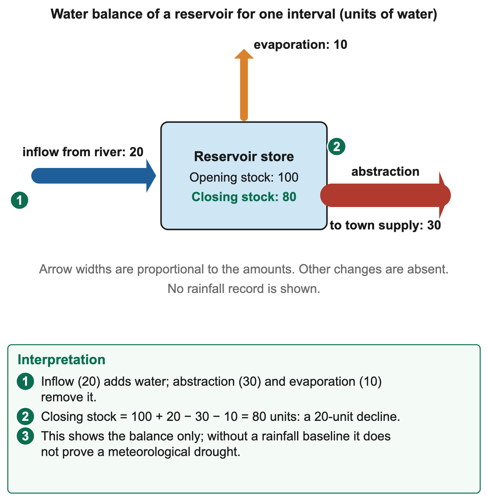

# 2.5 Utilisation and management of water resources in Namibia

*nam-6137-nssco-2026. Offline study notes, rendered from the approved content units on 2026-10-30. Everything here is also what the flashcards are built from.*

---

## Uses and competing demands

### Uses and competing demands

Water supports domestic needs, agriculture, industry and functioning ecosystems. Users may share the same river, aquifer, reservoir or distribution network, so decisions in one place can affect supply elsewhere. Competition becomes especially important where usable supply is limited or varies seasonally. A management explanation should identify the users, source, period and constraint rather than assume that the presence of water means every demand can be met.

Agricultural uses include crop irrigation, livestock drinking and suitable cleaning or processing activities on farms. Crops also use rainwater stored in the soil. Irrigation is deliberate application rather than any water a plant receives. The amount needed depends on crop, weather, soil and management. In Namibia farming is the largest user: in 2008 irrigation took about 40% of national water demand and livestock 26%, compared with about 20% for towns and industry, 6% for tourism, 5% for mining and 3% for rural households.

Domestic uses include drinking, cooking, washing, sanitation and cleaning. Adequate quantity and suitable quality both matter. A source may contain water that requires treatment before a particular use, while a safe supply can still be too distant or unreliable for practical access. A household connection count therefore does not describe all aspects of service. Availability when needed, affordability and the time required to obtain water influence its usefulness.

Industrial uses include processing, cooling, washing equipment and other operation-specific needs. Different industries require different quantities and quality. Some can use appropriately treated non-potable water for a particular task, while others require more stringent treatment. Reusing water can reduce fresh-water demand where the process permits, but it requires suitable quality control and equipment. A factory's presence does not establish a fixed universal consumption rate.

### Worked example

Ecosystems also require water. River flows support aquatic habitats and connected wetlands, while groundwater can support springs or other ecological functions. Allocating the whole measured supply to immediate abstraction can damage these functions or reduce downstream access. A management account should therefore consider relevant environmental needs as well as the three main human-use categories. The appropriate allocation depends on the actual resource and evidence, not an assumption that unused water has no value.

Competition can occur between sectors or within one sector. A city and irrigation scheme may rely on the same reservoir, while upstream and downstream farmers may share a river. A new user can increase demand without increasing supply. Scarcity may be seasonal, spatial or linked to treatment and delivery capacity rather than a complete absence of water. Identify which stage creates the shortage before selecting a response.

### Worked example

A hypothetical daily account illustrates the balance. Usable supply is 100 cubic metres; domestic need is fifty, agriculture forty and industry thirty. Combined need is 120, twenty above supply. Those demands cannot all be fully met from that stated supply during the interval without additional water, reduced demand or changed timing. The arithmetic does not establish which user should bear the gap; that is a management decision requiring priorities and consequences.

A volume account must use consistent units and periods. One cubic metre equals 1,000 litres. A daily figure cannot be directly compared with a monthly total without a suitable conversion. Likewise, a reservoir's stored volume is not the same as the daily rate available through a treatment plant. The store might be substantial while pumping or treatment restricts delivery. An explanation should state whether it concerns stock, flow or service capacity.

Conservation reduces avoidable use or loss while maintaining necessary services where possible. Repairing leaks, using suitable equipment, adjusting irrigation or reusing water can help. Their effects need measurement. Lower use per person does not establish a lower total if the population served increases sufficiently. A demand-management judgement should compare total withdrawal or delivery alongside the rate relevant to the service.

### Worked example

Consider a household system serving 100 people at 100 litres per person per day: total use is 10,000 litres. If use falls to eighty litres per person while the number served rises to 150, total demand becomes 12,000 litres. The per-person improvement is real, but total demand is 2,000 litres higher. A manager needs both measures before deciding whether the scheme's capacity is adequate.

Pricing and restrictions can influence demand, but effects depend on affordability, essential needs and people's ability to change practices. A higher charge may encourage reducing discretionary use while creating difficulties for low-income households if basic needs are not protected. A restriction announced without monitoring or workable alternatives may not achieve its aim. Judge actual access and savings rather than treating a policy statement as a delivered outcome.

Allocation also has a time dimension. Storing water during a wetter period can support later use, while excessive current withdrawal can weaken drought reserves. Maintenance and quality protection help retain usable supply. Short-term receipts from one user should not be the sole criterion where households, livelihoods and ecosystems depend on continued availability. A useful decision explains whose needs are protected, what constraint remains and what evidence supports the balance.

Windhoek illustrates integrated management rather than dependence on a single source. City information describes the contribution of the Omatako, Swakoppoort and Von Bach dam system, groundwater and reclaimed water. Supply and demand measures respond to changing conditions. These named components explain diversification; they do not provide a current source percentage or restriction category without a dated operational record.

### Worked example

A source mix does not eliminate competition. More water from one source may have pumping, treatment, energy or ecological costs. A demand reduction can defer new capacity while requiring cooperation and appropriate equipment. Compare the service gained and the wider effects over the relevant period. The aim is a usable, dependable and appropriately allocated resource, rather than the largest possible abstraction from every source.

### Worked example

A user can withdraw water without consuming all of it in the same sense. Some may return to a river or treatment system, though its timing, location and quality can change. A return flow unsuitable for immediate reuse is not equivalent to an unchanged supply. When comparing sectors, read what the resource measures. Withdrawal, net consumption, treated delivery and a billable volume can produce different totals for understandable reasons.

A management proposal can also displace pressure. Supplying one district from a new source may reduce its local shortage while increasing abstraction in another catchment. The connection should be assessed through source sustainability, delivery needs and affected users. An inter-basin transfer changes where water is available but does not create water without costs or consequences. A map of the route is only part of the evidence needed for an overall judgement.

Different responses operate at different timescales. Fixing a leaking connection can save part of a current delivery, while a new reservoir requires planning, construction and later filling. Emergency supply may protect immediate needs without being an affordable permanent system. The appropriate comparison should state whether the aim is today's access, next season's reserve or longer-term capacity. A measure can be useful for one aim without fully meeting the others.

Fair access also requires information about who receives the service. A settlement's total supply can rise while some households remain disconnected or face long collection journeys. An industrial allocation can be economically useful while requiring protection of essential domestic needs. Describe the distribution as well as the aggregate. This allows a judgement to recognise production benefits without treating every cubic metre as equally accessible to every user.

### Connections

Essential access, productive uses and ecosystem functions should be identified before comparing allocation proposals and their measured consequences.

---

## Groundwater and surface water

### Groundwater and surface water

Groundwater occupies pores and fractures in rock or sediment below the ground. An aquifer is material capable of storing and transmitting useful quantities of that water. Surface water occurs above ground in rivers, reservoirs, lakes and other visible water bodies. The categories are connected through infiltration, groundwater discharge and river or reservoir interactions. Groundwater is not an underground river in a large cave. Namibia's most productive aquifers are in the Karstveld (karst area), at Stampriet in the east and in Ohangwena in the north; tens of thousands of boreholes and wells tap groundwater across the country.

Precipitation can infiltrate the soil and, under suitable conditions, move deeper to recharge groundwater. The rate and amount depend on rainfall, soil, geology, vegetation and previous moisture conditions. Not all rain becomes recharge: some evaporates, is used by plants, runs off or remains temporarily in the soil. In Namibia potential evaporation is far higher than rainfall over much of the country, so only a small part of the rain recharges aquifers.

Groundwater can be reached by suitable wells or boreholes, with pumping where needed. Availability depends on the aquifer, depth, water quality and recovery rate, as well as equipment and energy. A drilled hole does not guarantee an adequate yield. Excess abstraction can lower groundwater levels or affect connected sources. Stored groundwater may buffer short-term rain variation, but its stock still needs protection and suitable replenishment.

Surface sources include perennial rivers, seasonal channels and impounded reservoirs. A perennial river flows throughout the year under its usual conditions, while an ephemeral channel carries water intermittently. Namibia's five perennial rivers, the Kunene, Okavango, Kwando, Zambezi and Orange, lie along or cross its borders and are fed by rain in neighbouring countries. Interior rivers are ephemeral: they flow for only hours or days after heavy rain, then sink into their sandy beds. A dry channel can carry a large flow after rain in its catchment; a single dry observation does not establish that it never floods.

Reservoirs store surface water for later use. They can bridge part of the gap between episodic inflow and continuous demand, within their capacity and operating limits. Open water can lose volume through evaporation, while sediment can reduce useful storage. A reservoir's maximum capacity is not its present content. A dam-wall symbol identifies a structure, not how much usable water is behind it on the date of a question.

Groundwater storage generally avoids the same direct open-surface evaporation exposure, though recharge and discharge processes still affect the balance. Surface sources can be easier to observe but vary strongly with inflow. Neither category is automatically safe to drink. Microbial or chemical contamination can occur, and suitable treatment and monitoring depend on source and intended use. Appearance alone cannot establish suitability.

An aquifer and a reservoir can be used together. Surface supplies during wetter conditions may reduce pressure on groundwater, while groundwater can provide a supplementary reserve during some dry periods where sustainable abstraction permits. Managed recharge can add suitably treated water to an appropriate aquifer under controlled conditions. It requires suitable geology, water quality and operating arrangements, not simply pouring water into any hole.

### Worked example

A resource comparison should state its evidence. A map of borehole locations identifies access points but not each borehole's current pumping rate or water quality. A river map identifies drainage but not continuous supply at every point. A dated level record or monitoring table adds information about condition. Combining the records helps distinguish the existence of a source, its present quantity and its practical service capability.

### Worked example

Suppose an aquifer receives ten water units and loses fifteen through abstraction and other stated outflows over one interval. With all other changes absent, storage falls by five. A reservoir receiving twenty while losing eight to delivery and four to evaporation gains eight. These are separate simplified balances using consistent units. They explain why source category alone cannot establish whether stock is rising or falling.

### Worked example

Sources have different storage and movement times. Surface flow after a storm can rise rapidly, while some aquifers respond slowly to recharge. A slowly replenished groundwater store may appear dependable over a short period but decline under sustained abstraction. A resource assessment needs an appropriate monitoring interval, not just a successful pumping observation on one day. The possibility of natural recharge does not establish that it matches current removal.

A simplified source diagram should distinguish the unsaturated soil above the water table from saturated material below. Infiltration enters the ground, while deeper movement can recharge the aquifer where conditions allow. A borehole provides access, not an extra natural inflow. A pump arrow leaving the aquifer represents abstraction. Those directions help the learner read the water balance rather than assuming that underground storage is being created by drilling.

### Connections

Always read the source record’s date, unit and intended use before deciding what its quantity or location establishes.

---

## Significance for human activities

### Significance for human activities

Groundwater and surface water help determine where people can settle, farm and operate services or industries. A usable source can support drinking, sanitation, livestock or production, while unreliable access can restrict those activities. The significance depends on quantity, quality, timing, distance and the infrastructure connecting the source to users. Water visible nearby is not the same as a dependable service.

Away from the border rivers, most farms and many towns depend on boreholes, because usable aquifers can retain water through dry periods and are protected from direct open-water evaporation, subject to storage, recharge, quality and abstraction. Along the border, the Kunene alone supplies water to about 35 per cent of Namibia's population. Surface storage may collect episodic inflow for later urban or agricultural use. Both require appropriate extraction, treatment and delivery. A pump failure or damaged pipeline can interrupt access even when the source retains water, so physical scarcity and infrastructure failure should be explained separately.

### Worked example

Windhoek's combination of surface supplies, groundwater and reclamation demonstrates the value of diversifying the supply chain. The sources can contribute under different conditions, with management deciding how they are used. The presence of alternatives does not establish unlimited reserve or remove treatment, cost and maintenance requirements. A case explanation should connect the resource mix to resilience without inventing a current operating percentage.

### Connections

Water access also affects time and opportunity. Longer collection journeys can reduce time available for other work, while interrupted supplies can disrupt food preparation or enterprise activity. Protecting sources and managing demand therefore supports more than one economic sector. A supported judgement identifies the service maintained and its beneficiaries, while recognising ecological needs and other users relying on the same resource.

---

## The hydrological cycle, floods and droughts

### The hydrological cycle, floods and droughts

The hydrological cycle transfers water between atmosphere, land, surface stores and groundwater. Evaporation changes liquid water to vapour, transpiration releases water from plants, condensation supports cloud formation and precipitation returns water to the surface. Interception, infiltration, runoff and groundwater movement then distribute it through the landscape. The cycle renews flows but does not make usable water evenly available at every place or time.

### Worked example

A supply account depends on the catchment and period. Some precipitation returns to the atmosphere, some is stored and some moves towards channels or aquifers. Soil condition, vegetation, slope and rainfall intensity affect those pathways. A large rainfall total can produce considerable runoff without equivalent recharge. Conversely, recharge can occur away from the place where groundwater is later abstracted. A local shower is not a complete account of a regional source.

Flooding occurs when water inundates land that is normally not submerged. Heavy or prolonged rain can increase channel flow; saturated or low-infiltration surfaces can produce rapid runoff; restricted channels or drainage can worsen local accumulation. The effects depend on the storm, catchment and exposed uses. In March 2009 heavy seasonal rain flooded the Cuvelai basin of northern Namibia; together with floods on the Zambezi and Okavango, about 13,000 people were displaced, 92 died and crops were destroyed.

### Worked example

Urban hard surfaces can reduce infiltration and speed runoff into drains or channels. If capacity is exceeded, flooding can occur locally. On other land, saturated ground can also generate considerable runoff even without paved surfaces. Vegetation can influence interception and soil condition, but it cannot absorb an unlimited storm. A useful explanation combines the observed land surface, rainfall and drainage conditions through the water pathway.

Floods can damage homes, fields, stores, roads and water infrastructure. They may contaminate sources or interrupt treatment and delivery. The presence of abundant floodwater therefore does not establish abundant safe household supply. Broken pipes, polluted wells or inaccessible pumps can create an immediate service shortage. A response must distinguish the volume in the landscape from water meeting the needs of a particular use.

Flood effects can also include later opportunities, such as replenished stores or water for suitable floodplain activities. These do not cancel immediate losses. Timing, duration, depth and land use influence the balance. Compare the particular location and period rather than classify a flood as one uniform benefit or disaster for every user. A reservoir gaining water can coexist with downstream households experiencing damage.

Drought concerns a sustained water shortage relative to the setting's conditions or requirements. Rainfall deficits can reduce runoff and recharge, while high evaporative demand can increase losses. Surface stores may decline first or more visibly, and groundwater can respond over different timescales. A dry climate is not the same as a drought. On 22 May 2024 Namibia declared a national state of emergency over its worst drought in about 100 years: dam levels were low, farmers were badly affected and over 331,000 households registered for drought relief.

### Worked example

Repeated poor inflow can draw down reserves while users continue withdrawing. A reservoir may therefore reach a critical level after several seasons rather than immediately after the first below-average rainfall. Groundwater abstraction can similarly exceed recharge over time. Management must consider opening stocks, inflows, use and other losses. Focusing only on the current month's rain can miss the accumulated deficit.

A teaching water-balance diagram can show opening reservoir stock of 100 units, inflow twenty, abstraction thirty and evaporation ten over the same interval, with other changes absent. Closing stock is eighty. The inflow arrow enters the store, while abstraction and evaporation leave it. The diagram supports a twenty-unit decline. It does not by itself prove a meteorological drought, because no rainfall baseline or longer record is supplied.

Another comparison shows flood and drought through different processes. A short intense storm over hard surfaces can create rapid runoff and local flooding, while a prolonged regional rainfall deficit lowers reservoir inflow. Neither example establishes the precise conditions of every Namibian catchment. The purpose is to connect cause, transfer and consequence, using the actual evidence rather than treating any wet or dry observation as a complete explanation.

Risk management includes protecting infrastructure, monitoring source conditions, maintaining drainage where appropriate, planning demand and retaining reserves. The measure must fit the risk. A deeper store can buffer some inflow variation but needs water to fill; a warning can reduce exposure if people have safe options and time to respond. An announced response is not the same as a functioning system or a demonstrated reduction in harm.

A reservoir balance must include opening stock. In the diagram example, 100 plus twenty minus thirty minus ten gives eighty units. Reporting only inflow minus abstraction would omit evaporation, while reporting inflow alone would ignore both use and the existing reserve. If the same twenty-unit net decline repeated with no other changes, storage would continue falling. That conditional calculation does not predict rainfall; it shows why repeated deficits require attention.

Flood peaks depend partly on how quickly water reaches a channel. Similar storm totals can produce different peak flows if one catchment routes water rapidly and another stores more temporarily. Surface condition, drainage and antecedent moisture help explain the difference. A hydrograph records flow over time, while a rainfall chart records incoming precipitation. Their units and shapes should not be treated as interchangeable, even when the events are connected.

Drought can have delayed effects beyond the immediate dry period. A depleted reservoir or aquifer may need sustained inflow to recover, while damaged livelihoods can take longer to rebuild. One later storm may improve conditions without restoring the whole reserve. Distinguish renewed input from completed recovery. Monitoring source levels and usable supply alongside rainfall helps identify whether the deficit remains.

### Connections

A management record should also distinguish hazard and exposure. High flow through an unoccupied channel is a physical condition; damage depends on what lies in its path and its vulnerability. Warnings, location choices and protected infrastructure can reduce some consequences even when the storm itself cannot be prevented. This connection links the hydrological process to human risk without blaming every flood on a single local action.

---

## Methods of water supply

### Methods of water supply

Water supply methods include surface storage, groundwater extraction, desalination and recycling or reclamation. Each can contribute under suitable conditions and each has costs or limits. A source's existence must be connected to abstraction, quality control, transport and demand. Adding a method does not establish that its usable output will meet the whole requirement at an affordable cost.

### Worked example

A dam is a structure obstructing or controlling flow; a reservoir is the stored body of water. The impounded reservoir lies upstream of the wall in the usual valley-dam arrangement because incoming water is held back before passing the structure. Downstream water released from the dam is not the impounded reservoir. Read flow direction and contours or the channel before shading a storage area on a resource.

Reservoir storage can capture wet-period inflow for later demand. Its usefulness depends on catchment inflow, capacity, losses, quality and operating decisions. Sediment can reduce useful space, evaporation removes water and drought can limit refilling. Namibia's major dams include Hardap, Naute, Neckartal, Von Bach, Swakoppoort and Omatako. Benefits of a dam include a stored supply for dry periods, water for irrigation, flood control, fishing and recreation, and sometimes hydroelectricity. Problems include flooding farmland and homes so that people must move, heavy evaporation losses, less water and silt reaching people downstream, sediment filling the reservoir, and bilharzia risk where infected freshwater snails release parasite larvae that enter the skin during contact with infested water.

A well or borehole accesses groundwater. Wells are often relatively broad excavations, while boreholes are drilled holes, commonly narrower and potentially deeper. The relevant question is not simply depth but whether useful, suitable water can be obtained sustainably. Pumps may require energy and repairs. A borehole count does not establish how many are functioning or the amount each can deliver during a dry period.

Groundwater extraction must account for recharge and effects on connected users or environments. Excessive pumping can lower levels, increase pumping costs or reduce nearby supplies. Quality can also limit use. Protecting the headworks and surrounding area can reduce some contamination pathways, while monitoring helps identify change. Groundwater should not be described as automatically clean merely because it is below the surface.

Desalination removes dissolved salts from saline water. It can use seawater or suitably selected brackish sources, depending on the system. Reverse osmosis uses membranes under pressure; distillation separates water through evaporation and condensation. Both require equipment, energy and maintenance, while intake and concentrated brine handling need suitable management. Desalination is therefore a conversion method rather than the discovery of a new freshwater river.

Coastal desalination can add supply where a saline source and suitable infrastructure are available. A reverse-osmosis plant near Wlotzkasbaken, north of Swakopmund, opened in 2010. NamWater contracted to receive its desalinated water in 2013; its 2024 report describes the plant supplying the coastal network and uranium mines. Delivering that water inland or to higher ground adds pumping and network needs. Energy cost and reliability affect operation. A coast's length alone does not establish a feasible national supply to every settlement. Assess intended volume, location, delivery and environmental effects rather than assuming the ocean removes all scarcity.

Recycling or reuse treats used water for another suitable purpose. Treatment requirements depend on intended use: water for a particular industrial or landscape task may need different treatment from drinking water. A single simple filter is not a universal reclamation process. A reliable system needs appropriate treatment barriers, monitoring, operation and control of source inputs. The term recycled does not establish suitability without those conditions.

Windhoek provides a named reclamation case. Its supply arrangements include reclaimed water associated with Goreangab alongside surface and groundwater sources. The teaching point is a managed alternative supply within a wider system, not that raw wastewater is directly safe to drink. Neither the name Goreangab nor visual clarity can substitute for treatment and quality assurance. Current proportions require a dated operating record.

### Worked example

Recycling can reduce the demand for fresh abstraction for some services and make use of a flow that would otherwise leave the system. Losses and quality requirements remain. If ten units are collected and eight meet the required treatment and delivery conditions, the usable contribution is eight, not ten. Do not count the original withdrawal and its reused fraction as two independent additions to the natural water stock.

### Worked example

Supply diversification can improve resilience where sources fail under different conditions. An aquifer, a dam and a reclamation plant may provide different opportunities, but all can depend on energy, maintenance or networks. Shared failure points matter. A power interruption affecting several pumps can constrain multiple sources at once. A realistic evaluation therefore considers the complete chain and possible common constraints rather than simply counting source names.

Demand management complements supply. Repairing leaks preserves water already treated or transported; appropriate use reduces avoidable withdrawal; tariffs and restrictions can influence behaviour under suitable arrangements. Savings need an appropriate baseline and service comparison. A lower recorded delivery could reflect a supply failure rather than efficiency, so the evidence must show whether useful needs were maintained.

A dated City of Windhoek release of 8 August 2025 reported that, after above-average rain in 2024/25, reserves could meet demand for at least two rainy seasons; the city lifted its 15% savings target and began recharging the Windhoek southern aquifer. This illustrates that restrictions and source use can change with evidence. It is a historical example, not a statement of today's restriction status. Plans should be adjusted using current monitoring while the underlying principles of storage, reclamation, groundwater and responsible use remain applicable.

A supported choice states the aim and constraints. Desalination may add coastal supply but require energy and delivery; a borehole may suit a local aquifer but need sustainable yield and quality; storage may buffer seasonal flow but depend on refilling. The strongest solution can combine methods with suitable demand measures. No method's name proves adequacy, affordability or environmental success without the relevant evidence.

### Worked example

Usable supply needs its own calculation. Suppose a system abstracts 100 units but loses ten in delivery before users receive water. Delivered supply is ninety if no other change occurs. Repairing half that loss raises delivery to ninety-five without increasing abstraction. The service improves through reducing waste, not through a new source. Whether the saved amount meets additional demand depends on the size and timing of that demand.

Treatment capacity can be another bottleneck. A source might provide 100 units per day while the plant can prepare only eighty for the intended use. Adding a larger pump does not raise usable delivery beyond that treatment limit unless other arrangements change. Conversely, extra treatment capacity cannot supply water absent from the source. Identify the constrained stage before investing in an expansion.

Groundwater and reservoir management can complement one another where suitable infrastructure exists. Banking suitably treated water in an appropriate aquifer during favourable conditions may protect a reserve for later use. The operation needs water quality control, recharge capacity and monitoring of recovery. A stated plan to recharge is not proof that water was stored successfully or can all be recovered when needed.

A map-based reservoir task needs direction as well as area. Follow the river towards the wall: the retained water backs into the upstream valley. If contour information is supplied, the future waterline should follow the stated elevation rather than cross rising ground arbitrarily. No constructed cross-section is needed to recognise that relationship. Shading the downstream channel would confuse released flow with the impounded store.

### Connections

When judging a proposed new method, ask what evidence would establish success. A borehole needs a suitable sustainable yield and quality; a desalination plant needs usable delivered volume and appropriate brine handling; a reclamation system needs reliable quality and use records. Installation is evidence of activity, while those records test the service and environmental outcomes. A proposal can be promising before all outcomes are demonstrated, but the conclusion must retain that distinction.

---

## Water pollution and its effects

### Water pollution and its effects

Water pollution occurs when harmful substances, organisms or conditions impair water or its uses. Causes include unsuitable sewage discharge, agricultural runoff, industrial wastes, fuel spills and poorly managed solid waste. The relevant explanation follows a source, a pathway and an effect. In Windhoek, a 2020 study of Goreangab Dam found very poor water quality upstream, where sewage and wastewater effluent enter, and concluded that human activity is a major cause.

Sewage contamination can introduce disease-causing organisms where treatment or containment is inadequate. Using unsafe water can transmit diarrhoeal diseases such as cholera, which spreads through water or food contaminated with faeces where safe water and sanitation are lacking. Health consequences depend on exposure and conditions, so a polluted-water observation is not a diagnosis for an individual. The geographical lesson is the link between sanitation, source protection, treatment and safe access, rather than unsupported claims that all illness in an area has one cause.

Agricultural nutrients can reach water through surface runoff or leaching. Excess nutrient supply can stimulate abundant algae or plant growth. When organisms die and decompose, the process uses dissolved oxygen, potentially harming fish and other aquatic life. This sequence differs from saying fertiliser simply removes oxygen on contact. The effect depends on nutrient loading, water conditions and the organisms involved.

Pesticides, industrial chemicals or fuel can also enter water through relevant pathways. Toxic effects depend on the substance, concentration and exposure. Oil can affect surfaces, organisms or shore environments, while some contaminants persist or move through connected systems. An explanation should use the stated material rather than call every substance a poison with identical effects. Suitable monitoring identifies the actual problem and guides an appropriate response.

Sediment can affect water too. Erosion and runoff can increase suspended material, reduce clarity and transport attached substances. Deposited sediment can affect habitats or storage. Turbid water is not the same as a measured microbial or chemical hazard, although the problems can coexist. Clear water can still contain invisible contaminants. Appearance is an observation, not a complete safety test.

Pollution can reduce the usable supply even when total water volume is unchanged. A source that needs extra treatment may become more expensive or temporarily unusable for a particular purpose. Households or enterprises may need another supply, while treatment and monitoring add costs. This connects quality to scarcity: water existing in a reservoir does not establish that it can be delivered for every intended use.

Human consequences can include illness-related disruption, higher treatment costs, reduced suitable irrigation or industrial supply, lost recreation value and affected fishing livelihoods. The pathway should be specific. A fishery loss may arise from oxygen depletion or toxic exposure, while household disease transmission concerns microbial contamination and exposure. Do not use one mechanism as a generic explanation for all natural and human effects.

Ecosystem consequences can extend downstream or into groundwater. Flow can transport contaminants beyond the source site; infiltration can carry some substances into aquifers. Dilution may reduce concentration but does not necessarily remove the material or every risk. Preventing a harmful discharge can be more effective than relying on a larger receiving flow. The appropriate response depends on the contaminant and the environment.

Pollution prevention includes suitable sanitation, treatment, controlled waste handling, protection of sources and appropriate application or storage of agricultural materials. Each measure addresses a pathway. A treatment plant without operation or maintenance may not deliver the intended water quality. An industrial rule without compliance evidence does not establish that discharge has stopped. Compare measured outcomes with the required use and standard rather than accepting installation or paperwork alone.

### Worked example

A simple investigation can compare suitably collected upstream and downstream observations with information about flows, timing and other possible sources. A worse downstream result can support a spatial association, but attributing it to one discharge needs relevant evidence and consideration of alternatives. Safe sample collection and appropriate laboratory methods are necessary for many contaminants. A school observer's colour or smell record cannot establish precise chemical concentrations or drinking safety.

A treatment account also needs an appropriate boundary. Removing suspended solids is a useful change but does not prove that dissolved salts or microbes meet the required conditions. Different treatment barriers address different problems. Recycling, desalination and conventional treatment should therefore be judged against the actual source quality and intended use. A statement that water has been treated is incomplete without knowing what the treatment achieves.

### Worked example

Water management brings quantity, quality and access together. Protecting a source can preserve usable supply, while reducing waste can ease pressure on limited resources. A supported conclusion identifies the relevant pollutant pathway, affected users or organisms and the measure that addresses it. It should also state the limits of the available evidence, particularly where a health, safety or causal claim would require monitoring beyond visual observation.

### Worked example

Human and environmental effects can reinforce each other. Loss of aquatic organisms can reduce a fishing resource; unsuitable water can raise household costs when a different source is needed; damaged wetland functions can affect later water conditions. The specific link should be stated rather than assuming every effect follows from any pollutant. Quantity, concentration, exposure and the receiving system influence what happens.

A trend needs consistent measurements. A concentration recorded after a storm may differ from a dry-period result because flow and inputs differ. Comparing the same method, unit and relevant conditions improves interpretation. Even then, a change in concentration does not alone establish the total pollutant load, which also depends on water volume or flow over time. At this level, the main requirement is to identify what the supplied record measures before claiming more.

A source-protection judgement can use several records together: discharge practices, suitable water tests, delivery conditions and affected-use observations. Fewer visible floating objects can be a useful improvement without establishing microbial safety. A lower nutrient concentration can be relevant without proving that every ecological function has recovered. State the observed improvement and the additional evidence needed for the wider claim.

### Connections

Protection and monitoring need continuing operation, clear responsibilities and appropriate records to establish whether usable quality is maintained.
