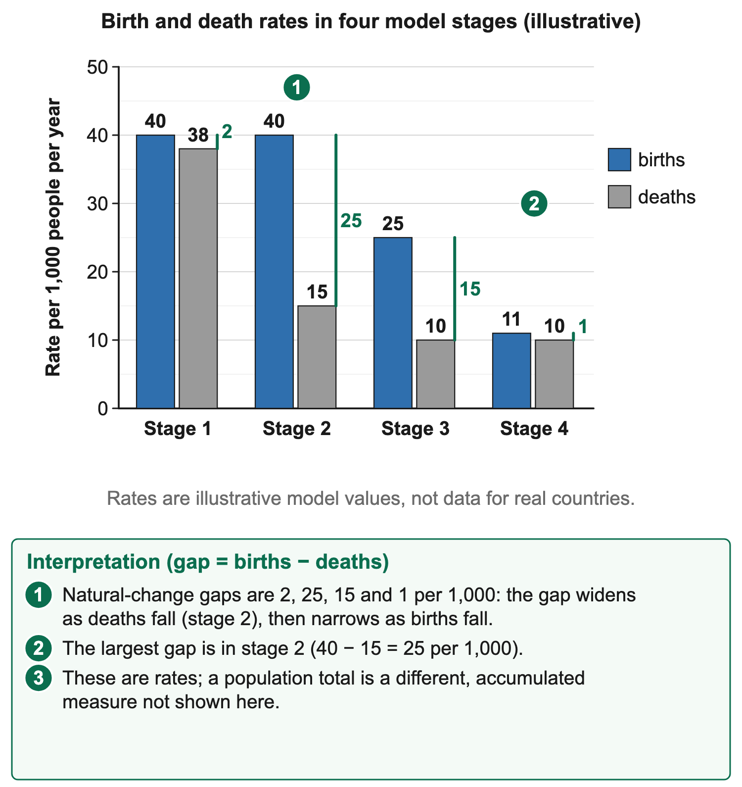
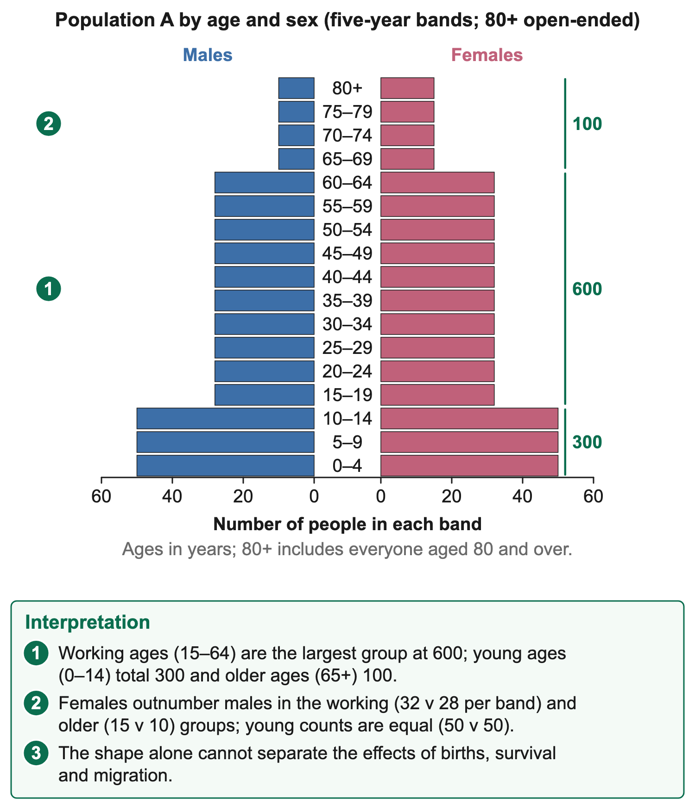
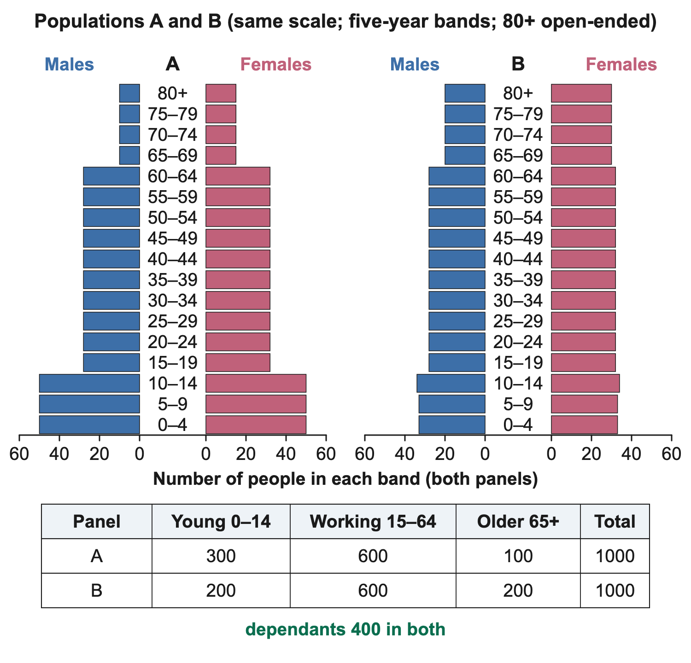
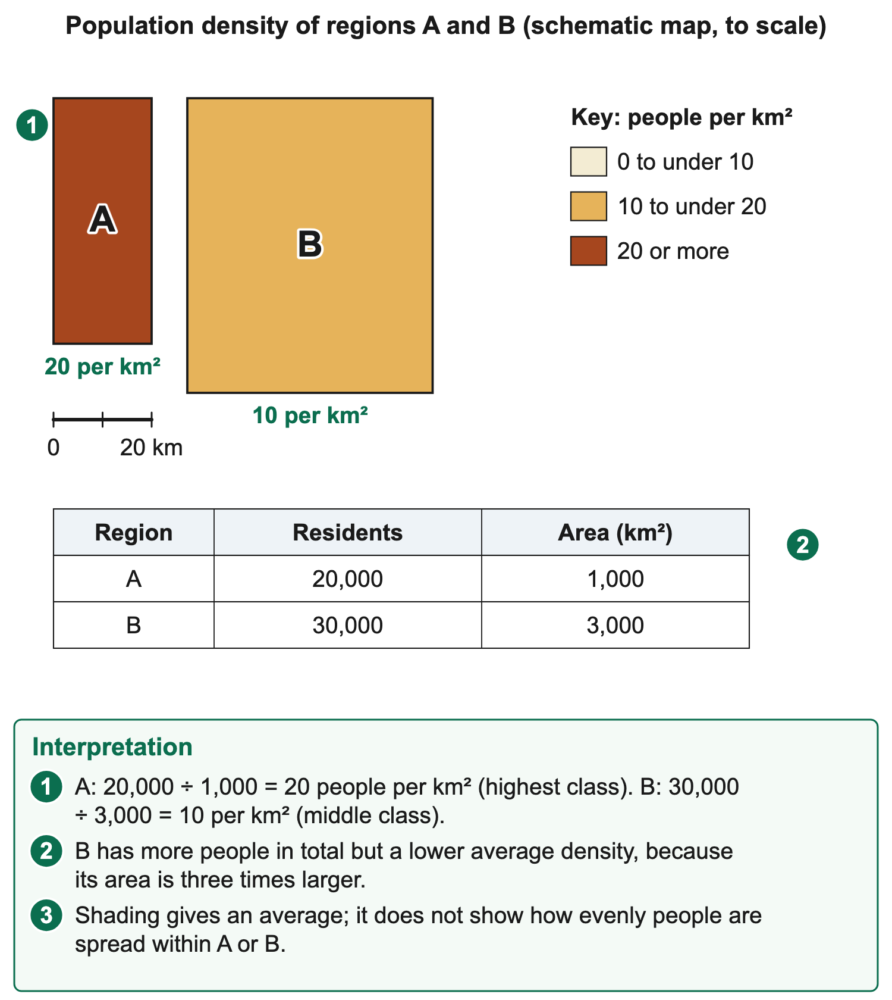

# 3.1 Population Studies

*nam-6137-nssco-2026. Offline study notes, rendered from the approved content units on 2026-10-30. Everything here is also what the flashcards are built from.*

---

## Rapid world population growth

### Rapid world population growth

Rapid population growth occurs when births substantially exceed deaths, with the balance accumulating over time. Historically, falling mortality combined with continued high fertility increased natural growth in many populations. Better survival can reflect improved nutrition, clean water, sanitation, public health and healthcare. These changes do not require an immediate matching fall in births, so a wide birth–death gap can persist during demographic transition.

At the world scale, migration redistributes people between places but does not add people to the global total. Global change depends on births and deaths. For a country or settlement, immigration and emigration also matter. The scale therefore changes which components explain growth. Describing international migration as a cause of growth in the whole world's population would count the same people in a different location as new people.

A larger starting population can produce a larger numerical increase even when its percentage growth rate is lower. At 2% a population of one million gains 20,000 in the stated year; at 1% a population of ten million gains 100,000, assuming the rates apply to those opening totals. Percentage and absolute change answer different questions. A declining growth rate does not automatically mean a declining population.

### Connections

The phrase population explosion describes a period of rapid increase rather than a claim that every country has the same pattern today. Some populations grow rapidly, others grow slowly or decline, and age structures differ. Explain the component changes and period involved, using dated evidence rather than treating one historical global description as a permanent national condition.

---

## Births, deaths and migration

### Births, deaths and migration

Population change is the balance of births, deaths and movement over a defined area and period. Births add people and deaths remove them. Immigration adds residents arriving from outside the area, while emigration removes those leaving it. Natural change is births minus deaths; net migration is arrivals minus departures. Total change combines both balances. State the boundary before deciding whether a movement counts as migration into or out of the population being studied.

The crude birth rate expresses live births per 1,000 population over the stated year, conventionally using a suitable mid-year population denominator. The crude death rate expresses deaths per 1,000 population over the same kind of interval and denominator. They are rates, not simple birth or death counts. A country with more births can have a lower birth rate if its population is sufficiently larger.

A rate of thirty births per 1,000 is 3% of the population in that year, not thirty per cent. If the comparable death rate is ten per 1,000, natural increase is twenty per 1,000, equivalent to 2%. This calculation excludes migration unless it is added separately. Do not subtract a percentage from a per-thousand rate without first putting both on the same basis.

### Worked example

Suppose a population records 3,000 births and 1,000 deaths during a year. Natural increase is 2,000 people. If 500 people immigrate and 800 emigrate across the specified boundary, net migration is minus 300 and total change is plus 1,700. These are counts. Calculating rates needs a stated population denominator; the totals alone do not establish the birth or death rate.

### Worked example

An opening population of 100,000 would become 101,700 under that simplified account if all other adjustments are absent. The percentage change relative to the opening total is 1.7%. This opening-population growth calculation should not be confused with a formally estimated annual demographic rate based on a mid-year population. Use the method and denominator requested by the resource and label the result clearly.

Immigration and emigration are directional descriptions of movement. A person moving from country A to country B is an emigrant from A and an immigrant to B. The same journey therefore has two perspectives. A positive net migration balance does not mean nobody left; it means arrivals exceeded departures. Similarly, negative net migration does not prove a population fell if natural increase was large enough to outweigh it.

Internal migration changes the distribution within a country but does not directly change its national total. A move from a rural Namibian area to Windhoek adds to one local population and subtracts from another. It does not add an extra person to Namibia's total. International migration crosses the national boundary and can change that total. These different scales should remain explicit in both calculation and explanation.

A population can grow despite more deaths than births if net immigration is sufficiently positive. It can decline despite natural increase if net emigration is larger in magnitude. For example, natural increase of 200 and net migration of minus 500 give a net decline of 300. Reading only one component would produce the wrong conclusion. A component table should therefore be reconciled before describing the overall direction.

Birth rate differs from total fertility rate. Total fertility rate summarises the average number of children a woman would have under the current age-specific fertility schedule continuing through her reproductive years. Its unit is births per woman, not births per 1,000 total population. Fertility measures and crude birth rates are related but influenced differently by age composition. Do not use the number of children per woman as if it were a percentage growth rate.

Migration is also different from an ordinary short visit or commute. Population movement here concerns a change in usual residence under the relevant definition. A tourism arrival count is not an immigration count merely because someone crossed a border. A census or survey should state its residence and time rules. Those rules help prevent the same temporary movement from being assigned to the wrong population component.

Records can contain uncertainty. Some births, deaths or moves may be under-recorded, and censuses can require adjustments or estimates. A simplified teaching account states that its components are complete; a real dataset may not. Missing data should not be treated as zero. A sound explanation identifies what the record measures and avoids claiming a precise unobserved cause from an unexplained difference between two totals.

A component answer therefore has two stages: describe the observed balance, then explain relevant influences on it. A higher recorded birth rate is an observation; access to education or family-planning services is a possible explanatory influence requiring appropriate evidence. Keeping measurement separate from explanation prevents a plausible general mechanism from being presented as a fact about every household in a particular country.

### Worked example

A birth-rate comparison needs the denominator. In a complete teaching record, A has 1,000 live births among a mid-year population of 50,000, giving twenty per 1,000. B has 1,500 among 100,000, giving fifteen per 1,000. B has more births but the lower crude rate. Substituting the birth count for the rate would reverse the interpretation of relative frequency.

The same logic applies to deaths. If a population records 500 deaths among 50,000 people, its crude death rate is ten per 1,000. Comparing that with births requires the same period and denominator basis. A table containing annual births and monthly deaths cannot be combined directly. First establish what each number covers, and obtain matching data rather than guessing the missing intervals.

Net migration can be zero while movement is substantial. Arrivals of 1,000 and departures of 1,000 cancel in the balance but still affect households, skills and services. Their age structures can differ, changing composition even without changing the total. A zero net figure therefore does not mean there were no migration-related effects. Gross movements and their characteristics answer additional questions.

### Connections

A component table should label arrivals and departures explicitly so their direction is preserved when calculating the net balance.

---

## Population and available resources

### Population and available resources

Overpopulation and underpopulation describe relationships between people and the resources, technology and organisation available to support them. They are not synonyms for high and low density. A densely settled area can maintain high living standards through productive activity, infrastructure and trade, while a sparsely settled area can face severe shortages. The relevant question is how effectively resources meet people's needs under the stated conditions.

### Worked example

Overpopulation refers to a situation where population pressure exceeds the support that the available resource and productive system can sustainably provide at the relevant living standard. Symptoms may include inadequate housing, jobs, water or services, but their causes also involve distribution, investment and management. A large population total alone cannot prove the condition. A 2014 study reported that Windhoek's northern and north-western areas held over 60% of its people on a quarter of its land, and many lack adequate housing and services.

Underpopulation refers to a population too small, or with insufficient relevant labour and skills, to use available opportunities effectively under the prevailing conditions. A small workforce can limit production or make infrastructure expensive per user. However, low density does not establish an unused opportunity. Some dry or sensitive areas cannot support intensive settlement sustainably, and technology or trade can alter the labour required for production.

### Worked example

Resources include more than land area. Water, soil, energy, skills, capital, infrastructure and institutions influence what can be produced and accessed. Trade can connect a region to resources elsewhere, while ecological limits affect continued use. A resource-rich country can still have unequal household access if income or services are poorly distributed. An average national output therefore cannot by itself establish the standard of living of every person.

### Worked example

Technology can change the relationship. Suitable irrigation can support crop production where water is available; improved transport can connect a settlement to markets; efficient equipment can produce a service with fewer inputs. Each has practical and environmental requirements. Technology is not an unlimited substitute for missing resources, and a proposed improvement must be feasible before it is counted as extra support capacity.

### Worked example

A hypothetical settlement has 1,000 residents and a dependable water system supplying 80,000 litres per day against a stated requirement of 100 litres per person. The resulting 100,000-litre need exceeds supply by 20,000. This establishes a water-service gap under the supplied requirement. It does not prove that every other resource is inadequate or that population reduction is the only response. Loss reduction, suitable new supply or appropriate demand changes may also be relevant.

### Worked example

A second hypothetical area has useful production opportunities but lacks the workers or connections to operate them. Recruitment, training, machinery or transport could address different parts of the constraint. Calling it underpopulated without identifying the opportunity and the missing capacity would be weak. A supported conclusion states what more people or skills could contribute, while considering housing, services and environmental effects of expansion.

### Worked example

The relationship changes through time. Population growth can enlarge a market and workforce while increasing service needs. A resource decline can create pressure without population growth; improved productivity can support more people without an immediate deterioration in living standards. Use matched dates and measures before attributing a problem to population alone. This prepares for the study of contrasting growth patterns and their different consequences.

The time period changes the judgement. A town may have enough current school places for existing children but insufficient places for the larger cohort approaching school age. Planning responds to structure and future demand, not only the current total. Conversely, building on an assumed future increase can create underused capacity if the forecast changes. Projections require stated assumptions and later monitoring.

### Worked example

Resource access also involves distribution. A city can have enough total housing floor area while many households cannot afford or access suitable accommodation. That problem cannot be diagnosed from the average population density alone. Income, ownership, location and service provision may matter. A supported answer identifies the actual shortage or exclusion before attaching a broad population-resource label.

### Worked example

A development comparison should use useful output and living conditions rather than total output alone. If production rises 10% while population rises 20%, average output per person falls under that simplified account. If production rises 30% with the same population increase, average output per person rises. These calculations still do not establish equal household gains or ecological sustainability. They show how growth rates interact, while distribution and resource recovery require additional evidence.

### Connections

An environmental limit can change the support available. A declining aquifer or lost productive soil can reduce opportunities without any population increase. Restoring a suitable resource can improve support without an immediate demographic change. This two-way relationship is why a geographical explanation should consider both people and the system providing their services.

---

## Why population growth differs

### Why population growth differs

Population growth differs because fertility, mortality and migration vary between places and periods. Social, economic, environmental and policy conditions influence these components, while age structure affects the observed rates. A good explanation identifies the component first, then follows a relevant mechanism. It should not assume that every low-income or high-income country has an identical demographic pattern.

Social influences on births include education, marriage and partnership patterns, gender roles, knowledge and access to voluntary reproductive-health services. Longer education and later childbearing can contribute to fewer births during a particular period, depending on people's choices and circumstances. The mechanism involves opportunity, timing and control rather than a claim that educated people all choose the same family size.

Access to suitable family-planning information and services can help people achieve their desired timing and number of children. Services must be usable, voluntary and appropriate. A clinic's existence does not establish access for everyone if cost, distance or other barriers remain. Population policy should be assessed through rights and actual service conditions rather than assuming that a published target dictates private decisions.

Economic conditions can influence the costs and benefits households associate with raising children. Housing, childcare, education costs, job security and the opportunity cost of time can affect decisions. In some settings children contribute to household production or parents rely on family support in old age. These are contextual influences, not definitions of people's motives. Explain the stated circumstance without presenting a cultural stereotype as evidence.

Social security and reliable livelihoods can alter dependence on children for later support. Better child survival can also change family decisions over time, although the response is not immediate or uniform. A falling infant mortality rate need not produce an identical birth-rate fall in the same year. Demographic change can involve delays and interactions, which is why a one-year comparison does not establish a complete causal transition.

Government policies can aim to slow rapid growth or support births where low fertility and ageing are concerns. Measures may include voluntary family planning, education, childcare, parental support or financial arrangements. The outcome depends on delivery, people's choices, costs and wider social conditions. A policy announcement is an input, not a measured change in births. Comparing before-and-after rates still requires attention to other influences and timing.

China is the best-known example of population control. From about 1979-80 to 2015 its one-child policy limited most couples to one child; couples who had extra children could be fined, although rural couples whose first child was a girl could often have a second. Births fell, but the policy contributed to a male-biased sex ratio and rapid ageing, leaving fewer young workers to support more older people. All couples were allowed two children from 1 January 2016, and on 31 May 2021 China announced that couples could have a third child, with support measures set out in July 2021 to encourage births.

Japan provides a contrasting support-policy example. Japan’s 2025 White Paper on Children’s Policy describes a December 2024 childcare-policy direction emphasising suitable quality, local needs and family support. The mechanism aims to address constraints on desired childbearing, not to force an identical choice on every household. Expanded childcare support can be relevant without proving that fertility rose; employment, housing, service access and personal preferences remain part of the context.

Mortality can fall through safer water, sanitation, adequate nutrition, vaccination, treatment and wider public health improvements. These reduce particular exposures or improve survival under suitable conditions. The explanation should connect an intervention to the relevant pathway. Better sanitation can reduce some infectious disease transmission, while healthcare access supports prevention or treatment. Neither mechanism implies that every cause of death disappears.

Healthcare access depends on more than a building. Skilled staff, supplies, affordability, transport and timely use influence whether services improve survival. Rural or disadvantaged groups may face barriers despite a national improvement. A lower national mortality measure should therefore not be assumed to describe every community equally. Relevant age-specific or local evidence may be needed for a distributional claim.

Social and environmental influences on deaths include living conditions, food security, conflict, unsafe water, pollution and hazards. Their effects depend on exposure and response capacity. A flood can damage sanitation or services, while a prolonged food-access problem can weaken health. Disease can also change death rates sharply. Namibia was one of the five countries worst affected by HIV/AIDS: about one adult in five was living with HIV in 2004, and life expectancy at birth had fallen to 49 years by 2002, as many young adults died. Antiretroviral treatment, expanded from the mid-2000s, lets people with HIV live much longer.

Crude death rates are affected by age structure. A population with many older people can have a relatively high crude death rate even with good age-specific survival. Another with a youthful structure can have a lower crude rate without superior healthcare. Comparing crude rates alone cannot establish which health system is better. Age composition and suitable survival indicators help explain the difference.

### Worked example

Migration can reinforce or offset natural change. A growing employment centre may attract residents, while a place with limited opportunities may lose people. Conflict or environmental hazards can force movement, with effects depending on safety and available destinations. A positive natural increase is therefore not sufficient to explain total growth. The migration balance must be considered at the same boundary and period.

The Namibian 2023 census provides a dated population baseline rather than a forecast. The Statistics Agency reports a total of 3,022,401 for that census. Later population, migration or growth claims need their own estimates and dates. Census categories and age bands should be read directly before calculating an indicator, because a table using ages fifteen to fifty-nine cannot be substituted silently into a formula defined for fifteen to sixty-four.

A component comparison can illustrate different pathways. Population A has birth rate thirty and death rate ten per 1,000, with no net migration. B has birth rate ten and death rate twelve per 1,000 but net immigration of five per 1,000. A has natural growth of twenty per 1,000; B has natural decline of two but total growth of three per 1,000. Different component balances can therefore both produce an increasing total.

A time-series interpretation should separate rate and number. Birth rates may fall while the annual number of births stays substantial because many people are at childbearing ages. This population momentum is one reason a slower fertility pattern need not immediately stop growth. The age structure inherited from earlier births matters. A policy evaluation needs a suitable period to distinguish intention, early response and longer demographic effects.

The most useful explanation therefore combines evidence without reducing it to one cause. Social opportunity, economic constraints, health conditions, policy and migration can work together or offset one another. Name the observed component changes, explain relevant mechanisms and keep the date and limits of the selected case visible. This provides a sound basis for judging consequences rather than assigning countries fixed labels from an old textbook description.

Comparisons should account for population composition. Two countries with the same fertility behaviour at each age can have different crude birth rates if one has a larger share at childbearing ages. Similarly, migration of young adults can change future births without a direct policy change. The crude indicator is useful but combines behaviour with structure. A more detailed explanation needs the relevant age pattern rather than assuming that one national rate reflects identical decisions by all residents.

A mortality example illustrates the age issue without claiming actual country figures. A has a large older share and a crude death rate of twelve per 1,000; B is much younger and has ten. Those numbers alone do not prove worse healthcare at A. Older populations face more deaths because of their composition, while age-specific survival could still be better. Relevant life-table or age-specific evidence would be needed for the healthcare comparison.

Birth policies also take time to affect a population. Changes in childcare or service access may influence decisions over several years, while children born under a new pattern enter working ages much later. A short-term employment problem cannot be solved immediately by a measure intended to support births. Linking the policy to its timescale helps distinguish present service support from future age-structure effects.

Migration policy and economic opportunities can also affect totals more quickly than births, but outcomes remain conditional on arrivals, departures and access. An invitation to recruit workers is not a count of workers who moved. A destination may need housing, fair working arrangements and services to make the opportunity usable. The population outcome should be measured after implementation rather than assumed from the policy intention.

Selected examples should therefore retain their dates. China's stated 2021 change and Japan's dated childcare-support measures illustrate contrasting concerns and instruments, while Namibia's census supplies a population baseline. None is a substitute for a current estimate or a complete causal evaluation. The case's contribution is strongest when its observed fact is connected to a clear mechanism and its limits are acknowledged.

A policy comparison can distinguish its stated aim, funded measures and observed outcomes. If only the aim is documented, the evidence supports an intention rather than a realised demographic effect; later monitoring is needed to test implementation and change.

### Connections

Policy effects should be checked against the relevant demographic component: a birth-support measure concerns fertility decisions, while migration can independently alter total growth.

---

## Consequences, dependency and living standards

### Consequences, dependency and living standards

Population change affects the size and age composition of demand for schools, housing, jobs, healthcare and other services. It can enlarge a market and workforce, while creating pressure if investment or resources do not keep pace. Consequences depend on growth rate, age structure, employment, productivity and distribution. A larger total is not automatically a lower living standard, and a smaller total is not automatically an easier development situation.

### Worked example

Young dependants and older dependants commonly refer to age groups outside a chosen working-age band. In the standard teaching convention, young ages are under fifteen, older ages sixty-five or more and working ages fifteen to sixty-four. Use the bands actually stated in a resource. These are age categories. The economically active population is different: it is the people supplying labour, meaning those in work plus those unemployed but looking for and available for work. Some working-age people do not earn, and some older people continue working or provide unpaid support.

### Worked example

The total age dependency ratio is the number in the specified dependent age groups divided by the specified working-age population, multiplied by 100. It is expressed as dependants per 100 working-age people. Do not divide by the whole population or reverse the ratio. The measure summarises age composition; it does not tell how many people each individual worker actually supports or how resources are shared between households.

### Worked example

Suppose a population contains 300 people under fifteen, 600 aged fifteen to sixty-four and 100 aged sixty-five or more. The dependent groups total 400. The ratio is 400 divided by 600, multiplied by 100, giving about 66.7 dependants per 100 working-age people. The young ratio is fifty and the older ratio about 16.7, using the same denominator. These are separate components of the total rather than percentages of all residents.

The same total dependency ratio can conceal different needs. A population dominated by young dependants may require more schools, maternal and child services and later job creation. One with more older dependants may require different healthcare, care support, accessible housing or pension arrangements. Ageing problems are therefore not simply the problems of an excessive total population. The composition and services needed differ.

A youthful population can provide a future workforce, innovation and a larger market if health, education and employment opportunities develop suitably. The potential is not automatic. Large cohorts entering adulthood can face unemployment or underemployment if useful work does not grow. The idea of a demographic opportunity depends on enabling conditions, not merely the presence of many young people.

### Worked example

An ageing population can involve a rising older share as fertility falls and survival improves. Older people contribute skills, care, income and community roles, so they should not be treated as having no value. Policy concerns include the balance between support needs and available resources, the design of services and opportunities for participation. A higher older share does not establish the same financial burden in every economy.

Standard of living concerns the material conditions and services people can access, including income, housing, food, water and relevant opportunities. Average income is useful but does not describe every household's circumstances. Unequal access can coexist with economic growth. A population analysis should connect changes to the actual service or livelihood measure rather than infer universal welfare from the national total.

Life expectancy at birth summarises how long a newborn would be expected to live under the current age-specific mortality pattern continuing through life. It is an indicator expressed in years, not a promise about an individual child's lifespan. It can improve with survival conditions, but differences need relevant data and methods. An average does not show all inequalities between groups or places.

Infant mortality concerns deaths before the first birthday per 1,000 live births in the stated period; formal estimates can be derived through life-table methods. It is not deaths among all children under five and not a percentage of the total population. A simple teaching account with ten infant deaths among 1,000 live births corresponds to ten per 1,000 under its stated complete-record assumptions. Do not substitute all deaths or all residents into that calculation.

Life expectancy and infant mortality answer different questions, although survival in early life influences broader life-table measures. A lower infant mortality indicator can be a useful improvement without establishing that adult health, income or housing all improved equally. A supported development judgement combines relevant indicators while respecting what each measures. It should not use one health statistic as a complete measure of every dimension of living conditions.

Rapid growth can increase the number of service users even if use per person stays constant. If a town serves 1,000 people with a given daily requirement and later serves 1,500 at the same rate, total need rises by half. Maintaining access requires appropriate supply, efficiency or other changes. The response should focus on meeting useful needs sustainably rather than treating population numbers as the only adjustable component.

Slow growth or decline can create different problems. A shrinking working-age group may make it harder to staff services or support fixed infrastructure costs, depending on productivity and migration. Some facilities may be underused while care demand rises. Training, appropriate technology, service reorganisation and opportunities for participation can respond to different constraints. No single population policy settles every economic effect.

A dependency comparison needs consistent age bands and dates. If one dataset uses sixty as the older threshold and another sixty-five, the ratios are not directly equivalent. Likewise, an age dependency ratio cannot be read as an unemployment rate. Record the groups, numerator, denominator and unit before interpreting the result. This prevents a correct-looking calculation from describing a different measure.

### Worked example

A supported consequence answer therefore identifies the population feature, the service or resource pathway and the conditions affecting the outcome. More young residents can raise school demand; more older residents can change care needs; more working-age residents can create an opportunity if jobs and skills exist. It should recognise contributions and differences rather than describe any age group as simply a burden.

The dependency ratio can be checked against the population total. In the 300/600/100 example, dependent ages form 400 of 1,000 people, or 40% of all residents. The dependency ratio is about 66.7 per 100 working-age people because its denominator is 600. Both calculations are correct but describe different measures. Calling the ratio 40 would use the wrong denominator for the named indicator.

A demographic ratio is not a household budget. A working-age student may receive support, an older business owner may support others and a child may contribute unpaid work while still needing protection and education. These facts do not make the age indicator useless; they define its limits. It is a broad structural measure used alongside employment, income and service evidence, rather than a literal list of who pays for whom.

### Worked example

A young population's immediate and later needs differ. More children can require school capacity now, while the same cohort later needs secondary education, training and suitable work. A one-time construction project may not follow that changing demand. Planning needs the cohort's size, likely progression and resources to operate services over time. A large school building without staff or materials does not establish adequate education access.

### Worked example

Older-age needs are also varied. Some people require intensive care, others remain active and independent, and many contribute family support or experience. The age share alone cannot supply the exact healthcare budget. Suitable service and health records help determine needs. A respectful explanation discusses the changing balance of services and resources without describing every older person as economically inactive or dependent in the same way.

Life expectancy should not be calculated by averaging the ages of people who happened to die in one small sample. It uses a mortality schedule and life-table reasoning. The learner need not construct a full life table here, but should recognise the indicator's meaning and unit. A simple average age at death and life expectancy at birth can differ because their populations and methods differ.

Infant mortality likewise needs the right age limit and denominator. Deaths before age one belong to this indicator; deaths between one and four belong to a different age range. A rate of twenty per 1,000 live births is equivalent to 2% under a simple complete-record interpretation, not twenty per cent. If the question supplies formal estimated probabilities, use the stated method rather than replacing it with an incompatible count calculation.

A wider living-standard evaluation can combine water access, housing, income distribution and relevant health indicators. Improvement in one can coexist with weakness in another. More average income may not reach disadvantaged households, while better survival can occur alongside continuing housing pressure. The conclusion should identify the supported change rather than compress every aspect of welfare into one population statistic.

### Connections

The same young cohort can increase school demand now and labour supply later. Planning should follow that progression with education, training and employment opportunities rather than assume a potential future contribution already meets present costs.

---

## The Demographic Transition Model

### The Demographic Transition Model

The Demographic Transition Model describes a broad transition from high birth and death rates to low birth and death rates. Its main teaching version here uses four stages. The gap between the rates indicates natural change when measured on the same basis, while the population total accumulates earlier changes. Migration is not the main mechanism represented by the basic model, so a country's total growth can differ from the model's natural-change pattern.

Stage one has high birth and death rates, with substantial variation possible. Their average gap is small, so natural growth is slow or fluctuating. High mortality can reflect limited healthcare, poor sanitation, food insecurity or other hazards in the relevant historical setting. A high birth rate does not automatically produce rapid growth if deaths are also high. Read the difference between rates rather than the height of one line alone.

Stage two has a falling death rate while the birth rate remains relatively high. Improved survival opens a wider gap, increasing natural growth. The total population rises more rapidly as that positive balance accumulates. This stage illustrates why a rapid increase need not be caused by a rising birth rate: deaths can fall first. Explanations should name the survival mechanisms rather than claim that medicine alone explains every change.

Stage three has a falling birth rate alongside an already relatively low death rate. Natural increase remains positive in much of the stage but generally narrows as the rates approach. The total can continue rising, sometimes substantially, while the growth rate slows. Social opportunity, economic conditions, desired family size and access to services can contribute to the fertility change under relevant conditions.

Stage four has low birth and death rates, with a small natural-change gap. Growth may be slow or close to balance in the simplified model. Small differences can still produce increase or decline, and migration can alter the national total. The model's low rates do not mean births and deaths cease. A stable total can have continuing births, deaths and movement that approximately balance.

A schematic four-stage rate table can use stage-one births forty and deaths thirty-eight per 1,000; stage two forty and fifteen; stage three twenty-five and ten; stage four eleven and ten. Natural increase is respectively two, twenty-five, fifteen and one per 1,000. These figures illustrate the model, not measurements of real countries. They show that the largest natural-growth gap is in the second example, not where the final population total is necessarily greatest.

On a DTM chart, rates and total population need separate labels if both are shown, because they use different units. A rate curve does not become a population-count curve merely because it rises. The total can remain high after the growth rate narrows. Read axes, keys and stage boundaries before interpreting height or slope. An unlabeled line cannot support a precise calculation without knowing what it represents.

A population total reflects earlier accumulation. If a stage-four population begins large and grows slowly, it may still add many people numerically. A smaller stage-two population can have a faster percentage rate and a smaller absolute increase. This distinction links the DTM to the earlier rate-versus-number examples. The stage describes component patterns, not an automatic ranking of total country size.

The model is a simplification, not a timetable every country follows at the same speed. Economic change, conflict, health shocks, migration and policy can alter rates or create reversals. Countries also contain varied groups and regions. A national line can hide these differences. Use the model to interpret a pattern, then recognise where real evidence requires additional explanation.

A crude death rate can rise as a population ages despite improvements in age-specific survival. Such an increase does not automatically mean a return to stage one's conditions. Age composition matters. The basic model is useful for broad contrasts but should not replace indicators showing how survival differs at particular ages. This prevents a single crude rate from becoming an unsupported judgement of healthcare quality.

### Worked example

Stage identification should use both birth and death evidence. A low death rate alone could occur in several stages; the birth-rate level and direction distinguish them. Likewise, a high population total does not identify a stage. A resource answer should describe the paired rate pattern and resulting natural change before assigning the most suitable stage label.

A stage-two record with births forty and deaths fifteen per 1,000 gives twenty-five per 1,000 natural increase, or 2.5%. A stage-three record of twenty-five and ten gives fifteen per 1,000, or 1.5%. The latter is slower but still positive. If net migration is supplied separately, add it on a compatible basis to assess total change. The DTM's natural-growth calculation does not silently include it.

Population pyramids can be related to these patterns, but not assigned mechanically without context. A broad young base can be consistent with relatively high births; a narrower base can reflect lower recent births. Migration, past shocks and survival also shape the pyramid. The next sections interpret the structure directly before making a qualified link to the model.

The gap between two rate lines is not itself a population total. On a chart with rates per 1,000, a vertical gap of twenty represents twenty per 1,000 natural increase for that point or interval, not twenty people. To estimate a number, the relevant population denominator and period are needed. The total-population line, if present, uses its own count scale and should be read separately.

A stage transition can be recognised through direction as well as level. In stage two, a relatively high birth line with a falling death line creates a widening gap. In stage three, the falling birth line narrows the gap above the low death line. Both can have a low death rate at some point, so that observation alone cannot distinguish them. Use the whole supplied pattern and key.

### Worked example

The model does not claim every population had exactly equal rates at stage boundaries. Its purpose is a broad explanation of changing mortality and fertility. A small positive or negative difference at low rates can occur without changing the basic description of a late transition. If a resource includes migration or an extension beyond the four-stage model, distinguish that information from the four stages taught here rather than silently changing their meaning.

### Worked example

Health shocks can temporarily alter mortality, while conflict or migration can affect age structure. Such events may create a short reversal not represented by a smooth teaching curve. A real time series can therefore look less orderly than a model. This does not justify forcing observations onto the curve or inventing dates when each country supposedly changed stage. Use the model as an interpretive framework with stated limitations.

Population momentum explains another lag. A large cohort entering childbearing ages can keep annual births substantial even if average births per woman fall. Over time the age structure adjusts, but not immediately. A graph showing a falling birth rate and a rising total can therefore be internally consistent. Check the units and accumulation before reporting a contradiction.

### Connections

A supported stage answer can be brief and precise: name the stage, describe both rates and explain the natural-growth implication. For stage two, high births and falling deaths create a wide positive gap. For stage three, falling births narrow it while the total still rises. These distinctions connect mechanism, chart reading and structure instead of treating the stages as names to memorise without interpretation.

---

## Reading age-sex pyramids

### Reading age-sex pyramids

A population pyramid shows age groups and sex categories using counts or percentages on labelled axes. Read the key, age intervals and unit before comparing widths. A broad base relative to older groups indicates a large young share in the displayed population, while a narrow base suggests fewer recent births relative to older cohorts. Neither shape alone proves an exact birth rate or a particular policy's effect.

A bulge among working ages may reflect a large birth cohort, migration or differences in survival. A gap can reflect low births, past losses, out-migration or recording issues. Explanations need relevant evidence, not one universal story. Sex differences can vary by age because of survival and migration, among other influences. The graph describes the structure before it explains its causes.

A teaching table groups a population as under fifteen: males 150 and females 150; fifteen to sixty-four: males 280 and females 320; sixty-five or more: males forty and females sixty. Total population is 1,000, with 300 young, 600 working-age and 100 older people. The young share is 30% and older share 10%. These broad bands illustrate arithmetic; a detailed pyramid normally separates narrower age groups.

When percentages are used, check whether each side is a percentage of the whole population or of its own sex total. The denominator changes interpretation. A supported description names base, middle and older shape using values or relative widths, then gives qualified reasons and likely service needs. It should not assume that every working-age person has a job or that a large young share proves current overpopulation.

### Connections

For a five-year pyramid matching these totals, use 50 males and 50 females in each of 0–4, 5–9 and 10–14; 28 males and 32 females in each five-year band from 15–19 through 60–64; and 10 males and 15 females in each of 65–69, 70–74, 75–79 and 80-plus. The final band is open-ended and labelled accordingly.

---

## Pyramids and demographic transition

### Pyramids and demographic transition

Population structure records the accumulated effects of births, survival and migration. A youthful pyramid with a broad base can be consistent with relatively high recent births and improving survival, as in a simplified early-transition pattern. A narrower base and larger older share can be consistent with sustained low fertility and longer survival. These are links to investigate, not exact stage labels determined from shape alone.

A chart showing a large population in middle and older ages may reflect births from earlier decades even after current fertility falls. The pyramid can therefore change more slowly than an annual birth-rate indicator. Migration can also add working-age residents or create a gap in an origin population. A DTM interpretation needs paired birth and death evidence alongside the structure when available.

### Worked example

In the teaching population of 1,000, young and older groups total 400 while working ages total 600. The age dependency ratio is about 66.7 per 100 working-age people. A second hypothetical population with 200 young, 600 working-age and 200 older has the same total ratio but a different balance of school and older-care needs. Equal ratios do not establish identical service requirements or DTM histories.

### Worked example

A supported answer describes the observed structure first, then relates it conditionally to the rate pattern. A broad base does not establish that deaths are currently high, and an older share does not prove total population decline. Keep counts, proportions and rates separate, using the resource's dates and age bands to avoid turning a useful model into an unsupported prediction.

### Connections

A second five-year panel can match B using male/female counts 33/33, 33/33 and 34/34 in the three young bands; 28/32 in each of ten working-age bands; and 20/30 in each of four older bands including labelled 80-plus. Use the same axes and unit for comparison.

---

## Density and distribution

### Density and distribution

Population distribution describes where people live, including concentrations, sparse areas and patterns between them. Population density expresses people per unit area. The average is population divided by area, using compatible boundaries and dates. An average density does not mean people are evenly spaced. A region can contain a dense town and a sparsely settled hinterland while having a moderate overall average.

Physical influences include water availability, climate, relief, soils and exposure to hazards. Reliable water can support settlement and production, while severe scarcity can constrain them. Gentle accessible land can make construction and movement easier than some steep sites. These are conditional mechanisms rather than rules preventing people from living in dry or steep places. Technology, income, infrastructure and history can alter the possibilities.

### Worked example

Climate affects comfort, production opportunities and resource needs. A very dry area may require expensive supply arrangements, yet mining, ports or other economic functions can support settlements there. A favourable physical setting alone does not guarantee concentration if jobs, access or services are absent. The explanation should connect a resource or constraint to a livelihood and settlement pathway.

### Worked example

Economic influences include employment, markets, transport, industry and services. A town offering jobs can attract migrants and support businesses. A port can connect trade and supply chains despite a dry coastal setting. A mine may create a settlement whose future depends on the resource and other opportunities. The presence of employment is an attraction, while actual migration and settlement growth require population evidence.

Human and historical influences include political decisions, land allocation, service investment, earlier settlement and social networks. Existing infrastructure can encourage further concentration by reducing access costs. Historical inequalities can also shape where people have land or services. A density pattern should not be explained as a natural consequence of rainfall alone when these influences are relevant.

Namibia's 2023 census provides a dated source for studying uneven settlement. The national density was 3.7 people per km², but people are very unevenly spread. Khomas, which contains Windhoek, was the most populous region, with 494,605 people (16.4%), while Ohangwena (31.5 per km²) and Oshana (26.7 per km²) in the north were the most densely populated. //Kharas in the dry south was the most sparsely populated. Rainfall rises from almost nothing at the coast to over 600 mm a year in the far north-east, so the wetter north supports many farming villages; Windhoek attracts people with government and service jobs; and the coastal towns grow through ports, fishing and mining. Use the correct administrative boundaries and date before combining population and area figures.

### Worked example

Suppose region A has 20,000 residents in 1,000 square kilometres and B has 30,000 in 3,000 square kilometres. Densities are twenty and ten people per square kilometre. B has more people but a lower average density. If both contain towns, the average still does not identify each town's concentration. A density answer should report both the arithmetic and the distribution limit.

A choropleth map shades areas by values or categories, with a key defining the intervals. Density is generally more suitable than raw population for comparing unequal areas, because it accounts for area size. A large region can have many people but low density. Colouring it darkest simply because of its total can mislead if the intended question concerns concentration.

A density map also hides variation within each region. An area assigned ten people per square kilometre can include empty land and a concentrated town. The shading represents an average for the unit, not a continuous count at every point. Use local maps or point data where available to investigate finer patterns rather than reading the regional fill as uniform settlement.

### Worked example

Map interpretation should separate pattern and cause. A concentration near an employment centre is an observation; jobs are a plausible mechanism where supported. A sparse area with low rainfall may reflect a water constraint alongside access, land use and history. Name evidence for the chosen causes and avoid inventing them from colour alone. If the map lacks rivers, roads or jobs, additional resources may be needed.

The relevant scale changes the answer. National distribution, regional density and household location are not interchangeable. A country can urbanise while its overall density remains low, because people concentrate into a small part of its area. This distinction links distribution to migration and settlement change without implying that urban growth spreads evenly across the landscape.

Density calculations require matching area units. If a map gives area in square kilometres, report people per square kilometre. Converting a distance scale alone does not directly provide an area without a suitable area method. Using the population of a town with the area of its whole region produces a different, usually misleading measure. Boundary compatibility is as important as arithmetic accuracy.

A change in administrative boundaries can affect apparent density or growth. If a region is divided, the new total cannot be compared with the old boundary as if the area were unchanged. A consistent-boundary dataset or an explicit adjustment is needed. The same issue affects urban shares if the definition of urban changes. Read notes accompanying the table before interpreting a trend as a movement of people.

### Worked example

A hypothetical choropleth with A at twenty and B at ten people per square kilometre places A in a higher class under a zero-to-less-than-ten, ten-to-less-than-twenty, twenty-or-more key. B's total population can still be larger if its area is larger. The shaded pattern concerns density, while an accompanying table can describe total population. Neither makes the other false.

Physical and economic influences can interact at one site. A coastal settlement may have a dry climate but develop through a port, employment and supplied water. A wetter rural area may support farming but have fewer concentrated jobs. The comparison should explain the actual settlement pathway rather than assume that rainfall alone determines density. Suitable evidence about services, transport and history strengthens the explanation.

A description of uneven distribution can name concentration, sparse areas and exceptions. An explanation then selects supported causes. Keeping these stages distinct avoids replacing a requested map description with a list of general factors. If the key has broad classes, report class-level comparisons rather than invent an exact value for every point.

### Connections

Spatial explanations should use dated settlement and infrastructure evidence, because a mapped pattern can outlast the original activity that helped establish it.

---

## Population movement

### Population movement

Migration is movement involving a change in usual residence under the relevant definition. Internal migration stays within a national boundary, while international migration crosses it. Either can involve voluntary choices or movement under severe compulsion. A daily commute or temporary holiday is not automatically migration. State the origin, destination, boundary and reason rather than classifying a journey by distance alone.

Rural–urban migration is an internal movement from a rural origin to an urban destination within the country. Push factors are conditions encouraging departure, such as limited employment, poor service access or livelihood pressure. Pull factors are perceived opportunities at the destination, such as jobs, education, healthcare or social networks. The terms describe a relationship between places; they are not a guarantee that the expected benefit will be obtained.

A person may move for several reasons at once. Education, family ties, employment and housing can interact. A job-seeker may be attracted by information from relatives but face uncertain work or high living costs after arrival. The decision can be understandable even if the outcome is difficult. Avoid describing migration as proof that every rural area has no opportunities or every town has jobs for all arrivals.

Internal migration redistributes population and service needs. An urban destination can gain working-age residents and demand for housing, transport or schools. An origin can lose labour while receiving remittances or later return migrants with skills. The balance depends on who moves, duration, employment and ties. Windhoek shows this. About 60% of its residents in 2001 and in 2011 were migrants not born in the city. Many, especially from the northern regions, settle in the northern and north-western parts of the city, often in informal settlements; the 2014 study reported that the northern and north-western areas together held over 60% of the city's people on 25% of its land. Khomas region grew from 342,141 people in 2011 to 494,605 in 2023, an increase of 44.6%, putting pressure on housing, water, sanitation and jobs.

Voluntary international migration can involve employment, study, family or other chosen opportunities across a border. The origin loses an emigrant and the destination gains an immigrant under the stated residence definition. Skills and income can move, while remittances can support households at home. Costs can include family separation, recruitment barriers or loss of particular workers. The outcome differs between migrants and settings.

Involuntary or forced movement can follow conflict, persecution, disasters or severe threats that leave little safe choice. Not everyone displaced crosses a national border. People displaced within a country are internally displaced, while cross-border protection categories involve specific definitions. At this level, distinguish the actual boundary and circumstances without assigning a legal status from a vague movement story.

A movement can contain both choice and constraint. A household may choose among destinations while being forced to leave an unsafe origin. Calling all movement entirely voluntary or entirely involuntary can obscure this. Use the supplied evidence and explain the dominant pressure. Rights, safety and access to services remain relevant to the human consequences, rather than treating displaced people as simply a number entering a destination.

Migration affects age and sex structures where movement is selective. A destination attracting working-age adults can develop a middle-age bulge, while an origin may have a larger young or older share among those remaining. This does not establish the exact structure without data. Use age-specific movement records or a pyramid before assigning a particular shape entirely to migration.

### Worked example

Suppose 800 people arrive in a town and 500 leave during a stated year. Net migration is plus 300. If births exceed deaths by 200, the town's total change is plus 500, ignoring other stated-absent adjustments. At the national scale, internal arrivals from another part of the same country are balanced by departures there. The boundary determines whether the movement changes the total or its distribution.

### Worked example

Impacts can be managed through appropriate housing, services, fair access and economic planning. A destination benefits more from skills where people can use them, while an origin can benefit from remittances or return links. Planning should consider actual growth and movement rather than assume that restrictions remove the underlying reasons. A supported judgement recognises migrants' contributions and needs alongside the capacity required to maintain usable services.

Migration impacts should be compared from origin and destination perspectives. A trained worker leaving can reduce a particular skill supply at the origin, while earnings sent back may support household food, education or investment. The destination may gain skills and workers but need housing and services. These effects can coexist. A judgement should name the particular flow and affected groups rather than conclude that migration is wholly beneficial or harmful.

Remittances are transfers, not an automatic development outcome. Their size, reliability, costs and uses matter. A household receiving support may improve immediate access while a wider region still faces limited employment. A return migrant may bring skills or capital, but opportunities to use them depend on local conditions. Evidence of movement alone does not establish these benefits for every origin household.

An involuntary movement example needs careful scale. A family leaving a dangerous district for another district in the same country is internally displaced under the stated residence circumstances. Crossing a national boundary changes the movement category, but the precise legal protection status needs relevant facts and rules. The geographical explanation can identify compulsion and boundary crossing without making an unsupported legal determination.

Selective movement can also affect ratios. If mostly working-age adults leave an origin while young and older residents remain, the age dependency ratio can rise even without more dependants being born. The denominator changes. Conversely, a destination receiving working-age adults may lower its age ratio while still needing jobs and housing. A lower demographic ratio is therefore an opportunity indicator rather than proof of improved living standards.

Movement records must distinguish gross flows, net balance and population change. A town with arrivals of 800 and departures of 500 has 1,300 recorded moves but a net gain of 300. Adding that to natural increase of 200 gives total growth of 500 in the simplified account. Reporting 1,300 as the migration contribution to growth would count both directions as additions.

### Connections

A reliable migration comparison records origin, destination, residence rule and period. Without those details, a journey count may mix commuting, visits and residential moves, obscuring its population effect.

---

## Population growth and environmental pressure

### Population growth and environmental pressure

Population growth can increase demand for water, energy, land, housing and waste services where use per person and other conditions remain similar. If capacity or recovery does not keep pace, pressures can include depleted resources, pollution or habitat conversion. Population is one influence among consumption, technology, distribution and management. A large total alone does not establish a particular environmental outcome.

A growing settlement can need more water even when use per resident falls. Expansion can remove vegetation or create more hard surfaces, affecting habitats and runoff. More waste can exceed collection or treatment capacity if investment lags. Each explanation needs a pathway from demand to environmental condition, rather than a general statement that more people cause pollution.

### Worked example

A hypothetical town grows from 1,000 to 1,500 people while daily water use falls from 100 to eighty litres per person. Total demand rises from 100,000 to 120,000 litres despite improved per-person use. The example establishes a demand change, not source depletion unless supply and recovery are also known. Demand, withdrawal and resource balance should remain distinct.

### Worked example

Planning can reduce some pressures through suitable density, infrastructure, efficiency, source protection and waste management. Poor households should not be blamed for an outcome without considering access, investment and wider consumption. A supported environmental assessment uses actual land, resource and service records at matching dates, then asks which measures maintain useful needs within the resource and ecological constraints.

### Connections

Match dates and boundaries before attributing land or service changes to population growth; compare consumption and management alongside the total.

---

## Managing change and development

### Managing change and development

Population-related strategies should connect people's rights and needs with economic opportunities and environmental limits. Voluntary reproductive-health services, education, suitable employment, housing and infrastructure can address different components or consequences. A strategy is not simply a numerical target. Its value depends on access, implementation, choice and the service or resource outcome it is intended to improve.

Where rapid growth increases school or water demand, timely investment and efficient service design can help maintain access. Where an ageing structure changes needs, suitable care, participation opportunities, training or productivity measures may be relevant. The same policy does not solve every demographic situation. Start with the actual component pattern and age structure before selecting a response.

A population-policy announcement does not establish that births, migration or living standards changed as intended. Compare suitable evidence over an appropriate period, recognising other influences and delayed effects. A lower rate can coexist with a growing total, and a higher working-age share can remain an unrealised opportunity without jobs. Keep intention, delivery and outcome separate.

Environmental sustainability also requires the consumption and production side. Reducing losses, protecting sources and improving appropriate technology can change the support available per person. Benefits need to reach intended users. A supported conclusion judges whether the measures maintain useful access and ecological functions, rather than assuming that one population size or one modern technique is ideal for every place.

### Connections

Useful monitoring compares the intended service, its beneficiaries, costs and resource outcomes, allowing revision when the original measure leaves a constraint unresolved.

---

## Environmental assessment of population change

### Environmental assessment of population change

An assessment can test whether environmental conditions change alongside settlement growth. State the claim and choose relevant evidence, such as mapped land cover, water demand, waste collection or an environmental-quality score from a bi-polar survey. A bi-polar grid scores each site on pairs of opposite descriptions, such as no litter against much litter, on a scale such as -3 to +3, so that totals for a formal suburb and an informal settlement can be compared. Match dates, area boundaries and definitions. A population increase and worse litter conditions can be associated without proving that residents alone caused the change; collection schedules, visitor activity or reporting may also matter.

### Worked example

A testable hypothesis might predict more exposed ground where built-up area expands. Compare suitable before-and-after maps using the same classification, and record uncertainty or changed image quality. A second hypothesis could concern resource demand, requiring matched population and use figures. Do not treat a land-cover area as a measure of individual consumption or infer source depletion from demand alone.

If site observations are used, define a selection frame. Random, systematic and stratified sampling provide different rules for coverage and potential bias. Use the chosen rule consistently, survey every site at a similar time of day and use enough locations for the results to be meaningful. Repeated observations can improve reliability, while a larger sample does not automatically correct a leading or unsuitable measure.

A conclusion should state whether the hypothesis is supported at the measured scale, using values and exceptions. Evaluation identifies a specific limitation and a remedy, such as matched seasonal observations, consistent boundaries or clearer categories. A management recommendation then follows the observed pathway rather than assuming that the population total is the sole cause or that one visit establishes a national trend.

### Connections

A matched design should retain the same operational definitions so changed recording methods are not mistaken for environmental change.

---

## Census data and choropleth maps

### Census data and choropleth maps

A census aims to enumerate a population and relevant characteristics at a specified reference time under stated rules. Its figures are dated observations, not a permanent current total or a forecast. Namibia's 2023 census is an appropriate named baseline for population study, while later figures require a dated estimate or new observation. Read the source's definitions, boundaries and age bands before calculating.

Density is population divided by matching land area. If region A has 20,000 people in 1,000 square kilometres, its density is twenty people per square kilometre. Region B with 30,000 in 3,000 has ten. Shading by these rates produces a different comparison from shading raw totals. Include a title, date, area units and a clear non-overlapping key.

A teaching key might use zero to less than ten, ten to less than twenty and twenty or more people per square kilometre. B belongs in the middle category and A in the highest. Boundary values must have a single category; overlapping intervals such as ten-to-twenty and twenty-to-thirty leave twenty ambiguous unless the rule is specified.

### Worked example

A choropleth describes regional averages, not uniform settlement within each boundary. Differences in region size, internal urban concentration and data quality affect interpretation. Describe the mapped pattern with named areas or directions from the supplied resource, then identify what additional evidence would be needed to explain it. Do not manufacture settlement or environmental causes from the shading alone.

### Connections

Record missing values separately from a true zero; an unshaded area should have an explicit meaning in the key.
