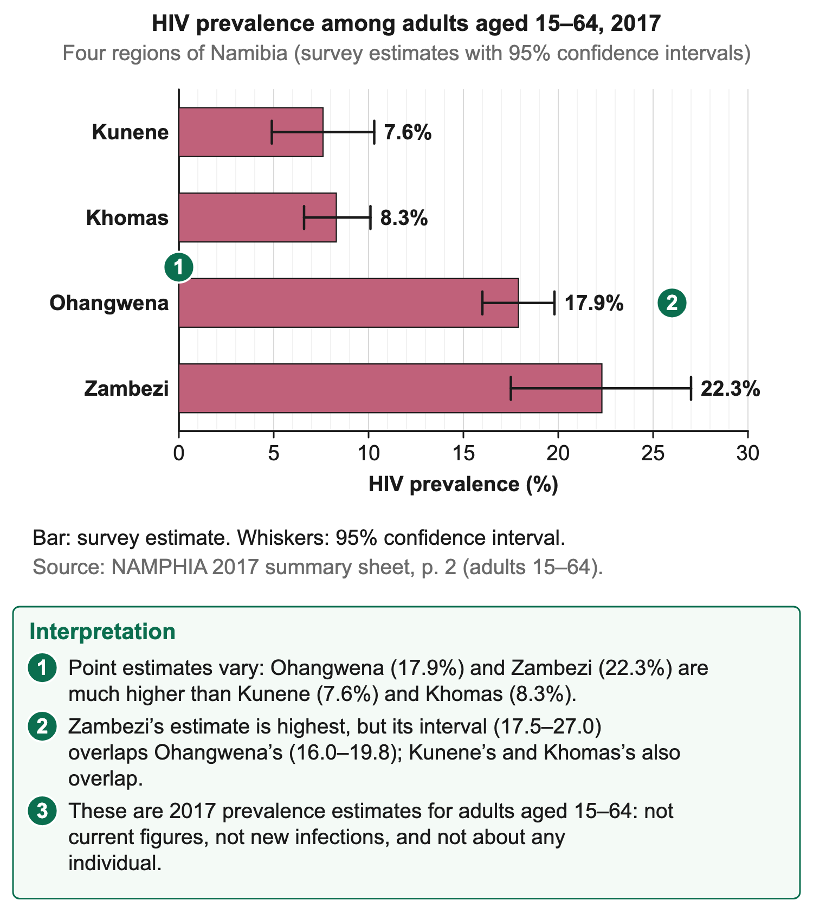

# 3.2 HIV and AIDS

*nam-6137-nssco-2026. Offline study notes, rendered from the approved content units on 2026-10-30. Everything here is also what the flashcards are built from.*

---

## HIV, AIDS and accurate interpretation

### HIV, AIDS and accurate interpretation

HIV is the human immunodeficiency virus, which attacks the immune system. AIDS is acquired immunodeficiency syndrome: the most advanced stage of HIV infection, when the immune system is so weakened that the body can no longer fight illnesses such as tuberculosis and other opportunistic infections. HIV names the virus; AIDS names the syndrome, not a different virus. A person living with HIV does not necessarily have AIDS, and effective treatment can stop AIDS from developing.

The immune system helps protect the body against infection. HIV can weaken that protection when infection is not effectively managed. This explains why preventing illness and maintaining treatment access matter to population health and livelihoods. It does not establish an individual's health condition from appearance. A learner should use accurate terms rather than assume that everyone living with HIV is visibly ill or unable to study, work or care for others.

Transmission involves relevant exposure to certain body fluids, including blood, semen, vaginal fluids and breast milk. HIV can also be transmitted during pregnancy or delivery. Ordinary social contact, shared food, handshakes and hugs do not spread HIV. This distinction helps prevent exclusion and stigma. Social interaction with someone living with HIV is not itself evidence of a transmission event or a reason to deny participation in school or work.

Antiretroviral therapy, often shortened to ART, suppresses HIV replication. It is treatment, not a cure or a harmful recreational-drug category. Its role in preserving health is central to demographic and economic interpretation. The word drugs in a health context can mean medicines; transferring a discussion of harmful recreational substance use onto prescribed ART would reverse the relevant mechanism.

People maintaining effective ART and an undetectable viral load do not transmit HIV sexually. The condition matters: being diagnosed or simply having once received medicine is not the same as maintaining suppression. This specific prevention result should not be silently expanded to every possible route or used to claim a cure. Clinical monitoring and support belong to healthcare, while the geographical lesson is how usable services affect health, participation and transmission.

Condoms used correctly and consistently can reduce sexual transmission risk and can also prevent unintended pregnancy. These are related but distinct effects. Their population implications depend on use, access and the wider pattern of births and deaths. Neither distributing products nor discussing them proves an observed change in infections or births. Outcomes require appropriate records over time, while individual clinical decisions belong with qualified health services.

Statistics also need careful terminology. Prevalence describes the proportion living with HIV in a defined population at a stated time. Incidence concerns new infections over a stated period among the relevant population at risk. A treatment-coverage percentage describes another denominator again. They should not all be called the infection rate without identifying the actual measure, age group and time.

A higher number living with HIV does not automatically mean more new infections. Improved survival can increase the number of people living with a manageable chronic condition, while prevention reduces new infections. Population size, diagnosis and estimation methods also affect reported figures. This is why a prevalence change cannot by itself prove a prevention programme failed or a treatment programme succeeded.

The same caution applies to demographic labels. People living with HIV contribute to households and the economy in many roles. Impacts of illness depend on treatment, access, workplace arrangements, income and support. An accurate explanation describes the pathway from untreated or poorly managed illness to a particular consequence, then recognises how effective treatment changes that pathway. It should not describe a person's HIV status as a fixed measure of economic value.

### Worked example

Confidentiality and respectful language support both rights and useful public-health work. A school investigation should use anonymous published data or clearly fictional teaching records rather than ask classmates to disclose status. A regional statistic cannot reveal the status of a particular resident. Keeping these boundaries clear allows population and service patterns to be studied without turning an aggregate record into a personal judgement.

A useful interpretation starts by asking what an observation establishes. A test result belongs within the appropriate testing and confirmation process; a clinical syndrome requires clinical assessment; a published population percentage describes a group. None should be inferred from a person's occupation, region, clothing or appearance. The distinctions protect both factual accuracy and people's privacy.

### Connections

The terms prevention, diagnosis, treatment and care describe different functions. A measure can contribute to more than one, but a lesson should name the relevant mechanism. This prevents a treatment benefit being confused with a cure or an awareness activity with a measured reduction in transmission.

---

## Reading Namibia's statistics and spatial patterns

### Reading Namibia's statistics and spatial patterns

Use a dataset's date, age group, measure and uncertainty before interpreting its map or chart. NAMPHIA surveyed households in 2017; its regional prevalence figures below concern adults aged fifteen to sixty-four, not every resident or today's population. The summary reports 7.6% in Kunene, 8.3% in Khomas, 17.9% in Ohangwena and 22.3% in Zambezi. These are estimated proportions, not counts of new infections.

The corresponding 95% confidence intervals are 4.9–10.3, 6.6–10.1, 16.0–19.8 and 17.5–27.0%. A chart should retain the date and age band and show uncertainty or provide it alongside the bars. The displayed point estimate in Zambezi exceeds Kunene's by 14.7 percentage points. That subtraction is not a 14.7% relative increase, and four examples do not describe every region.

In 2017 national adult prevalence was 12.6%, with Zambezi and Ohangwena above it and Kunene and Khomas below it. Zambezi borders Zambia and Botswana, and the Trans-Caprivi Highway carries freight through Katima Mulilo; Ohangwena borders Angola. These transport routes and border crossings offer a possible explanation for part of the pattern. Travel or migration can separate partners, connect sexual networks and interrupt access to prevention or treatment. These circumstances can increase exposure through unprotected sex; neither travelling nor working in a particular occupation automatically means that someone has HIV or several partners.

Ohangwena is densely settled, while Kunene, with lower prevalence, is very sparsely populated; but regional prevalence alone cannot establish why regions differ or which explanation matters most. It reflects past infections, age and sex composition, migration and survival on treatment. Population density and ordinary contact do not themselves transmit HIV. Unequal power in relationships can make negotiating protection harder. To test a transport-route explanation, compare evidence about exposure and access to services while accounting for these other influences; do not treat a regional correlation as proof of causation.

### Connections

The survey period, 2017, differs from a website's later upload date; use the observation date in the figure title.

---

## Demographic, social and economic effects

### Demographic, social and economic effects

HIV-related illness and deaths can affect population structure and livelihoods where prevention, diagnosis, treatment or care are insufficient. The consequences are not fixed for every person living with HIV. Effective treatment can preserve health and participation, while social support and fair access can reduce avoidable hardship. A geographical explanation needs the condition and pathway rather than the unsupported statement that HIV status means inability to work.

Demographic effects can include changes in mortality and life expectancy where illness causes premature deaths. If losses affect particular ages, the age structure and household composition can change. However, a population pyramid gap alone does not prove an HIV effect; migration, past births, other health conditions or recording can contribute. Relevant age-specific health and demographic data are needed to support attribution.

Mortality and fertility interact with total growth. Reduced deaths through treatment can support survival and change the population trajectory. This does not establish an exact national growth rate without births and migration as well. A general mechanism should not be turned into a precise prediction from one treatment statistic. Nor should a greater number living with HIV be interpreted automatically as worsening mortality.

### Worked example

Household effects can involve care needs, income interruption or medical and travel costs during illness. A family member providing care may have less time for other work. Children can face interrupted schooling where household resources or care arrangements are strained. These are conditional pathways, not claims that every household with a member living with HIV experiences school withdrawal or poverty.

Stigma and discrimination can create harm separate from the biological infection. Exclusion from employment, fear of disclosure or disrespectful treatment can reduce income or discourage access to services. Accurate information, confidentiality and supportive institutions can reduce those barriers. A social explanation should therefore identify whether a consequence comes from illness, inaccessible care or discrimination, rather than combining them into one inevitable outcome.

Loss of a parent or caregiver can change household responsibilities and support needs. Outcomes depend on surviving relatives, community arrangements, services and income. It is inaccurate to assume that every child affected by HIV has HIV or that every orphan's situation has the same cause. Published data should specify the category and age group before a conclusion is drawn.

Economic effects can include lost working time during untreated illness, replacement or training costs for enterprises and increased demand on health and support services. Households may sell assets or reduce spending on education or production when income falls and costs rise. The scale depends on actual illness, income protection and usable care. Treatment and non-discriminatory workplaces can preserve participation and reduce some of these pressures.

At national level the effects were large before treatment was widely available. United States Census Bureau estimates for 2008 put Namibia's life expectancy at about 50 years, compared with about 71 years in a model without AIDS, and the crude death rate at 14 per 1,000 instead of 5. Population growth was about 0.9% a year instead of 1.9%. WHO estimated that about 57,000 children had lost one or both parents to AIDS by the end of 2003.

### Worked example

Health spending has immediate costs and possible wider benefits. Funding treatment, prevention and support requires resources, while healthier people can continue learning, working and caring for others. A narrow account of medicines as an economic cost misses those benefits. Conversely, a statement that treatment saves money needs a defined period and complete relevant cost evidence rather than an assumed amount.

### Worked example

A hypothetical household account illustrates one pathway without assigning it to a real family. During an illness interval, earnings fall from N$3,000 to N$2,000 while relevant travel and care costs rise by N$400. Available funds for other needs are N$1,400 lower than before if all other flows are unchanged. This arithmetic describes the supplied scenario, not a usual loss experienced by every household or proof of an individual's diagnosis.

Support can alter the chain. Reliable care, suitable leave, accessible transport or income protection may reduce avoidable interruption. Education and respectful services can make prevention and treatment more usable. Their success requires delivery and appropriate outcomes. A policy title or a count of leaflets is not equivalent to stable health, continued schooling or protected income.

Most AIDS deaths occur among adults aged about 15 to 49, the economically active and child-bearing ages. On a population pyramid the bars for these ages become narrower. Social impacts are effects on people, families and communities: more orphans and child-headed households, grandparents caring for grandchildren, children leaving school to nurse sick relatives or earn money, and stigma that isolates families.

Economic impacts concern money, work and production. Illness and deaths reduce the number of skilled and experienced workers, so firms lose productivity and must recruit and train replacements. Absenteeism rises, household incomes and savings fall, and fewer people pay tax. Government spends more on health care, medicines and grants, leaving less for other development. Treatment reduces many of these effects by keeping people healthy enough to work.

An age-structure claim needs an appropriate comparison. A record of deaths among adults can be relevant, but the total number living at those ages and other causes are needed to assess the scale. A large number of deaths can partly reflect a large population. Likewise, a lower observed death count after treatment expansion may be encouraging without isolating the programme's exact causal effect. Appropriate rates, methods and time records strengthen the interpretation.

Household work includes unpaid activities. A caregiver, a student or a person managing a household can contribute even without a wage. Illness can interrupt these roles, while effective care can support them. An economic account focused only on salary would miss those changes. State what the supplied measure covers before calling it the full household cost or benefit.

### Connections

A livelihood strategy should address the identified link. Income protection can reduce an immediate cash gap; accessible care can reduce avoidable illness; non-discriminatory practice can reduce exclusion. One measure may help without replacing the others. A supported judgement explains its contribution and the remaining conditions rather than promising that a single intervention removes every social or economic consequence.

---

## Responses and stakeholder roles

### Responses and stakeholder roles

An effective response links prevention, voluntary testing, appropriate treatment, care and social support. Government, local authorities, NGOs, churches, private organisations and individuals can contribute different functions. Their roles should be judged against a clear objective, such as usable access or maintained support, rather than listed as institutions whose involvement proves success. Stigma, distance, cost and unreliable services can remain barriers despite an announced programme.

Government responsibilities can include public-health planning, service provision, procurement, standards, training and monitoring. A dependable medicine and care chain requires suitable supplies, staff and access. A clinic building without those functions does not establish effective coverage. Relevant measures include who can reach services, whether care continues and what outcomes are observed under appropriate confidentiality.

Government also supports prevention information and suitable data systems. Accurate information helps distinguish transmission routes, treatment and rights. Monitoring needs a clear indicator and denominator: people tested, people diagnosed, people receiving treatment and people with viral suppression are different groups. Combining them as if each percentage referred to all people can misrepresent progress. The treatment cascade must retain its conditional denominators.

Local authorities can support access through relevant local services, communication, referral links or coordination within their responsibilities. NGOs may provide outreach, counselling support, navigation or assistance for groups facing barriers. Their contribution depends on relevance, continuity and connection to qualified services. An event reaching many people is a useful activity record but does not establish that people could later obtain or maintain the needed care.

Churches and other faith or community organisations can offer compassionate support, reduce stigma and help households maintain social connections. Such support should respect confidentiality and avoid misinformation. It complements rather than replaces medical care. A moral judgement about a person's status is not a public-health explanation and can worsen exclusion or service barriers.

Private-sector organisations can provide non-discriminatory workplaces, suitable leave or support for access to care, while protecting private information. Staff can then continue participation under appropriate conditions. A workplace policy needs implementation: an employee may still face exclusion if managers ignore it. Evaluate actual practice and appropriate aggregate outcomes rather than assume that a written statement changes every experience.

Individuals can seek accurate information, use suitable prevention services, support others respectfully and access or continue care under clinical guidance. The ability to do so is affected by cost, availability, safety and other circumstances. A response should not shift all responsibility onto individuals while ignoring institutional barriers. Personal choice is meaningful only where usable options exist.

In Namibia the government leads the response through the Ministry of Health and Social Services. It launched the national antiretroviral programme in government health facilities in 2003, and ART is provided free of charge in the public sector. It also runs programmes to prevent mother-to-child transmission (begun in 2002), voluntary counselling and testing, free condom distribution and awareness campaigns, especially for women and young people. The National Code on HIV/AIDS and Employment forbids discrimination at work because of a person's HIV status.

### Worked example

Regional and local authorities take part in the committees that plan the response in each area. They can include HIV awareness in their town services and support clinics and community programmes. Non-governmental organisations (NGOs) offer counselling and testing, home-based care for sick people, food and emotional support for people on treatment, and help for orphans and vulnerable children. NGOs reach remote villages through volunteers, but many depend on donor funding that can end.

A service comparison can identify the actual constraint. A community may have accurate information but lack affordable transport to care. More leaflets would not directly solve that barrier; appropriate transport or closer usable services may be relevant. Another community may have accessible services but widespread misinformation. The appropriate response differs because the supplied cause differs. Recommendations should follow evidence rather than repeat the same intervention everywhere.

Churches and faith-based organisations can reach communities through their congregations and institutions. They provide counselling, home visits and care for the sick, help orphans with food, school fees and uniforms, and use their meetings to reduce stigma and encourage testing. Some faith-based institutions also provide treatment. A weakness is that some religious messages discourage condom use or present HIV as a moral failing, which can increase stigma.

Private firms can run workplace programmes with testing, condoms and education, keep employees' status confidential and allow time off for treatment; a national business coalition on HIV/AIDS was set up in 2004 to support this work. Individuals can get tested and know their status, use condoms correctly, reduce their number of sexual partners, take treatment every day if they are positive, and support people living with HIV instead of excluding them.

### Worked example

A treatment cascade illustrates the denominator issue. In a hypothetical eligible group of 100 people living with HIV, eighty know their status and sixty-four receive treatment. Treatment among those diagnosed is eighty per cent, while treatment among all 100 is sixty-four per cent. Those figures are both correct for different questions. If fifty-eight of the sixty-four have the stated suppression outcome, the conditional percentage needs the sixty-four denominator. It should not be reported as the percentage of all 100 without recalculation.

A service programme should therefore state the target group and the measure before comparing sites. One clinic may serve more people in absolute terms but a smaller proportion of eligible residents. A remote service may have higher travel barriers despite similar staffing. Population size, need and access conditions influence the judgement. A raw attendance total cannot show whether coverage is equitable.

Coordination can help connect functions. An outreach worker may provide accurate information and a referral, while a qualified service supplies testing or care. A workplace can allow time to attend, and community support can reduce stigma. The benefit depends on whether those links function. A referral issued is different from an appointment reached or sustained access maintained.

Monitoring should allow problems to be corrected without exposing individuals. Suitable anonymous totals and protected clinical systems can identify missed groups or service interruptions. A school lesson should use published aggregates and fictional scenarios for calculations. Collecting private status information is unnecessary for learning the geography and can create harm.

### Connections

Evaluation should distinguish a service interruption from a change in demand, using appropriate records before selecting an operational response.

---

## Prevention, treatment and population effects

### Prevention, treatment and population effects

Correct and consistent condom use can reduce sexual HIV transmission and unintended pregnancy. These mechanisms can influence population through different components: fewer infections can reduce later illness and deaths, while pregnancy prevention can affect births. The overall population-growth effect is not determined by the word condom alone. It depends on use, fertility choices, survival, migration and the period being examined.

Correct and consistent condom use affects population structure in two ways. First, fewer unplanned pregnancies lower the birth rate, so the base of the population pyramid tends to become narrower; this birth effect tends to slow growth. Second, fewer HIV infections mean fewer adults aged about 15 to 49 fall ill and die, so the working-age bars stay wide, fewer children become orphans and more people survive into old age. The reduction in deaths tends to increase growth, so the net effect depends on births, deaths and migration as well as correct, consistent condom use.

ART suppresses HIV and supports health when effective care is maintained. Improved survival can reduce HIV-related mortality and support longer lives. People can continue education, employment, care work and other roles, reducing some household and enterprise pressures associated with unmanaged illness. These are benefits of usable sustained treatment, not effects of treating medicines as harmful recreational substances.

Treatment also has a prevention role. Maintaining an undetectable viral load prevents sexual transmission, while other circumstances require their own appropriate guidance. The condition should travel with the statement: diagnosis alone or a one-time medicine collection does not establish maintained suppression. This distinction explains why continued access and support matter alongside initial programme enrolment.

Population indicators can move in different directions during successful treatment. More people may be living with HIV because they survive longer, even while new infections or deaths fall. A prevalence increase alone cannot settle whether prevention failed. Incidence, mortality, treatment and population composition provide complementary evidence. The age group and date must remain compatible before a comparison is made.

Economic interpretation needs a similar distinction. Treatment purchases and service delivery have costs, while maintained health can preserve income, skills and household stability. A full evaluation compares relevant costs and benefits over a stated period. It should not claim that an individual is worth more only when earning money; unpaid care, learning and participation also contribute to households and society.

### Worked example

Wider use of ARVs mainly lowers the death rate. Fewer adults die young, so the middle bars of the pyramid stay wide, life expectancy rises and more people reach the older age groups, widening the top of the pyramid. Fewer children lose their parents. Because deaths fall while births continue, population growth can increase if births and migration are unchanged, adding to future demand for schools, jobs and housing.

### Worked example

ARVs also affect the economy. Workers stay healthy enough to keep their jobs, so skills and experience are kept, absenteeism falls and households keep their income. Fewer orphans and sick relatives reduce the cost of care for families and the state. However, treatment is a large, lifelong cost: the government must buy medicines, pay health workers and run clinics, using money that could otherwise go to education or roads.

The combined response therefore connects health, rights and usable services. Prevention reduces relevant exposure; diagnosis links people to care; sustained treatment supports health and specific prevention benefits; social support reduces avoidable exclusion. Population and economic outcomes are judged with dated compatible records. This approach teaches the required mechanisms while recognising people's agency and avoiding an inevitable-damage narrative about living with HIV.

### Worked example

A simplified demographic account helps separate mechanisms. Suppose a population records fifty births, thirty deaths and no net migration in an interval. Natural increase is twenty. If an effective health response reduces deaths to twenty while births stay fifty, natural increase becomes thirty. If births also change, the resulting balance must be recalculated rather than assumed. These are hypothetical component figures, not estimates of a Namibian programme's effect.

A prevention measure affecting unintended pregnancies can alter the birth component, while reduced HIV-related illness can alter survival and participation. Their overall direction depends on the combination. A question asking about growth therefore needs births, deaths and relevant migration, not just a count of condoms distributed or people enrolled in care.

A treatment evaluation should also retain the timeframe. Restored health and continuity of work may be observed sooner than a broad national age-structure change. An early programme report can provide useful access evidence without supporting a completed long-term demographic claim. Match the conclusion to the measured interval and level, and use suitable later records for a longer-term judgement.

### Connections

Use the stated age group and denominator consistently, because a change of definition can create an apparent trend without a comparable underlying change.
