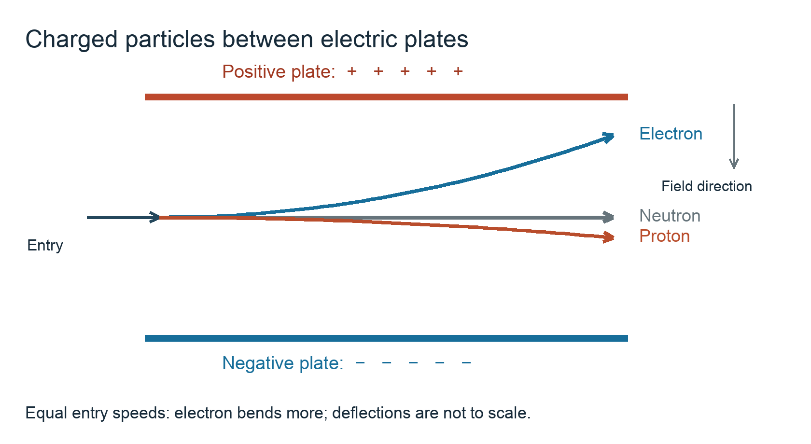

# 1.2 Atomic structure

*nam-8224-nsscas-2026. Offline study notes, rendered from the approved content units on 2026-10-22. Everything here is also what the flashcards are built from.*

---

## Electric-field diagram pilot

### Particle paths in an electric field

An electric field can change the direction of a moving charged particle. In this diagram the upper plate is positive and the lower plate is negative. An electron entering from the left bends upwards towards the positive plate. A proton entering from the left bends downwards towards the negative plate. The neutron follows the straight path because it has no net electric charge. The paths begin changing direction as the charged particles enter the field. The drawing communicates the signs of the charges and the directions of the forces. Its distances and deflections are schematic: do not read a radius or a force magnitude from it. The larger electron deflection represents its greater response at equal entry speeds, but the drawing does not give a numerical ratio. When particles enter with the same speed, the electron is deflected more strongly than the much heavier proton. A quantitative comparison would require defined field strength, speed and masses. To interpret a particle-path question, first identify the two plate signs. Next identify the charge of each particle. Opposite charges attract, so a negative particle bends towards the positive plate and a positive particle towards the negative plate. Then check that an uncharged particle remains on the initial straight path. Labelling the plates and all three paths makes the reasoning visible. The arrows on the paths indicate motion; the separate field arrow points from the positive plate towards the negative plate.

