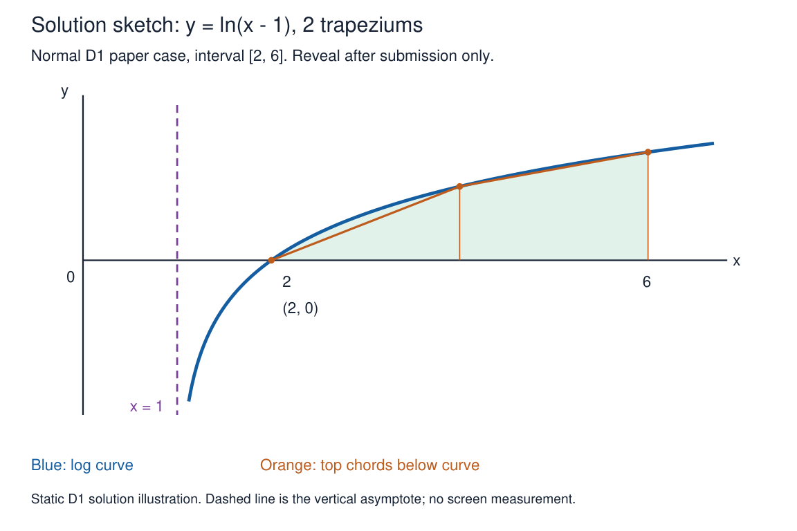
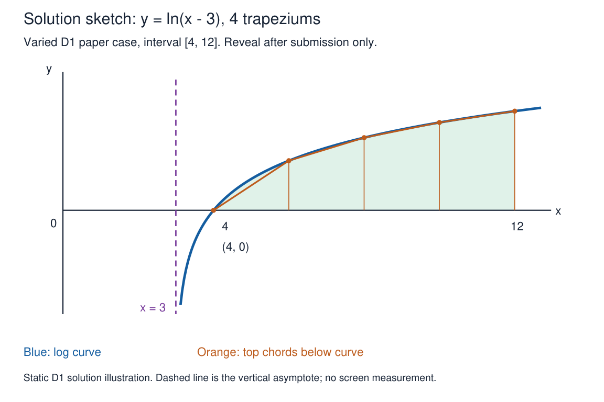
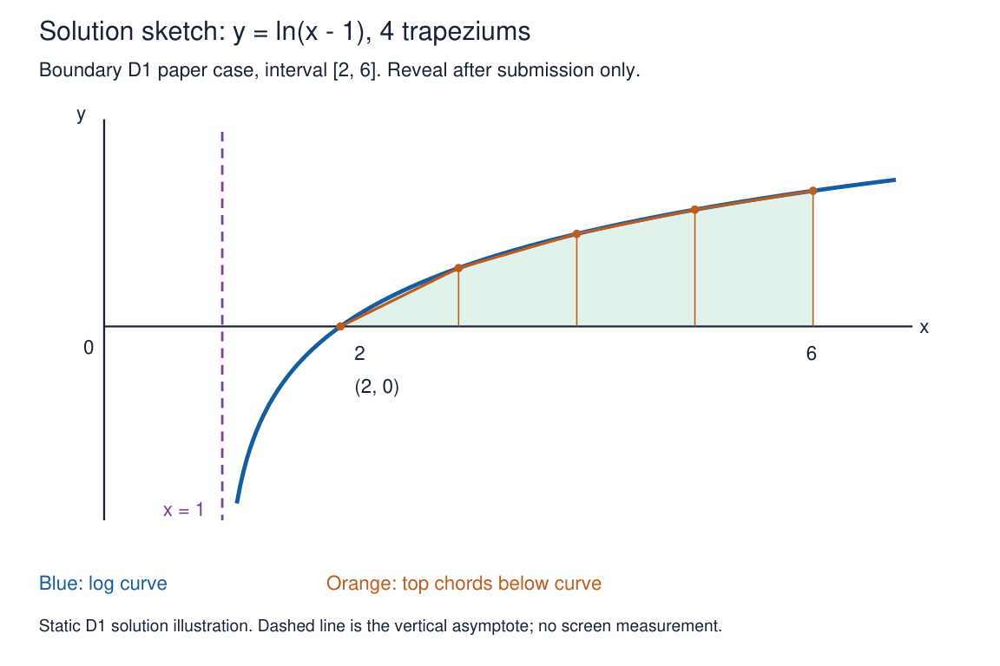

# Design exemplar: WB8227-trapezium-sketch-estimate

NSSCAS Mathematics 8227, 2020 syllabus; Vitalis; PLANNER Codex; 24 November 2026. **D4 v0.1.4**, branch `logarithmic-hence-chain`, selection `8227:D:SEL:trapezium-sketch-estimate:logarithmic-hence-chain`. Manual paper examples only; Claude D4 changed-scope confirmation, then owner approval pending. No runtime item/generator.

Each case asks(a) a specified equal-strip logarithmic trapezium estimate to3sf, (b) **hence**, showing the transformation, a related integral estimate to3sf, (c) the log sketch with intercepts/asymptote and(d) bias from that own sketch with a geometric reason. Marks3+2+3+2=10. Static solution graphs below reveal the answer and therefore appear only after submission in the later app.

## Normal — two strips, shift1, factor2

$I=\int_2^6\ln(x-1)\,dx$, two equal strips. Hence estimate$J=\int_2^6 2\ln(x^2-2x+1)\,dx$.

| Action | Reason | Result |
|---|---|---|
| Set nodes/ordinates | Width$\Delta=(6-2)/2=2$ | Nodes$2,4,6$; ordinates$0,\ln3,\ln5$. |
| Sum trapezium areas | Endpoint/interior weighting | $T=\frac22(0+2\ln3+\ln5)=3.80666248977\ldots\approx3.81$. |
| Factor the inner quadratic | This alone is b:B1 evidence | $2\ln(x^2-2x+1)=2\ln((x-1)^2)$. |
| Use the logarithm law and hence reuse(a) | $x-1>0$ on the interval | $2\ln((x-1)^2)=4\ln(x-1)$; $J\approx4T=15.2266499591\ldots$, canonical3sf$15.2$. |
| Sketch the curve | Log argument positive, value0 at argument1 | Domain$x>1$, asymptote$x=1$, intercept$(2,0)$; below-axis branch for$1<x<2$, no$y$-intercept. |
| Compare top chords with curve | Every chord is below this own correctly sketched log branch | Underestimate, with top-chord-below-curve reason. |

Full evidence earns **10/10**. Non-exhaustive canonical-path(b) fixtures, with valid hence work: **{15.2,15.24}**;15.23 is also a valid higher-precision canonical-path answer.15.24 is$4\times$the reported3sf(a)3.81, retained by B1FT;15.2 is the canonical/rounded F.T. product. The extra-digit F.T. product is not called the canonical3sf value. Independent quadrature/area check: exact$I=5\ln5-4=4.04718956217\ldots>T$.

## Changed — four strips, shift3, factor3

$I=\int_4^{12}\ln(x-3)\,dx$, four equal strips. Hence estimate$J=\int_4^{12}3\ln(x^2-6x+9)\,dx$.

| Action | Reason | Result |
|---|---|---|
| Set nodes | Width$(12-4)/4=2$ | $4,6,8,10,12$ with ordinates$0,\ln3,\ln5,\ln7,\ln9$. |
| Apply correct weights | Sum four trapeziums | $T=\frac22[0+2(\ln3+\ln5+\ln7)+\ln9]=11.50514527765\ldots\approx11.5$. |
| Recognise square, then log power | $(x-3)^2=x^2-6x+9$, $x>3$ | $3\ln((x-3)^2)=6\ln(x-3)$, hence$J\approx6T=69.0308716659\ldots\approx69.0$. |
| Draw translated log graph and justify bias | Labels must change with the shift | Asymptote$x=3$, intercept$(4,0)$, negative branch for$3<x<4$; four top chords below curve give underestimate. |

**10/10**. Non-exhaustive canonical-path(b) fixture **{69.0}**: canonical3sf and$6\times11.5$ agree. Independent exact$I=9\ln9-8=11.7750211960\ldots>T$. The translated presentation is not an independent new(a)/(b) computation if the same$(L,n,k)$ context was exposed previously. All$(h,L,n)=(2,8,4)$ presentations are excluded for every$k$. This case has$h=3$ and is not verbatim, but its(a)/(b) numerical outcomes match published values: translation is not fresh quadrature evidence. Its per-part keys enforce that exposure.

## Admitted boundary — width1 and F.T. rounding

$I=\int_2^6\ln(x-1)\,dx$, four equal strips. Hence estimate$J=\int_2^6\ln(x^2-2x+1)\,dx$.

| Action | Reason | Result |
|---|---|---|
| Width and nodes | Four intervals across length4 | $\Delta=1$; nodes$2,3,4,5,6$; ordinates$0,\ln2,\ln3,\ln4,\ln5$. |
| Sum trapeziums | Keep guard digits in logarithms | $T=\frac12[2(\ln2+\ln3+\ln4)+\ln5]=3.982772786565\ldots\approx3.98$. |
| Factor and rescale | $\ln((x-1)^2)=2\ln(x-1)$ | $J\approx2T=7.96554557313\ldots\approx7.97$. |
| Sketch and compare | Same function, a different chord set | Asymptote$x=1$, intercept$(2,0)$; four top chords below the curve, hence underestimate. |

**10/10** for the full canonical working. Non-exhaustive canonical-path(b) fixtures **{7.96,7.97}**:7.96 comes from the sanctioned$2\times$reported(a)3.98;7.97 comes from guard digits. Preserve the actual route rather than falsely marking7.96 as the canonical unrounded product. Exact$I=5\ln5-4$ remains greater than$T$.

## Marking probes after D2 repair

For normal, other parts complete unless stated:

- Correct factorised$2\ln((x-1)^2)$, then wrongly squares$T$: b:B1 retained, b:B2 lost; **9/10**. If neither correct factorisation nor scale is shown, b0 gives **8/10**.
- Correct(b) by visible independent non-hence quadrature: exclusive **SC1/2**, maximum9/10; never add SC1 to the normal2mark path. Bare$J$ alone is0/2 under OD-1, not automatic SC1.
- Bare correct$T$ alone is0/3. Feedback says the number is right and asks for trapezium working; it does not invent a numerical error.
- An incorrect concave-up(c) with independently correct asymptote/intercept labels can earn c2/3. If the learner coherently says “overestimate; the top edges lie above my curve”, **d2/2 F.T.**, total9/10. Shape is penalised in(c) only. This is the named `D1-TRAP-FT-BRIDGE`:OD-5 retains2023own-graph conclusion F.T. and its no-overlay verbal-reason standard. The only accepted extension is DB1 judged against the same own curve, supported by2025; no drawn-trapezium requirement is imported.
- Correct(a,b), no sketch and a bias sentence: **5/10** (c0,d0). A clear blank is not an unreadable upload. An unreadable sketch is pending clarification for the affected criteria, not guessed as blank or wrong.
- Correct sketch and only “underestimate”: d1/2, total9/10. “The graph is increasing” is not the dependent geometric reason. Correct unambiguous concavity shorthand may establish chord position from the own sketch.

The c:B1 checklist is operational: one curve only, lies to the right of its own asymptote, approaches that own boundary downwards without crossing, rise through quadrants4and1 with decreasing gradient, no finite horizontal asymptote. Labelled$x=h$ as a vertical guide or clearly approached boundary earns c:B2; labelled$(h+1,0)$ earns c:B3. No compulsory point table or second derivative is added.

## Exclusions, capacity and limits

Reject undefined log ordinates, zero/unequal strip widths, an inconsistent fixed image and replacement by a curve with different curvature. $h=0$ is outside this chosen domain but mathematically possible; $\ln x$ also has no$y$-intercept. All original subpart variants with$(h,L,n)=(2,8,4)$ are outside the fresh pool for every$k$. The marked-precision squaring collision$(L,n,k)=(4,4,2)$ is excluded for every$h$.

36 raw →30 admitted presentations →11 whole$(L,n,k)$ contexts. Part keys/counts: a$(L,n)$4; b$(L,n,k)$11; c$h$3; d$(h,L,n)$11 own-graph/chord contexts. The canonical bias outcome has **one** class, not30fresh decisions. Mathematical all-part-key packing is3 (including the h=2 attributed original sketch); strict generated-fresh packing is2 before examples because only h=1 and h=3 are fresh. After one such worked example, at most1 wholly fresh complete task remains, and further a/b/d exposures may exhaust it sooner; repeated parts in practice are labelled after-feedback. Every admitted(b) canonical-path fixture set, including$(8,2,k)$ rounding fixtures, is saved in the domain audit. Ordinate2dp rounding changes canonical(a) only at$(4,4)$; that limitation is visible rather than advertised as universal error discrimination.

Separately written oracle recomputes each trapezium as individual areas, the transformed integrand independently, and bias by numerical integration. SVGs have explicit visibly dashed asymptote segments, correct same-data nodes/chords and moved tick labels; per-asset inspection is recorded. No actual app marking/render/history or seeded generation test has run. All four parts and whole branch are **Apply3**, classification `8227-pilot-design-0.1.1`; no Analyse label remains.

### D2 response-rule probes

- Writing $2\ln(x^2-2x+1)=4\ln(x-1)$ directly implies the square and earns b:B1; subsequent correct $J=4T$ earns b:B2.
- b:B2 accepts the appropriate product of the learner’s own(a), not only a precomputed list. At the normal,15.23 is canonically3sf-correct. For own working estimates10.84,11.52,11.52 and scales4,4,6, respectively,43.36/43.4,46.08/46.1,69.12/69.1 are valid F.T. products with the correct shown scale.
- A correctly shaped $\ln x$ sketch with asymptote$x=0$ and intercept$(1,0)$ in the normal earns c1/3, not0/3: only canonical shift labels fail. Coherent own-graph(d) can still earn2/2.
- One drawn chord and a brief statement explicitly comparing it to the own curve can earn DB1; a bias word alone cannot. Two unlabelled function graphs earn c0,d0 even when one looks recognisably logarithmic; never select it by shape. An explicitly labelled unique log curve allows its c:B2/B3 and(d) to be judged, while the multiple-function c:B1 exclusion remains.
- OD-6 governs the misread principle; apply the single proposed operational settlement in subject-rules MR03. Deduct after gross marking from the first A/B earned on the datum anywhere in question order; dependencies retain gross awards. Eligibility is decided once and reused. Practice feedback names the misread. OD-1/OD-5 remain scoped to their named rules.

### Original-subtask guard for remaining $h=2$ contexts

The admitted mathematical domain still contains **30 presentations / 11 contexts**, with a combinatorial all-part-key packing of **3**. However, its $h=2$ sketch subtask shares 2023 Q6(c) exactly in assessed content. It is **not a fresh generated variant**. A future explicitly selected original/mixed-practice route may show that part only with the original wording and attribution “NSSCAS Mathematics 8227, 2023 Paper 2, Question 6(c), page 11”; the whole question must not be labelled original. The canonical record carries the exact source wording and locator.

A generated-fresh request blocks the part key `('log-sketch',2)`, leaving **22 fully generated presentations**, 11 contexts, part-key counts **4/11/2/8**, and a conservative generated-fresh packing of **2**. All three paper examples here use $h=1$ or $3$ and contain no unlabelled $h=2$ original subtask. Mathematical packing 3 and generated-fresh packing 2 are separate counts; no silent freshness claim is made.

D3 log-law probe: on the changed case, writing only $J=6T=6(11.5)=69.0$ with no factorisation or visible logarithm-law derivation earns **b1/2** (B2 only), not B1. Writing $3\ln((x-3)^2)=6\ln(x-3)$ first earns B1 as well. A genuine reading of $k=2$ as $k=3$ in the normal, followed by correct $3\ln((x-1)^2)=6\ln(x-1)$ and $6T=22.8$ (or $22.86$ from reported $T$), earns b1/2 after one MR−1 at b:B1, total9/10; it first uses that datum in b.

Near-copy disclosure: the admitted $(h,L,n)=(2,8,2)$ integrals differ from 2023 Q6 chiefly in strip count (and possibly k). They remain in the explicitly attributed original/mixed route because c is the original h=2 sketch; no domain change is made. For k=2, wrong scales $k^2$ and $k+2$ equal $2k=4$: do not infer a scale misconception from the number alone. Seeing the factorised square retains b:B1 (official row04). Visibly wrong log-law reasoning then loses b:B2 under its correct-working (www) requirement, even when k=2 makes the numerical scale coincide; the fixture earns b1/2, total9/10. This is a proposed D4 marking clarification, not an OD-1 penalty.

OD-6 sources: NSSCAS 2025 examiner report PDF345 item4 (`CONVENTION:108`) and Cambridge International 9709/12 March2016 mark scheme PDF3, Penalties. The Cambridge convention is comparable-board evidence adopted by Vitalis, not a Namibian published allocation. The per-datum unit, deduction order, eligibility ledger and gross-before-net dependency mechanics are proposed operational rules in MR03, pending approval of the exact manifest; they are not further owner decisions. Practice feedback names the misread.
