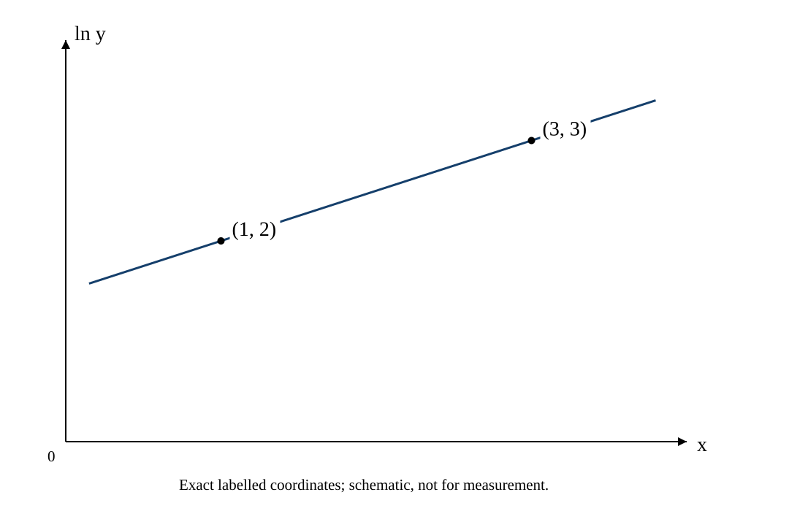
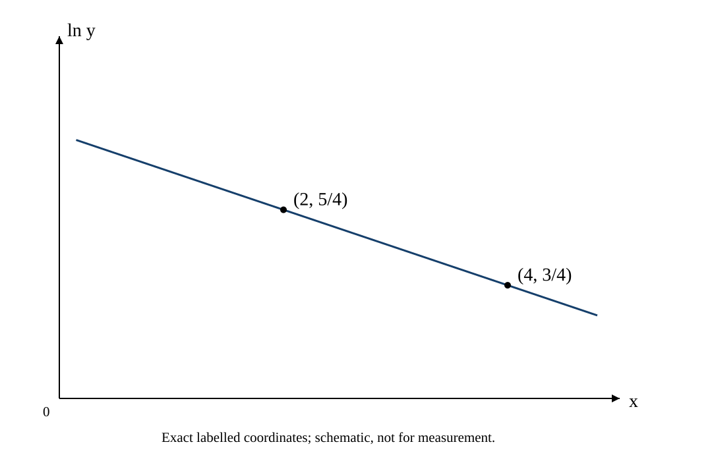
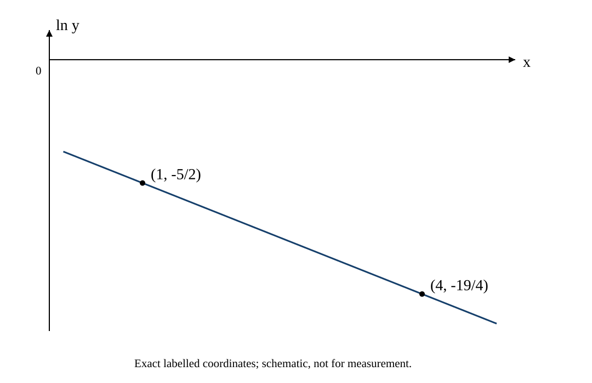

# Worked design exemplar — WB8227-log-linear-model

NSSCAS Mathematics 8227, December 2020; Grade 12. Owner Vitalis; PLANNER Codex, 23 November 2026. Proposed version 0.1.0; owner approval and independent design review pending. These are original paper design illustrations, not runtime learner items.

Graph-intercept examples need an original graph whose horizontal axis is $x$ and vertical axis is $\ln y$, with the exact coordinate labels below. The three original static diagrams below make these paper examples reviewable; they are not runtime learner assets or a diagram generator. The later diagram must include every label, including negative ordinates, and disclose neither hidden parameter. The gradient-target branch supplies its transformed gradient in text and needs no image. All questions are newly authored.

## Graph-intercept — normal

Question: The variables satisfy $y=Ae^{px+p}$, with $A>0$. A straight line on axes $x$ and $\ln y$ passes through the exact labelled points $(1,2)$ and $(3,3)$. Find $A$ to three significant figures and $p$ exactly, showing your working. [5]

1. Action: take natural logarithms. Reason: a product becomes a sum and logarithm reverses the exponential. Result:
   $$\ln y=px+p+\ln A.\qquad\text{[G-B1]}$$
2. Action: calculate the gradient of the labelled line. Reason: its coefficient of $x$ is $p$. Result:
   $$p=\frac{3-2}{3-1}=\frac12.\qquad\text{[G-M1,G-A1]}$$
3. Action: substitute the first point. Reason: the intercept includes $p$ as well as $\ln A$. Result:
   $$2=\frac12+\frac12+\ln A,\qquad \ln A=1.\qquad\text{[G-M2]}$$
4. Action: undo the logarithm and round once. Result:
   $$A=e\approx2.72,\qquad p=\frac12.\qquad\text{[G-A2]}$$
   Total: 5 marks.

Independent original-model checks give $e\cdot e^1=e^2$ at the first abscissa and $e\cdot e^2=e^3$ at the second; their log ordinates are exactly two and three. Alternatively solve $2=2p+\ln A$ and $3=4p+\ln A$ simultaneously for the same five-mark cap.

## Graph-intercept — changed decay

Question: The model is $y=Ae^{px+p}$. A straight line on axes $x$ and $\ln y$ has exact point labels $(2,5/4)$ and $(4,3/4)$. Find $A$ to three significant figures and $p$ exactly, showing working. [5]

Transform to $\ln y=px+p+\ln A$ [B1]. The gradient is
$$p=\frac{3/4-5/4}{4-2}=-\frac14.\qquad\text{[M1,A1]}$$
Substitute the first point:
$$\frac54=2\!\left(-\frac14\right)-\frac14+\ln A,\qquad\ln A=2.\qquad\text{[M2]}$$
Thus $A=e^2\approx7.39$ and $p=-1/4$ [A1]; total 5. This changes growth to decay. The drawing must slope down as the horizontal coordinate increases. Independent checks give original values $e^2e^{-3/4}=e^{5/4}$ and $e^2e^{-5/4}=e^{3/4}$, agreeing with both labelled log ordinates.

## Graph-intercept — admitted lower boundary

Question: The model is $y=Ae^{px+p}$. On axes $x$ and $\ln y$, the exact labelled points are $(1,-5/2)$ and $(4,-19/4)$. Find $A$ to three significant figures and $p$ exactly, with working. [5]

Transform correctly [B1]. Calculate
$$p=\frac{-19/4+5/2}{4-1}=-\frac34.\qquad\text{[M1,A1]}$$
Use the first point with the complete constant term:
$$-\frac52=-\frac34-\frac34+\ln A,\qquad\ln A=-1.\qquad\text{[M2]}$$
Therefore $A=e^{-1}\approx0.368$ and $p=-3/4$ [A1], total 5. Independent original-model checks give log ordinates $-5/2$ and $-19/4$. Positive $y$ does not require positive $\ln y$; a viewport that clips the negative labels invalidates this question asset.

## Gradient-target — normal

Question: The model is $y=2^a a^x$, where $a$ is positive. The graph of $\log_2 y$ against $x$ has gradient $2$. (a) Find $a$ exactly. [3] (b) Hence find $x$ exactly when $y=8$. [2]

Take base-two logarithms:
$$\log_2 y=a+x\log_2 a.\qquad\text{[T-B1]}$$
Matching the gradient gives $\log_2 a=2$ [T-M1], hence $a=4$ [T-A1]. With the target,
$$3=4+2x,\qquad x=-\frac12.\qquad\text{[U-M1,U-A1]}$$
Total: 5 marks. Independent direct-index check: $2^4\cdot4^{-1/2}=16/2=8$. The alternative equation $2^{4+2x}=2^3$ earns the same two marks for the target part; never add both routes' method marks.

## Gradient-target — changed base

Question: The model is $y=3^a a^x$. The graph of $\log_3 y$ against $x$ has gradient $1$. Find $a$ exactly [3], then find $x$ exactly when $y=81$ [2].

The transformed line is $\log_3 y=a+x\log_3 a$ [B1]. Matching its gradient gives $\log_3 a=1$ [M1], so $a=3$ [A1]. Then $4=3+x$ [M1], hence $x=1$ [A1]. Total: 5. Direct check: $3^3\cdot3^1=81$. Exponentiation must use the stated base; a base-ten answer would not fit the gradient.

## Gradient-target — admitted upper prefactor and unit target

Question: The model is $y=3^{2a}a^x$. The graph of $\log_3 y$ against $x$ has gradient $2$. Find $a$ exactly [3], then find $x$ exactly when $y=1$ [2].

Transform to $\log_3 y=2a+x\log_3 a$ [B1]. The gradient gives $\log_3 a=2$ [M1], so $a=9$ [A1]. The target gives $0=18+2x$ [M1], hence $x=-9$ [A1]. Total: 5. Independent check:
$$3^{18}\cdot9^{-9}=3^{18}\cdot3^{-18}=1.$$
The variable has no elapsed-time restriction; a negative value is feasible. Evaluating the large prefactor numerically is unnecessary.

## Excluded cases and sample credit

Coincident graph abscissae do not identify a unique slope. Omitting the logarithm from the vertical-axis label changes the supplied representation. Inconsistent point labels or a zero-slope model are outside this branch. In the second branch, a nonpositive parameter, a unit parameter or an unspecified log base violates its recovery invariant; a zero target has no logarithm. These cases must not be repaired silently.

For the normal graph, a correct line/gradient but $A=e^{3/2}$ after treating the whole intercept as $\ln A$ earns 3 of 5. Feedback asks the learner to separate the offset $p$ from $\ln A$. The final pair $A=2.72,p=1/2$ alone earns two accuracy marks. A full simultaneous-equation solution earns five. For the normal gradient case, correct part (a) followed by $3=2x$ after dropping the prefactor earns 3 of 5. An unclear minus sign in the final value stays pending clarification. Feedback names only visible errors.

There are 30 graph-model identities, not 270 fresh tasks from re-labelling their coordinate presentations, and 40 gradient-target identities. Six worked examples were checked in the original exponential models; the 40 target identities were checked by exact index arithmetic. The six proposed same-type references across these three recipes were independently checked for equality of accepted direct-demand sets and response formats. Runtime diagrams, grading reliability and app rendering remain untested.
