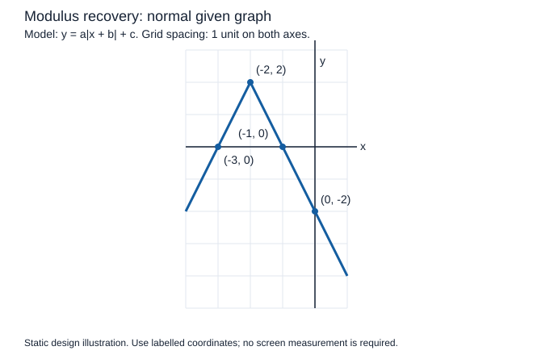
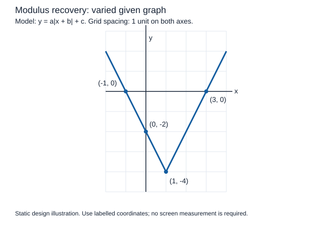
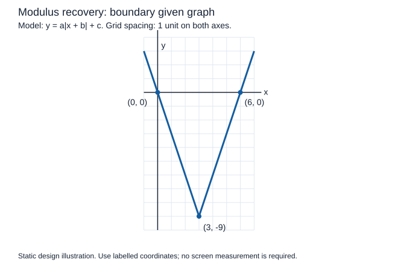

# Design exemplar: WB8227-modulus-graph-recovery

NSSCAS Mathematics 8227, 2020 syllabus; owner Vitalis; PLANNER Codex; 23 November 2026; proposed v0.1.0, branch `vertex-intercepts`. Manual stage-D illustrations only; no runtime items, generator or learner assignment. See the work order for source hashes, criteria, domain and reveal rules. All displayed data below are newly authored; textbook originals remain internal.

For each instance, a parameter-consistent graph is required with the following exact points, axes and V orientation. These tables are the paper asset specification, not proof that a rendered app asset exists. A later image must show all must-read givens; it must not display the answer coefficients. Ask: “The labelled graph has the form $y=a|x+b|+c$. Determine $a$, $b$ and $c$.”

| Case | Required graph labels | Shape |
|---|---|---|
| Normal $(a,b,d)=(-2,2,1)$ | vertex $(-2,2)$; zeros $(-3,0),(-1,0)$; $y$-intercept $(0,-2)$ | opens downward |
| Changed $(2,-1,2)$ | vertex $(1,-4)$; zeros $(-1,0),(3,0)$; $y$-intercept $(0,-2)$ | opens upward |
| Admitted boundary $(3,-3,3)$ | vertex $(3,-9)$; zeros $(0,0),(6,0)$; $y$-intercept is the same $(0,0)$ | opens upward; merge origin labels |

## Normal: horizontal sign and downward orientation

| Action | Reason | Result |
|---|---|---|
| Read the vertex in $a\lvert x+b\rvert +c$ | The modulus is zero at its vertex | $-b=-2$ and $c=2$, hence $b=2,c=2$. |
| Substitute the labelled zero $(-1,0)$ | It lies on this graph, and its distance from the vertex in $x$ is1 | $0=a\lvert -1+2\rvert +2=a+2$, so $a=-2$. |
| Check the remaining labels | A recovered formula must satisfy every given | At $x=-3$, $y=-2\lvert -1\rvert +2=0$; at $x=0$, $y=-4+2=-2$. The negative sign gives the downward V. |

Canonical result: $a=-2,b=2,c=2$, or $y=-2|x+2|+2$. All three B1 awards: **3/3**. Alternate route: right-arm slope from $(-2,2)$ to $(-1,0)$ is $-2$, which is $a$.

## Changed: upward graph and negative vertical displacement

| Action | Reason | Result |
|---|---|---|
| Read vertex $(1,-4)$ | Vertex is $(-b,c)$ | $b=-1,c=-4$. |
| Use zero $(3,0)$ | Its horizontal distance from vertex is2 | $0=2a-4$, so $a=2$. |
| Substitute the other points | Independent consistency check | At $x=-1$, $2\lvert -2\rvert -4=0$; at $x=0$, $2\lvert -1\rvert -4=-2$. |

Canonical result: $a=2,b=-1,c=-4$, or $y=2|x-1|-4$. **3/3**. Reversing orientation and the shift tests the same reconstruction decisions; it does not manufacture another recipe.

## Admitted boundary: origin serves two intercept roles

| Action | Reason | Result |
|---|---|---|
| Read vertex $(3,-9)$ | It gives $-b$ and $c$ | $b=-3,c=-9$. |
| Substitute the shared intercept $(0,0)$ | A point can be both an $x$- and $y$-intercept | $0=3a-9$, so $a=3$. |
| Check $(6,0)$ and shape | Avoid accepting a label collision as missing information | $3\lvert 6-3\rvert -9=0$; the V opens upward. |

Canonical result: $a=3,b=-3,c=-9$, or $y=3|x-3|-9$. **3/3**. No assumption that $b$ equals the $y$-intercept is valid.

## Rejected cases and independent check

$a=0$ is invalid for this vertex-reading task: $y=c$ is a horizontal line, not a V. $d=0$ is excluded because the two labelled zeros coincide with the vertex. A noninteger coefficient such as $a=-1/3$ is outside the selected integer modulus-graph limit. An arbitrary crop or fixed graph with one of these new formulas is invalid even if the coefficient computation is correct.

For the three admitted cases, a separate slope computation gives $-2,2,3$ on the right arm; the point residuals shown above are all zero. Inline finite enumeration checked108 tuples and108 distinct $(a,b,c)$ triples. This establishes the stated paper domain capacity, not a working seeded generator or trustworthy visual marker. Proposed Bloom: part `a` Apply3, whole3. Independent review and owner approval remain pending.

## Static paper-design diagrams

These are original design illustrations, not delivered runtime assets. Source values, SVG hashes and rendering evidence are in `planning/visual-design-asset-checks.json`.

