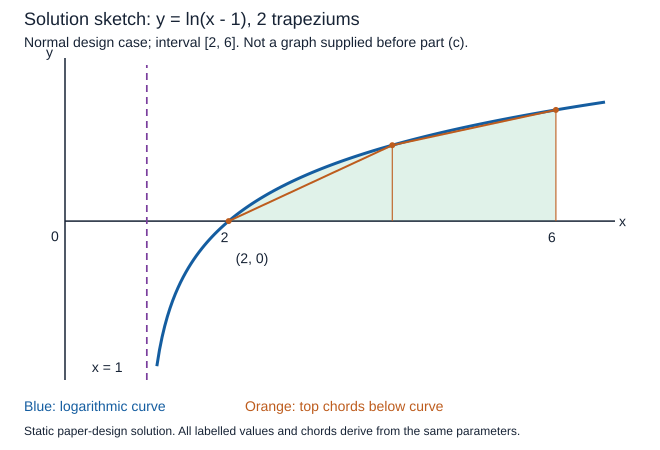
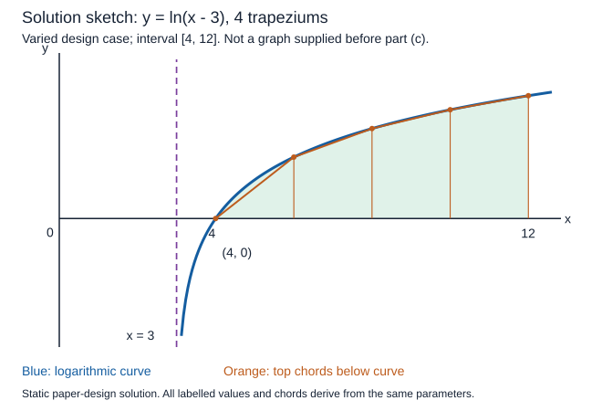
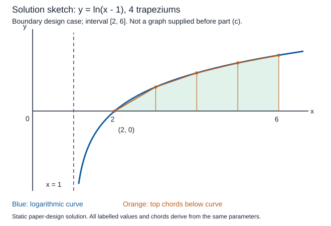

# Design exemplar: WB8227-trapezium-sketch-estimate

NSSCAS Mathematics 8227 (2020); owner Vitalis; PLANNER Codex; 23 November 2026; proposed v0.1.0, branch `logarithmic-hence-chain`. These are three manual stage D illustrations, not runtime instances. See work order for exact source references, marking and evidence limits. Paper diagrams below specify the complete required solution geometry; app rendering/marking is not certified.

All instances ask the four connected parts: (a) an equal-strip trapezium estimate to3 sf; (b) **hence** the transformed integral, showing the log-law link; (c) a labelled log sketch; (d) the direction of bias with a chord/curve reason. Each is3+2+3+2=10 marks.

## Normal — two strips, shift1, scale2

Given $I=\int_2^6\ln(x-1)\,dx$, use two equal strips. Hence estimate $J=\int_2^6 2\ln(x^2-2x+1)\,dx$. Sketch $y=\ln(x-1)$; use it to explain the bias of(a).

| Action | Reason | Result |
|---|---|---|
| Find width and ordinates | Two intervals cover length4; endpoints count once | $\Delta=2$, nodes $2,4,6$ and $y=0,\ln3,\ln5$. |
| Sum trapeziums | Each has area width times mean height | $T=\frac22(0+2\ln3+\ln5)=3.80666248977\ldots\approx3.81$. |
| Factor and apply log law | $x^2-2x+1=(x-1)^2$ and $x-1>0$ here | $2\ln((x-1)^2)=4\ln(x-1)$, so $J\approx4T=15.226649959\ldots\approx15.2$. |
| Locate sketch features | Log argument must be positive and equals1 at its zero | Domain $x>1$, vertical asymptote $x=1$, intercept $(2,0)$; no $y$-intercept. |
| Compare top chords with curve | This log curve bends downward; every chord over $[2,6]$ is below it | $T$ is an underestimate. The positive-interval shaded region is between the curve and the $x$-axis. |

Required solution sketch: one branch immediately right of $x=1$, tending downwards without meeting that vertical dashed line; it passes through $(2,0)$ and then rises with diminishing gradient. Include a below-axis portion for $1<x<2$. Overlay, if used, chords joining $(2,0),(4,\ln3),(6,\ln5)$ below the curve. The asymptote/intercept and strip-limit labels must remain readable.

Marking: a:B1/M1/A1 all earned3; b:B1/B2 earned2; c:B1/B2/B3 earned3; d:B1/DB1 earned2. **10/10**. An equivalent direct sum of two trapezium areas earns the same(a) method credit.

Independent truth check: exact $I=5\ln5-4=4.04718956217\ldots>T$. This exact primitive is an author oracle, not required learner knowledge and not an alternative to the requested trapezium method.

## Changed — four strips, shift3, scale3

Given $I=\int_4^{12}\ln(x-3)\,dx$, use four equal strips. Hence estimate $J=\int_4^{12}3\ln(x^2-6x+9)\,dx$. Sketch $y=\ln(x-3)$ and explain the bias.

| Action | Reason | Result |
|---|---|---|
| Choose nodes | $(12-4)/4=2$ | $x=4,6,8,10,12$; ordinates $0,\ln3,\ln5,\ln7,\ln9$. |
| Apply endpoint/interior weights | Four adjacent trapeziums share the interior ordinates | $T=\frac22[0+2(\ln3+\ln5+\ln7)+\ln9]=11.50514527765\ldots\approx11.5$. |
| Transform(b) | $x^2-6x+9=(x-3)^2$, with $x>3$ | $3\ln((x-3)^2)=6\ln(x-3)$, so $J\approx6T=69.0308716659\ldots\approx69.0$. |
| Sketch and compare | Translation preserves log shape, not labels | Asymptote $x=3$, intercept $(4,0)$, below-axis branch $3<x<4$; chords over $[4,12]$ lie below curve, so underestimate. |

Required solution sketch changes the actual asymptote, intercept, interval and four-strip overlay. Reusing the normal case image would be wrong. All ten criteria earned: **10/10**. Independent exact check: $I=9\ln9-8=11.7750211960\ldots>T$.

## Admitted boundary — smallest width and a rounding follow-through

Given $I=\int_2^6\ln(x-1)\,dx$, use four equal strips. Hence estimate $J=\int_2^6\ln(x^2-2x+1)\,dx$. Sketch the log curve and explain the bias.

| Action | Reason | Result |
|---|---|---|
| Use width1 | Four intervals now cover the same length4 | Nodes $2,3,4,5,6$, ordinates $0,\ln2,\ln3,\ln4,\ln5$. |
| Form trapezium sum | Preserve full ordinate precision | $T=\frac12[2(\ln2+\ln3+\ln4)+\ln5]=3.98277278656\ldots\approx3.98$. |
| Apply log law and hence step | Here $k=1$, so scale is2, not1 or a square of $T$ | $J\approx2T=7.96554557313\ldots\approx7.97$. |
| Preserve sketch and bias logic | Same curve, different chords | Asymptote $x=1$, intercept $(2,0)$; four chords lie below curve; underestimate. |

All ten criteria earned for canonical precision: **10/10**. If a learner explicitly uses their reported(a) value3.98, $2\times3.98=7.96$ is accepted under the proposed b:B2 follow-through rule; it is not evidence that the unrounded canonical result7.97 is wrong. Retain the exact path and show the two rounding routes in marking feedback. Independent check uses $I=5\ln5-4$ again; $T<I$, and this four-strip result is closer than the two-strip result. The branch does not require proving a general refinement theorem.

## Rejected boundaries, marking samples and proof limits

A logarithm ordinate at $x=h$ is undefined; reject rather than generate it. A chosen curve whose concavity changes over the interval cannot inherit “underestimate” from this branch. Zero strip count is invalid. Merely choosing $h=0$ is mathematically possible but outside this pilot’s fixed domain; it needs a reviewed domain extension. The graph $y=\ln x$ also has no $y$-intercept, since it is undefined at $x=0$.

For the normal case:

- Correct quadrature but $J=(3.81)^2$: b0/2; all other parts correct gives8/10. Feedback: “Your trapezium estimate is consistent. First rewrite the quadratic inside the logarithm as a square, then use the logarithm power rule; the estimate itself is not squared.”
- Correct sketch omitting only its asymptote label: c2/3, with the rest correct9/10. Ask for the missing line/label; do not invent a curve-shape error.
- Correct $J$ by independent quadrature with no hence relation: bSC1/2, maximum9/10 with all else correct. Never add SC1 to the full2 mark path.
- Correct “underestimate” alone on a correct sketch: d1/2. “The graph is increasing” adds no geometric reason. A clear statement that the top edges of the trapeziums lie below the curve earns the dependent second mark.
- Unreadable sketch or unclear label: request clarification, retain the original, and do not represent a guessed score as reliable.

Finite enumeration checked36 distinct $(h,L,n,k)$ tuples and positive log arguments. Independent area sums and analytic-integral inequalities check all four $(L,n)$ quadratures; horizontal translation and positive log-law scale preserve the result. These are paper mathematics checks, not seeded runtime replay or app visual assessment. Proposed part Bloom3,3,3,4 gives whole4; independent classification and owner design approval remain pending.

## Static paper-design diagrams

These are original design illustrations, not delivered runtime assets. Source values, SVG hashes and rendering evidence are in `planning/visual-design-asset-checks.json`.

