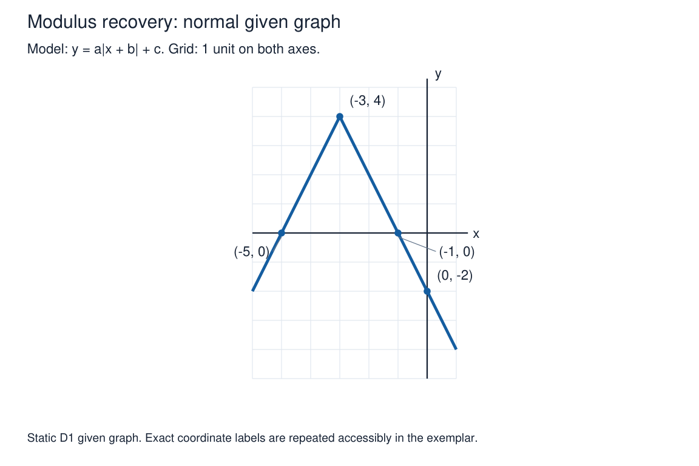
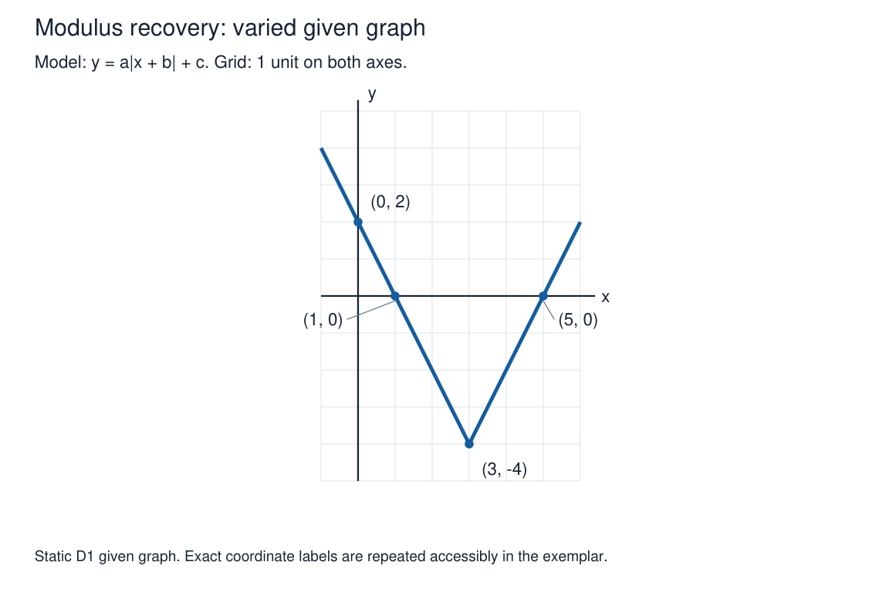
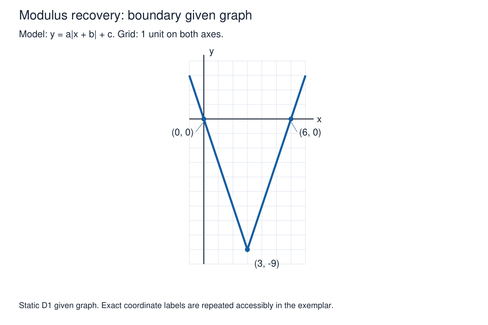

# Design exemplar: WB8227-modulus-graph-recovery

NSSCAS Mathematics 8227, 2020 syllabus; Vitalis; PLANNER Codex; 23 November 2026. **D1 v0.1.1**, branch `vertex-intercepts`, selection `8227:D:SEL:modulus-graph-recovery:vertex-intercepts`. Manual paper cases only. Claude short check, then owner approval pending. No runtime items/generator.

For each graph ask: “The labelled graph has the form $y=a\lvert x+b\rvert+c$. Determine $a$, $b$ and $c$.” Coordinates are also supplied accessibly in the table. Graphs are original illustrations from exactly these values, not textbook crops or delivered app assets.

| Case | Parameters | Required labels / orientation |
|---|---|---|
| Normal | $(-2,3,2)$ | Vertex$(-3,4)$; zeros$(-5,0),(-1,0)$; $y$-intercept$(0,-2)$; downward V |
| Changed | $(2,-3,2)$ | Vertex$(3,-4)$; zeros$(1,0),(5,0)$; $y$-intercept$(0,2)$; upward V |
| Boundary | $(3,-3,3)$ | Vertex$(3,-9)$; zeros$(0,0),(6,0)$; $y$-intercept also$(0,0)$; upward V |

## Normal: signed reconstruction

| Action | Reason | Result |
|---|---|---|
| Read the vertex | The modulus argument vanishes there, so vertex$=(-b,c)$ | $b=3,c=4$. |
| Substitute zero$(-1,0)$ | It lies on the straight-arm modulus graph | $0=a\lvert-1+3\rvert+4=2a+4$, hence$a=-2$. |
| Check other labels and orientation | One valid model must fit every given | At$x=-5$, $-2\times2+4=0$; at$x=0$, $-2\times3+4=-2$; $a<0$ gives downward V. |

Canonical $a=-2,b=3,c=4$, formula$y=-2\lvert x+3\rvert+4$. Correct working earns B1www+B1www+B1www = **3/3**. Independent right-arm slope$-4/2=-2$ agrees. A bare coefficient list alone scores0 under OD-1; the complete correct formula can earn3 under the official Q2 formula-position exception, provided no wrong working.

The targeted parabola route gives$a=-1$ from the zero, or$-2/3$ from the$y$-intercept; neither is canonical. Reading$b$ as the$y$-intercept gives$-2$, also wrong. Thus this new normal no longer hides those errors.

## Changed: upward graph and rightward shift

| Action | Reason | Result |
|---|---|---|
| Read vertex$(3,-4)$ | Vertex$=(-b,c)$ | $b=-3,c=-4$. |
| Use zero$(5,0)$ | Its horizontal distance from vertex is2 | $0=2a-4$, so$a=2$. |
| Check zero$(1,0)$ and$y$-intercept | Verify independently | $2\lvert1-3\rvert-4=0$ and$2\lvert0-3\rvert-4=2$. |

Canonical $a=2,b=-3,c=-4$, formula$y=2\lvert x-3\rvert-4$. Valid work or the official complete-formula exception earns **3/3**. Right-arm slope$4/2=2$. A parabola gives$a=1$ from a zero or$2/3$ from the$y$-intercept, not2.

## Admitted boundary: one point serves both intercept roles

| Action | Reason | Result |
|---|---|---|
| Read vertex$(3,-9)$ | Vertex$=(-b,c)$ | $b=-3,c=-9$. |
| Use shared point$(0,0)$ | A point may be both an$x$- and$y$-intercept | $0=3a-9$, hence$a=3$. |
| Check$(6,0)$ | Preserve all constraints despite the merged origin label | $3\lvert6-3\rvert-9=0$. |

Canonical $a=3,b=-3,c=-9$, formula$y=3\lvert x-3\rvert-9$. **3/3** with valid evidence. Right-arm slope$9/3=3$. Wrong parabola routes give$a=1$, not3; the merged label does not collapse discrimination.

## Partial, wrong and ambiguous evidence

For normal: valid$b=3,c=4$ vertex work followed by the wrong quadratic substitution$0=a(x+3)^2+4$ earns **2/3**, preserving valid independent vertex credit but withholding the affected$a$www award. Feedback: “The vertex reading is right. This graph has straight modulus arms; use the modulus expression, not a parabola.” A bare correct list scores0 but feedback says the values are correct and requests working. An unreadable coefficient sign or genuinely unspecified tuple order is pending clarification, not a fabricated misconception.

The D0 normal$(-2,2,1)$ and changed$(2,-1,2)$ are mathematically valid but excluded as non-diagnostic under the repaired filter. Official original$(-2,-3,1)$ stays outside the fresh pool. Zero$a$ destroys the V; zero$d$ collapses both zeros; fractional graph coefficients violate the selected integer bound. These are distinct reasons, not all “mathematically wrong”.

Domain audit:108raw →44admitted semantic models; all64 removals and overlapping named-error counts are saved. The separately written oracle recovers coefficients from independently supplied point coordinates and verifies every residual. Static SVGs/PNGs have per-asset value/hash/render records in `planning/visual-design-asset-checks.json`; later crowded/origin app tests remain unrun. Proposed Bloom part/whole Apply3, classification `8227-pilot-design-0.1.1`. No textbook original is learner-displayable.
