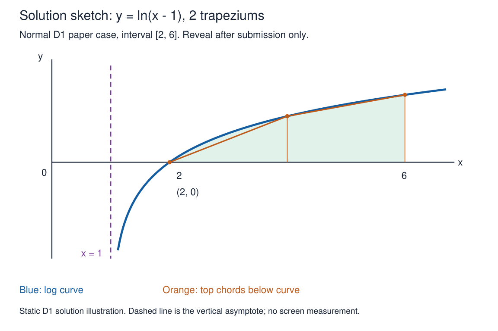
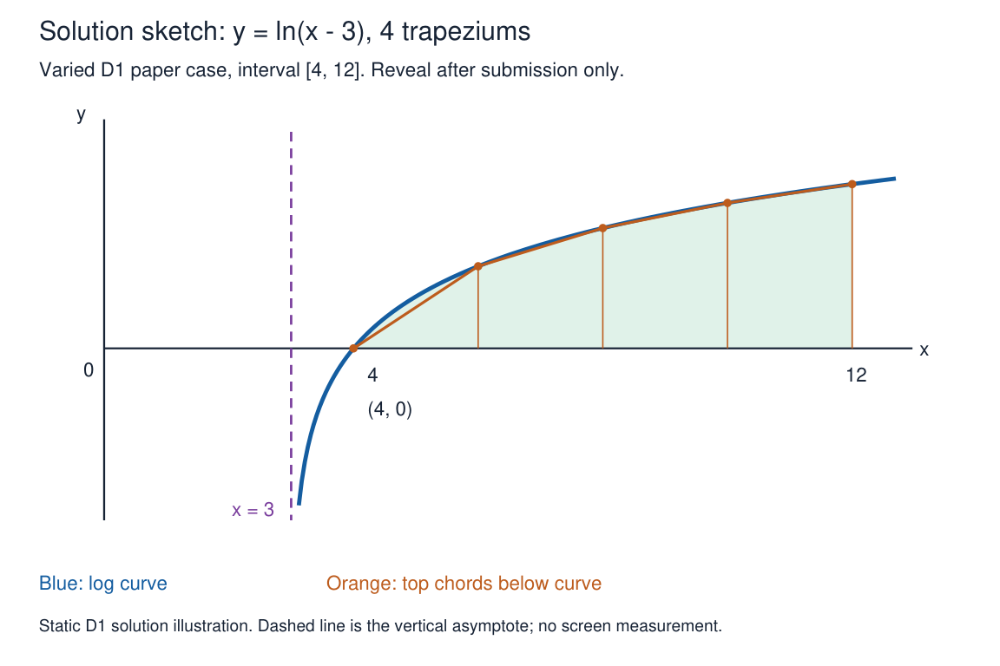
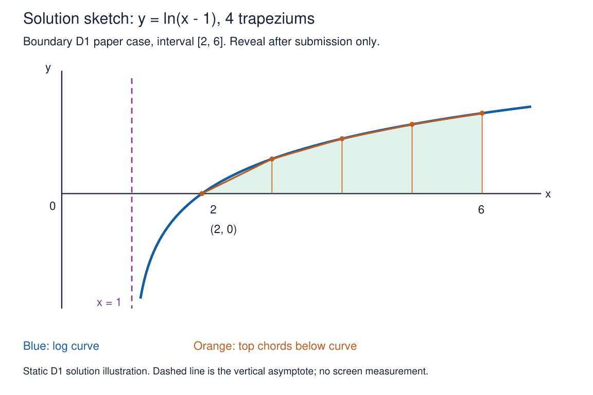

# Design exemplar: WB8227-trapezium-sketch-estimate

NSSCAS Mathematics 8227, 2020 syllabus; Vitalis; PLANNER Codex; 23 November 2026. **D1 v0.1.1**, branch `logarithmic-hence-chain`, selection `8227:D:SEL:trapezium-sketch-estimate:logarithmic-hence-chain`. Manual paper examples only; Claude short check, then owner approval pending. No runtime item/generator.

Each case asks(a) a specified equal-strip logarithmic trapezium estimate to3sf, (b) **hence**, showing the transformation, a related integral estimate to3sf, (c) the log sketch with intercepts/asymptote and(d) bias from that own sketch with a geometric reason. Marks3+2+3+2=10. Static solution graphs below reveal the answer and therefore appear only after submission in the later app.

## Normal — two strips, shift1, factor2

$I=\int_2^6\ln(x-1)\,dx$, two equal strips. Hence estimate$J=\int_2^6 2\ln(x^2-2x+1)\,dx$.

| Action | Reason | Result |
|---|---|---|
| Set nodes/ordinates | Width$\Delta=(6-2)/2=2$ | Nodes$2,4,6$; ordinates$0,\ln3,\ln5$. |
| Sum trapezium areas | Endpoint/interior weighting | $T=\frac22(0+2\ln3+\ln5)=3.80666248977\ldots\approx3.81$. |
| Factor the inner quadratic | This alone is b:B1 evidence | $2\ln(x^2-2x+1)=2\ln((x-1)^2)$. |
| Use the logarithm law and hence reuse(a) | $x-1>0$ on the interval | $2\ln((x-1)^2)=4\ln(x-1)$; $J\approx4T=15.2266499591\ldots$, canonical3sf$15.2$. |
| Sketch the curve | Log argument positive, value0 at argument1 | Domain$x>1$, asymptote$x=1$, intercept$(2,0)$; below-axis branch for$1<x<2$, no$y$-intercept. |
| Compare top chords with curve | Every chord is below this own correctly sketched log branch | Underestimate, with top-chord-below-curve reason. |

Full evidence earns **10/10**. Accepted(b) numerical set, with valid hence work: **{15.2,15.24}**.15.24 is$4\times$the reported3sf(a)3.81, retained by B1FT;15.2 is the canonical/rounded F.T. product. The extra-digit F.T. product is not called the canonical3sf value. Independent quadrature/area check: exact$I=5\ln5-4=4.04718956217\ldots>T$.

## Changed — four strips, shift3, factor3

$I=\int_4^{12}\ln(x-3)\,dx$, four equal strips. Hence estimate$J=\int_4^{12}3\ln(x^2-6x+9)\,dx$.

| Action | Reason | Result |
|---|---|---|
| Set nodes | Width$(12-4)/4=2$ | $4,6,8,10,12$ with ordinates$0,\ln3,\ln5,\ln7,\ln9$. |
| Apply correct weights | Sum four trapeziums | $T=\frac22[0+2(\ln3+\ln5+\ln7)+\ln9]=11.50514527765\ldots\approx11.5$. |
| Recognise square, then log power | $(x-3)^2=x^2-6x+9$, $x>3$ | $3\ln((x-3)^2)=6\ln(x-3)$, hence$J\approx6T=69.0308716659\ldots\approx69.0$. |
| Draw translated log graph and justify bias | Labels must change with the shift | Asymptote$x=3$, intercept$(4,0)$, negative branch for$3<x<4$; four top chords below curve give underestimate. |

**10/10**. Accepted(b) set **{69.0}**: canonical3sf and$6\times11.5$ agree. Independent exact$I=9\ln9-8=11.7750211960\ldots>T$. The translated presentation is not an independent new(a)/(b) computation if the same$(L,n,k)$ context was exposed previously. The exact official source tuple$(2,8,4,3)$ is excluded; this case has$h=3$ and is not served as a verbatim source original.

## Admitted boundary — width1 and F.T. rounding

$I=\int_2^6\ln(x-1)\,dx$, four equal strips. Hence estimate$J=\int_2^6\ln(x^2-2x+1)\,dx$.

| Action | Reason | Result |
|---|---|---|
| Width and nodes | Four intervals across length4 | $\Delta=1$; nodes$2,3,4,5,6$; ordinates$0,\ln2,\ln3,\ln4,\ln5$. |
| Sum trapeziums | Keep guard digits in logarithms | $T=\frac12[2(\ln2+\ln3+\ln4)+\ln5]=3.982772786565\ldots\approx3.98$. |
| Factor and rescale | $\ln((x-1)^2)=2\ln(x-1)$ | $J\approx2T=7.96554557313\ldots\approx7.97$. |
| Sketch and compare | Same function, a different chord set | Asymptote$x=1$, intercept$(2,0)$; four top chords below the curve, hence underestimate. |

**10/10** for the full canonical working. Accepted(b) set **{7.96,7.97}**:7.96 comes from the sanctioned$2\times$reported(a)3.98;7.97 comes from guard digits. Preserve the actual route rather than falsely marking7.96 as the canonical unrounded product. Exact$I=5\ln5-4$ remains greater than$T$.

## Marking probes after D1 repair

For normal, other parts complete unless stated:

- Correct factorised$2\ln((x-1)^2)$, then wrongly squares$T$: b:B1 retained, b:B2 lost; **9/10**. If neither correct factorisation nor scale is shown, b0 gives **8/10**.
- Correct(b) by visible independent non-hence quadrature: exclusive **SC1/2**, maximum9/10; never add SC1 to the normal2mark path. Bare$J$ alone is0/2 under OD-1, not automatic SC1.
- Bare correct$T$ alone is0/3. Feedback says the number is right and asks for trapezium working; it does not invent a numerical error.
- An incorrect concave-up(c) with independently correct asymptote/intercept labels can earn c2/3. If the learner coherently says “overestimate; the top edges lie above my curve”, **d2/2 F.T.**, total9/10. Shape is penalised in(c) only. This is the named `D1-TRAP-FT-BRIDGE`:2025’s own-graph F.T. is applied to2023’s two-slot conclusion/reason structure, retaining its verbal geometric alternative.2025’s actual-drawn-trapeziums requirement is explicitly disclosed as the hybrid departure awaiting acceptance.
- Correct(a,b), no sketch and a bias sentence: **5/10** (c0,d0). A clear blank is not an unreadable upload. An unreadable sketch is pending clarification for the affected criteria, not guessed as blank or wrong.
- Correct sketch and only “underestimate”: d1/2, total9/10. “The graph is increasing” is not the dependent geometric reason. Correct unambiguous concavity shorthand may establish chord position from the own sketch.

The c:B1 checklist is operational: one curve only, domain$x>h$, approach the vertical boundary downwards without crossing, rise through quadrants4and1 with decreasing gradient, no finite horizontal asymptote. Labelled$x=h$ as a vertical guide or clearly approached boundary earns c:B2; labelled$(h+1,0)$ earns c:B3. No compulsory point table or second derivative is added.

## Exclusions, capacity and limits

Reject undefined log ordinates, zero/unequal strip widths, an inconsistent fixed image and replacement by a curve with different curvature. $h=0$ is outside this chosen domain but mathematically possible; $\ln x$ also has no$y$-intercept. The official source tuple is outside the fresh pool.

36raw →35admitted presentations →12whole$(L,n,k)$ contexts. Part keys/counts: a$(L,n)$4; b$(L,n,k)$12; c$h$3; d$(h,L,n)$12own-graph/chord contexts. The canonical bias outcome has **one** class, not35fresh decisions. Maximum wholly-unseen full tasks is3 before examples because the sketch pool has only3; repeated parts in practice are labelled after-feedback. Every admitted(b) accepted set, including$(8,2,k)$ rounding fixtures, is saved in the domain audit. Ordinate2dp rounding changes canonical(a) only at$(4,4)$; that limitation is visible rather than advertised as universal error discrimination.

Separately written oracle recomputes each trapezium as individual areas, the transformed integrand independently, and bias by numerical integration. SVGs have explicit visibly dashed asymptote segments, correct same-data nodes/chords and moved tick labels; per-asset inspection is recorded. No actual app marking/render/history or seeded generation test has run. All four parts and whole branch are **Apply3**, classification `8227-pilot-design-0.1.1`; no Analyse label remains.
