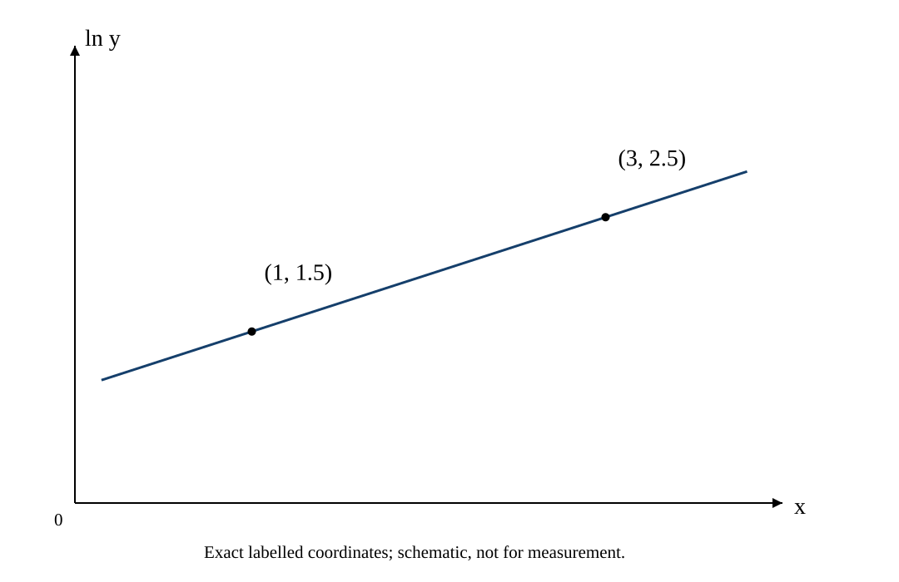
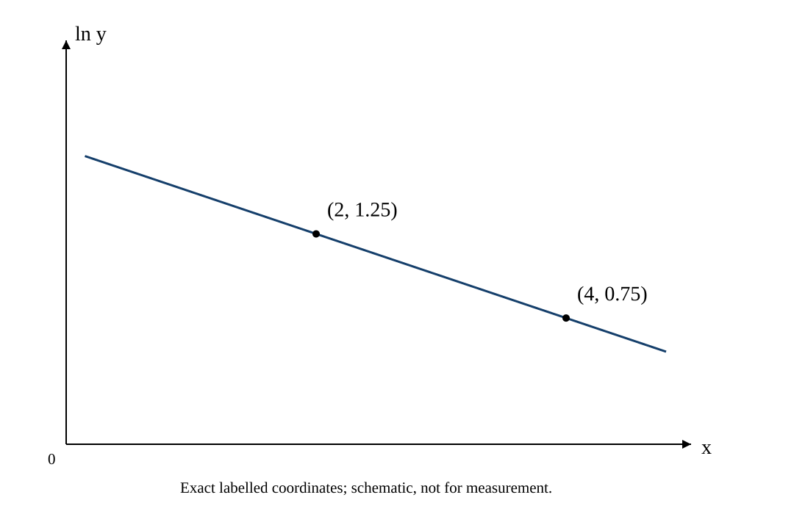
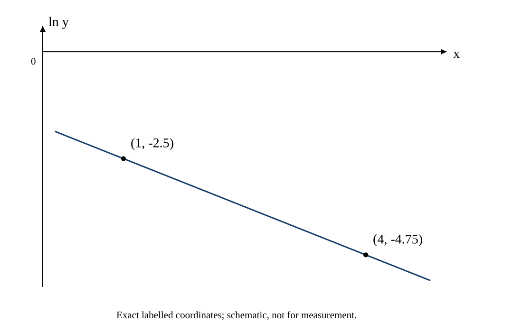

# Worked exemplar — WB8227-log-linear-model, D2

NSSCAS Mathematics 8227, December 2020; Grade 12. Owner Vitalis; PLANNER Codex, 23 November 2026. Proposed version 0.1.2, classification `8227-pilot-design-0.1.1`. Original stage-D paper illustrations; no runtime items. D2 repair awaits Claude’s changed-scope confirmation, then Vitalis approval.

The graph branch’s original static illustrations use horizontal $x$, vertical $\ln y$ and exact decimal coordinate labels. They are paper examples, not runtime-generated assets. Labels are offset away from the drawn line with no opaque rectangle covering it; a future renderer must test every admitted zero/negative ordinate and all label/axis intersections.

## Graph-intercept — normal

Question: The variables satisfy $y=Ae^{px+p}$, with $A>0$. The graph of $\ln y$ against $x$ is a straight line through exact labelled points $(1,1.5)$ and $(3,2.5)$. Find $A$ and $p$, giving non-exact decimal values to three significant figures. Show your working. [5]

1. Action: take natural logarithms. Reason: split the product before applying the exponent law. Result:
   $$\ln y=px+p+\ln A.\qquad\text{[G-B1]}$$
2. Action: use the two exact coordinates to find the gradient. Reason: its coefficient of $x$ is $p$. Result:
   $$p=\frac{2.5-1.5}{3-1}=\frac12.\qquad\text{[G-M1,G-A1]}$$
3. Action: substitute the first coordinate. Reason: the intercept contains $p$ as well as $\ln A$. Result:
   $$1.5=\frac12+\frac12+\ln A,\quad\ln A=\frac12,\quad A=e^{1/2}.\qquad\text{[G-M2,DM1]}$$
4. The final values are $A\approx1.65$ and $p=1/2$ [G-A2]. Total5.

Independent original-model checks give $e^{1/2}e^1=e^{1.5}$ at $x=1$ and $e^{1/2}e^2=e^{2.5}$ at $x=3$. Two coordinate equations can imply the correct transformed line without writing it separately, so the simultaneous method earns the same five-mark cap.

## Graph-intercept — changed decay

Question: The model is $y=Ae^{px+p}$, with $A>0$. The graph of $\ln y$ against $x$ has exact point labels $(2,1.25)$ and $(4,0.75)$. Find $A$ and $p$, giving non-exact decimal values to three significant figures. Show your working. [5]

Transform to $\ln y=px+p+\ln A$ [B1]. Its gradient is
$$p=\frac{0.75-1.25}{4-2}=-\frac14.\qquad\text{[M1,A1]}$$
Use the first point:
$$1.25=2\left(-\frac14\right)-\frac14+\ln A,\quad\ln A=2,\quad A=e^2.\qquad\text{[DM1]}$$
Hence $A\approx7.39$ and $p=-1/4$ [A1], total5. Original-model checks give $e^2e^{-3/4}=e^{1.25}$ and $e^2e^{-5/4}=e^{0.75}$. The straight transformed line falls as $x$ increases.

## Graph-intercept — admitted lower boundary

Question: The model is $y=Ae^{px+p}$, with $A>0$. The graph of $\ln y$ against $x$ has exact point labels $(1,-2.5)$ and $(4,-4.75)$. Find $A$ and $p$, giving non-exact decimal values to three significant figures. Show your working. [5]

Transform correctly [B1]. Calculate
$$p=\frac{-4.75+2.5}{4-1}=-\frac34.\qquad\text{[M1,A1]}$$
Then
$$-2.5=-\frac34-\frac34+\ln A,\quad\ln A=-1,\quad A=e^{-1}.\qquad\text{[DM1]}$$
The final values $A\approx0.368$, $p=-3/4$ earn the last A1; total5. Independent substitution reproduces log ordinates $-2.5$ and $-4.75$. Positive $y$ does not imply positive $\ln y$; both negative labels must remain visible.

## Gradient-target — normal

Question: The model is $y=2^a a^x$, where $a$ is positive. A graph of $\log_2y$ against $x$ has gradient $3$. (a) Find $a$ exactly. [3] (b) Hence find $x$ when $y=2^{10}$. Give an exact answer or a decimal correct to three significant figures. [2] Show your working.

Transform:
$$\log_2 y=a+x\log_2 a.\qquad\text{[T-B1]}$$
The given gradient means $\log_2 a=3$ [T-M1], so $a=2^3=8$ [T-A1]. Using that result with the target gives
$$10=8+3x,\qquad x=\frac23\approx0.667.\qquad\text{[U-M1,U-A1]}$$
Total5. Direct-index check:$2^8\cdot8^{2/3}=2^8\cdot2^2=2^{10}$.

A correct alternative uses $\ln y=a\ln2+x\ln a$ and maps to the plotted gradient $\ln a/\ln2=3$. This gives $a=e^{3\ln2}=8$ and the same target result. It earns all 5 marks; the appearance of $\ln$ is not itself an error. These calculator/log-law steps are a permitted method, not a new prescribed change-of-base objective.

## Gradient-target — changed sign of the recovered variable

Question: The model is $y=3^a a^x$, where $a$ is positive. A graph of $\log_3y$ against $x$ has gradient $2$. Find $a$ exactly [3]; hence find $x$ when $y=3$ [2], giving an exact answer or a decimal correct to three significant figures. Show your working.

$\log_3y=a+x\log_3a$ [B1]. Matching the gradient gives $\log_3a=2$ [M1], hence $a=9$ [A1]. The target gives $1=9+2x$ [M1], so $x=-4$ [A1]. Total5. Direct check:$3^9\cdot9^{-4}=3^9\cdot3^{-8}=3$. Unlike the retired gradient-one example, multiplying the base and gradient no longer gives the correct parameter.

## Gradient-target — admitted upper prefactor and unit target

Question: The model is $y=3^{3a}a^x$, where $a$ is positive. A graph of $\log_3y$ against $x$ has gradient $2$. Find $a$ exactly [3]; hence find $x$ when $y=1$ [2], giving an exact answer or a decimal correct to three significant figures. Show your working.

Transform to $\log_3y=3a+x\log_3a$ [B1]. The gradient gives $\log_3a=2$ [M1], so $a=9$ [A1]. Then $0=27+2x$ [M1], hence $x=-27/2=-13.5$ [A1]. Total5. Independent direct check:
$$3^{27}\cdot9^{-27/2}=3^{27}\cdot3^{-27}=1.$$
This supplied model has $c=3$, not the official source’s $c=2$, so its parameter question is not the verbatim2025 original. The original tuple and exact parameter subpart remain outside the fresh pool.

## Credit, diagnostic exclusions and limits

All bare parameter or target answers earn zero under OD-1, even if numerically right; feedback acknowledges the right values and asks for the visible method. For the normal graph, wrong working $\ln y=px+\ln A$ followed by the correct slope and coherent point substitution to $A=e$ earns the two gradient awards and the dependent method award,3/5. It does not earn the correct-line or canonical-amplitude awards. This preserves the official DM1 rather than adding a new correct-offset exclusion. Correct original/log equations written only at the two coordinates can imply G-B1.

For the normal gradient case, writing $\log_2a=3$ and then $a=2\cdot3=6$ loses the exact parameter award. A consistent positive-parameter target substitution can retain U-M1 F.T.; its incorrect final value cannot earn U-A1. Correct $\ln/\lg$ methods are accepted only when they relate to the stated plotted base. Dropping a prefactor newly in (b) does not demonstrate correct substitution. Consistently using an own earlier (a) line that already omitted it does earn U-M1 F.T.; canonical accuracy remains separate. Unreadable minus signs trigger clarification.

The graph domain replaces $L=0$ by $L=1/2$, so the named wrong product-log model cannot give the right parameters; there are still30 models and270 presentations, not270fresh tasks. The target branch’s40 grid tuples reduce to 20after excluding both multiplication and reversed-exponent coincidences. It has four parameter-model contexts and two exponentiation subdecision contexts; changing the target repeats the earlier parameter part. None of its targets equals the prefactor, and both positive and negative recovered values occur. The D1script checks those facts and all new examples in the original models.

Future E/F must check label bounding boxes against the entire line and axes, including zero-ordinate points. Three static illustrations and a domain checker are not a validated app renderer, generator or marker. Textbooks stay internal; all same-type claims remain part-scoped and attributed. Owner approval is still pending after the short independent check.

## D2 target follow-through example

In the normal gradient case, earlier wrong work $\log_2y=x\log_2a$ loses T-B1. Correct $\log_2a=3$, $a=8$ earns T-M1/T-A1. Substituting the target into that same line, $10=3x$, earns U-M1 F.T.; $x=10/3$ is not the canonical $2/3$ and earns no U-A1. The resulting total is 3/5. If the earlier line was correct and the prefactor disappeared only during (b), the new target substitution earns no U-M1. This implements the official “their log-equation” allowance, rather than a stricter unrecorded exception.
